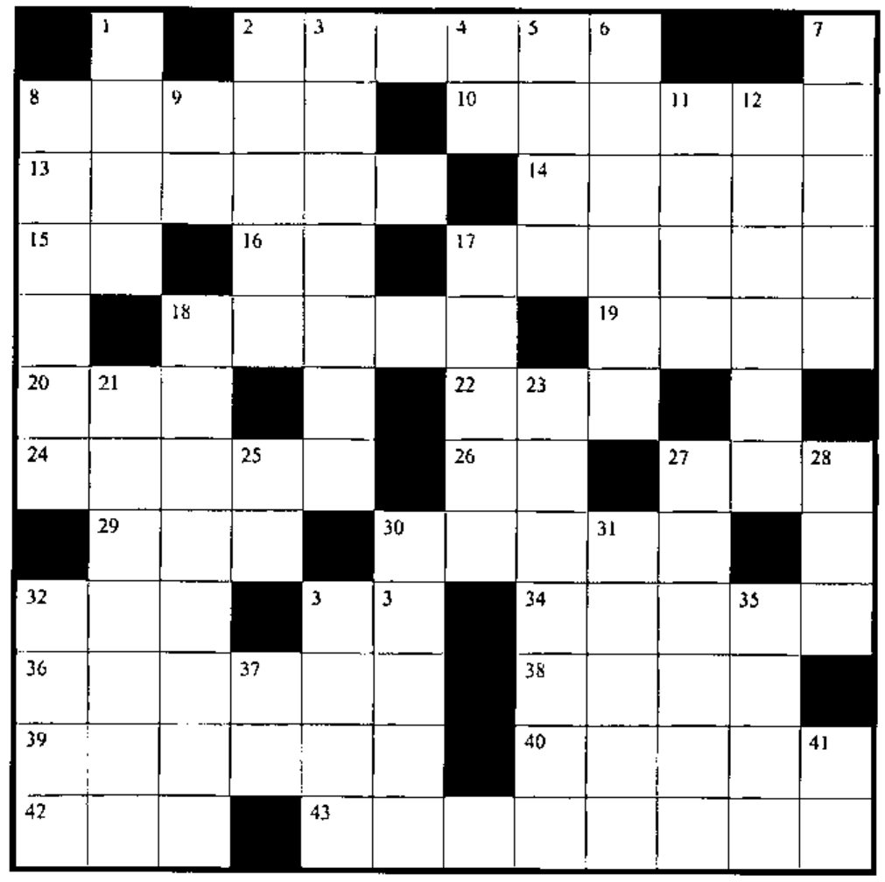
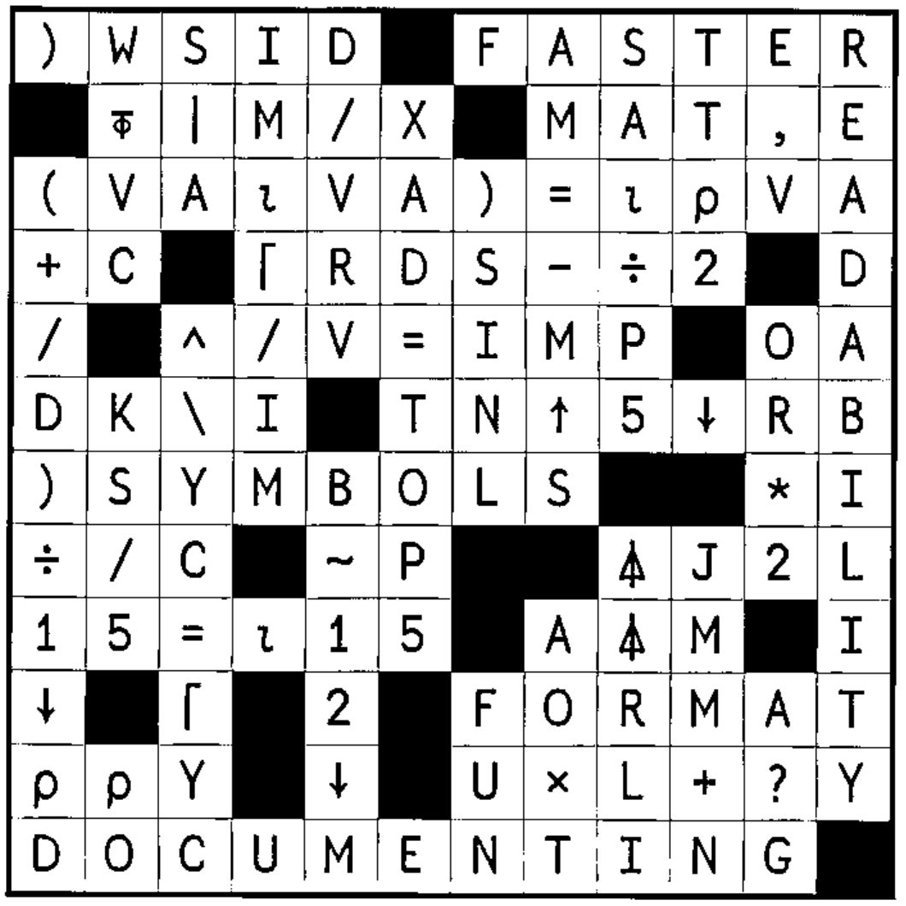

## New Crossword

### Across

2. Start with a blank slate
8. Preserve your work
10. `(|K)×(⌈RL)`, expressed as words
13. The location in vector E of the elements in `K[⍳VA]`
14. The magnitude of the elements of the cumulative sum of the reciprocal of `S`
15. `2↑⍎'''R5↓3'''`
16. `⎕__`, the current “seed” of the random number generator
17. Release storage from suspensions
18. List of all suspended identifiers
19. `1÷VEC`
20. `(ρS)ρ1`
22. `)___` when done
24. `(+/E)ρYPV` for positive integer vector `E`, scalar `YPV`
26. `⎕__`, for timing algorithms
27. List of all suspended functions
29. `MP+1|-MP`
30. Delete a stored workspace
32. Branch to line labelled `MB`
33. One random element of `⍳W`
34. `(V⍳AC)=⎕IO+ρV`
36. `(LTO↓JS),LTO↑S` for positive scalar `LTO`
38. `⎕IO++/∧\L≠OV` for vector `L`, scalar `OV`
39. `0` if `RLM=I`, `1` if `RLM>I`, `¯1` if `RLM<I`
40. `((POP,(ρN)-POP)/1 0)/N`
42. `2⍟×\XSρ2` in origin 1
43. `∨/BD∘.=PAYRL` for vector `PAYRL`

### Down

1. `+\(1++/∧\S≠5)ρ1` for vector S, `⎕IO=1`
2. Names of arrays in the workspace
3. `V[LI+⍳CE]` for scalar `LI`
4. Format to E decimal places ...
5. `A-A×⌊(|R)÷A`
6. `(E+F×RK)÷F`
7. `(⌽⍳ρρLSTC)⍉LSTC`
8. Delete from active workspace
9. `⎕__`, all available characters
11. Cumulative product of `SV`
12. Divide into `R` the lesser of `EE` or `S`
17. Replace active workspace
18. Number of identifiers tracked in the active workspace
21. `(⌈MTRX[;1])=(⌈MTRX[;2])` for two-column `MTRX`
23. `(~FIR∊LPP)/FIR`
25. `⎕__`, maximum number of significant digits to display
27. Retrieve objects without erasing or over-writing current objects
28. `V+.×⌽I*(⍳ρV)-⎕IO` for scalar `I`
30. Name of active workspace
31. `(⍳ρOA)=______` to flag first of each distinct value in vector `OA`
32. Branch to line labelled `L` if ...
33. A random number from `1` to `J-B` , in origin 1
35. The elements (simple vector) of the first `V` items of nested vector `R` in APL2 notation
37. `M[(1+ρM)-⍳ρM]` in origin 1
41. `⎕__`, the names of workspace objects

## Solution to Crossword in 20.1

