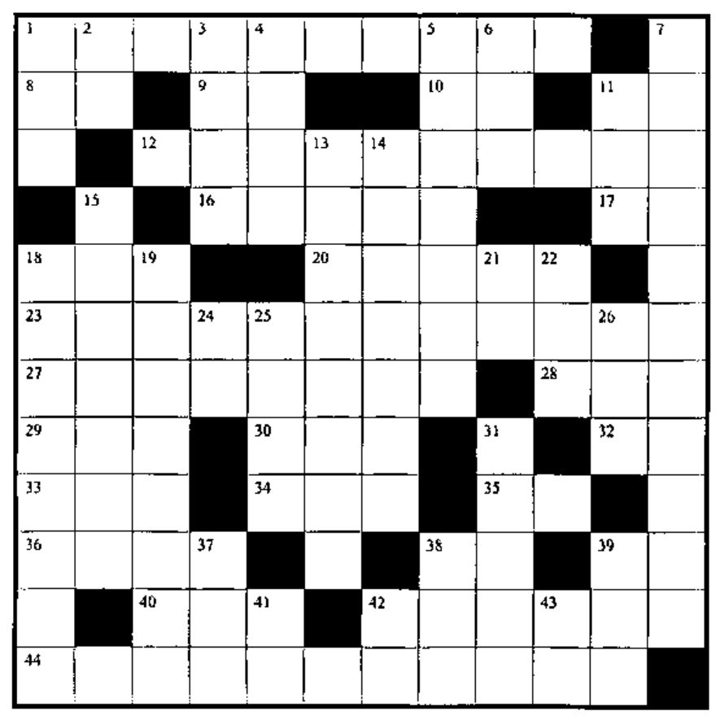
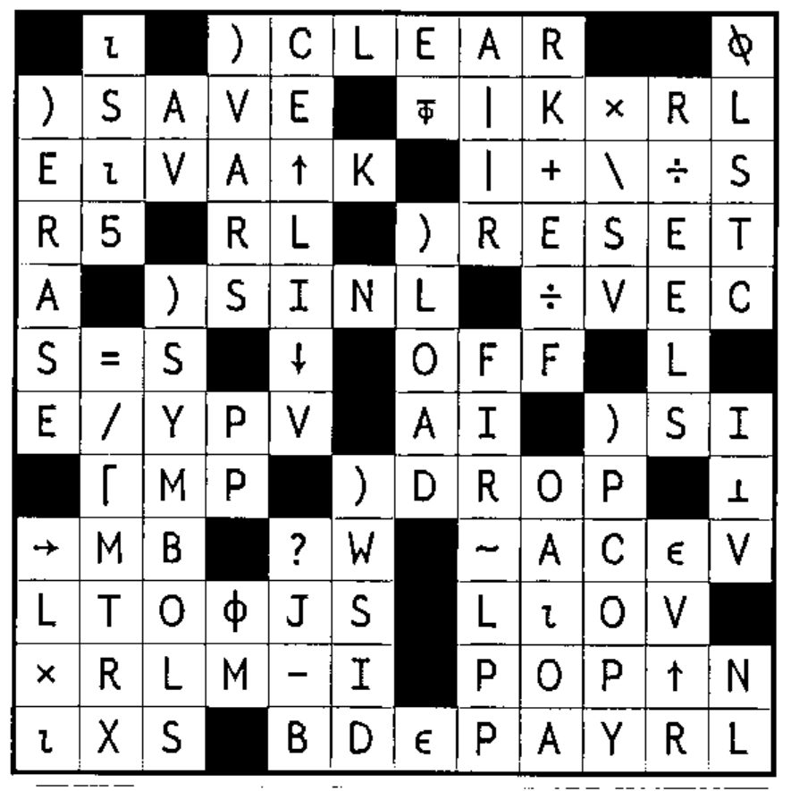

## New Crossword

### Across

1. Character matrix `CL` in sorted order according to collating sequence `CS`
8. A single random number from `⍳X`
9. `→⎕__` to restart your program
10. `⎕__` to see how much space remains
11. `⎕__` to show number of significant digits being displayed
12. Add vector `P` to each column of `M`
16. Index in vector `V[⍋V]` of `V[1]`
17. `⎕__` lets you make lightning strike twice
18. Branch to the line labelled `LP`
20. Length of tape to encircle `V` cylinders of diameter `B`, rounding each piece up to the nearest integer
23. First differences of vector `NC`
27. `R5` followed by 1 if `LS` and `V2` are identical, otherwise followed by 0
28. `*(⍟V)-⍟A`
29. `B≡(-⍴B)↑1` for bit vector `B`
30. `(1+E)-⍳E` in origin 1
32. `⎕__` to change the sensitivity of `=`
33. `(((1↑⍴R),1)⍴5),[2]R` for matrix `R`
35. `+/⍳7`
34. `C+0×⍳V` for numeric scalar `C`
36. `)RESET`
38. Alternating sum
39. `⎕__` to use either whole numbers (`0, 1, 2, ...`) or natural numbers (`1, 2, 3, ...`)
40. `(⍳0)⍴C[⍋C]`
42. `,+/NV≠(N*2)*0.5` vector `NV`, scalar `N`
44. `A_L`

### Down

1. `C` different random numbers from `⍳X`
2. `⎕__` to get things going
3. `CL←____` to increment `CL`
4. `('SCA',⍎'''⍉P↑L''')~'APL'`
5. `V` floored at `¯2` and repeated to shape `LW`
6. Localize `AM`
7. The value of a programming language lies in its __________
11. `P/R` for `P` and `R` scalars
13. Is vector V in ascending order?
14. `(⌽(VEC<0)/⍳⍴VEC),(⌽(VEC=0)/⍳⍴VEC),(⌽(VEC>0)/⍳⍴VEC)`
15. If `BL15←,S<15` for matrix `S`, return flagged elements of `S`
18. Branch to the line labelled `P` if `R` is less than 5
19. Return all but the first `P` elements of matrix `BRI`, but capped at `0`
21. 3.14159...
22. `V[B+⍳(⍴V)-B]`
24. `⎕__` to get list of fns or vars
25. `(CS↓V),CS↑V` for positive `CS`
26. `÷C÷N`
31. `,⍉(12,⍴VI)⍴VI` for vector `VI`
37. `(+/C)⍴G` for bit vector `C`, scalar `G`
38. `0-NM`
39. `G-I×⌊G÷I`
41. `⎕__` to express a user-defined function as a character matrix
42. Number of rows and columns in `M`
43. `1-N` for Boolean `N`

## Solution to Crossword in 20.2

