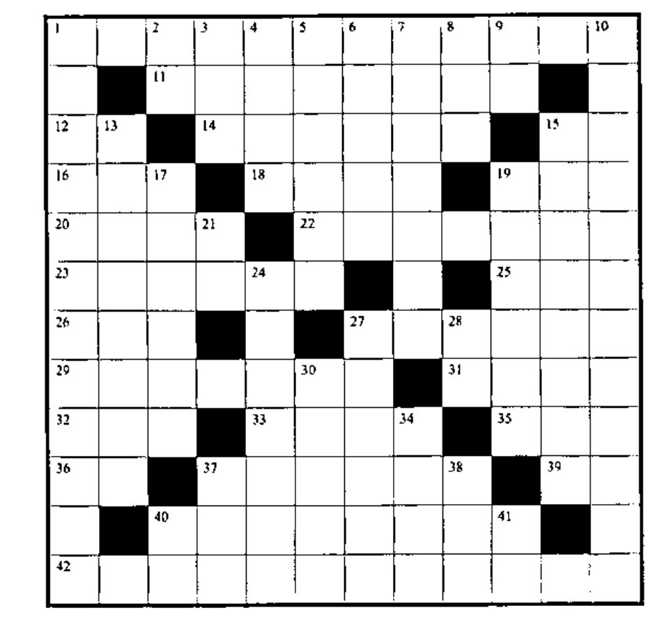

## Solution to Crossword in 20.3

![The completed 12 by 12 crossword grid from Vector 20.3, filled with APL symbols, names and digits; row 1 reads C L [ C S ⍋ C L ; ] and A, and the bottom row reads P R O G R A M M I N G](v20n4-p29-crossword/solution-20-3.jpg)

## New Crossword

### Across

1. APL, to the confused Greek novice
11. `1|PIF`
12. `⎕__` to pause awhile
14. `(⌽C)≥T` without using `>`, `≥`, `<`, `≤`
15. `⎕__` to show a function as a character matrix
16. `2|N` tells whether integer `A` is ___
18. `(+/ER)⍴2` for positive integer vector `ER`
19. `(-M)+M=M`
20. Is `N` at least as big as e raised to the `R` power?
22. The magnitude of the sum of `V` and each of the first five elements of `BU`
23. `*(⍟ED)-(⍟LTH)`, the easy way
25. Rank (number of dimensions) of `T`
26. `'FLAPPABLE' ~ 'APL'`
27. Ratio of `M` to `A`, displayed to `BR` places
29. `B` random numbers from `OC-VC` to `OC-1`
31. Area of rectangle `GA` wide by `T` long
32. `''⍴(R/⍳⍴R),⎕IO+⍴R` for bit vector `R`
33. `(×/⍴T)⍴T+2`
35. `(0,I)[⎕IO+T]` for numeric scalar `I`, bit vector `T`
36. `⎕__` returns the available characters
37. round the elements of `M` to the nearest integer
39. `"→" ~ 'TO'`
40. `W⍴-S×Y` for scalars `W`, `S`, `Y`
42. `⌹` uses the method of ___________

### Down

1. `∧/4 1 ...`
2. `⎕__`, number of significant digits to display
3. Keyboard abuse: “___ Enter”
4. Flag elements of matrix `AF` matching scalar `E`
5. Remainder of `H÷TR` subtracted from `B`
6. Smallest number in vector `V` or scalar `E`
7. Two more than vector KR. rotated `TP` to the left
8. `)____` is the same as `)RESET`
9. APL has consistent order __ execution
10. `⍋V` and `⍋⍋V` are ___________ of `⍳⍴V`
13. `VV∊DBC` for `1=⍴⍴DVC`, `LD„⍴DBC`, `⎕IO←1`
15. Turn the reciprocal of the cumulative product of `G` into a matrix with shape `B` and subtract it from `C`.
17. `D` raised to the power `1÷(¯1+E)`
19. Number of rows in `MAT`
21. `⎕__` is the “seed” for generating random numbers
24. Random integer from `T+1` to 20, `⎕IO=1`
27. `BC,[2]Q[;5/⍳1↓⍴Q]`
28. Character representation of numeric `G`
30. `+/V×S`, `V` a vector, `S` a scalar
34. `+/T,SU` for scalars `T` and `SU`
37. Smallest number in vector `S`
38. `M,[2]((1↑⍴M),1)⍴A` for matrix `M`, scalar `A`
30. `⎕__` is the space remaining
41. SC, MN, HR, DY, WK, MN, __, DC, CN, ML
