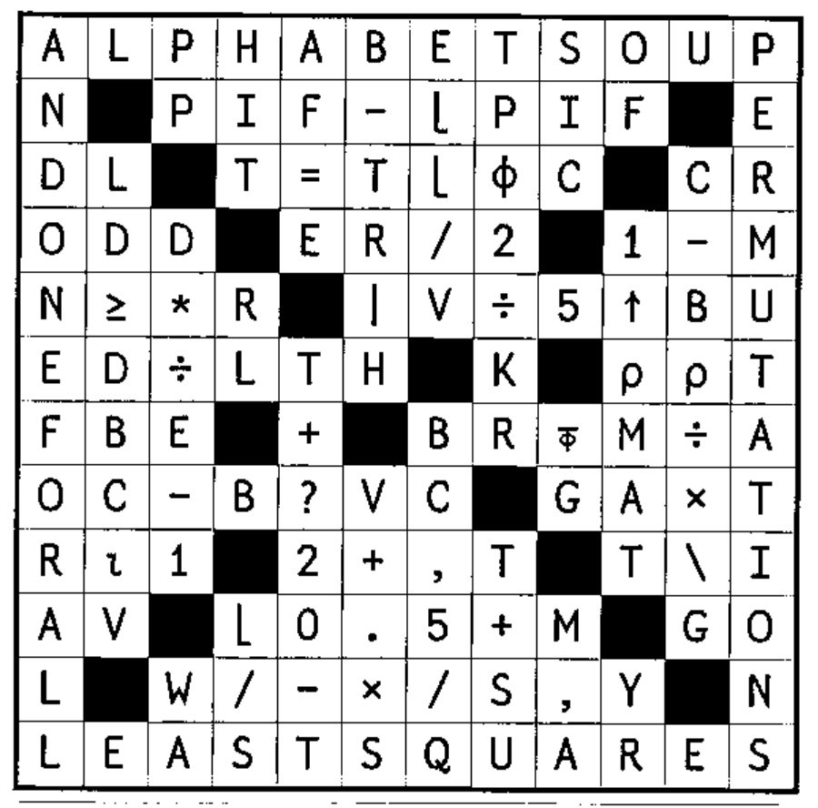
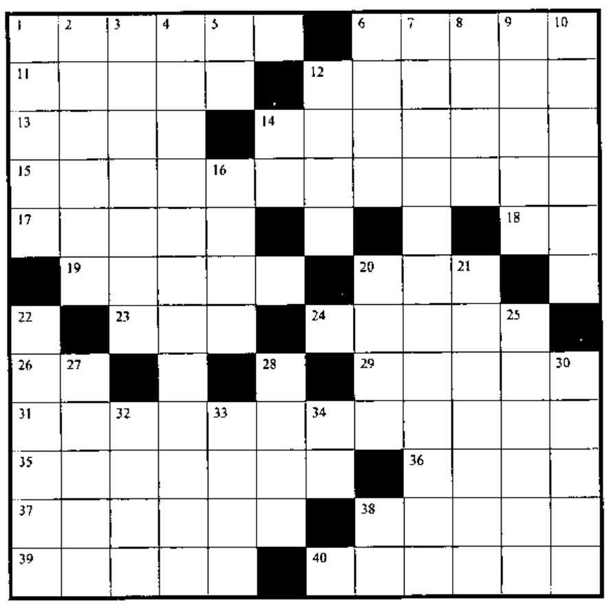

## Solution to Crossword in 20.4

## New Crossword

### Across

1. `F` random numbers from `(-B+V)` to `(-B+1)`
6. Number of values of vector `DS` not in `V`
11. `UM×EV` for numeric scalar `UM`, bit vector `EV`, without multiplying
12. `[KBρ⍳E]`
13. The largest value in vector `RM`
14. Is `W` true and `VND` identical to `C`?
15. The non-function symbol with orders of magnitude significance
17. The number `JGB` smaller than `S`
18. `⎕__`, the first number in `⍳N`
19. `∨/A∧~D` for vectors `A` and `D`
20. `(¯1 0 1)[⎕IO+(IN≥0)+(IN>0)]`
23. And so on
24. How many values in vector `N` are found in `V`?
26. The next integer at or below `Y`
29. Matrix `U` ravelled, with scalar `AJ` preceding the values of each row
31. All
35. `*(⍟B)+MF×L`
36. Word prefix meaning 31 across
37. Absolute value of the quotient of `BKA` and `H`
38. `(-R)-⍳O-R` (`O` not zero) in origin 1
39. `⍳` tells where, `∊` tells whether , a value is ____
40. Responsibility of system architect

### Down

1. The lesser of `-E` or `_DS`
2. `(+/BM)ρE-1` for bit vector `BV`, scalar `E`
3. Vector whose first difference is `RJC∊E`
4. Who `DEBUGGER BOY` grows up to be
5. A random number from the set `⍳M`
6. Number of dimensions in `VP`
7. Divisors
8. First `S` elements of vector `DI`
9. Are arrays `K` and `NI` different?
10. Rank 1 array
12. Are both `B` and `LT` true?
14. `⎕__`, the number of bytes remaining
16. Is `MB` larger than `C`?
20. Product of all the numbers in array `C`
21. Is the nunber `N` found in vector `I` beyond its first `JIM` elements?
22. The remainder of `F÷AB`, but  no more than 4
25. `V` followed by the location of `G` in vector `ON`
27. `''ρρ,(YN,BO)ρ0` for scalars `YN` and `BO`
28. Surface area of cylinder with diameter `D`, height `H`, excluding ends
30. `∧` is to intersection as `∨` is to _____
32. `×/KUρD` for scalars `KU` and `D`
33. The number of `D` size slices in an `EF` size pizza
34. `⎕__`, the number of users on your computer
38. `Eׯ1`
