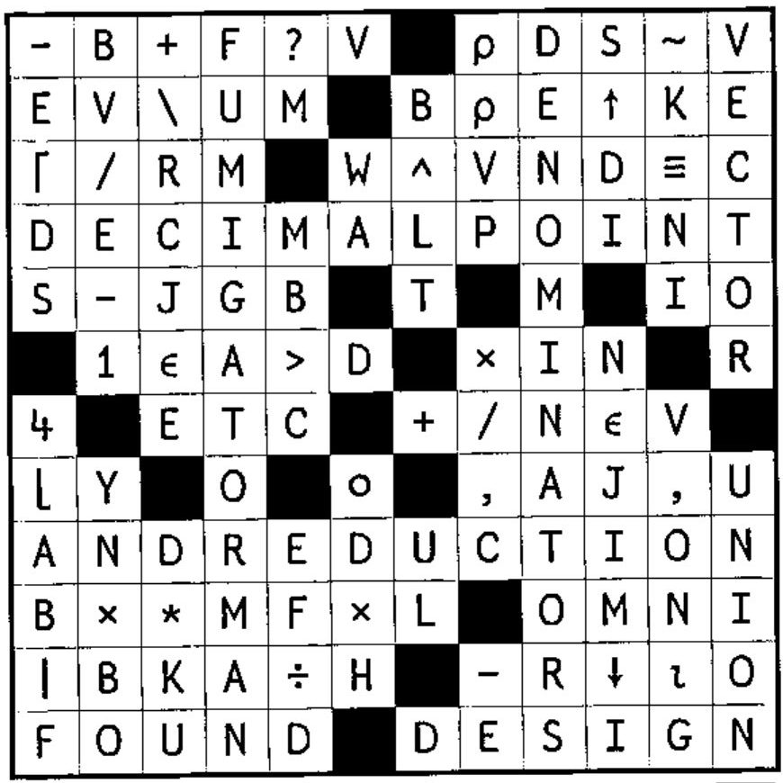
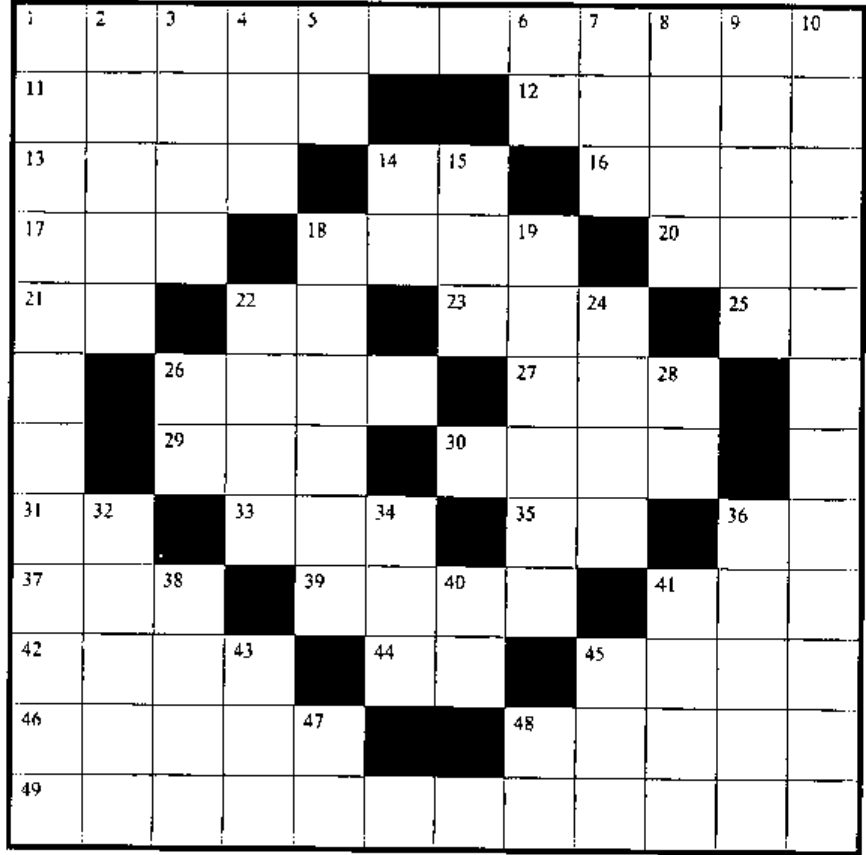

## Solution to Crossword in 21.1

## New Crossword

### Across

1. How to turn PL or AL into APL
11. One random number from `(-N),(-2×N),(-3×N),...,(-L×N)` to EV, without multiplying
12. `+/(R=R)/CP` for vector R, scalar CP
13. Round elements of vector B down to nearest integer; rotate left N places
14. `Z>0` for non-negative Z
16. `(L=KO)⍳1` for vector L, scalar KO
17. `M-E×⌊M÷E`
18. Cumulative sum of the absolute values of the numbers in the vector Y
20. `D[⍳3]`
21. `'ROAD'~'AEIOU'`
22. Any
23. `+/WρQ` for scalars W and Q
25. `3↓2⌽'QUEUE'`
26. Round to the nearest integer
27. `)__` is the same as `)RESET`
29. `~K∊2`
30. `(ln B) - (ln T)`
31. `∨`
33. `V↑U?U` where `V≤U`
35. `(*1)*N`
37. `)__` to see what’s suspended
39. Circumference of N circles, diameter D
41. `∨/,V`
42. The larger of U or minus N
44. `⎕__` sets significant display digits
45. BI formatted to `F[2]` decimal places in a width of `F[1]` characters
46. Indices of negatives in vector G, where `C←G<0`
48. `⌈/A,T` for scalar A, vector T
49. Branch of math with which `○` deals

### Down

1. The only dyadic operator in std. APL
2. `((D×D)*0.5)[⌽⍳ρD]×N`
3. `S+(1|M)-M`
4. E distinct random numbers from `⍳B`
5. Use `⎕__` to regenerate random numbers
6. `⎕__` tells whether a fn or var
7. World’s most concise notation
8. `O,(O+O),(O+O+O)` (note: the letter O)
9. Pad vector Q to length K and reshape to matrix with shape R
10. APL: A ____________ Language
14. Running product
15. Remainder from `W÷Z`
18. Sum of 52 distinct random numbers from `⍳N`
19. Raise SB to the power D; multiply by Y
22. `(MAT____)⌿MAT` to return all rows of MAT except those matching vector V
24. `(÷N)×QI`
26. `K-1|K`
28. `⎕__` can alter the result of `A>B`
32. `''ρ⍒R`
34. `*(⍟U)+⍟P`
36. `(+/B)≥((B×R)~0)⍳S` for bit vector B, nonzero vector R
38. `(D-1),(D-2),...,(D-I)`
40. P times pi
41. Round T up to nearest integer and format to one decimal place
43. `+\N↑G` for positive scalars N and G
45. `(⍳0)ρ(F<E)⌽F,E` for scalars F and E
47. `→  :  __` to
48. `'PAM'~'AP'[⎕IO+TIME>1200]` for `TIME←100⊥2↑3↓⎕TS` yesterday morning
