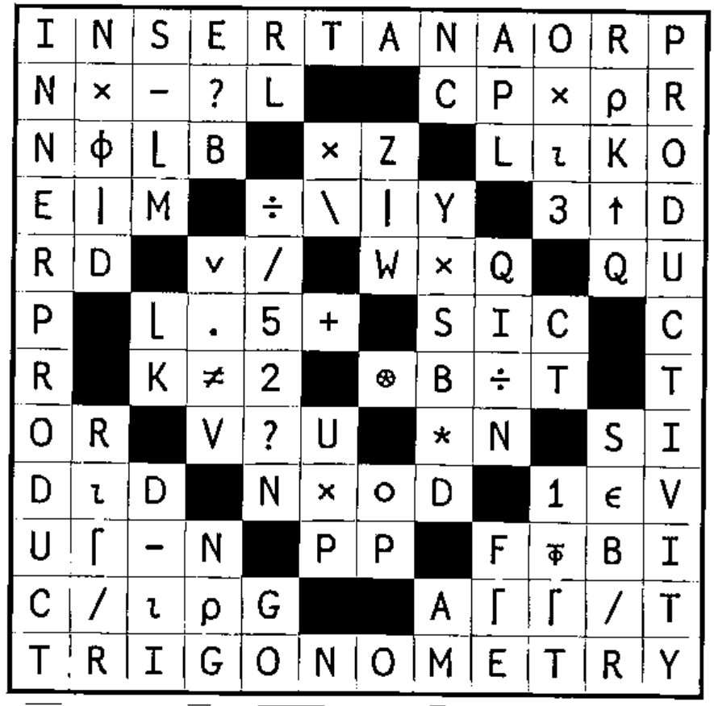
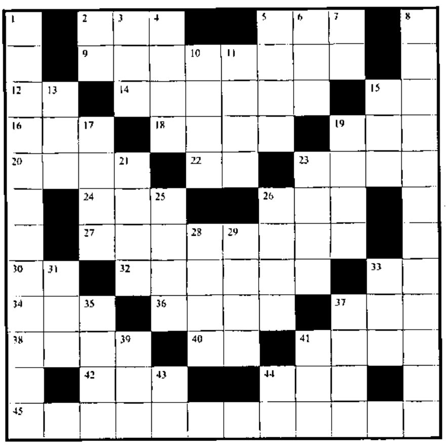

## Solution to Crossword in 21.2

## New Crossword

### Across

2. Centre of the universe
5. `S-V×⌊S÷V`
9. Set V as a bit vector flagging rows of CI that contain the vector S
12. `⎕__` to vaporize unwelcome objects
14. `(AD↓MBT),AD↑MBT` for positive AD
15. `⎕__` tells where to break long output lines
16. `1,(A-1)⍴0` for scalar A
18. `,1 ¯1∘.×V` for vector V
19. Flag leading 1s in bit vector E
20. OK different random numbers from `⍳B`
22. `⎕__` to define a local function
23. `MR[;1]-MR[;2]` for two-column MR
24. Number of elements in vector V1
26. `K×K>0`
27. Index of 1st element of vector V that is twice as large as the biggest number in vector NV
30. `×⍳` as in `→END×⍳A∊E`
32. Number of columns in MAT
33. `(F>0)-F<0`
34. B formatted to `R[2]` decimal places within width `R[1]`
36. Stick V as a new column to the front of matrix `1÷B`
37. `(5⍴F[1]),(5⍴F[2]),(5⍴F[3]),...`
38. `)____` to bring in more functions
40. `⎕__` to get a list of vars and/or fns
41. `∨/GI` for vector GI
42. Symbols that convert bits to indices
44. `(~S∊C)/C`
45. Raise to powers

### Down

1. `○R*2` for radius R
2. `⎕__`, the list of available characters
3. Make a copy of A and name it P
4. `(L+DV)≥1` for Boolean L and DV
5. Flag with bits elements of vector BV that begin subvectors that match V
6. `(CT*2)*0.5`
7. `)__` to see what’s not finished
8. ... 0.2 1 5 25 125 625 ...
10. `-____` is the alternating sum of the elements of matrix F from end to start
11. X below SM
13. The first X elements of vector K
15. The value of Boolean P with the elements at indices `P/⍳⍴P` replaced by M
17. One random index, ravelled, from vector V
19. `~0∊KV` for bit vector KV
21. `''⍴BV/⍳⍴BV` for bit vector BV
23. `⌊-NT`
25. All but the first 12 elements of V
26. `((1↑⍴AB),0)⍴AB` for matrix AB
28. Is N non-empty?
29. The quotient of M and L, rounded up
31. Format values in O (not zero) to F decimal places
33. `G[1]×G[2]×G[3]×...`
35. `P[BP/⍳⍴BP]`
37. Does SA contain a 5?
39. Where O first occurs in vector Y
41. `(~1∊I)⍴1`
43. Number of rows, columns in matrix N
44. `⎕__` to define “close enough” when deciding whether numbers are equal
