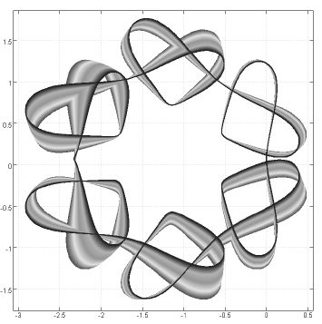

The effects of the collapse of the international financial system this winter are still rumbling through the economy. With revenues in freefall, firms are slashing costs and shedding workers. Already Britain has two million unemployed.

Wintry times are always summer for the APLs. With budgets frozen, managers abandon IT doctrines for tools and people who deliver quickly and cheaply. The times are ripe again for the Direct Development methods in which the APLs have always performed well.

*Go get ’em*. In this vein we are holding a 2-day conference – BAPLA 2009 – in Reading in June. This is an opportunity to introduce a new generation of business managers to what Direct Development makes possible.

The BAA London chapter now meets every month. See the APL Wiki for their agenda; join their Google Group baa-london to keep in touch.

We have resurrected from the defunct Product Guide a listing of companies and individuals offering consulting services in the APLs – see the back pages. This listing is free to BAA members and non-members alike. Contact Ray Cannon for changes and additions.

We know many *Vector* readers valued the Product Guide as a community ‘white pages’ for former colleagues, but a little study showed our listings were not up to date. Web applications such as Facebook and LinkedIn now do this job much better. For personal listings we recommend homepages on the J Wiki or the APL Wiki. And LinkedIn and Facebook both have Iversonians groups you can join. All of these can be found from the Community page at vector.org.uk.

Ian Clark, our projects officer, has brought to press the first title under the Vector Books imprint. Over the years, Eugene McDonnell wrote 41 articles for his *Vector* column on J. The first edition of *At Play With J* reproduces the articles as originally printed, and can be ordered from Lulu.com – see the Books page of our website. Because J has evolved since the first article appeared, volunteer editors are revising now for a second edition, in which the examples match the current version of J. Contact Ian if you can lend a hand.

Catherine Lathwell is making a documentary film about the story of APL. Find her project blog *APL Diaries* through the Community page at vector.org.uk and see if you can offer her any help. Catherine will be speaking about her project at the APLBUG meeting on 11 May at the Computer History Museum in Mountain View, CA.

In this issue, Chris Hogan explains how to negotiate the ISO 9000 certification some clients might demand you have, without losing your Direct Development agility. Morten Kromberg shows Dyalog in the ecumenical world of Unicode and Windows IMEs. Inspired by q and Paul Mansour’s flipdb, Adrian Smith whips up an in-memory DBMS. Dan Baronet introduces Spice, an addition to the Dyalog IDE, and David Liebtag describes new features of APL2.

The mathematicians are out in force. Bill Jones & Cliff Reiter marvel at Cauchy curves. In J-ottings 51, Norman Thomson has a go at the kids’ homework. In Italy, Gianluigi Quario completes his meditations on polynomials. And Gordon Sutcliffe reports a fast way to calculate Kendall’s rank correlation frequency distribution.

*Stephen Taylor*
