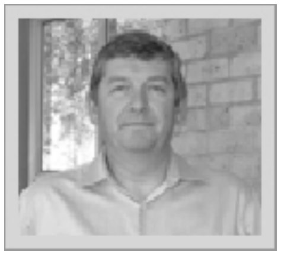
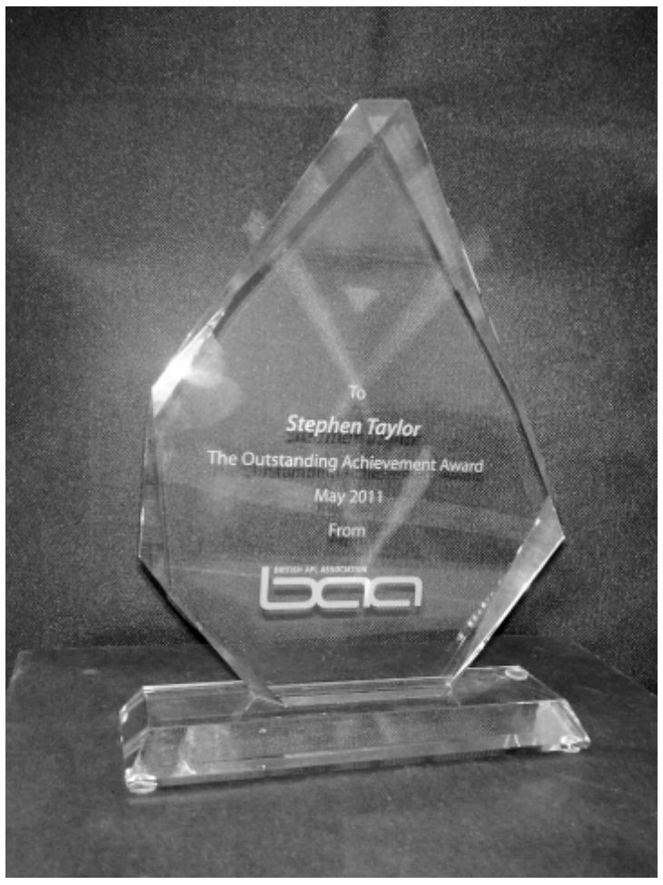

*by Paul Grosvenor - June 2011*
{ .byline }

Another year passes and it seems even faster than the previous year if that is possible. Once again we held our AGM at the Albion in London to an audience of 20 or so. Unfortunately I was unable to attend at the last minute so our new Secretary, Peter Merritt, stood in for me – trial by fire and all that. After the AGM presentations by Mike Hughes (Using WPF with Dyalog APL), Morten Kromberg (New features of version 13) and John Scholes (Function-trains in APL) were all well received as was the beer in the bar afterward.

2010/2011 has, once again, been a very busy year for the APL world. The Vendors are keeping our world alive with new features and initiatives; I just wish I could keep up with all of them myself. The positive momentum I described last year still seems to be in existence and even in these troubled times new APL users continue to appear. However we must not be complacent and the good old APL flag needs to be kept waving; a subject that I know is close to many hearts.

I thought that we might be able to have a conference this year as in 2009 but pressures of work simply took over and it became impossible to find enough time to organise it properly. Hopefully an event in London in 2012 will be possible.

Our committee for 2011/2012 remains unchanged from 2010/2011 so thank you to all for your continued support. As always we welcome new blood into the committee so if you do have some spare time and want to help please get in touch. Contact details can be found at the back of Vector.

Our issue with the BCS regarding our funds continues but their stance has not changed. Circa £14,000 remains under their control and we will continue to apply pressure on them to release it to us. Some of you may be aware that there was a vote of no-confidence in the BCS management last year and an EGM was called as a result. I submitted some information to that meeting on behalf of the BAA. Rather than me repeating all that was said and done please follow the following link where all the information can be found;

**www.bcsegm.blogspot.com**

We will keep you up to date with progress.

The BAA London group have continued their meetings each month which is very good news and I hope that even more of you can try to attend. Phil Last will be announcing each meeting through various forums including comp.lang.apl so if you are in the area, please feel free to drop in on them.

For the second year running I am proud to be able to announce that we have decided to present our **‘Outstanding Achievement Award’** once again. The award is designed to acknowledge the efforts of an individual, or organisation, within the world of APL where a particularly high level of achievement has been made. This year I am very pleased to be able to award it to Stephen Taylor for his work promoting APL and in particular for his efforts building and maintaining the Vector web site and of course the hours of time he has spent editing the Vector publication over the years.

**Congratulations and Thank You Stephen**

Thanks also to Optima Systems Ltd for sponsoring this award. The award reads;

> **To**
>
> **Stephen Taylor**
>
> **The Outstanding Achievement Award**
>
> **May 2011**
>
> **From BAA**

I hope that you, like myself, are looking forward to the coming year with eager anticipation and that I may get to see even more of you in some of the forthcoming APL conferences.

As always if you have any comments, thoughts or suggestions please email me at:

**chairman@vector.org.uk**
