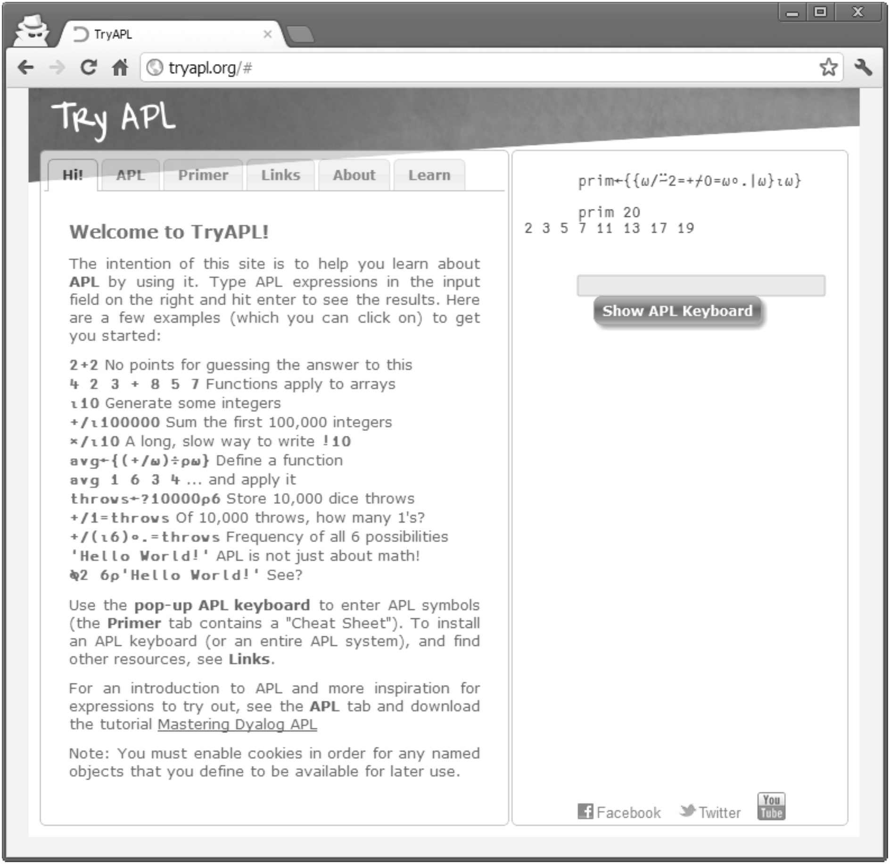

During his speech at the Dyalog 2012 Conference in Boston Joel Hough, the winner of the 2012 Dyalog APL Programming Contest, explained how he normally approaches a new programming language. He mentioned a couple of things; one was: “Then I try the language online.”

There is a simple reason why you can try Perl, Python or Ruby online: interpreted languages are perfect for this. However, not with APL.

Until 2012 - now there is http://tryapl.org

The right panel is a sort of session manager. One can try APL expressions and even define functions. Great!
