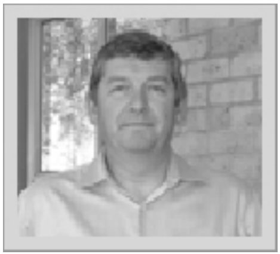

*by Paul Grosvenor*
{ .byline }

Time continues to pass at an ever increasing rate and another AGM is just round the corner. This time we look forward to seeing you all between 27th and 29th April at the Lee Valley YHA for both the AGM and a weekend of all things APL. I do hope that some of you will be able to make it (and Geek with the rest of us). Lively conversation, a barbie, a few libations and who knows even some programming will be the order of the day(s).

I wanted to get some feedback from the membership on a few issues and so have included this report before the AGM is held. Hopefully my questions / comments will make some sense.

1. As Stephen Taylor is no longer Editor of Vector we are looking to fill this post and continue to look for a suitable candidate. One of the suggestions made is for Optima Systems Ltd to put some resource in to assist the other members produce the journal. Whilst this is fine in some ways it would mean that the Chairman, Secretary and Editor roles of the committee would all come from the same organisation. My question therefore is;

   **Would the members be happy for so many posts to be filled from a single organisation and would this compromise impartiality?**

2. Our issue with the BCS regarding our funds continues but their stance has not changed which is what we suspected would be the case from the outset. Circa £14,000 remains under their control and has been absorbed into their organisation. There was a vote of no-confidence in the BCS management 2 years ago now and an EGM was called as a result. We submitted some information to that meeting on behalf of the BAA. Rather then me repeating all that was said and done please follow the following link where all the information can be found; **www.bcsegm.blogspot.com.**

   Since the BCS has not changed its views regarding the membership position of the BAA (and indeed other groups within the BCS) and there seems to be no documentary evidence to suggest that our membership was in any way different we now face a very hard uphill climb to pursue our claims. My question to you all is;

   **Should we now formally accept that we will not get our funds back from the BCS and direct our efforts into more beneficial directions?**

3. In recent years we have had an Outstanding Achievement Award which last year went to Stephen Taylor. This time I would like to do things slightly differently and ask for nominations from the wider community with a view to awarding the trophy next year. My question;

   **Are we happy to open up the nominations to such a community which may include APL, J, K, Q etc?**

4. Our membership year is tightly bound into the production of 4 issues of Vector and this can cause us problems when material or time is short. The question;

   **Would the membership be happy to continue with their subscriptions if the number of issues of Vector was not necessarily 4 per year?**

I look forward to hearing any views you may have regarding the above (or indeed any other points). If you would like to send an email with your thoughts to;

**chairman@vector.org.uk**

or

[e-mail address omitted]

Thank you and see you on the 27th
