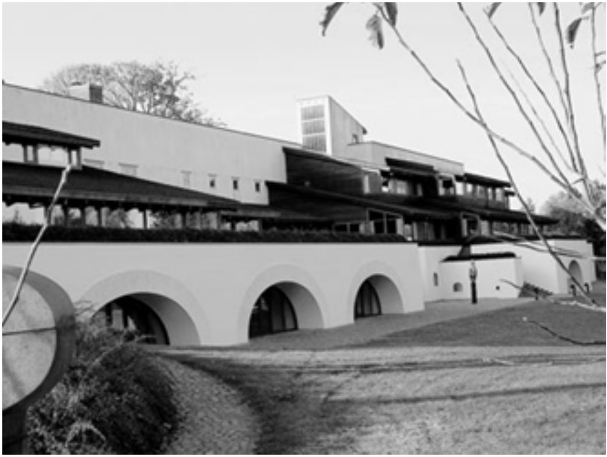

## Dyalog Ltd

### TryAPL.org

Since 2006, Dyalog has made a free educational version of APL available to anyone enrolled in a full-time education program. The number of downloads has gradually increased from a trickle to an average of one per day, with a total of twelve hundred licences downloaded to date (plus a few hundred non-commercial licences). However, we know that many people are reluctant to enter personal information in order to be able to test our product. In order to make APL more easily accessible to anyone who is interested, we have decided to make a version of Dyalog APL available as a “no-questions-asked” download for anyone who would like to play with APL. The unregistered version will show a pop up every 20-30 minutes to let you know that it is unregistered - and that you need to sign up for a free educational or a low cost (£50/$75) non-commercial licence to have access to a version without the pop-up.

Initially the unregistered version will only be available as 32-bit Unicode Edition of Dyalog APL for Windows; other platforms are planned to be added during 2012. The unregistered version will be available from http://www.tryapl.org/ and from the download zone of www.dyalog.com; the only field to be filled in is a checkbox acknowledging the terms and conditions of Dyalog’s non-commercial licence.

From January 1st 2012, the tryapl.org site will also host a simple interactive “APL Timesharing System”, which will allow anyone to enter APL expressions interactively while learning the language. This will complement Gary Bergquist’s on-line APL Tutorial, which is already available at http://tutorial.dyalog.com.

### MiServer

Observant users of the APL Wiki will have noticed a project which was started under the name “MildServer”, which has been an experimental framework developed with the goal of “making it possible for anyone who is able to write an APL expression to expose it as a web page”.

Thanks to the APL Tools Group at Dyalog, which is headed by Brian Becker and includes Dan Baronet, Nicolas Delcros, Morten Kromberg and intern Brian McCormick, this project is now rapidly gaining momentum. In addition to acquiring a catchier name, the “MiServer” now contains a number of tools for creating very nice-looking interfaces using the “JQuery UI” library, a handful of sample web applications and an extensive User Guide.

The MiServer is designed to be an “open source” project; all of the source code is stored in Unicode text files, and a modular architecture is intended to allow straightforward participation by users who are keen to help add support for more JQuery widgets, database interface tools, security mechanisms and other more sophisticated versions of the simple mechanisms which are provided as samples.

We hope that with the trial APL system and MiServer, students and other developers will find it much easier to take a first look at APL – and that the availability of a simple but effective web server framework will make APL an attractive platform for quickly delivering technical applications on the internet.

New versions of MiServer will be released constantly in the future, and will also be available on the APL Wiki and the dyalog.com/library page.

### Dyalog’12 in Elsinore

Reserve October 14th-18th 2012 in your calendar – these are the dates for the next Dyalog conference, which will be held at LO-Skolen in Elsinore, Denmark! The conference is experiencing therefore decided to add one more day to the conference, bringing it to five days including training sessions before and after the main conference. We have also decided to add more training sessions during the main conference days, focusing on introductions to features added to Dyalog APL in the current millennium (but not necessarily in the last one or two releases). If you plan to attend, please send suggestions for course topics to conference@dyalog.com. See http://www.konventum.dk/arkitekturen for more images of the venue.

The 2011 Dyalog conference was held on October 2nd-5th, at the John Hancock Conference Center in Boston, Massachusetts. As in with previous Dyalog conferences, we recorded about half of the presentations and they will start to appear on the http://video.dyalog.com website in December, alongside the existing recordings from Dyalog ’08, ’09 and APL2010 in Berlin.

### Dyalog Programming Contest

One of the highlights of the Dyalog conference in Boston was the presentation of the grand prize to the winner of this year’s Dyalog Programming Contest (as it was in ’09 and ’10). This year, the puzzles had been set by last year’s winner, Ryan Tarpine from Brown University – and were well received by the contestants – 130 of whom downloaded Educational licenses. This year’s winner, Joel Hough from the University of Utah, came third last year and decided to try again – and this time he made off with the grand prize of USD 2,500 and a round trip with all expenses paid from Salt Lake City to Boston.

Despite his age, Joel is already a veteran programmer, with (literally) dozens of programming languages under his belt – and he ranks learning APL as one of the more enjoyable experiences in his career.

He will be speaking at the QCON conference in San Francisco on November 18th, together with Morten Kromberg, on “Why APL is Still Cool”. More details at http://qconsf.com/sf2011/presentation/Why+APL+is+Still+Cool. For more about Joel and the other prize winners, see http://www.dyalog.com/news.htm.

We have prepared the 2012 Programming Contest and unveiled the next set of problems. As usual, anyone who introduces one of the winners will win the same amount of prize money as the winners themselves, so start thinking about which of your student friends you will put to work for you.

### Introductory APL Courses

As this is being written, Bernard Legrand is conducting another of his highly rated introductory APL courses, based on his book “Mastering Dyalog APL” (which is available from Amazon or as a free PDF download from http://www.dyalog.com/intro). The frequency with which these courses are being conducted is slowly increasing, and we expect to hold another course in 2012. If you or any of your colleagues could benefit from APL training, write to sales@dyalog.com for details.

### Version 13.1

The target release date for Version 13.1 of Dyalog APL is 13 April 2012. Tune in again in the next issue to read more about that, the new “Dyalog File Server”, and a number of additional tools and products that Dyalog will be making available in 2012.
