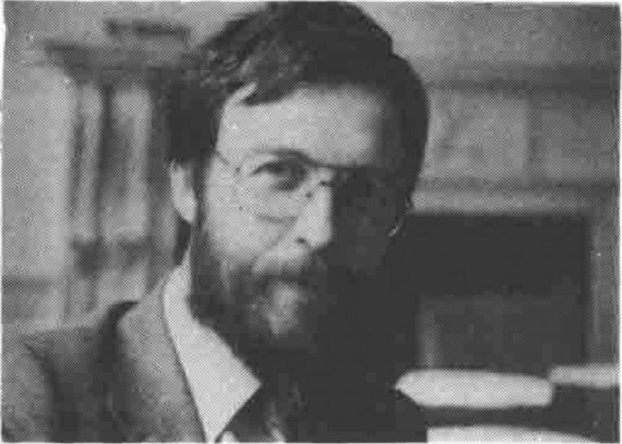
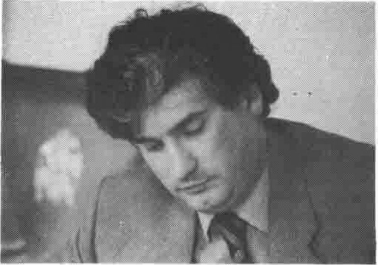
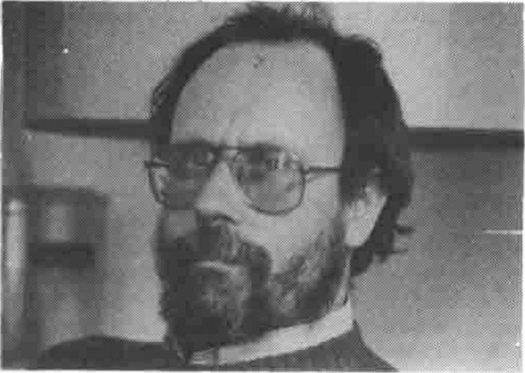
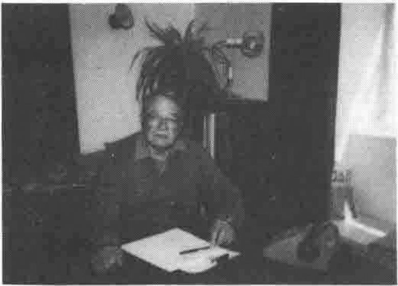
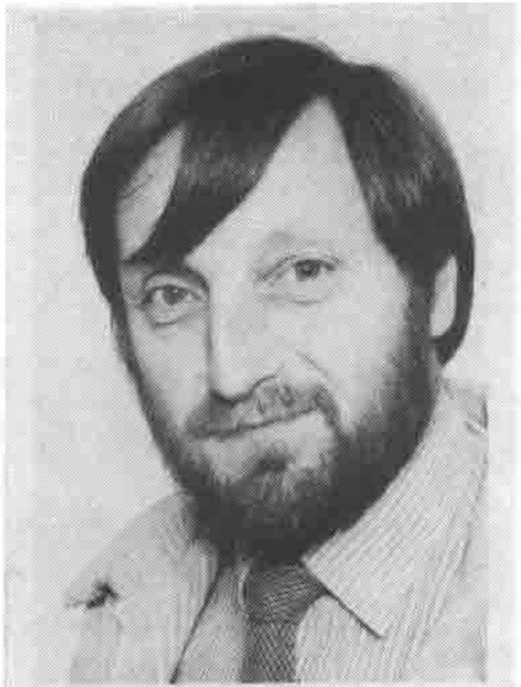
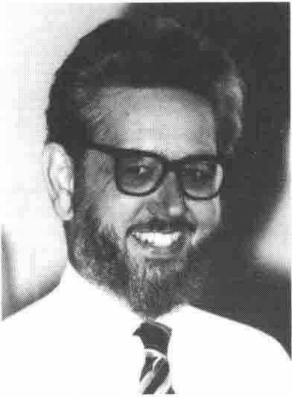
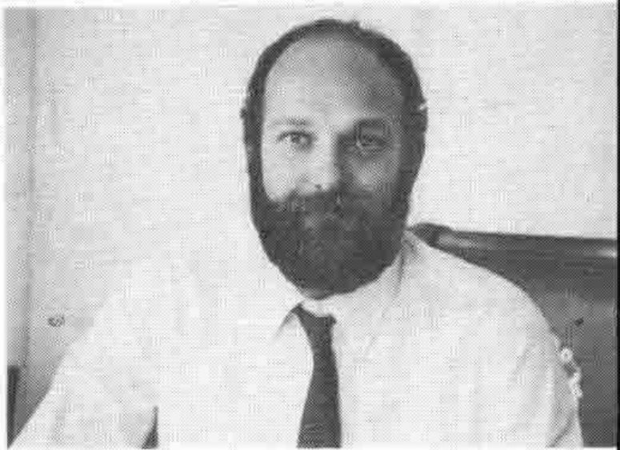

## Minutes of the Annual General Meeting held at the Royal Overseas League, London on 28th May 1985

1. The minutes of the 1984 AGM were taken as read.

2. Chairman's review.\
   *(This is reproduced in full later in the British APL Association News section.)*

3. Regulations.\
   The draft regulations published in VECTOR Vol.1, No.4 are the result of extensive redrafting and no amendments had been received for discussion. They were overwhelmingly accepted by the meeting, though one member was unhappy that our affiliation made it necessary for our Chairman to be a member of the BCS.

4. Officers' reports.\
   In the unavoidable absence of the Treasurer, the Chairman showed an outline of the accounts which will be published in full in VECTOR. They showed that the profit from "APL Business Technology 83" had enabled us to spend on VECTOR this year more than our income. We therefore have to increase our subscriptions by half and may well run at a loss this year in spite of this. The proposed subscription rates (plus a rate of £120 for overseas corporate members) were agreed without objection. The auditors were reappointed. Other officers felt that they need not add to what had been printed in VECTOR.

5. Elections to the Committee.\
   The secretary reported that he had only had one advance nomination, who had not insisted on having his particulars circulated. A postal vote would have ben impossible without candidates. The following were elected:

   | | |
   |---|---|
   | Chairman | Dick Bowman |
   | Treasurer | Mel Chapman |
   | Secretary | Anthony Camacho |
   | Journal | David Preedy |
   | Activities | Stan Wilkinson |
   | Education | Dick Gray |
   | Technical | Dave Ziemann |
   | Publicity | Romilly Cocking |

6. Dick Bowman proposed a vote of thanks to Phil Goacher which was passed by acclaimation.

Anthony Camacho, 6 June 1985.

## British APL Association Chairman's Report, May 1985

*by Philip Goacher*
{ .byline }

As outgoing Chairman, after three years in office, I look back over the past few years of achievement which have culminated in our Association becoming progressively international and about to host the annual APL conference for the first time in the UK.

In many ways we have changed a great deal, though in other ways we have changed very little.

From the original few members of the 'UK APL User Group' founded in 1976, membership grew steadily for some years. This was a predominantly UK based membership for which regular technical meetings were held at Imperial College in London with an annual one-day seminar and exhibition to review the APL hardware and software available.

When I became Chairman in 1982 we were in the interesting period when much was talked about APL on microcomputers, but all we had were specialist machines such as the MCM and the CP/M based Vanguard and early MicroAPL products.

At APL82 in Heidelberg we first saw APL2. This aroused a great deal of interest at very crowded demonstrations. At the same conference Inner Product unveiled VIZ:APL — a British *first* giving a virtual megabyte on a CP/M machine.

Appearing later that year was another home grown product — Dyalog APL, a 'second generation' interpreter developed to run on UNIX machines, with generalised arrays, virtual files and a lot more.

In 1983 the UK User Group ran its first conference at Loughborough. A successful first attempt which immediately raised the question as to whether we should host one of the annual international APL conferences following previous European venues such as Paris, Copenhagen, Pisa, Nordwijkerhout, and Heidelberg.

Not only did our success at Loughborough make the Group aspire to staging APL86, it also provided a substantial sum of money with which to develop the Group. A task force examined the structure of the User Group, its meetings and its newsletter. Its proposals were to revise the image of the Group, upgrade the quarterly newsletter and review the technical meetings.

In the last year all three areas have been tackled to some degree. The name of the Group was changed to The British APL Association which has undoubtedly helped to improve our image at home and overseas; new regulations have been drafted in keeping with a growing Association and the journal VECTOR was started from scratch. We are very concious that overseas members and those unable to travel regularly to our meetings rely on our publication for contact with the Association. Having spent a number of years helping Val Lusmore to produce a mere 32 page newsletter I know only too well the problems associated with gathering copy, editing and producing the final result. On behalf of the Association I would like to thank Robert Bittlestone and his Journal Editorial Committee for the tremendous work they have done in getting VECTOR off the ground so successfully as a leading APL publication. I bring many messages of congratulations from our overseas members who were at APL85 with their plea for you to keep it up.

The technical meetings have continued through the year, held recently at the Royal Overseas League in Central London, where we can provide more congenial surroundings for visitors. During the past year two special events were held in London. One brought some of the best speakers and exhibits from Helsinki to a seminar entitled 'APL84 in Focus', at the Waldorf Hotel. The second special event ('What's New for 1985' at the Regent Crest Hotel) provided an opportunity for the APL vendors to describe and exhibit their latest products and services.

Having successfully bid for APL86 whilst attending APL84 in Helsinki, we were fortunate in being able to send a team of three to APL85 in Seattle to promote next year's conference at UMIST. We are indebted to British Airways official carriers for APL86, who helped with travel arrangements and assisted with our promotion in Seattle.

And so to the present. We have a growing number of overseas delegates, both individual and corporate, as a result of publishing VECTOR, in addition to our UK members. We are now an international organisation with a widely read journal, but we should be planning to do even better — there are many more APL users to recruit, and you can help us do it.

We also look to our members to support the APL86 conference by submitting papers, by helping the committees involved in running the Association and the conference, by supporting VECTOR with articles and letters, and by coming to the conference next year.

I would like to thank all those who have served on the 1984 management committee of the Association for the support they have given me throughout the year. As retiring chairman I wish my successor and his committee every success in the coming year.

## British APL Association 1985 Report and Accounts

### Income and Expenditure for year ended 30th April 1985.

| | £ | £ |
|---|--:|--:|
| **Income:** | | |
| Subscriptions: | | |
| Full | 3383 | |
| Corporate | 752 | |
| Sustaining | 2000 | |
| Library | 60 | 6195 |
| Special Events: | | |
| APL '84 in Focus | 880 | |
| What's new for 1985 | 762 | 1642 |
| Total Income | | 7837 |
| **Expenditure:** | | |
| Meetings | | 1193 |
| Vector (less advertising income) | | 11830 |
| Committee | | |
| BAA | 713 | |
| APL '86 | 350 | 1063 |
| Mailing | | 1583 |
| Professional fees | | 60 |
| Total Expenditure | | 15729 |
| Excess of expenditure over income | | 7892 |

### Balance Sheet as at 30th April 1985.

| | £ |
|---|--:|
| Cash | 8828 |
| Debtors | 3532 |
| | 12360 |
| Less Creditors | 9722 |
| Net assets | 2638 |

*Note:*

The committee will be making every effort to contain and, hopefully, reduce expenditure. It is hoped therefore that members will see the increased rates as more than justified and pay promptly.

The accounts, to BCS requirements, were prepared and signed by Mel Chapman as treasurer and audited by Roger Francis MSc. BSc.(Econ) ACIS.

8th May, 1985

## British APL Association Committee Members

Dave Ziemann (*Technical*)

David Preedy (*Journal*)

Romilly Cocking (*Publicity*)

Dick Bowman (*Chairman*)

Dick Gray (*Education*)

Mel Chapman (*Treasurer*)

Anthony Camacho (*Secretary*)

Stan Wilkinson (*Activities*)

## Activities Programme 1985/6

Due to the careful advance planning of the Activities working group, the forthcoming Association activities remain as announced in VECTOR Vol.1 No.4:

| | |
|---|---|
| September 13 | — Large APL Systems There are increasing numbers of multi-person long term development projects within the APL community. What do we have to learn from the mainstream DP business and what in turn can we teach them? |
| October 18 | — Micros and applications using micros. |
| November 15 | — Compilers and Interpreters APL compilers are becoming a reality; what goes on inside them and what impact does this have on the application developer? |
| **1986** | |
| January 17 | — Joint Meeting with OR Society Who don't know about it yet! OR is an area which has had long links with using APL as a tool; what's going on and what can we both do to make OR use of APL even more successful and widespread? |
| March 21 | — APL System Design Beyond wet fingers and pieces of string which design techniques are most useful to the APL developer; how much discipline is useful and how much is restrictive. |
| May 16 | — AGM + Relational Databases etc. Besides your regular opportunity to vote with your feet, an examination of the impact which developments such as APL2's link with mainline DB2 databases may have on the future use of APL. |
| July 7 to 11 | — APL86 Of which you will read much more elsewhere. |

I would like to remind everybody about the questionnaire regarding the September meeting (should it be about ADRS?, if so should it be upgraded to a Special Event? or should it be Consultants Questiontime?); so far we haven't had many back.

Also on the theme of participation and making the Association match your needs, can I remind members of the sheer exultation into which the Activities Working Group is thrown whenever somebody spontaneously offers to stand up and talk at meetings. All you have to do is ask (allowing about two months' notice so that we can organize and publicise). Indeed we also welcome suggestions about subjects for possible meetings. So volunteer; after all the worst that's going to happen to you is that you'll be invited to join the Activities Group.

The venue for all Association meetings will continue to be the Royal Overseas League (London W1) with all meetings scheduled to begin at 2pm. Don't forget the opportunity which this gives you to meet other APL users and implementers both before and after the meeting proper.

Once again I remind everyone of the APL Publications bookstall which is a regular feature of London events and the opportunity which this gives you to purchase all that hard-to- find APL literature.

As usual, this programme is subject to revision; further details of each event will be sent to British members nearer to the date.
