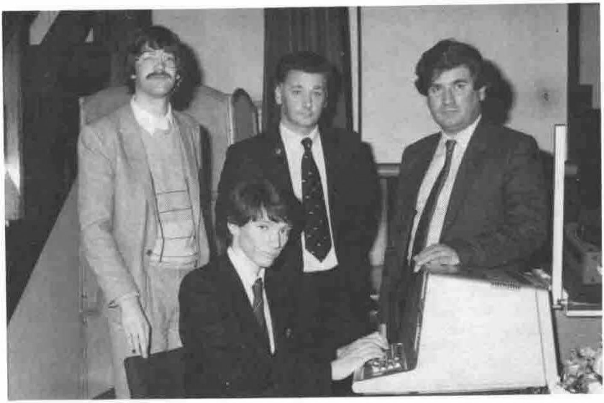

*by Romilly Cocking*
{ .byline }

Portsmouth Grammar School were the deserving recipients of an APL micro-computer at a brief ceremony on November 15th 1985.

The computer (a TRS 80 running APL\*Plus/80) was awarded by the committee of the British APL Association. Romilly Cocking handed it over on behalf of the association to Roy Thornton (Director of Computing at the school). Also present were two younger APL experts – Andy Tonks (currently a student at the School) and Mark Taylor (an old boy).

In a short presentation speech, Cocking emphasised the importance of nurturing educational interest in APL. “If the language is to continue its exponential growth, it is vital that we do everything possible to ensure a steady stream of graduates and school-leavers who are familiar with the language.”

Portsmouth Grammar School were selected as recipients because of their prior involvement with APL. We look forward to hearing further news of their achievements.

