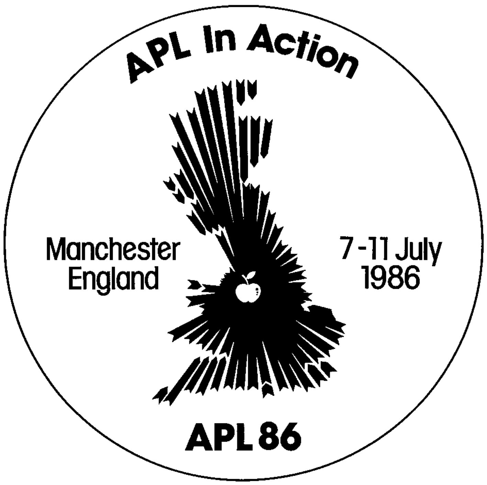
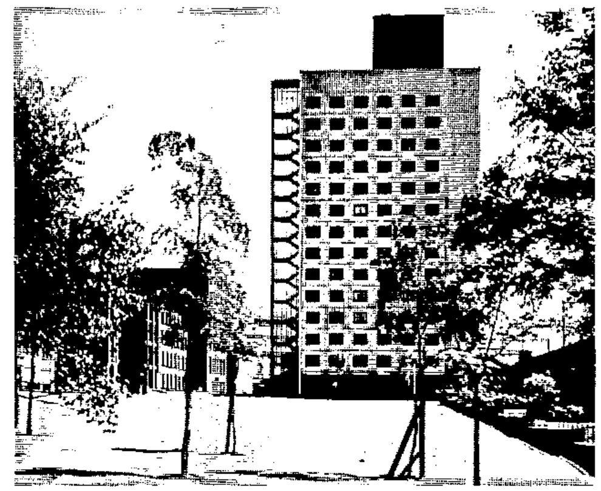

## Welcome To The APL86 Conference

On behalf of the Organising Committee and the British APL Association, I am both proud and happy to invite you to participate in APL86 – **APL In Action.** This, the latest in the series of International APL Conferences, will be held at the University of Manchester Institute of Science and Technology (UMIST) from 7-11 July 1986, organised by the British APL Association in co-operation with the British Computer Society and the Association for Computing Machinery.

The conference will be of high quality; response to our initial call for papers was over 150 contributions and our major regret is that we can include only a limited number of these in our timetable. In addition to these contributed papers we have much more lined up in the way of invited speakers, panel discussions, formal debates and Birds of a Feather sessions; last, but by no means least, there will be the usual major APL Exhibition.

Manchester itself is situated in the North West of England, with excellent travel facilities, and may be considered among its other attributes to be the birthplace of British computing. Away from the conference context you will find that Manchester provides an excellent base for visiting some of the most scenic parts of Britain, among them the Lake District, North Wales, the Peak District and the Potteries. Further afield, but within easy reach, are York, London and the Scottish border.

The UMIST conference facilities are virtually ideal for a conference like APL86, with major lecture theatres equipped with excellent audio-visual aids grouped around a central exhibition area; there is copious space for all manner of the fringe events which go toward making an event like this a resounding success. Accommodation may be either on-site (a two minute stroll from the main APL86 location), or in one of Manchester’s excellent hotels (again, only a few minutes’ walk away).

The Organising Committee is very excited about the programme we are putting together and will be doing its best to ensure that you will have a truly enjoyable stay; we look forward to seeing you in Manchester.

*Dick Bowman* – APL86 Chairman

### Organising Committee

| | |
|---|---|
| Chairman | Dick Bowman, Central Electricity Generating Board |
| Programme | Anthony Camacho, Consultant |
| Publicity | Philip Goacher, British Computer Society |
| Technical | Dave Ziemann, Cocking and Drury |
| Treasurer | Mel Chapman, North Staffs Polytechnic |
| Exhibition | Christine McCree, Beechams |
| Administration | Cathy Darue, Tesco |
| Secretariat | Josy Roberts, BISL |

## APL86 – Programme and Timetable

**Scope Of The Programme:** Why should you come to APL86? Because you will learn how to use your current APL better; find out about other APLs that you might use; see how the best APL users go about their work – and whatever your work, you can bring away a briefcase full of useful functions.

We have a dozen papers on how to write APL better: how best to provide full screen interaction: what productivity tools are really useful: how to integrate graphics into the dialogue.

APL can be badly written and get the reputation of fragility. We have papers on how to improve the reliability and robustness of your code and your systems. We have several papers on prototyping and commercial systems, including APL typesetting – come and see how others do it.

There are of course the traditional uses of APL in logic, statistics and mathematics: if Quarternians or Tensor analysis is your field we have papers for you too. The Logic programmers have a field day. Apart from papers on APL as a logic programming language we have ‘Expert Systems’, ‘Knowledge Based Systems’ and a half day tutorial on using the power of APL2 in Artificial Intelligence.

As one of our authors has put it – ‘A Language for Thoughts and Dreams’.

**Programme Outline:** The conference begins on the morning of Monday 7 July and the formal sessions continue until lunch on Friday 11 July. There are three main themes upon which the programme streams are based, namely: APL in Action, APL Environment and APL Notation. Each session in these streams has been given a title to reflect its particular emphasis – eg the Monday stream for APL in Action is entitled ‘Commercial Uses’.

An ‘Education’ tutorial day on Sunday 6 July will precede the conference.

In addition to the prearranged programme of invited speakers, semi-formal meetings will be set up during the conference to discuss topics of special interest to delegates. Rooms will be available for such meetings as well as a fully equipped rehearsal room for speakers.

If you have a particular interest in a stream then please complete the boxes marked ‘Special Interest’ on the booking form. Likewise, if you would like to book a ‘Birds of a Feather’ session please enter the topic in the box marked BOF on the booking form.

**Exhibition:** Throughout the conference a comprehensive exhibition will be open to delegates. Exhibitors will be able to demonstrate various hardware and software products discussed during the conference. Product forums will be run by some exhibitors, giving delegates the opportunity to follow items of particular interest.

The following exhibitors have so far reserved space at APL86:

| | |
|---|---|
| APL People | I P Sharp Associates |
| Cocking and Drury | Mercia Software |
| Dyadic Systems | MicroAPL |
| IBM | STSC |

## Conference Highlights

- APL86 Education Open Day  
  A pre-conference event to focus attention on APL in education
- Product Review Sessions  
  There will be a number of product forums, where APL software and hardware products will be reviewed
- A State-of-the-Art Exhibition  
  Already 26 booths taken
- A Number of Invited Talks and Tutorials, including

  | | |
  |---|---|
  | Jim Brown | AI and APL2 |
  | Andrew Dickey | Linking to Assembler Code |
  | Dieter Latterman | Graphics |
  | Ray Polivka | Introduction to APL |

- Contributed papers on a wide range of topics, including  
  Extending APL to Logic Programming, M Alfonseca  
  APL and AI – A study of Search, Ed Eusebi and Jim Brown  
  IOTA3: The Integration of Spreadsheets and APL, John Searle  
  APL in Quality Business Management, Terry McKee  
  LAPLAN – A Corporate Planning Model for Laura Ashley, Adam Dakin  
  PC Local Area Network – APL Manufacturing Resource Planning, H Clark Key and R L Post  
  Writing Multi-User Applications in APL2, Jim Brown  
  APL: A Prototyping Language, Bob Bernecky  
  APL Graphics Representation and Analysis of Space-Based Observation, Jack Rudd  
  Typesetting APL Manuscripts, John Howland  
  Crash Proofing Programs, Otway Pardee  
  APL2 – A Mathematicians Delight, Norman Thompson  
  Style and Literacy in APL, Rowland Pesch and Mike Berry  
  An APL/370 Compiler. Performance and Comparison with an APL Interpreter and Fortran, Wai-Mee Ching  
  Field Results with the APL Compiler, Clark Wiedmann  
  Japanese APL Language System on IBM Multistation 5550, M Udo and M Alfonseca

## APL 86 TIMETABLE

[provisional provisos]

### Sunday 6 July

**A special event for those interested in APL and Education**  
**A day of presentations and discussions on using APL to teach and teaching APL**  
Details to be announced

Conference Registration

### Monday 7 July

| Time | | | |
|---|---|---|---|
| 9.00–1.00 | Conference Registration | | |
| 10.30 | Exhibition Opens | | |
| 11.30–1.00 | Opening Plenary Session | | |
| 1.00–2.00 | Lunch | | |
| 2.00–3.00 4.00–5.30 | APL Philosophy | Better APL | Commercial Uses |
| 6.00–7.15 | Civic Reception | | |
| 6.00 | Exhibition closes | | |
| 7.30–8.30 | Dinner | | |

### Tuesday 8 July

| Time | | | |
|---|---|---|---|
| 8.00–9.00 | Breakfast | | |
| 9.00 | Exhibition opens | | |
| 9.30–11.00 & 11.30–1.00 | Workshop Better APL | Discussion The APL Entrepreneur | Mathematics & Statistics |
| 1.00–2.00 | Lunch | | |
| 2.00–3.30 4.00–5.30 | Workshop cont. | Debate to be announced | Mathematics & Statistics |
| 5.45–7.15 | Product Forums | | |
| 7.15 | Exhibition closes | | |
| 7.30–8.30 | Dinner | | |
| 8.30– | Real Ale Evening for connoisseurs of the hop | | |

### Wednesday 9 July

| Time | | | |
|---|---|---|---|
| 8.00–9.00 | Breakfast | | |
| 9.00 | Exhibition opens | | |
| 9.30–11.00 & 11.30–1.00 | Tutorials in various subjects | APL Theory | APL in Business |
| 1.00–2.00 | Lunch | | |
| 2.00–3.00 & 4.00–5.00 | Tutorial: APL2 and AI (assuming no knowledge of either – all you need is standard APL) | | |
| 5.45–7.15 | Product Forums | | |
| 7.15 | Exhibition closes | | |
| 7.30–8.30 | Dinner | | |
| 8.30– | “Birds of a Feather” | | |

### Thursday 10 July

| Time | | | |
|---|---|---|---|
| 8.00–9.00 | Breakfast | | |
| 9.00 | Exhibition opens | | |
| 9.30–11.00 & 11.30–1.00 | APL for Prototyping | Discussion Non-serial machines | Enhanced APL’s & their uses |
| 1.00–2.00 | Lunch | | |
| 2.00–3.00 4.00–5.30 | Better Tools in APL | Debate to be announced | Logic Programming |
| 5.45.–7.15 | Product Forums | | |
| 7.15 | Exhibition closes | | |
| 7.30–9.30 | Conference Banquet | | |

### Friday 11 July

| Time | | |
|---|---|---|
| 8.00–9.00 | Breakfast | |
| 9.00 | Exhibition opens | |
| 9.30–11.00 | APL is wonderful | How to print in APL |
| 11.30 | Exhibition closes | |
| 11.30–1.00 | Closing plenary session Round-up and awards | |
| 1.00 | Lunch | |
| 2.00 | Farewell | |

## How To Get To APL86

Manchester lies at the heart of the United Kingdom. From it radiates a vast network of air and surface routes, both national and international.

**By Air:** Manchester’s international airport is the principal airport in the UK outside London. International flights are available to many parts of the world on the services of the large number of international airlines operating from the airport.

For APL86 delegates travelling from Europe, direct flights link Manchester with Belgium, France, West Germany, Italy, Ireland, The Netherlands, Scandinavia and Switzerland. Direct flights are also available to Canada and the USA.

Regular shuttle flights run between London Heathrow and Manchester to extend considerably the number of destinations that can be easily reached.

Buses linking the airport to the air terminal in central Manchester stop quite near the UMIST campus.

**By Rail:** With two Inter-City rail terminals, Manchester connects with all parts of the UK. For example, London is only two and a half hours away.

Discount fares are available to all delegates travelling to APL86 by train, and application forms will be sent to those who request them.

By taking advantage of cheap, daily return fares, accompanying persons can use the Inter-City rail network to travel to many interesting towns and cities – even to shop in London’s West End.

**By Road:** Motorways give fast and speedy access to Manchester from almost any part of the country. There are direct connections to Scotland, the North, London and the South East with links to the East and West coasts, including the main channel ports.

The motorway spur linking Manchester to the main M6 motorway will bring APL86 delegates very close to the UMIST campus. Local maps will be supplied to those wishing to drive to the conference.

Please indicate on the booking form which form of transport you will be using so that we can send the appropriate information.

**British Airways:** The official airline for APL86 can offer a fly/drive scheme, allowing delegates to spend a few days sightseeing before or after the conference. Contact your local British Airways office or appointed travel agent to arrange your itinerary.

## Accommodation

**UMIST:** Accommodation in the halls of residence on the campus at UMIST has been included in the delegate and accompanying person fees. Rooms are available for the duration of the conference only (6-10 July inclusive) and consist of single study bedrooms with washbasin. Shared bath/shower and WC facilities are available on each floor – usually serving four rooms.

Also included in the fees (both delegate and accompanying person) are all meals from the evening of Sunday 6 July to lunch on Friday 11 July. A cold buffet will be available for those arriving late on Sunday 6 July. All residents have access to kitchen facilities (tea/coffee provided) and to communal TV lounges.

A limited number of twin rooms are available (conference rate per person) and these will be allocated on a first come, first served basis. A full guide to the campus will be provided with confirmation of booking.

**Hotel Supplement:** Delegates wishing to stay at one of the nearby four-star hotels will be charged a supplement in addition to the conference fee. Please note that this charge is to supplement the amount allocated for accommodation in the conference fee. The rates per room, per night are £50 for a double/twin room and £36 for a single room. This price includes breakfast, private bath, telephone, colour TV, tea and coffee making facilities and VAT at 15%. Extras, such as drinks are settled with the hotel directly. These rates also apply to accompanying persons.

Hotel bookings must be made before 7 April, after which time delegates must make their own hotel arrangements.

Please indicate on the booking form if you wish to book a hotel.

**Facilities:** All delegates and accompanying persons will be entitled to use the UMIST sports facilities during the week of the conference. Automatic membership of the campus bars also applies.

## Registration Information and Terms

**Registration:** Delegates are requested to register as early as possible using the enclosed Registration Form. A separate form is required for each delegate – please photocopy the form as required. Completed forms together with payment in full should be sent as soon as possible to;

> Conference Department (APL86)  
> The British Computer Society  
> 13 Mansfield Street  
> London W1M 0BP, England  
> Telephone 01 637 0471

**Fees:** Reduced fees are available to delegates holding membership of any of the following: British APL Association (BAA), British Computer Society (BCS), SigAPL and the Association of Computing Machinery (ACM). The rates in pounds sterling are:

| | Before 7 April | Before 6 July | On-Site |
|---|--:|--:|--:|
| Delegate – Member | 316.25 | 345.00 | 373.75 |
| – Non-Member | 345.00 | 373.75 | 406.50 |
| Accompanying Person | 152.50 | 181.25 | 210.00 |
| Banquet (Accompanying Person) | 20.00 | 20.00 | 20.00 |

Delegate and accompanying person fees include accommodation at UMIST and all meals from the evening of Sunday 6 July to lunch on Friday 11 July. In addition, the delegate fee includes attendance at conference sessions, access to the exhibition areas, conference documentation and attendance at the conference banquet. All fees are inclusive of Value Added Tax at 15%.

**Payment:** All fees are due with the application and must be in £ sterling. Cheques should be drawn on a British clearing bank and be made payable to the ‘British Informatics Society Limited’. Confirmation of the booking will be sent to each delegate along with relevant maps and instructions. Early payment discounts will apply according to the date of the postmark on the envelope in which the application has been sent.

Payments still outstanding after 11 July will be subject to a 5% surcharge.

**Substitution:** A registered delegate may nominate a substitute providing that the conference office is informed no later than 4 July 1986. The amount of fees then due is according to the eligibility of the substitute, who will be invoiced for any difference owing.

**Cancellations:** Cancellations will be accepted only if received in writing not later than 6 June 1986. A 10% handling charge will be deducted from any refund.

**Programme:** The Organisers reserve the right to make changes to the advertised programme.
