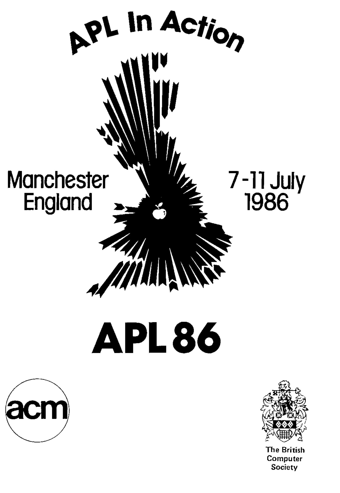
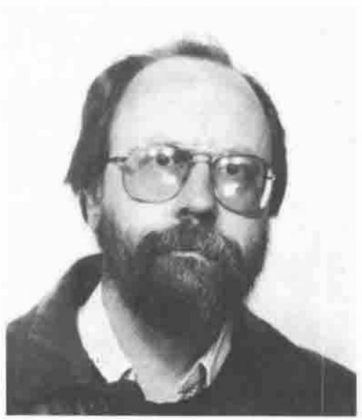
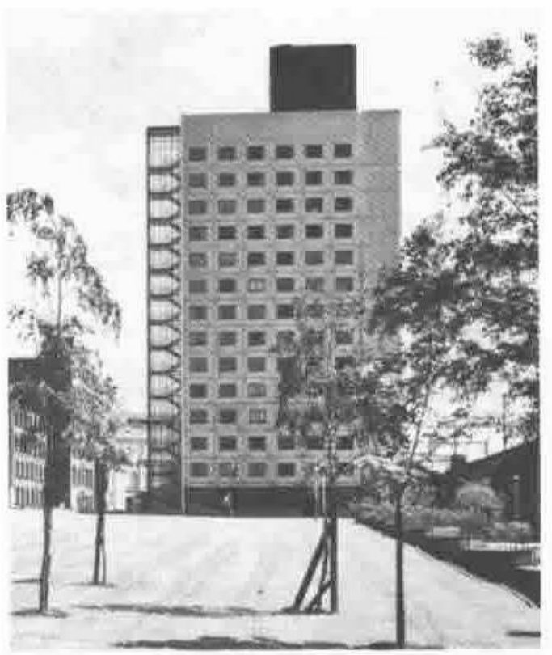

On behalf of the Organising Committee I am pleased to bring you the latest information on APL86. As our preparations become finalised we are pleased to see an attractive and informative programme taking shape – this is definitely the conference you cannot afford to miss!

Our theme – APL in Action – indicates that both the presentors of contributed papers and exhibitors will be providing more demonstrations than ever before.

Whether you are a system developer or a user, a beginner or an expert, there is much to interest you.

Bookings have surprised us by beginning earlier and in greater quantity than in previous years. If this trend continues we may sell out! Book early to be sure of your place.

I look forward to meeting you in Manchester.

**Dick Bowman** 
APL86 Chairman

### Organising Committee

| | |
|---|---|
| Chairman | **Dick Bowman**, Central Electricity Generating Board |
| Programme | **Anthony Camacho**, Consultant |
| Promotion | **Philip Goacher**, British Computer Society |
| Technical | **Dave Ziemann**, Cocking and Drury |
| Treasurer | **Mel Chapman**, North Staffs Polytechnic |
| Exhibition | **Christine McCree**, Beechams |
| Administration | **Cathy Dargue**, Tesco |
| Secretariat | **Josy Roberts**, BISL |

## Plans for APL 86

Plans for APL86 are now so well advanced that we can offer you abstracts of the contributed papers, a timetable and a description of tutorials and some invited talks.

There are a few things we can’t tell you yet – we are still finalising arrangements for invited speakers, prizes, competitions and what I suppose we should call side shows. And of course we cannot tell what new products will be launched at the exhibition.

What is APL86 going to be like? We can offer the following facts:

1. You will be able to learn more at APL86 than on any week’s professional development seminar or course. There are three full streams of activities to choose between and one stream consists entirely of tutorials.
2. You can choose what you learn. The whole conference is timed in 45 minute sessions: the lecture theatres open on to a common concourse and you can change streams at every break.
3. There is something for you in every subject that APL is used for, from stock control to typesetting, from graphics to music, from Laura Ashley to Nuclear Physics, and there are more varieties of machine and of APL than ever before.
4. You can see and hear better – the theatres have raked seating and are equipped with the latest visual aids. More of the papers will be accompanied by demonstrations with these aids than ever before; so many indeed that we have equipped two theatres with large screen BARCO colour VDU projectors.
5. All the foremost vendors of APL hardware and software are exhibiting: you will be able to see and question them for the whole week and by Friday 11 July, if you wish, you will be really well informed about what the market has to offer.
6. In addition to the Conference Proceedings (46 contributed papers out of 166 abstracts offered to us) which are full of valuable material, we intend to publish a second volume of Tutorials and other contributions. These will contain extended tutorial material and such useful things as Alan Graham’s APL2 Idiom List.
7. For our software exchange we already have offers of a row of microcomputers. Bring or send your software for any implementation of APL and a six by four inch (15 by 10 cm) advertisement for us to put on the wall and let other delegates see what things you can do with APL. Blank disks will be on sale and we will allow commercial software samples if they are free.
8. The bookstall will be run by a professional bookseller: they will handle all the APL books they have heard of and a good many rarities will also be on sale (back numbers of APL magazines, Proceedings of little-known APL conferences, private venture publications and so on). Anyone with APL books for sale please contact us.

## Invited Speakers, Plenary Sessions and Other Attractions

Our list of invited speakers is not yet final. We are still adding to it.

The conference will be opened by Dr. K.E. Iverson. His subject is “The Split in APL”. Most APLers would like to understand the differences between the enhanced versions of APL and few of us have the opportunity to find out for themselves. Dr. Iverson’s introduction will suit people who have only ever used a simple APL and those who have some experience of enhanced versions. His aim is to clarify matters so that listeners can appreciate both the theoretical basis and the practical effect of the differences (and of the different states of implementation.)

On Tuesday morning we have a panel session on “The APL Entrepreneur”. Robert deCloss and Timo Seppala are among the members of this panel which is being arranged by Romilly Cocking.

Other panel sessions are on the ISO standard, on Graphics (organised by Theo Formanek with Giorgio Faconti’s help), on Typesetting APL and on New Implementation.

On Thursday 10 July from 2 pm to 3 pm Povl Skifter, the Financial Director of Bang & Olufsen will tell us about the Bang and Olufsen Data Workshop. The APL community is sometimes a bit too inward looking. Mr. Skifter will bring us a view from the outside and tell us what benefit the Data Workshop brings to his company and why it was done in APL. His talk will be followed, for those who are interested in more of the detail, by a paper from Gert L. Moeller, who worked on the project.

There are two debates: in one Neil Mitchison will suggest that APL is not yet suitable for AI; in the other Richard Nabavi will argue that the enhancements to APL are doing nothing to help persuade more people to use it. These debates are formal arguments; they begin with a speech in favour from the proposer, and one against from the opposer. Then a seconder on each side makes a short speech at which stage the chairman will invite contributions from “the floor of the house”, in other words, the audience. The last few minutes are taken up by a summing up: first the opposer and finally the proposer, and at the end there is a vote to see whether the “Motion before the House” is agreed or not.

Our closing plenary session will be run under the chairmanship of Mr. Roy Sykes, of Whizbang fame (now Managing Director of Optimation). We are sure of a lively close to the conference under his guidance.

## A Tutorial Volume Too!

The people giving tutorials and invited speakers have all been asked to contribute some suitable text to the tutorial volume. This will be a companion to the Proceedings, but whereas the proceedings should be papers of original work, the tutorial volume can include material which is only partly new or which might have been given out at the papers presentation as a handout. We can also allow items of greater length in the tutorial volume (such as Alan Graham’s APL2 idiom list, which was too long for the proceedings).

Both the tutorial volume and the proceedings will be produced in the same format as previous proceedings.

## APL86 Timetable

### Sunday 6 July: Education Day

> A special event for those interested in APL and Education 
> A day of presentation and hands on experience on micro-computer versions of APL 
> Designed to introduce people in education to APL and APL users and persuade them that it is better than other languages both to teach and to use in teaching other subjects. 
> Details of speakers and timetable available on application.

### Monday 7 July

| | Stream 1 | Stream 2 | Stream 3 |
|---|---|---|---|
| 09.00 | | | |
| 10.30 | Registration Begins Exhibition Opens | | |
| 11.30 | Opening Plenary Session Dr. K.E. Iverson “The Split in APL” Other speakers to be announced | | |
| 13.00 | Lunch | | |
| 14.00 | Intro to APL2 Polivka | Berry/Pesch | Kee/Post |
| 14.45 | | Pesch | |
| 15.30 | Refreshment Break | | |
| 16.00 | Intro to APL2 Graham | Landaeta | Dakin |
| 16.45 | | | Barnaud |
| 17.30 | | | |
| 18.00 | Exhibition Closes | | |
| 18.00 - 19.15 | Civic Reception | | |
| 19.30 - 20.30 | Dinner | | |

> Notes on the tutorials (stream 1) and abstracts for the contributed papers (streams 2/3) follow the timetable and are listed in alphabetical order of author/speaker.

### Tuesday 8 July

| | Stream 1 | Stream 2 | Stream 3 |
|---|---|---|---|
| 09.30 | APL2 & the IC Ostling/Helgason | Thomson | Bastian |
| 10.15 | | Dorrer | McKee |
| 11.00 | Refreshment Break | | |
| 11.30 | Generalised Linear Models Sykes | “The APL Entrepreneur” | Gustafsson |
| 12.15 | | | Groner/Cook |
| 13.00 | Lunch | | |
| 14.00 | APL & Assembler on the PC Dickey | APL enhancements don’t help spread of APL - Debate | Rudd |
| 14.45 | | | Soop |
| 15.30 | Refreshment Break | | |
| 16.00 | APL/PC A P s Alfonseca/Selby | ISO Report and Panel Discussion | Searle |
| 16.45 | | | Sullivan/Fordyce |
| 17.30 | | | |
| 17.45 - 19.15 | Product Forums – The exhibition closes at 19.15 | | |
| 19.30 - 20.30 | Dinner | | |
| 20.30 - | Real Ale Evening *(For connoisseurs of the hop)* | | |

### Wednesday 9 July

| | Stream 1 | Stream 2 | Stream 3 |
|---|---|---|---|
| 09.30 | A 2nd course in APL Jaffe | Weigang | McGowan/Parker |
| 10.15 | | Christopher/Ching | Butterworth |
| 11.00 | Refreshment Break | | |
| 11.30 | APL2 & Comp Fns Latterman | Jernigan/Eisner | Naugle |
| 12.15 | Idioms - Graham | | Wiedmann |
| 13.00 | Lunch | | |
| 14.00 | APL2 & AI Brown, Eusebi and Guerreiro | | Stengl/Gfeller |
| 14.45 | | | Benkard |
| 15.30 | Refreshment Break | | |
| 16.00 | APL2 & AI Continued | Livingstone | |
| 16.45 | | | |
| 17.45 - 19.15 | Product Forums – The Exhibition closes at 19.15 | | |
| 19.30 - 20.30 | Dinner | | |

### Thursday 10 July

| | Stream 1 | Stream 2 | Stream 3 |
|---|---|---|---|
| 09.30 | Teaching Stats with APL Hawkes/students | Bernecky | Pardee/Weintraub |
| 10.15 | | Yoshino | Mayhew |
| 11.00 | Refreshment Break | | |
| 11.30 | Formanek & Graphics Panel Discussion | APL is not suitable for AI – Debate | Chua/Winton |
| 12.15 | | | Brown |
| 13.00 | Lunch | | |
| 14.00 | Plenary Session: Bang & Olufsen’s Financial Director – “Bang & Olufsen’s DATA WORKSHOP – benefits from APL” | | |
| 15.00 | APL for Thoughts & Dreams: Smith | Moeller | Alfonseca |
| 15.40 | Refreshment Break | | |
| 16.00 | Smith continued | Sandi | Brown |
| 16.45 | | McDonnell | Eusebi |
| 17.30 | | | |
| 17.45 - 19.15 | Product Forums – The Exhbition closes at 19.15 | | |
| 20.00 - 22.00 | Conference Banquet | | |

### Friday 11 July

| | Stream 1 | Stream 2 | Stream 3 |
|---|---|---|---|
| 09.30 | Howland/Feldberg & Typesetting Panel Discussion | Goldsmith | Udo |
| 10.15 | | Holmes APL Calculator | New Implementations |
| 11.00 | Refreshment Break | | |
| 11.30 | Closing Plenary Session and Award Giving Roy Sykes and a round up of APL86 Other speakers to be announced | | |
| 13.00 | Lunch | | |
| 14.00 | Farewell – Exhibition Closed | | |
| 14.30 | APL86, EuroAPL, SigAPL and other committee meetings by prior arrangement | | |

## Tutorials

Stream 1 of APL86 consists entirely of tutorials. All are given by experts in their field. Below is a summary of arrangements as they stand at the time of writing (end of March 1986).

*An Introduction to APL2 – Principles and Concepts* — Mon. Stream 1 1400 
**Ray Polivka** aims to suit the needs of people relatively new to APL. Anyone who knows a bit of standard APL should find this a splendid introduction to APL enhancements.

*APL2 by Example* — Mon. Stream 1 1600 
**Alan Graham** will pick up the thread where Ray left it and will present the power and elegance of APL2 in example after example.

*APL2 and the Information Centre* — Tue. Stream 1 0930 
**Bjorn Helgason and Kenneth Ostling** will review the features of APL2 which help in the Information Centre – component files (object library), graphic images and the use of the SQL workspace and the PC with IC/1.

*Generalised Linear Models* — Tue. Stream 1 1130 
**Dr. Alan Sykes** will demonstrate and explain the advanced software in use at the Department of Management Science and Statistics at University College of Swansea.

*APL and Assembler on the PC* — Tue. Stream 1 1400 
**Andrew K. Dickey** will explain why you might want to call PC assembler routines from APL and how to go about doing it – with examples in APL\*PLUS/PC.

*APL PC Auxiliary Processors* — Tue. Stream 1 1600 
**Manuel Alfonseca and David Selby** will explain how IBM PC APL can use Auxiliary Processors to do work the interpreter cannot handle and will deal with the uses of eleven of those currently available, including interfaces to non-APL programs, graphics, a screen handler, DOS files, the ports (and RS232 and GPIB/IEEE) and even a music interface.

*A Second Course in APL* — Wed. Stream 1 0930 
**Stephen Jaffe** submitted this as a paper: we liked it so much we asked him to give a sample rather than a paper about it. He will give guidance for non-experts in the use of multidimensional arrays and the less obvious uses of grade and scan.

*APL2 and Complementary Functions* — Wed. Stream 1 1130 
**Dieter Latterman** will explain how the power of APL2 makes many standard utilities obsolete. He will teach you how to write those utilities you still need as defined functions which behave like and can be used just like primitives, and how nested arrays are for many purposes more suitable and natural to handle than simple matrices.

*APL2 Idioms* — Wed. Stream 1 1215 
**Alan Graham’s** second tutorial was submitted and accepted as a paper but the full list of wonderful idioms was so long that we have had to put it into the Tutorial volume. In this session he will explain some of the most useful and interesting idioms on the list.

*Artificial Intelligence Using APL2* — Wed. Stream 1 1400 
The two tutorials will be given by **Ramiro Guerreiro, Ed Eusebi and Dr. James Brown** (IBM’s Chief Architect of APL2). The first part is the Fundamentals of AI (for newcomers to it) such as propositional and predicate logic, rules of inference, resolution and search strategies. Part two is about the implementation of these ideas in APL2 using nested arrays and recursive function sets. The results will be compared with PROLOG and LISP and you can have listings of the APL2 functions.

*Teaching Statistics with APL* — Thur. Stream 1 0930 
**Professor Alan Hawkes** and students will teach you some statistics and show how easy it is to convert standard formulae into APL. Some student projects may also be demonstrated if there is time.

*Graphics with APL – a tutorial and panel discussion* — Thur. Stream 1 1130 
**Theodor Formanek** will show how to do simple graphics with APL – the geometry needed and the data structures that are suitable. The lecture part will be suitable for people who have not previously used APL for graphics. This will be followed by a panel session with contributions (and we hope some demonstrations) from a number of people who have done spectacular work with APL Graphics. Come and ask them questions!

*APL A Language for Thoughts and Dreams* — Thur. Stream 1 1500 
**Phil Smith** aims to startle people out of their complacency to overcome old habits of thinking and to reveal the magic of APL to newcomers. Come and see why his sessions have such a wonderful reputation.

*How to Typeset APL (and other things)* — Fri. Stream 1 0930 
This is more than a tutorial: it is two contributed papers (from **John Howland and Ian Feldberg**) with quite different approaches to producing mixed APL and Roman text, followed by a panel discussion in which everyone concerned with printing or publishing APL will want a say – not to mention the authors.

## Alphabetical List by Author Name of All Contributed Papers to APL86

**M. Alfonseca and M.J. Tobar** — Thur. Stream 3 1500 
*Extending APL to Logic Programming* 
Abstract: The limitations that make IBM’s PC APL slow at logic programming were analysed. The best option for speeding it up was to give it an auxiliary processor with suitable logic functions. It can now compete with PROLOG. The paper also describes experience in use.

**A.M. Barnaud, B. Mailhol & Y. Le Borgne** — Mon. Stream 3 1645 
*Development of a Portable Software Product for Library Automation.* 
Abstract: The paper describes the use of APL alongside assembler and C to produce a system to meet the needs of French public libraries. It handles cataloguing, bibliographical enquiries and follow-ups on lending and acquisition. It runs on IBM mainframes and Unix machines.

**C. Bastian** — Tue. Stream 3 0930 
*The Scope of APL in Nuclear Measurements* 
Abstract: The whole range of data acquisition and analysis in experimental nuclear physics can be covered with a few APL workspaces. Typical steps in the treatment of statistical data are highlighted and compared with solutions in other languages. There is advice for APLers wishing to compete against FORTRAN.

**J. Philip Benkard** — Wed. Stream 3 1445 
*Analysis of Function Application in Deep Arrays* 
Abstract: The proposed extension suggests that arrays of functions as well as arrays of data are possible in APL2, although they are more complex. The paper examines the case of mixed function arrays and draws a parallel with the Sharp concept of function rank.

**Robert Bernecky** — Thur. Stream 2 0930 
*APL: A Prototyping Language* 
Abstract: A thorough analysis of prototyping and APL’s advantages over other languages for this task. Hierarchical and hybrid approaches to modelling systems of various degrees of complexity are illustrated with examples to show that APL makes for A Pleasant Life!

**Michael J.A. Berry and Roland H. Pesch** — Mon. Stream 2 1400 
*Style and Literacy in APL* 
Abstract: The shibboleth that APL instruction lines should be short is amusingly contrasted with the practice of many skilled APL writers. Then it is suggested that the genius of the language calls for line length to be appropriate for the task in hand and many examples are given of ‘four lines good – two lines better’ (or even one line best).

**Dr. James A. Brown et al** — Thur. Stream 3 1600 
*Logic Programming in APL2* 
Abstract: This paper explores the representation of Logic using the data structures of APL2. Some LISP and PROLOG features are translated into APL2 and developed to create a complete PROLOG-like programming environment, with an inference engine and knowledge base. Search strategies are also discussed.

**Dr. James A. Brown** — Thur. Stream 3 1215 
*Writing Multi-user Applications in APL2* 
Abstract: This paper presents a general scheme for rapid implementation of multi-user applications showing the special features of APL2 that make it suitable for this.

**Richard W. Butterworth and Robert A. Stephan** — Wed. Stream 2 1215 
*DELIS: A Decision Support System Generator for Frequency Data* 
Abstract: DELIS displays frequency data as tables or graphs on many types of display and output device. It provides query and display functions, a method of passing queries to be processed and functions for automatic analysis and response to the queries. The APL is plain VSAPL. Frequency data is extracted by PL/1 and passed to the system in APL file format.

**Wai-Mee Ching** — Wed. Stream 2 1030 
*An APL/370 Compiler and Some Performance Comparisons with APL* 
Abstract: An experimental 370 compiler works with a subset of APL chosen for engineers and scientists. The compiled code runs several times faster than the interpreter and is of about the same quality as is produced from FORTRAN. The paper explains how the front end analyses the APL dataflow to produce parse trees, graphs and tables and how such efficient 370 code is generated.

**Thomas W. Christopher and Ralph W. Wallace** — Wed. Stream 2 1000 
*Compiling Optimized Array Operations at Run-Time* 
Abstract: Some APL interpreters hold arrays as descriptors which point to a block of memory holding the data sequentially. Scalar functions therefore can be translated into machine code which has fewer loops than the number of dimensions to the array. This paper describes an analyser which constructs optimised array operations at run time from the descriptors of the arrays. The performance and results from experiments are analysed.

**Y.S. Chua and Charles N. Winton** — Thur. Stream 3 1130 
*Automated Application Programming Environment* 
Abstract: Small businesses can justify the low cost of tailor-made applications in APL if ways can be found to reduce the programming cost of the user and file interfaces. The paper offers file and screen utility functions to help solve this problem and illustrates their value and portability with an example.

**Adam Dakin** — Mon. Stream 3 1600 
*LAPLAN – A Corporate Planning Model for Laura Ashley* 
Abstract: A really complex business problem was handled by a group of APL novices and a successful system developed on a microcomputer in a remarkably short time. The detailed steps are explained. The whole is an excellent example of the strengths in APL and its value in prototyping.

**Prof. Dr. Ing. Egon Dorrer** — Tue. Stream 2 1015 
*From Tensor and Suffix Notation to APL* 
Abstract: Tensor and suffix notation reveals the simplicity and symmetry of some otherwise complicated and obscure multivariate formulae. Matrix algebra and APL normally would hide the structures of interest but the paper shows how to represent the notation in APL and the advantages and disadvantages of APL for this work are made clear.

**Ed Eusebi and Dr. James A. Brown** — Thur. Stream 3 1645 
*APL2 and AI: A Study of Search* 
Abstract: To demonstrate the suitability of APL2 for AI some paradigm AI problems are solved. They show logical inference, state space representations and other AI methods. A set of functions for searching a database of rules and facts will be explained and demonstrated. Enhancements to cater for heuristic, bidirectional and parallel search are shown.

**Ian Feldberg** — Fri. Stream 1 1015 
*TEXT: Publication-Quality Characters Come to APL Graphics* 
Abstract: TEXT is an APL workspace that creates and manipulates all kinds of characters on the screen or a plotter. It can be used with several plotting packages. Characters can be scaled, rotated justified etc. The workspace will be demonstrated.

**Martin Gfeller and Monika Stengl** — Wed. Stream 3 1400 
*Open Fullscreen Systems* 
Abstract: An open fullscreen system combines two advantages a) presenting the user with data and prompts a whole screen at a time, b) providing access to the power of APL and all the functions in the workspace. Systems can be designed which allow any command to be given whatever the current state of the system. Non-APL users can be given access to some of the same power through cover functions which become a command language like keyword APL.

**Leslie H. Goldsmith et al.** — Fri. Stream 2 0930 
*LOGOS: an APL programming environment* 
Abstract: Logos provides support to the user, developer and manager of application systems. It leads to increased programmer productivity and more robust software by providing a centralised uniform interface. Logos resides in the development workspace and looks like a small holdall containing a huge variety of tools and facilities shared in a controlled way with other programmers.

**Alan Graham** — Wed. Stream 1 1215 
*The Usage of APL2 – Common Idioms and Problem-solving Techniques* 
Abstract: This collection – a must for anyone using an enhanced version of APL – contains many examples which are shown in several forms from the fully general to those which rely on the shapes of their arguments. There is a discussion of techniques and a well annotated list of idioms.

**L.H. Groner and J.H. Cook** — Tue. Stream 3 1215 
*Modelling the Arithmetic of Statistical Distributions* 
Abstract: The paper reviews various kinds of extended arithmetic and their advantages. Statistical modelling can be approached as an extended arithmetic of distributions. An APL prototype leads to a suggestion for the result of the Quad-CR of a primitive function.

**Stig Gustafsson** — Tue. Stream 3 1130 
*Quaternions and Homogeneous Co-ordinates* 
Abstract: Real numbers, complex numbers and mathematical vectors are all special cases in the number scheme of quaternions (which are ordered quadruples of real numbers). Quaternions provide an attractive alternative to matrix methods for transformations of geometric figures – especially rotations about arbitrary axes (such as are needed by robots). APL allows easy implementation of quaternions but a hybrid between quaternions and homogeneous matrices gives the best speed of transformation.

**John E. Howland** — Fri. Stream 1 0930 
*Typesetting APL using a Macintosh.* 
Abstract: The approach described uses the Macintosh and LaserWriter to produce commercial quality printing. The PostScript notation used by the LaserWriter is explained and examples of both bit mapped and analytic characters are given.

**Stephen B. Jaffe** — Wed. Stream 1 0930 
*Topics for a Second Course in APL* 
Abstract: After the introductory course and a little experience, what do newcomers to APL need? Here is part of a syllabus for the second course. It helps with multidimensional arrays, the less obvious applications of grade and scan and the creation of better user interfaces including the process of closing an open workspace and error trapping. The presentation will be a sample of the course.

**Robert Jernigan and Arie Eisner** — Wed. Stream 2 1130 
*A Generalised Data Base Interface for APL* 
Abstract: By the provision of a function through which all database calls are made it becomes possible to link APL with several different proprietary databases. Only subfunctions invisible to the APL programmer vary according to the database in use. The generalisation that made this possible is described. The system has been in use for over two years at John Hopkins University.

**H. Clark Kee and Roy L. Post** — Mon. Stream 3 1400 
*Manufacturing Resource Planning on a PC Local Area Network* 
Abstract: Eight work years and $150,000 of hardware (12 PCs and a network with a 137 megabyte file server) make an astonishingly cheap and efficient modular construction for this system – its specification looks like a job for a large mainframe. Many micros make light work – APL is quite fast enough – the most heavily loaded unit is the file server. A comprehensive account full of lessons for people wanting similar cost effective results.

**David Landaeta** — Mon. Stream 2 1600 
*A Notation for Manipulating Arrays of Operations* 
Abstract: How should arrays of operations be incorporated into APL? This paper combines and builds on earlier suggestions and proposes to extend strand notation, to allow ‘orders’ of operation with ways of stepping between order levels and to extend the use of jot to allow niladic operator calls.

**D. Livingstone** — Wed. Stream 2 1600 
*The Integration of Relational Database Algebra into APL* 
Abstract: Instead of linking databases to APL (which involves inconsistencies and loss of generality), this paper proposes that APL is enhanced by the addition of relational database primitives. A relation would become a special case of generalised arrays. The paper concludes by proposing ways to improve machine efficiency in the use of such extensions.

**E.E. McDonnell** — Thur. Stream 2 1645 
*A Perfect Square Root Routine* 
Abstract: This is an example of the use of APL as a prototyping language to design and test algorithms for use in other languages. Here it is used on the method now incorporated into Sharp APL for calculating square roots. The problems of binary representation and how to minimise the inaccuracy in the result are explored. Some fascinating problems arose and were resolved in the testing of the method (“perfect” because the method is as accurate as the representation allows).

**J.E. McGowan and D.J. Parker** — Wed. Stream 3 0930 
*Medium Term Forecasts of Half-Hourly Power Demand* 
Abstract: A new forecasting methodology was developed and implemented in APL to provide these forecasts from records of demand by category, date, time, outside temperature etc. The system can estimate the effect of changing one or more of the variables and can display the results graphically.

**Terence J. McKee** — Tue. Stream 3 1015 
*APL in Quality Business Management* 
Abstract: The paper amusingly shows how people are accidentally misled by graphs and statistics and gives advice on how to avoid such pitfalls. The data may be accurate but care needs to be taken (guidelines provided) if the decision to take remedial action is to be correctly made.

**Loren B. Mayhew** — Thur. Stream 3 1015 
*Increasing Productivity with ISPF/APL2* 
Abstract: Interactive System Productivity Facility provides a consistent way for users to edit, browse, create and delete datasets. It deals with things a screen or ‘panel’ at a time. The paper explains how to use ISPF from APL2, so giving users the environment they are used to and greatly shortening the process of providing the user interface. Live examples will be demonstrated.

**Gert L. Moeller** — Thur. Stream 2 1500 
*A Logic Programming Tool for Qualitative System Design* 
Abstract: This paper describes the boolean geometrical representation of rules for expert systems. The method is used to simulate the reactions of complex television and audio products to user commands. Ideas for new features can readily be tried out and designs refined to improve ease of use and eliminate snags. The techniques have been used to develop Bang and Olufsen products.

**Richard L. Naugle** — Wed. Stream 3 1130 
*APL Compilation and Interpretation by Translating to F83VEC* 
Abstract: A way of overcoming APL’s slowness or excessive memory usage is to translate the appropriate functions into another language. This paper considers one such method using a version (F83VEC) of reverse polish FORTH extended to use the APL character set and demonstrates the improvement in speed dramatically.

**Professor Otway O’M. Pardee** — Thur. Stream 3 0930 
*Checkpoint – Restart for APL Applications* 
Abstract: APL programs can be made proof against crashes arising from external causes such as communications or equipment failure, if there is a reliable file system. The method is called ‘check point and restart’ and can easily be applied to any APL code and tuned for the best balance between protection and cost.

**Roland H. Pesch** — Mon. Stream 2 1445 
*Empty Frames in Sharp APL* 
Abstract: The rules for deriving the shape of the result from the shape of the arguments (and the function to be performed) are not reliable in the “empty frame” case when the shape of an argument contains a zero. Some functions return results programmers don’t expect and dislike. Ways of overcoming the problem are reviewed and assessed.

**Jack Rudd** — Tues. Stream 3 1400 
*APL Graphics Representation and Analysis of Space-based Observations* 
Abstract: APL can process three dimensional data and produce views from space of the earth against a background of stars showing the line between day and night. Shuttle flights and 3D terrain maps are also shown. The paper describes techniques for deriving 3D models from multiple 2D satellite observations. Examples will be displayed in colour.

**Claudio Sandi** — Thur. Stream 2 1600 
*Generalised Arrays and Shortest Path Problems* 
Abstract: The paper presents an analysis of the classical “shortest path” problem using three different methods implemented both in VSAPL and APL2. APL2 is shown to provide a substantial improvement in run time for this type of problem, and particularly for one class of algorithm.

**John R. Searle** — Tue. Stream 3 1600 
*Iota3: the Integration of Lotus Spreadsheets and APL* 
Abstract: The paper describes a software system which integrates Lotus 123 and Symphony with APL. It allows spreadhseet users access to some of the power of APL and APL users to hold a spreadsheet as an extension of the workspace. APL\*PLUS/PC and IBM APL PC experience is described.

**Karl Soop** — Tue. Stream 3 1445 
*Bringing Graphic Dialogues to APL* 
Abstract: This paper proposes a canonical representation for pictorial data and a picture processor. These make picture processing easy to incorporate into the interaction between the user and the machine even for complex graphics. Experience with an APL2 prototype is described.

**Gerald A. Sullivan and Kenneth J. Fordyce** — Tue. Stream 3 1645 
*Extending Worksheet Modelling Software with Expert System Technology* 
Abstract: This is a description of a tool called Automated Ledger Book, which is a worksheet model generator with an equation manipulating expert system and a natural language interface. It can answer ‘what if’ questions and give justifications for its responses. The system will be demonstrated.

**N.D. Thomson** — Tue. Stream 2 0930 
*APL2 – A Mathematician’s Delight* 
Abstract: APL has always claimed to be suitable for mathematics and to help the understanding of mathematical ideas. The APL2 enhancements have increased the affinities between APL and mathematics in many delightful ways, some of which are outlined in this paper.

**M. Udo et al.** — Fri. Stream 3 0930 
*Japanese APL Language System on IBM Multistation 5550* 
Abstract: APL’s problems with an extended character set are insignificant compared with those of languages that need a range of characters that cannot be represented within a byte per character. This paper describes how the 10,000 Kanji characters were incorporated into IBM PC APL. The method could be adapted for other languages with large character sets.

**Jim Weigang** — Wed. Stream 2 0930 
*Machine Oriented Languages in the APL environment* 
Abstract: To enable APL to compete in efficiency with other languages we need a way to specify the machine operations in detail. The functions that use most time can then be optimised. APL itself is not ideal for this, as the paper explains. It then shows what is needed to make compiled functions available in a workspace and describes experience with several methods, including a language specially designed for the job (TABL).

**David M. Weintraub** — Thur. Stream 3 0950 
*Assertive Comments in APL Programming* 
Abstract: This proposal suggests that instead of describing what code is intended to do, comments should assert the current state of relevant variables at critical points in the code. This is shown to match the design method that many APLers use, which works from desired result to functions.

**Clark Wiedmann** — Thur. Stream 3 1215 
*Field Results with an APL Compiler* 
Abstract: This is a report on users’ experience with an APL compiler, as gained from case studies. It deals with how long it takes to learn to use the compiler, how much faster processes run, how much extra development effort it takes, what parts of the workspace should be compiled and how the cost of compile time compares with the savings in run time.

**Matsuki Yoshino** — Thur. Stream 2 1600 
*APL as a Prototyping Language: Case Study of Compiler Development Project* 
Abstract: APL’s advantages for such work are its conciseness, its excellent debugging and modelling facilities, the great power of enclosed arrays and the simple interface between the workspace and outer environment provided by shared variables. The strategy used is to write prototype functions in APL and by several steps to convert from high level APL to low level Pascal. The benefits of this approach are evaluated.

## The Software Exchange

At APL86 there will be a forum where delegates can meet to exchange software. For each item of software offered one advertisement may be displayed in the Exchange. Whilst there is space available we will accept advertisements for samplers or commercial software as well as privately owned software. The only condition is that there is to be no charge.

A number of microcomputers (mainly IBM PCs) will be available and these may be booked in advance. There will be a full time attendant to make bookings and to assist delegates.

The Software Exchange will be open during exhibition hours (except when required for any demonstrations).

We aim to have enough machines to allow every delegate participating in the Exchange sufficient time to copy the software they want. We will have a supply of very reasonably priced floppy disks, in case you need extra.

There will be no restriction on what is offered, except that it should be useful to APLers. Bring along a single, elegant function or a raft of graphics pictures, public domain music or a complete stock control workspace. The more you bring the better the Exchange will be – and what might you find to take back with you? Here is your chance to show the world what you can do with APL.

Please Note: The Exchange is not available for copying software for sale. 
Piracy and selling code are prohibited; persons caught attempting either will be debarred.

## The Exhibition

The exhibition area is on two floors: on the concourse between the lecture theatres and on the floor below, next to the bar. The two floors are connected by a broad open staircase.

We have extended the exhibition area and already have more than thirty stands booked – the exhibitors include all the major APL vendors.

| | Stands | Exhibitors |
|---|---|---|
| Upper Floor | C1 - C3 | MicroAPL |
| | C4 - C6 | Cocking & Drury |
| | C7 | Mercia Software |
| | C8 - C9 | Dyadic Systems |
| | C10 | Analogic |
| | C11 - C20 | STSC |
| Lower Floor | B1 | Bookstall |
| | B2 | Ampere |
| | B3 - B4 | I P Sharp |
| | B5 | BCS – British APL Association |
| | B6 | ACM |
| | B7 | APL87 |
| | B8 - B11 | IBM |
| | B12 | APL People |

You can be sure that all the exhibitors will be doing their best to interest you and show you their latest and best products.

The exhibition will be open the whole time during the conference, so there will be plenty of time to look at everything that takes your fancy. Anyone who attends APL86 can come away well informed about all the latest products from the main vendors.

For detailed expositions, and particularly for new and enhanced product launches, there are Product Forums. These are half hour presentations by vendors in the lecture theatres from 17.45 on Tuesday, Wednesday and Thursday. The schedule of Product Forums will be announced at the conference.

## How to get to APL86

Manchester lies at the heart of the United Kingdom. From it radiates a vast network of air and surface routes, both national and international.

**By Air:** Manchester’s international airport is the principal airport in the UK outside London. International flights are available to many parts of the world on the services of the large number of international airlines operating from the airport.

For APL86 delegates travelling from Europe, direct flights link Manchester with Belgium, France, West Germany, Italy, Ireland, The Netherlands, Scandinavia and Switzerland. Direct flights are also available to Canada and the USA.

Regular shuttle flights run between London Heathrow and Manchester to extend considerably the number of destinations that can be easily reached.

Buses linking the airport to the air terminal in central Manchester stop quite near the UMIST campus.

**By Rail:** With two Inter-City rail terminals, Manchester connects with all parts of the UK. For example, London is only two and a half hours away.

Discount fares are available to all delegates travelling to APL86 by train, and application forms will be sent to those who request them.

By taking advantage of cheap, daily return fares, accompanying persons can use the Inter-City rail network to travel to many interesting towns and cities – even to shop in London’s West End.

**By Road:** Motorways give fast and speedy access to Manchester from almost any part of the country. There are direct connections to Scotland, the North, London and the South East with links to the East and West coasts, including the main channel ports.

The motorway spur linking Manchester to the main M6 motorway will bring APL delegates very close to the UMIST campus. Local maps will be supplied to those wishing to drive to the conference.

Please indicate on the booking form which form of transport you will be using so that we can send the appropriate information.

**British Airways:** The official airline for APL86 can help with group travel and fly/drive schemes, allowing delegates to spend a few days sightseeing before or after the conference. Contact British Airways for further information. A list of local British Airways offices is given on the following page.

### British Airways Offices

The following are British Airways Offices that will be able to help to arrange your travel to APL86. Please call or write to the manager of your nearest office to see what he can offer you.

AUSTRALIA 
33 King William Street 
Adelaide (Tel 2117566) 
243 Edward Street 
Brisbane (Tel 2211599) 
330 Collins Street 
Melbourne (Tel 6023000) 
140 St Georges Terrace 
Perth (Tel 3225011) 
64 Castlereagh Street 
Sydney (Tel 2335566)

AUSTRIA 
Mr Strelka, Karntner Ring 10 
Vienna (Tel 657691)

BELGIUM 
Mr Van Wezer 
Centre International Rogier 
9th Floor, Brussels 
(Tel 02/2194220)

BRAZIL 
21st Floor, Avenue Rio Branco 108 
Brazil (Tel 021 800 6926 
or 242 6020 local)

CANADA 
1021 De Maisonneeuve West 
Montreal (Tel 2879282) 
60 Bloor Street West 
Toronto (Tel 5952500) 
1012 West Georgia Street 
Vancouver (Tel 112 800 2688090)

DENMARK 
Vesterbrogade 2 
Copenhagen (Tel 01146000)

FINLAND 
Mr Raymond, Keskuskatu 7, 4th Floor 
Helsinki (Tel 650677)

FRANCE 
91 Avenue des Champ Elysees 
Paris (Tel 7781414)

WEST GERMANY 
Mr Keil, Friedenstrasse 1 
Frankfurt (Tel 250121)

GREECE 
10 Othnos Street 
Athens (Tel 105 57)

HONG KONG 
Jardine Airways, Alexander House 
Chater Road, Kowloon (Tel (5) 775023)

IRELAND 
112 Grafton Street 
Dublin 2 (Tel 686666)

ISRAEL 
59 Ben Yehuda Street 
Tel Aviv (Tel (03) 229251

ITALY 
Mr. Guglietmetti, Via Bissolati 48 
Rome (Tel 479991)

JAPAN 
Mr Terashima, Sanshin Building 
Yurakucho, Chiyoda 
Tokyo (Tel 03 214 4161)

MEXICO 
Mr Sanchez, Edifico Alber 
Paseo de la Reforma 322 
Mexico City (Tel 525 9133)

NETHERLANDS 
Mr Hage, British Travel Centre 
Hirsch Building, Leidseplein 
Amsterdam (Tel 229333)

PORTUGAL 
Avenida da Liberdade 23/37 
Lisbon (Tel 360931/4)

SOUTH AFRICA 
Anglo American Life Centre 
2 St George’s Street 
Cape Town (Tel 252970) 
NBS Building, 300 Smith Street 
Durban (Tel 3044741) 
Nedbank Mall 
145 Commissioner Street 
Johannesberg (Tel 331-0011)

SPAIN 
Gran Via 68, Madrid (Tel 2475300)

SWEDEN 
Mr Shaw, Norrmailmstorg 1 
Stockholm (Tel 08/2339000)

SWITZERLAND 
Mr Stevens, Talacker 42 
Zurich (Tel 2114090)

USA 
530 5th Avenue 
New York (Tel 212 687 1600)

## Accommodation

**UMIST:** Accommodation in the halls of residence on the campus at UMIST has been included in the delegate and accompanying person fees. Rooms are available for the duration of the conference only (6-10 July inclusive) and consist of single study bedrooms with washbasin. Shared bath/shower and WC facilities are available on each floor – usually serving four rooms.

Also included in the fees (both delegate and accompanying person) are all meals from the evening of Sunday 6 July to lunch on Friday 11 July. A cold buffet will be available for those arriving late on Sunday 6 July. All residents have access to kitchen facilities (tea/coffee provided) and to communal TV lounges.

A limited number of twin rooms are available (conference rate per person) and these will be allocated on a first come, first served basis. A full guide to the campus will be provided with confirmation of booking.

**Hotel Supplement:** Delegates wishing to stay at one of the nearby four-star hotels will be charged a supplement in addition to the conference fee. Please note that this charge is to supplement the amount allocated for accommodation in the conference fee. The rates per room, per night are £50 for a double/twin room and £36 for a single room. This price includes breakfast, private bath, telephone, colour TV, tea and coffee making facilities and VAT at 15%. Extras, such as drinks are settled with the hotel directly. These rates also apply to accompanying persons.

Hotel bookings must be made before 7 May, after which time delegates must make their own hotel arrangements.

Please indicate on the booking form if you wish to book a hotel.

**Facilities:** All delegates and accompanying persons will be entitled to use the UMIST sports facilities during the week of the conference. Automatic membership of the campus bars also applies.

## Registration Information and Terms

**Registration:** Delegates are requested to register as early as possible using the enclosed Registration Form. A separate form is required for each delegate – please photocopy the form as required. Completed forms together with payment in full should be sent as soon as possible to:

> Conference Department (APL86) 
> The British Computer Society 
> 13 Mansfield Street 
> London W1M 0BP, England
>
> Telephone 01-637 0471

**Fees:** Reduced fees are available to delegates holding membership of any of the following: British APL Association (BAA), British Computer Society (BCS), SigAPL and the Association of Computing Machinery (ACM). The rates in pounds sterling are:

| | | Before 6 July | On-Site |
|---|---|---:|---:|
| Delegate | – Member | 345.00 | 373.75 |
| | – Non-Member | 373.75 | 406.50 |
| Accompanying Person | | 181.25 | 210.00 |
| Banquet (Accompanying Person) | | 20.00 | 20.00 |

Delegate and accompanying person fees include accommodation at UMIST and all meals from the evening of Sunday 6 July to lunch on Friday 11 July. In addition, the delegate fee includes attendance at conference sessions, access to the exhibition areas, conference documentation and attendance at the conference banquet. All fees are inclusive of Value Added Tax at 15%.

**Payment:** All fees are due with the application and must be in £ sterling. Cheques should be drawn on a British clearing bank and be made payable to the ‘British Informatics Society Limited’. Confirmation of the booking will be sent to each delegate along with relevant maps and instructions. Early payment discounts will apply according to the date of the postmark on the envelope in which the application has been sent.

Payments still outstanding after 11 July will be subject to a 5% surcharge.

**Substitution:** A registered delegate may nominate a substitute providing that the conference office is informed no later than 4 July 1986. The amount of fees then due is according to the eligibility of the substitute, who will be invoiced for any difference owing.

**Cancellations:** Cancellations will be accepted only if received in writing not later than 6 June 1986. A 10% handling charge will be deducted from any refund.

**Programme:** The Organisers reserve the right to make changes to the advertised programme.
