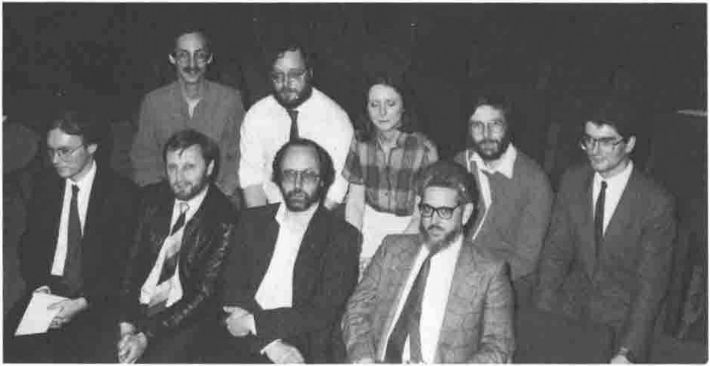
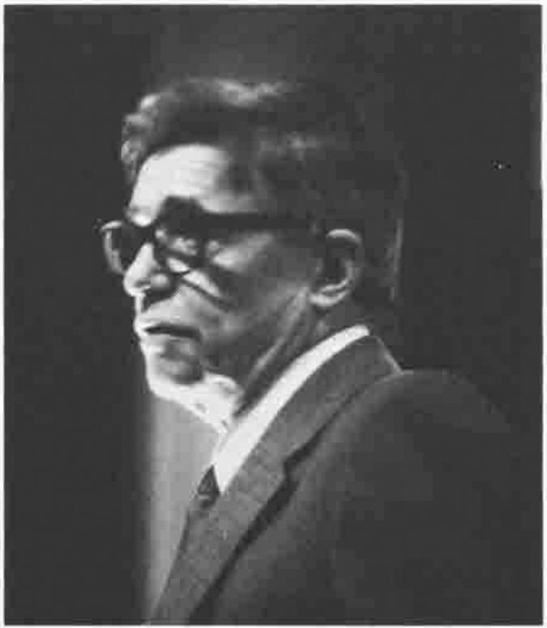
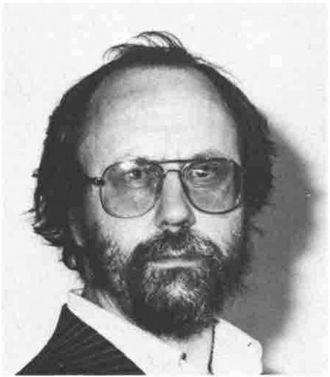

*compiled by David Preedy*
{ .byline }

## Treasurer’s report

The maintenance and administration of the Association’s membership database has now become the total responsibility of the treasurer. It is hoped that by having direct control over the system, rather than using a ‘middle man’, we will be able to provide a more efficient and responsive service to the membership.

At the same time it is intended to control VECTOR distribution more closely so that members will not receive copies of the journal until they are fully paid-up for the current year. Please ensure that you do not suffer this fate by forwarding the 1986-87 subscription without delay. Otherwise this may be the last VECTOR you see!

It is not intended to issue membership cards for the current year - nor for that matter for last year! Clearance of your subscription cheque should serve as acknowledgement of receipt of payment. Any members who require a formal receipt should enclose a stamped addressed envelope with their cheque.

As a consequence of the Data Protection Act, any member may request that his name and address be removed from the Association’s database. Any member wishing to do so should contact the Treasurer in writing.

*(Ed: At the A.G.M. the treasurer gave an interim statement of the Association’s report and accounts for 1985/86 - the final figures are awaiting exact costings and receipts for VECTOR volume 2, number 4. The final report and accounts for 1985/86 will be published in the next issue of VECTOR.)*

## HMW Programming Consultants Ltd.

The Association are pleased to welcome HMW Programming Consultants as the latest company to join the growing ranks of our sustaining members. Unfortunately they have joined too late to submit an entry to our regular *News from Sustaining Members* column in this issue, but I am sure they will have lots of news for us in the next issue.

In case you want to conatct them before their address is emblazoned on the back cover of the next VECTOR, their address is:

> Ken Jackson,  
> HMW Programming Consultants Ltd.,  
> 142 Feltham Hill Road,  
> Ashford, Middx.,  
> TW15 1HN.  
> Tel. 07842-41232

*9 members of the new committee at the Royal Overseas League:*

*Back row:* David Ziemann *(Technical)*, Roy Tallis *(Activities)*, Christine McCree *(Recruitment)*, David Preedy *(Journal)*, Gerard Paul-Clark *(Publicity)*

*Front row:* David Eastwood *(Projects)*, Mel Chapman *(Treasurer)*, Dick Bowman *(Chairman)*, Anthony Camacho *(Secretary)*

*Ken Iverson talking to the BAA on "The split in APL"*

*Dick Bowman - re-elected chairman*
