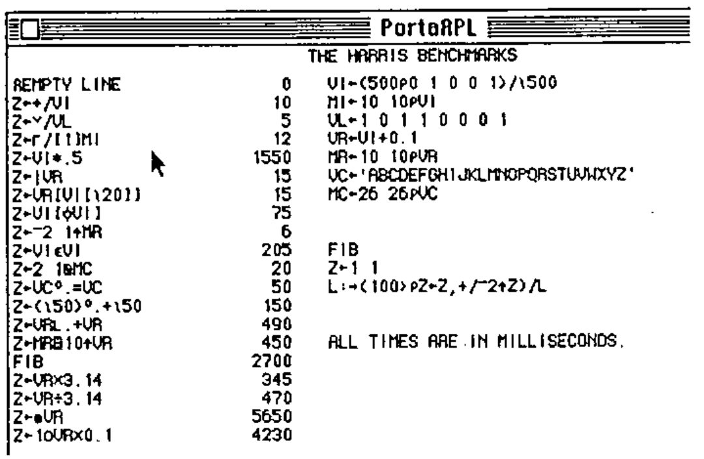
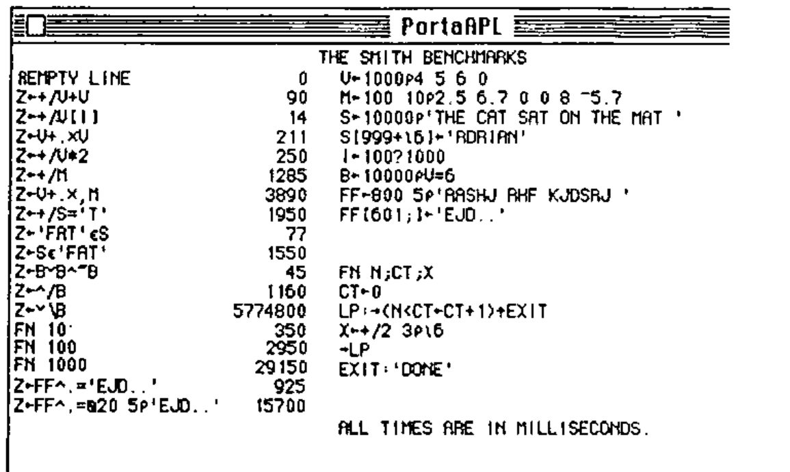
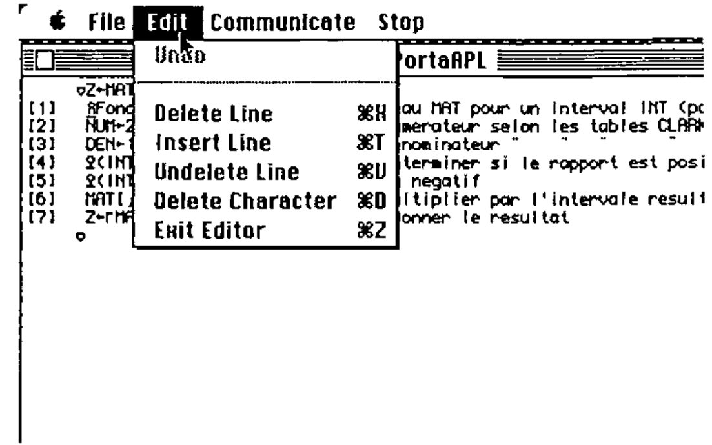

*reviewed by Normand R. Montour*
{ .byline }

## Introduction

The Apple Macintosh computer has many features which could attract the inveterate APL user: its simplicity, highly interactive concept and a somewhat “futuristic” approach to Data Processing. It was lacking the only element which could make the APLer happy: APL.

The Portable Software Company of Cambridge, Massachussetts, has remedied this situation. The PortaAPL interpreter is a lean, efficient and attractive package both with regard to the Macintosh and to APL. One already sees the horrible spectre of comparison showing its benchmark on the horizon. Being of a lazy nature, I felt that the wheels which were invented by others could turn just as well for me, so I decided to use two benchmarks previously presented in the April 1985 issue of VECTOR by Adrian Smith and David Ziemann. The latter was using what have become known as the “Harris” benchmarks.

## Benchmarks

In the Harris/Ziemann benchmarks, PortaAPL performed extremely well and the vendor uses those benchmarks as a demonstration/marketing tool. I do not include here the findings of Mr. Ziemann, since most readers can refer to their issue of VECTOR.

It is only when I started to execute the benchmarks devised by Adrian Smith for the IBM PC that I found a slight performance problem in the “scan” operator:

I have already reported the problem to the vendor and I do not believe this problem will linger very long. The other benchmarks, however, show that PortaAPL compares quite advantageously to other APL interpreters.

## APL on the Macintosh

Once past the benchmarking obsession,we can consider the real beauty of a product such as PortaAPL. The Macintosh offers some excellent user interface tools: the Mouse, pull-down menus, windowing, and a very “solid” user interface. PortaAPL makes intelligent use of all these features plus a few more, including interfacing to other Macintosh products such as MacPaint, MacWrite (through the clipboard) and QuickDraw.

The file system is adequate, vaguely similar to the VAX/APL system (see reference 1), but with the unfortunate restriction of limiting the access method to a sequential file system. All primitives are supported including a few extensions. The PortaAPL interpreter does not offer a Nested Array facility, but this will hopefully reach the mind of the product designers. The most interesting feature of their file system is to access the Macintosh mini-finder from defined functions; this allows the user to select and open files and to choose the disks on which these files reside.

My main reason for buying a Macintosh instead of a more traditional computer of the IBM type was to relieve me of my day-to-day computerized job and to enjoy the plain and simple pleasure of a good and servicable tool to help me with writing music, composing love letters and developing my house floor-plan. I can very well see PortaAPL helping me make a musicological analysis program or getting me involved in the study of cryptography. The Macintosh is a very “visual” machine, and PortaAPL provides all the necessary functions to allow APL to take full advantage of those “visual” features.

The PortaAPL sound generation is very primitive and it does not allow any control of the advanced functions of the built-in Macintosh sound synthesizer. Polyphony is not available, nor is shaping of envelope, timbre and reverb. Other Macintosh applications already use these admirably, so it is regrettable that PortaAPL provides so little access to them.

## Full-screen editor

The full-screen editor is substituted for the Del editor. It can edit functions and character arrays. The use of the Mouse and pull-down menus makes it very efficient and one can learn to live without sophisticated functions such as those provided by VM/SP’s Xedit (and its popular interfaces to APL thanks to Norman Brenner – see reference 2). The twelve-fingered APLer may choose the clutch-shift-ctl-alt-esc-key editing style in lieu of the Mouse and menu operations.

The character set is crisp and clean, and no modifications are necessary to either keyboard or circuitry to obtain the proper APL characters for both display and printer (I used an Apple Imagewriter). Character arrays are edited using the `⎕ED` system function.

## Usage and Feel

The PortaAPL interpreter “feels” very solid and the addition of little details such as “double-clicking” a workspace into the active workspace reveals the Macintosh dimension into the user interface. There is also a communications/terminal emulator mode which I was not able to test, but which seems to provide an adequate means of using host APL resources. The documentation is well written with plenty of examples and illustrations (all of which were drawn on the Macintosh). The supplied workspaces provide some cover functions for the most complex processes and usability functions for control of Mouse, files and external interfaces (Quickdraw, communications, etc.). Most of the other APL features are present, such as Trace and Stop, diamond, and a comprehensive set of System Variables and System Functions adapted either for the Macintosh or for the vendor’s own flavour of APL. Comments are allowed on the right-hand side of the program and blank lines within functions are ignored. User-defined operators are not available.

PortaAPL also provides the ability to `)EXPORT` and `)IMPORT` workspaces to and from other systems.

## Summary

Although it still contains a few bugs (which most APLers could circumvent anyway), PortaAPL is a very promising package because it opens a whole world of possibilities for the APL authors to spread their ideas in the Macintosh community, and to the Macintosh users to have access to the immense library of applications that were developed in APL during the golden years of Host Programming. I invite my fellow Iversonians to test drive this interpreter and to feed me comments. Perhaps we could even start a PortaAPL special interest group within the British APL Association. Anyone interested can contact me at:

> Informaticien, [address omitted]

PortaAPL is available from Portable Software, 60 Aberdeen Ave., Cambridge, Mass. 02138, USA.

## References.

1. *VAX-11 APL Reference Manual*, DEC, Maynard, Mass., December 1982.
2. *Editing APL objects using CMS XEDIT*, by Norman Brenner, ACM APL84 Conference Proceedings, June 1984.
