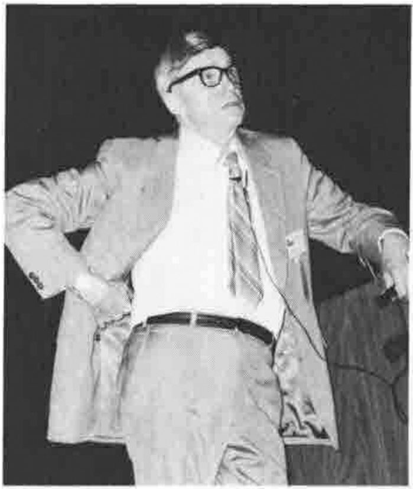
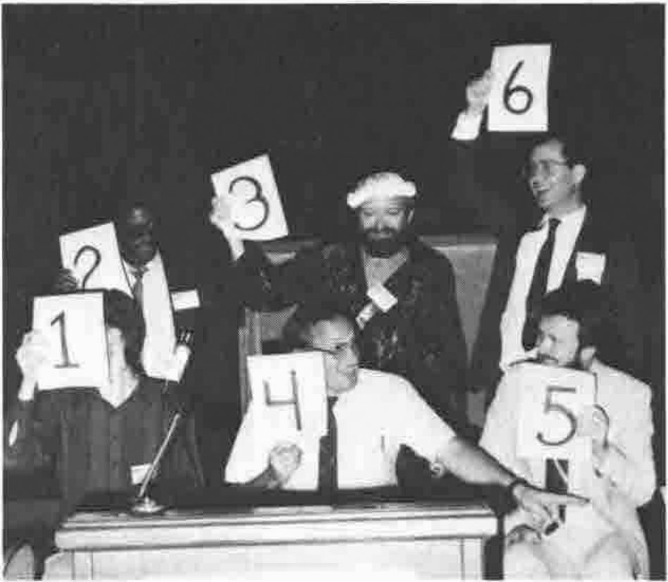
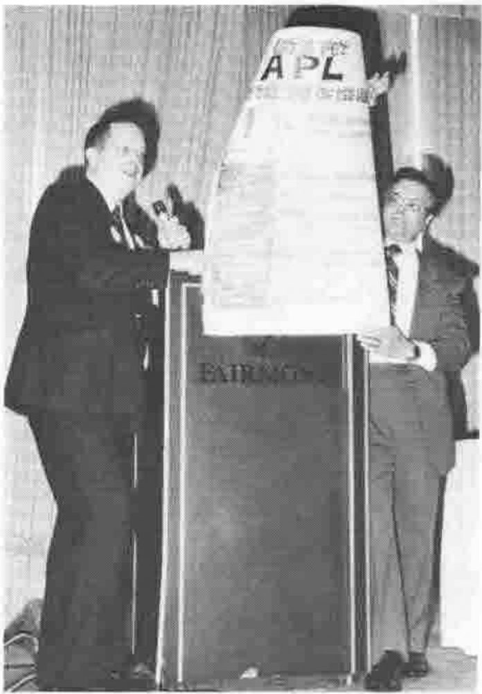
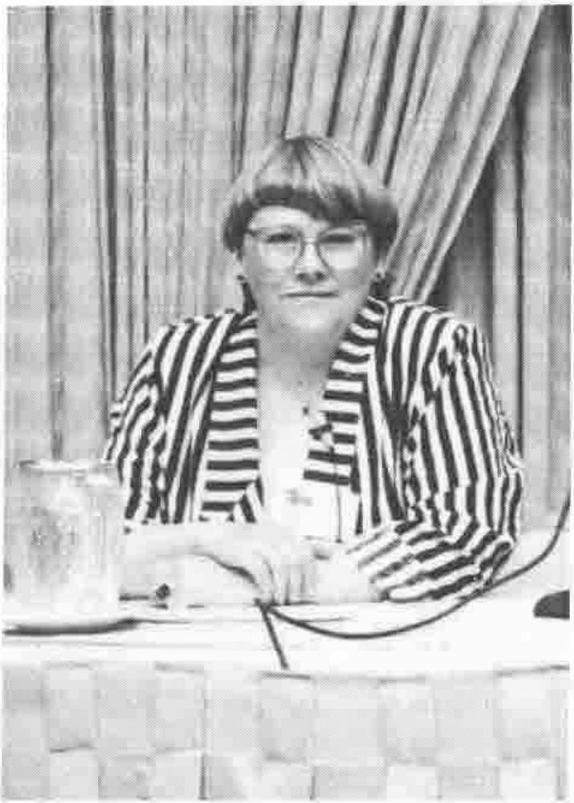
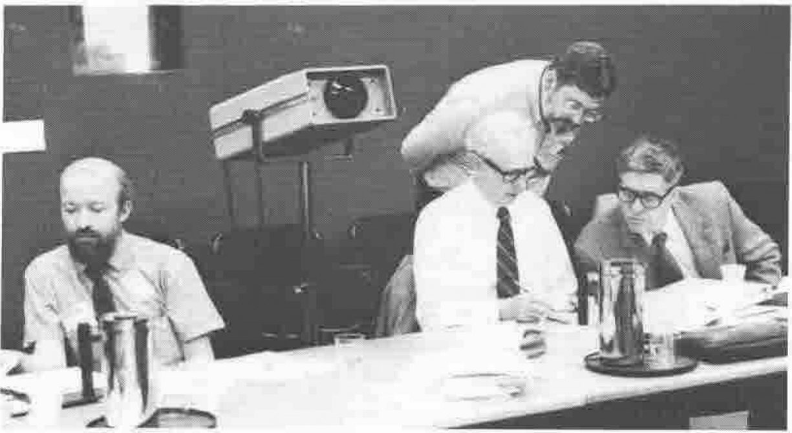
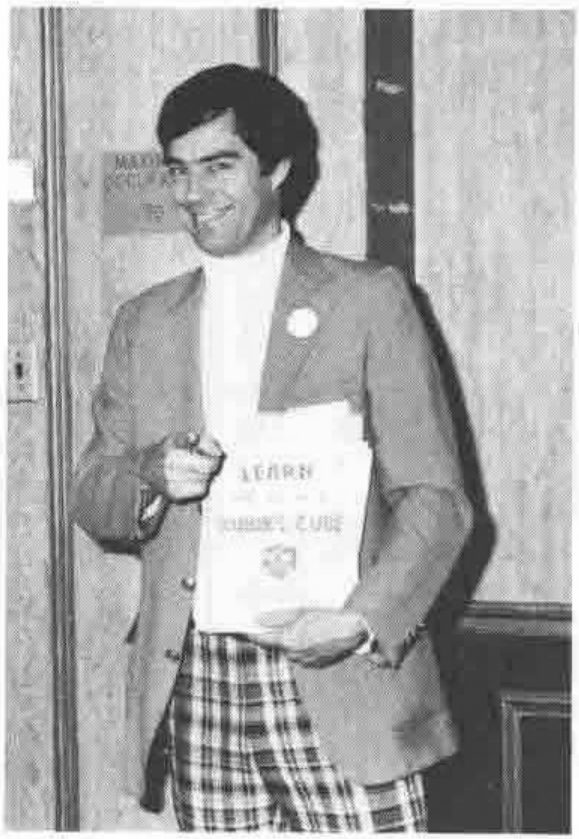
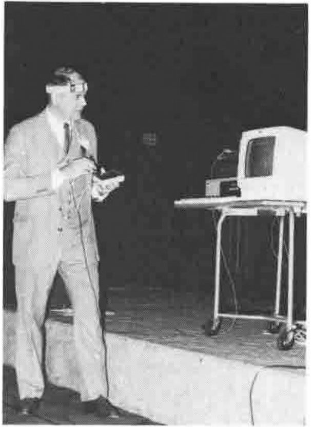
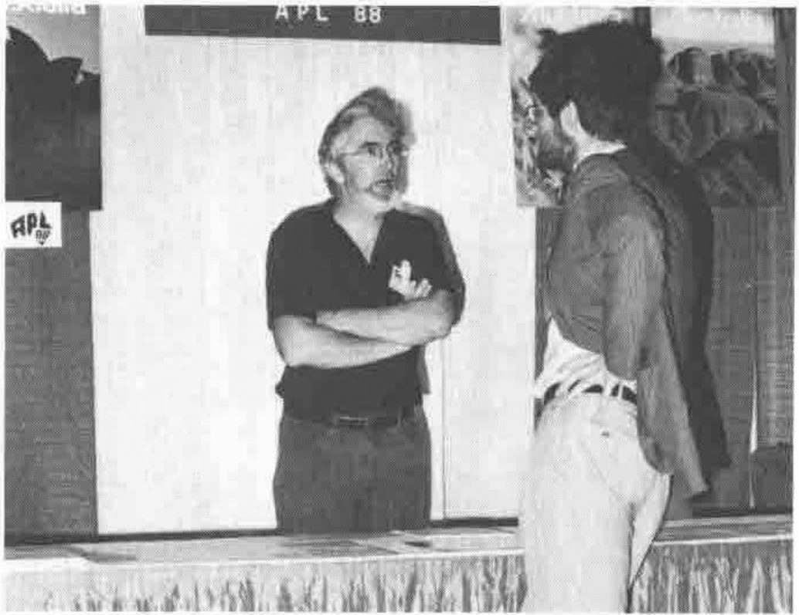
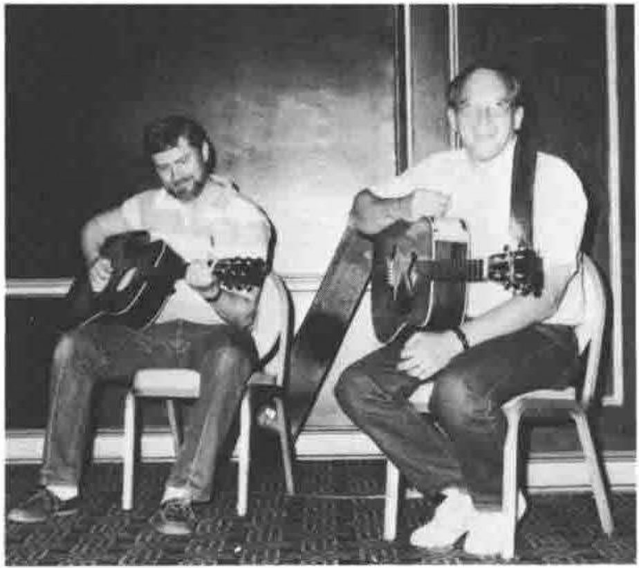
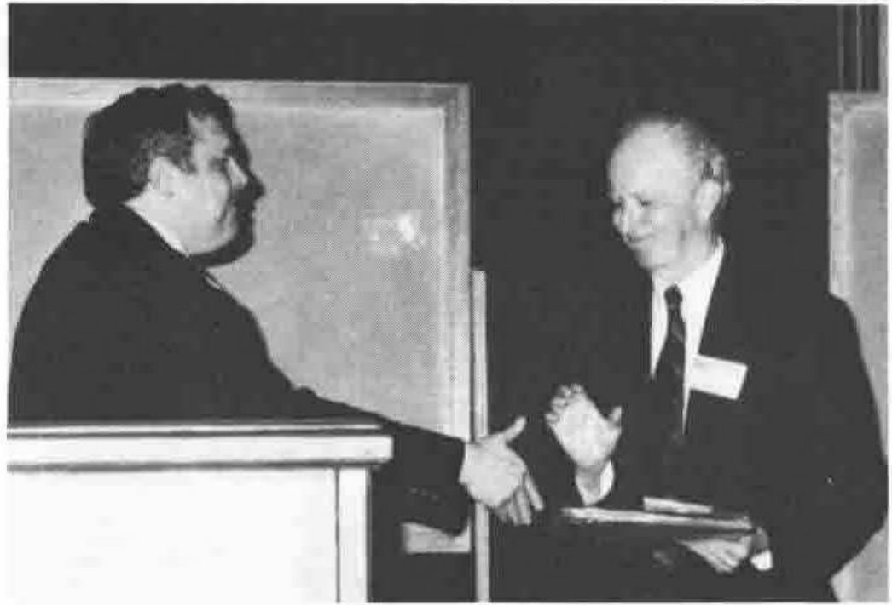

## Some of David Ziemann’s photographs from Dallas

Ken Iverson
{ .caption }

2=Carl Moore, 3=Bob Bernecky, 4=Jim Brown and 5=Cory Skutt – apologies to 1 and 6
{ .caption }

Ed Cherling helped by John Carpenter “Lets put APL top of the heap”
{ .caption }

Gitte Christensen
{ .caption }

Bob Bernecky, E.E. McDonnell, Bob Smith and Ken Iverson at the ISO meeting before APL 87
{ .caption }

Prof. Howard Peelle
{ .caption }

Phil Smith demonstrating computer control by neural link
{ .caption }

Neville Holmes and a booking for APL 88 from Paul Chapman
{ .caption }

Skip Cave and Jim Brown at one of the I-APL benefit concerts they organised
{ .caption }

John Myrna congratulating E.E. McDonnell on winning the SIGAPL outstanding achievement award
{ .caption }
