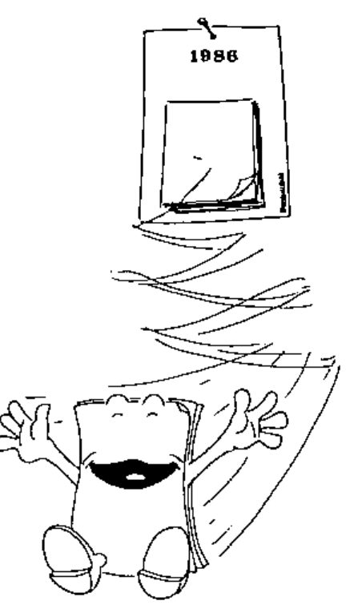
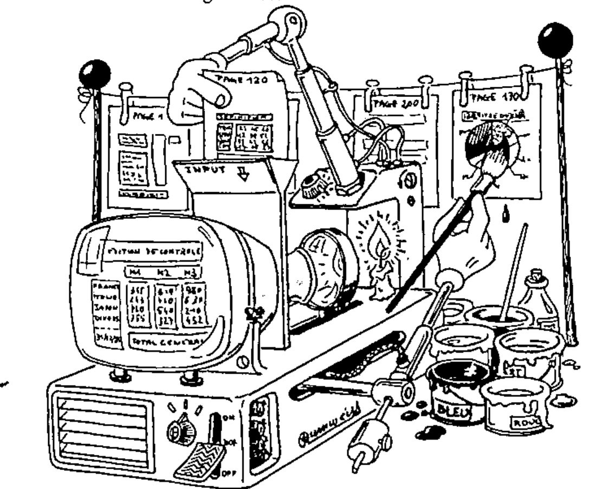

## Book Review

**APL et GDDM; travail en plein ecran**

**B Legrand**

*reviewed by Adrian Smith*
{ .byline }

### Introduction

The first thing to say about this book is that it is in French!! The second thing is that it really doesn’t matter; the cartoons and the APL are readable in any language, and the French bits would cause few problems to even the most rusty of O-level scholars. Consequently I shall forget the language barrier entirely, and concentrate on the content and presentation of the material.

Basically, it takes you through GDDM-style screen handling ‘from the bottom up’. For some reason, IBM make it terribly hard for you to do this yourself. It is not that the AP126 interface is intrinsically hard to use; rather that the relevant documentation is split over several different manuals, many of which (e.g. the ‘bible’ of the GDDM Programmer’s Guide) ignore APL altogether. As I remember it, it took me several days to track down and cross-reference the necessary documentation, before I could even begin to follow the trail which M. Legrand has opened up with his book.

*Comment lire les brochures IBM.*
{ .caption }

Under the most appropriate heading ‘Mise en Garde’, the author compares the action of the IBM routine SETCURSOR with his own ‘hand-built’ function:

> “ . . . . voici la liste de fonctions qui sont indispensables au positionnement du curseur par cette technique:
>
> SETCURSOR ASFCUR BOX 
> ERRSTOP GDDNT0 GDDM 
> GDDMANALYZE MESSAGE 
> QREPLACE XBLANKS
>
> Bien entendu, certaines de ces fonctions ne sont appelés qu’en cas d’incident, mais ce sont quand même plus de 75 instructions qui sont ainsi nécessaires au fonctionnement de SETCURSOR.
>
> A titre de comparison, notre fonction ECURS n’a que deux instructions, et la totalité de notre jeu d’utilitaires compte 100 instructions seulement.
>
> Toutes les autres instructions representent un surcout inutile”

I love that final phrase “un surcout inutile”. What’s more I really don’t believe you could translate it, and I rather hope no one is daft enough to try!!

### Who should read this Book?

To be fair, you probably do need at least a smattering of French. However having seen the mess that the translator made of M. Legrand’s previous book I would stick firmly by my view that no translation is infinitely superior to a bad one.

Basically, if you want to write clean efficient full-screen applications, you should take a deep breath, )DROP 1 FSDESIGN and invest a few pounds of your company’s money in this book. It won’t by any means take you all the way, but it will at least show you where to start, and the cartoons will keep you amused along the way:

*Libération d’une page.*
{ .caption }

The topics covered begin with basic GDDM concepts, working from the page, up through formats, and then to fields within each format. Simple functions are used throughout to illustrate the concepts, and M. Legrand is very thorough in his treatment of such detail as the position of field attributes. He also points out most of the pitfalls, such as the so-called ‘numeric input’ field type; this rejects the APL minus, but accepts any old rubbish like ‘2 . 3 . . 4’ as valid. He rightly rejects it as useless.

### Reservations

So far so good, but there have to be some reservations. My main worry is that a little knowledge is a dangerous thing. The functions in this book will get you going with a good basic understanding of GDDM; they are not the basis of a fully fledged application development system. On the other hand the IBM supplied routines are an absolute disaster area and almost anything would be an improvement. M. Legrand suggests that you use the IBM routines for screen design (where efficiency doesn’t matter) and progressively replace the screen-handling routines with your own code.

You can start with the basics (such as his example of setting the cursor) and the savings in CPU should be more than enough to spur you on. It sounds reasonable enough, but if you have more than a few dozen workspaces to look after you have set yourself some nasty upgrade problems. You may also find yourself at the end of the book with a half-baked system and a nasty question mark hanging over your maintenance commitment.

Finally, there is no mention at all of graphics. Most IBM sites will surely have PGF running alongside GDDM, and the interface from APL is again straightforward, and fits in well with M. Legrand’s approach. I seem to remember quoting my PIECHART function in a previous Vector; I think it was 4 lines, of which the first two were comments!

### Summary

For some time, I have been puzzled by the ‘accepted fact’ that GDDM is not an efficient way of handling the screen from APL applications. I had never even looked at the IBM routines, beyond the most cursory glance at the code. M. Legrand has cleared things up considerably; it is not APL-GDDM that is inefficient – it is the way the IBM routines go three times round the houses to get there!

COMMENT FONCTIONNE GDDM
{ .caption }

If you are serious about using APL in ‘real’ systems, you need someone in your organisation who will get right down to the nitty-gritty of GDDM at the lowest level. M. Legrand’s book is the start that person needs; if he needs to go further he is (as indeed I was) on his own. Never mind; ‘APL et GDDM’ will have more than paid for itself by then.
