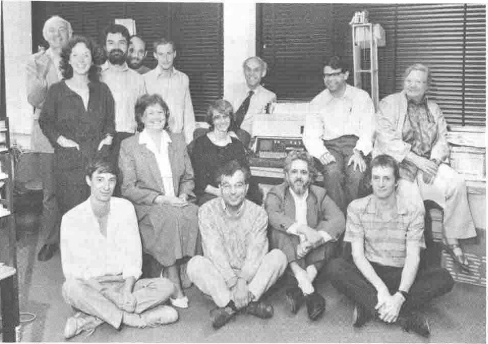

*by Pauline Hawkes*
{ .byline }

'APL is the language for mathematicians'. 'If you have to communicate with computers, choose the language you use with care'. 'Why go on using steam engines when the electric motor is to hand?' Remarks like these, and being married to a dedicated APL user, made me want to know more. When I learnt that an APL course for teachers was to be run at King Alfred's College, Winchester, I grasped the opportunity gratefully. The course was sponsored by the British APL Association with the intention of helping to spread the use of the language, which is still almost unknown among teachers, even after 20 years, to large numbers of young people in schools, colleges and at home.

This will be made very much easier with the release of I-APL this year. This is a public domain interpreter which should run on a wide variety of small microcomputers of the kind typically found in schools and in the home, such as the BBC, Atari, Spectrum, etc. The only cost to the user will be the price of a disc and some documentation. You will be able to make as many copies as you like. However, there is still the task of convincing teachers.

Few people in schools and colleges have even heard of APL, and the reaction of most of those who have is 'Oh, yes, it is a very mathematical language.Too many symbols for us, we need something more practical that can be used in business studies or science, etc.'. Well, it is excellent for doing mathematics and this should be encouraged. However, it has a much wider application, and is used particularly for important decision support systems in most of our major companies, where an odd symbol never shows its face. This kind of use should also be brought home to teachers and pupils, but using a rather different approach through practical case studies using supplied software.

Thus it was that I found myself, one of fourteen people from the world of education, in delightful surroundings which I would have loved to explore. However, the intensity of the four-day course, which went on late into the evenings, permitted little respite. It was reminiscent of cramming for finals. Fourteen proved to be a reasonable number in terms of getting to know each other and the level of supervision the course tutors were able to offer. A larger group would certainly have had severe hardware problems. Despite the small number there was an amazing variety of teachers from public and comprehensive schools, a tertiary college, sixth form college, college of higher education, a university and polytechnics. Also there were two people from county education advisory services, one in mathematics and one in computing. Geographically we came from as far afield as Newcastle and Swansea as well as the home counties. Mostly we were mathematicians with only limited computing experience, or computer specialists with limited mathematical training. The few well versed in both disciplines survived the best and astounded the rest by how much could be achieved in such a short space of time with such a powerful tool as APL.

The team of tutors, led by Norman Thomson, consisted of John Durran and Anthony Camacho, supported by his wife Sylvia. The course was primarily aimed at the use of APL in teaching mathematics, although some felt they would have liked more emphasis on uses in teaching other subjects. The presence of guest speakers Paul Barnetson, Matt Taub and Mike Kingston from IBM was very welcome, and it was particularly interesting to hear about applications in business and engineering, such as analysing customer files, costing the construction of a housing development, and the problems of magnetic coatings on tapes and discs. A versatile language indeed! The lecturers were excellent and their enthusiasm infectious. The support they gave each other was admirable: team teaching at its best.

Perhaps some of us were as sceptical as our colleagues when we first arrived. However, after a memorable four days we shall never be quite the same again. At times we felt a bit overwhelmed by the intensity of the course, the power and breadth of a language which can achieve so much so concisely and with such elegance. An important factor for us was to discover that APL has an intellectual attraction, and it is fun. What better recommendation for its use in education? Why struggle with the one-step-at-a-time complexities of BASIC, PASCAL, COBOL etc., which are usually matters of boring, trivial detail, when the power, logic and eloquence of APL is at hand? APL has sparked off a new interest and enthusiasm for computing in those of us who had previously found computing dull.

Lectures and two excellent videos were interspersed with exercise sessions, although the latter proved too short for most of us. We will have more sympathy for our own students in future when they fail to complete their assignments on time. The exercises needed to be more carefully graded. It is difficult to cope with unusual new symbols and concepts while trying to solve fairly hard mathematical problems. We needed a lot of simple problems at first to boost our confidence in assimilating the APL vocabulary and grammar. The overall effect was a little too much detail too fast for most of us to master confidently. It is clear that some of us should have studied more thoroughly the tutorial notes sent to us beforehand; however this had not always been possible. We felt also that it would have been useful to have some discussion about uses in the classroom.

The course achieved its main purpose of giving us a broad feel of APL in a short space of time and encouraging us to go away and learn more. The documentation supplied was excellent and will keep us going for quite some time. In varying degrees we were all converted to APL, and while I doubt if many of us would rush off and immediately start teaching a course ourselves, most of us now feel inclined to encourage the introduction of APL into our own educational environments. One young lady will be able to do so using an old but working IBM 5110, donated by the Decision Analysis Unit at LSE, which she won for her establishment by an eloquent plea on their behalf. The rest of us eagerly look forward to getting our I-APL interpreter. The only real criticism concerned the hardware. The variety of machines and especially the keyboards, some incorrectly labelled with APL symbols, caused quite a bit of difficulty, while one machine per person would have been ideal.

The advent of GCSE makes this an ideal time to introduce APL into schools. The investigative approach encouraged in these new examinations is ideally suited to the use of APL for experimenting with mathematical ideas and for the ease with which statistical data can be explored. One course member, a computer scientist, was a little worried that APL would encourage bad habits, i.e. programming at the keyboard and the 'try it and see' approach. Mathematicians, on the other hand, would see this as one of the attractions! It is quite simply the best way to do mathematics on a computer, and is a potential motivator in the classroom as well as enabling self-taught high achievers to go a long way. The statistics student can explore in detail real data instead of performing routine calculations on artificially simplified data. A big advantage is that APL has a very low threshold, which should enable even quite young children to do something interesting. And yet it also has a very high ceiling which provides a challenge to the highest intellect.

In conclusion, I would like to express the grateful thanks of the participants to the BAA, those behind the development of I-APL, and above all the course lecturers for all the hard work that went into introducing us to APL in a style and at a price we could afford. I hope that similar courses will be run at other locations around the country, perhaps with the formation of local interest groups. If the new 'freeware' interpreter can be made available in significant numbers, and with the right promotion, I expect that, as with the BASIC expansion, the children will soon leave the teachers far behind. We wish the project every success.

Pauline Hawkes

Swansea Tertiary College

