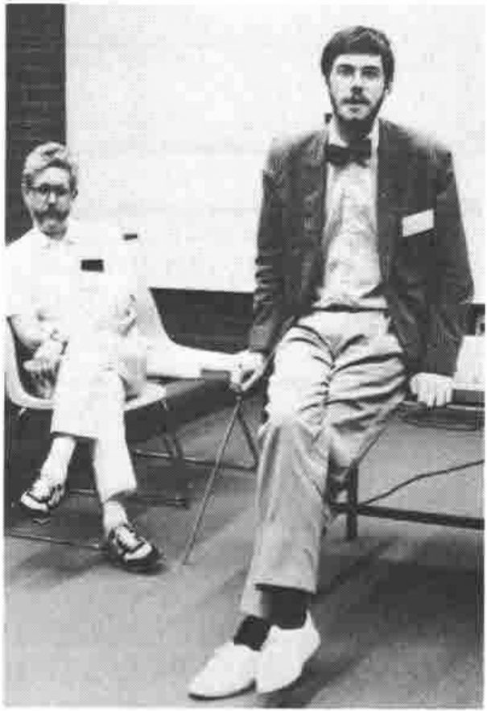

*by Anthony Camacho*
{ .byline }

The AGM of I-APL Ltd was held in public in the school of Architecture in the Wilkinson building, Sydney University, Australia on 2nd February 1988. Directors present were: A J Camacho, H A Peelle, D M Ziemann, S M Camacho, P G H Chapman and L Alvord. Apologies were received from E M Cherlin. There were several interested spectators.

### Report

1. As this is the first AGM there were no minutes to be read.
2. The company was incorporated on 30 September 1986. The articles of association were available for inspection there and until 8 Feb in room 3224 of International House.
3. The draft accounts were presented to 31 January 1988. It is intended to have the company's financial year end on 31 March 1988 which is why the accounts are not final. The total of donations is £21,951.57 of which £20,700 has been spent on programming and £825.81 on disks, printing, bank charges etc. There are outstanding cheques for £2,920 to pay for printing the I-APL Encyclopedia, Tutorial and Instruction Manual and there are several hundred pounds of expenses which project members will claim and some minor items of freight and mailing to pay for. Overall the project will be about £1500 overdrawn by Feb 29 and when/if the VAT on the programming can be reclaimed, £1,200 in credit. Products have been priced so that we will recover their cost when two thirds of the stock is sold.

The Chairman's report was as follows:

I am glad to report that the project has had a successful 17 months. Paul Chapman's I-APL/PC port is now available with an instruction manual, a Tutorial thanks to Norman Thomson and Linda Alvord and an APL Encyclopedia thanks to Garry Helzer. Ports to several other machines are well advanced; in particular:

| | |
|---|---|
| R C Piccoline | Kim Andreasen |
| BBC 'B' & Master | Tony Cheal |
| Acorn Archimedes | Tony Cheal |
| Sinclair QL | Tony Cheal |
| Amiga | David Angier |
| CBM 64 | Andrew Baillie |
| Microbee | Ian Shannon |
| CP/M (generic Z80) | Paul Woods |
| Unix | Paul Chapman |

We do not have recent details of the status of the ports to the other machines.

*Anthony Camacho and Paul Chapman at the AGM of I-APL*

We have at least two more books in course of preparation (by Tama Traberman edited by Norman Thomson and by Linda Alvord). We need help with porting and promoting APL to educational institutions.

It was recorded that Norman Thomson had resigned from the board of I-APL as soon as there was any danger of a conflict of interest with his terms of employment at IBM and that Paul Chapman and Linda Alvord had agreed to join the board.

The report, the provisional accounts and the changes to the board were accepted nem. con.
