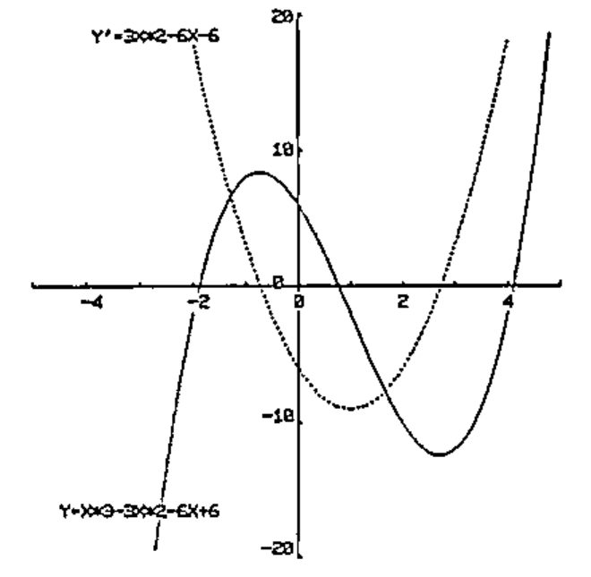
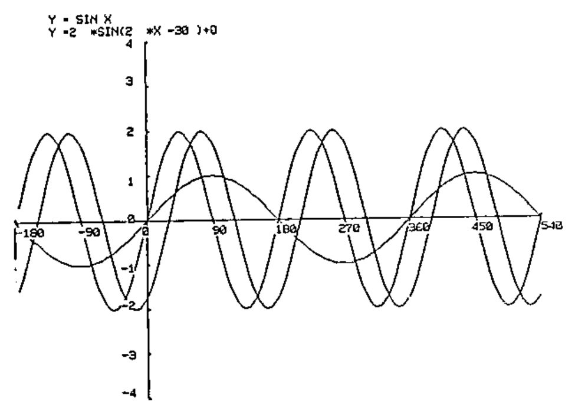
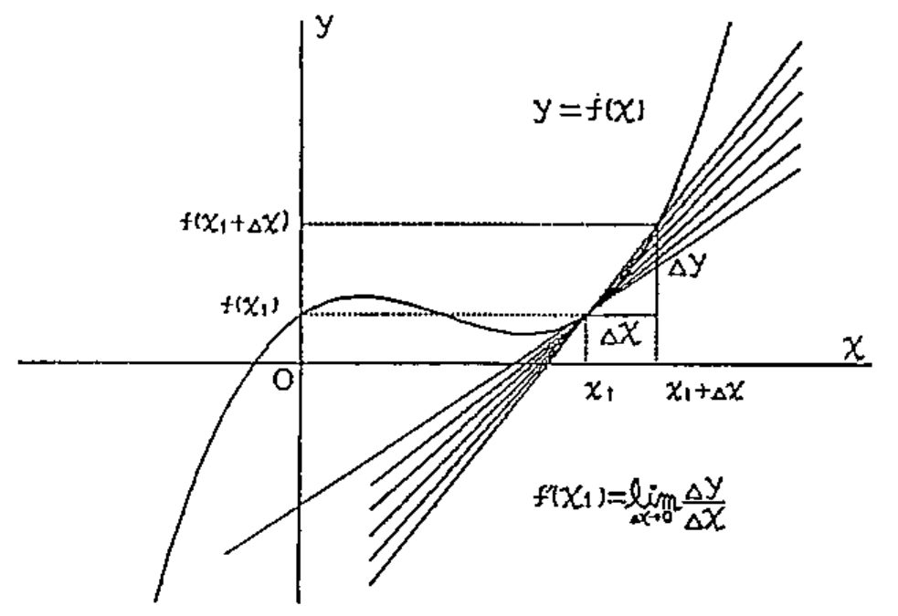
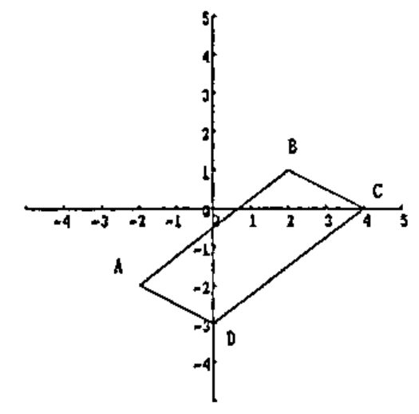
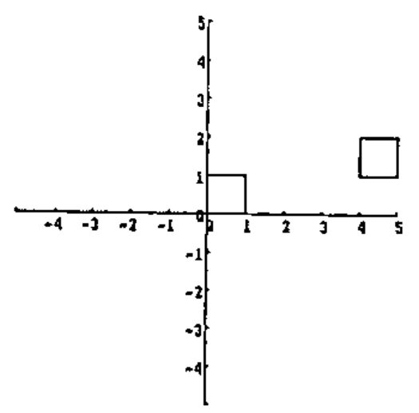
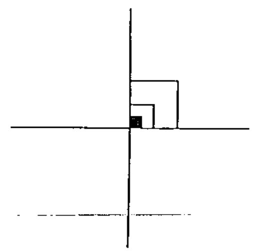

*by Makoto Kikkawa*
{ .byline }

Makoto Kikkawa arrived in Sydney with some superb material to illustrate her paper; she used some of this to accompany the talk she gave to the teachers on Education Day. The following is an edited version of her printed notes: it is a pity that current technology is still not cheap enough for us to reproduce her slides and colour printed overheads. They were of magnificent quality, but they also illustrated in the most direct way that children can produce inspired work if competently taught and given flexible tools.

## APL in a Japanese High School

Good afternoon, ladies and gentlemen, I am very happy to be with you here to tell you what my fellow teachers and I are doing in using APL at Shokei Jogakuin Senior High School in Japan.

First of all, I would like to tell you about the current situation in the use of APL in Japanese high schools. I must confess that it is a very poor situation. 93% of Japanese high schools own computers of some sort, but 51% of these schools own only one computer. Among them as much as 79% are using only BASIC machines. Only half of the computer-equipped high schools use the system for subject instruction. There are some disturbing factors in the use of PCs for subject instruction. The biggest problem lies with the teachers.

In Japan only Miyagi Prefecture high schools use APL for math instruction and are trying to develop educational materials for APL-assisted math classes. 44 math teachers from 33 schools out of 106 in Miyagi Prefecture established the Computer Study Group of the Society of Mathematics Education in 1970. They have a meeting once a month to study APL and exchange information to develop educational materials in APL. Their contribution includes making text books such as "APL Text" and "Computer Assisted Mathematics: Elementary Analysis" and the presentation of papers to the parent Society.

Shokei Jogakuin is one of the most active members of this group. The school began offering math classes using computers in both regular and elective courses in the early 1970s. In 1982 we shifted the system from FORTRAN to APL. Since then we have been working on the system very effectively, especially in using APL graphics. This was the turning point in the use of computer education in Shokei. Currently 15 personal computers are used with a ratio of 3 students per machine in regular classes, and a ratio of 1 to 1 in elective classes. At present, teachers are working on a formula manipulation system with APL graphics for their classes.

| School Year | All Mathematics Courses:<br>Required Subject | All Mathematics Courses:<br>Elective Subject | hrs/<br>week | Computer Related Education:<br>Contents | Textbook | hrs/<br>year |
|---|---|---|--:|---|---|---|
| 1st year<br>(Ages: 15-16) | Math 1 | | 5 | Introduction;<br>Visit Computer center | 0-1: Illustrated Introductory Computer Guide | 1<br>4<br>(half day) |
| 2nd year<br>(Ages: 16-17) | Elementary Analysis | | 4 | Using graphics to teach math concept | Computer Assisted Mathematics: Elementary Analysis | 20 |
| | Math 2 | | 4 | | None | est. |
| | | Basic Math | 2 | | None | 0 |
| 3rd year<br>(Ages: 17-18) | Algebra and Geometry | | 2 | Using graphics for linear transformation | None | 5<br>(est.) |
| | Math 2 | | 2 | Statistics | None | 8 |
| | | Differential Integral Calculus | 3 | | None | 0 |
| | | Math 1 | 3 | | None | 0 |
| | | Basic Math | 3 | | None | 0 |
| | | The Computer | 2 | Learning APL and Drawing graphics | APL TEXT<br>Graphics in APL | 70 |

*Curriculum Table*

The curriculum is divided into 3 major fields for the use of APL in the classroom.

1) An introduction to computers for all freshmen.

2) Using APL in math classes.

3) Using computer graphics by both teachers and students.

Every year before the summer vacation we have given our "Introduction to Computers" seminar to all freshmen. They are introduced to the computer system at our school, watch the video tape "Computer", talk about the textbook "0 and 1: An Illustrated Introductory Computer Guide" published by Shokei, and see computer demonstrations. During the summer vacation teachers take interested students and their parents to the Computer Centre of Miyagi Prefecture.

I will show you what we are doing during these introductory lessons. Using the iota function we show them the speed and memory of the computer, which is characteristic of computers in general. Using the domino function we show them how we can solve simultaneous equations with the computer.

```apl
      ⍳100
1 2 3 4 5 6 7 8 9 10 11 12 13 14 15 16 17 18 19 20 21 22 23 24 25 26 27 28 29
      30 31 32 33 34 35 36 37 38 39 40 41 42 43 44 45 46 47 48 49 50 51 52 53
      54 55 56 57 58 59 60 61 62 63 64 65 66 67 68 69 70 71 72 73 74 75 76 77
      78 79 80 81 82 83 84 85 86 87 88 89 90 91 92 93 94 95 96 97 98 99 100

      A←⍳100
      A×A
1 4 9 16 25 36 49 64 81 100 121 144 169 196 225 256 289 324 361 400 441 484 529
      576 625 676 729 784 841 900 961 1024 1089 1156 1225 1296 1369 1444 1521
      1600 1681 1764 1849 1936 2025 2116 2209 2304 2401 2500 2601 2704 2809
      2916 3025 3136 3249 3364 3481 3600 3721 3844 3969 4096 4225 4356 4489
      4624 4761 4900 5041 5184 5329 5476 5625 5776 5929 6084 6241 6400 6561
      6724 6889 7056 7225 7396 7569 7744 7921 8100 8281 8464 8649 8836 9025
      9216 9409 9604 9801 10000

      +/A
5050
      +/A×A
338350
```

2\) Using ⌹ (domino) function

(1) \(2x - y = -1\), \(2x + 3y = 12\); \(x = 1\), \(y = 2\)

(2) \(3x + 2y = 7\), \(x + 4y = 9\); \(x = \frac{9}{8} = 1.125\), \(y = \frac{13}{4} = 3.25\)

(3) \(3x + 2y - z = 20\), \(x + y - 2z = 4\), \(4x - 2y - 3z = 14\); \(x = 6\), \(y = 2\), \(z = 2\)

```apl
(1)   A←2 2⍴3 2 1 4
      A
3 2
1 4
      B←7 9

      B⌹A
1 2

(2)   A←2 2⍴2 ¯1 2 3
      A
2 ¯1
2  3
      B←¯1 12

      B⌹A
1.125 3.25

(3)   A←3 3⍴3 2 ¯1 1 1 ¯2 4 ¯2 ¯3
      A
3  2 ¯1
1  1 ¯2
4 ¯2 ¯3
      B←20 4 14

      B⌹A
6 2 2
```

Students' responses are very quick. When we presented such a demonstration one of the students said "Why do you give us these problems when the computer can solve them?" At that time she was having a hard time solving the same problems by herself in the math lesson. Another student remarked "That computer is an impertinent fellow even though it's no human".

When using APL in math classes we teach them only the few APL symbols necessary to solve problems. For example we use APL for a 3rd year statistics class involving 4 class periods; it is a study of the heights of students. The 1st period is used for naming data, input and assignment to memory. Then the data is expressed as a matrix and is sorted. In the 2nd period the students obtain data characteristics such as: number of subjects, maximum, range, sum total, mean, standard deviation. In the 3rd period they study how to make random numbers and how to make a sample of student heights using random numbers. The 4th period is dedicated to getting the frequency distribution program and using it, the students getting the frequency distribution of actual heights and of heights simulated with random numbers. For these lessons the students have to learn only 7 symbols.

In the 3rd year in the elective "The Computer" class, APL itself is taught. Teachers use a text "APL Text" which was published in 1980 by the Computer Study group.

While teaching APL we have found some problems. First, in APL the order of execution is from right to left. This feature is completely different from the order of calculation with which the students have been familiar since their childhood. Accordingly, if teachers do not clearly tell students that the execution order is based upon the idea of composite functions they often make mistakes such as:

```apl
3 × 4 - 5   >>>>   (5 - 4) × 3
```

Secondly APL employs unusual notations. I will show you an example. Matrix product is expressed:

```apl
AB   >>>>   A+.×B
```

but AB is not a matrix product in APL, A x B is the product of respective elements.

Third is index origin, which should be taught to be 1 in the same way as the origin of natural numbers. However, when the teachers say this origin is changeable some students think it is changeable to numbers other than 1 or 0. Accordingly,

```apl
5 6 7 8 ......15   >>>>   ⎕IO←5
```

and then try iota 11.

The most important use of computers in our school is APL graphics for teaching mathematics. We have set our computer beside a blackboard and the graphics are displayed on a 26-inch TV screen. At any time teachers can illustrate problems from elementary analysis or algebraic geometry. The advantages are great: static math concepts become dynamic images and theoretical expressions become real pictures. Linear transformations of matrix data used to involve so many calculations that only the simplest examples could be used; but the computer can display linear transformations quickly and easily. As a result, students are able to understand difficult problems and concepts unexpectedly fast when using APL graphics. In other words, APL has great value as a tool for displaying math concepts.

Here is a graph of \(Y = X^3 - 3X^2 - 6X + 6\), and its derivative \(Y' = 3X^2 - 6X - 6\)



This shows parallel movement of a sine curve:

    Y = sin X, Y + 2 sin 2X and Y = 2 sin (2X - 30degrees).



This explains the concept of a tangential line. For explaining differential calculus, the concept of a tangential line can be most effectively explained by the continuous movement of the lines.



After several such lessons, students expressed the wish to do the same kind of graphic work. The teachers realized that this would be of great help in studying math. The students' creation of their own graphics is certainly a good exercise in the algebra and geometry that they have already learned in the classroom. It is mainly in "The Computer" class that students start learning APL and then doing their own graphics work.

With the help of fellow teachers I wrote "Graphics in APL" for students to use in working on graphics. This is a hand-written text of 50 pages specially-designed for personal computers (IBM JX). Students learn how to use standard commands or standard methods such as movement of patterns, transformation of patterns, animation and so on.



```apl
      A    B   C   D    A
D←5 2⍴¯2 ¯2 2 1 4 0 0 ¯3 ¯2 ¯2

      D
¯2 ¯2   ←--- A
 2  1   ←--- B
 4  0   ←--- C
 0 ¯3   ←--- D
¯2 ¯2   ←--- A

(data matrix)

DRAW D  ←--- Execution
```

For example, in making a pattern I first tell them to draw the desired pattern on graph paper to find all the pairs of co-ordinates of its points. Then, using the rho function, the pattern can be described in an n x 2 matrix. The numbers on the right show the input data used here.

### Movement of Pattern



```apl
V←5 2⍴0 0 1 0 1 1 0 1 0 0

      V
0 0
1 0
1 1
0 1
0 0
      ⍴V
5 2
```

Value of movement<br>
x ----> 4, y ----> 1

```apl
    V           (⍴V)⍴4 1           V+(⍴V)⍴4 1
0 0             4 1                4 1
1 0             4 1                5 1
1 1      +      4 1       ⇒        5 2
0 1             4 1                4 2
0 0             4 1                4 1
```

For the movement of patterns, data such as this is used. By adding the desired values of movement to the first and second columns we can easily achieve the task.

For continuous movement, we must use looping algorithms, or the function definition said to be defined "recursively". For students there seems no difference between the two methods: they can use both techniques with ease.

Transformation is achieved by the following technique:

\begin{equation*}
\left\{\begin{aligned} x' &= ax + by \\ y' &= cx + dy \end{aligned}\right.
\qquad
\begin{pmatrix} x' \\ y' \end{pmatrix} = \begin{pmatrix} a & b \\ c & d \end{pmatrix} \begin{pmatrix} x \\ y \end{pmatrix}
\end{equation*}

For convenience we rewrite them as follows:

\begin{equation*}
(x, y) \begin{pmatrix} a & c \\ b & d \end{pmatrix} = (ax + by,\ cx + dy) = (x', y')
\end{equation*}

Then we express it as:

    (n x 2 data matrix) +.x (2 x 2 matrix of linear transformation)

### Similarity (Expansion, Contraction)



```apl
      DRAW V
      DRAW V+.×HO

      V
0 0
1 0
1 1
0 1
0 0
      HO
1 0
0 1

DRAW V+.×HO×2
         2 expansion
FILL V+.×HO×0.5
         ½ contraction
```

Similarity, expansion and contraction, symmetry, rotation and shape-change are done by using the same techniques.

Using such techniques students did really splendid work. Here are examples of teachers' demonstrations and work done by 3rd year students in "The Computer" classes. [Here Makoto showed slides of some delightful pictures created by her students.]

To conclude my talk I would like to offer some practical advice for all of you who are interested in APL-assisted math classes.

Teaching Math through graphics:

a) Viewing speed should be harmonised with the students' rate of understanding and thinking.

b) Let them take notes or draw graphs by hand. Then visual understanding becomes long-term comprehension.

c) When giving assignments, specify the technique to be used for them and if need be the formula to be used. Evaluation of the work done by the students should be limited to whether or not the required technique is well used. This is math instruction, not fine art class.

As to school facilities, we must have a good computer system with many functions and capabilities. This is the most critical requirement of a computer-assisted class. APL is the best, I think, but unfortunately it is very expensive. It is hard to fit into the school budget. I hope the vendors will think this over and do something for teachers and students.

Thank you.
