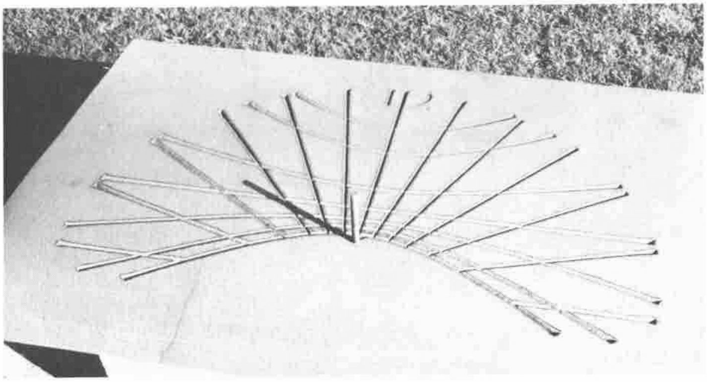

*by Adrian Smith*
{ .byline }

> Interviewer: What other projects did you work on at MIT?
>
> Bricklin: I did a wide variety of things. I was a member of the team implementing APL, and by 1973 I was running the project that implemented APL. I was also involved in the LISP project.

In case you don't know, Dan went on to create VisiCalc, and thus to revolutionise the relationship between the business community and the computer. (The above quote is taken from a whole series of interviews in "Programmers at Work", published by Microsoft Press.)

Of course Dan was heavily constrained by the Apple-II, a machine with just 16K of memory and the (very occasional) floppy disk. In the circumstances he did a pretty incredible job, but he had to cut away many of the most powerful APL ideas (operators, function definition) out of his design.

**Adrian Smith (by Richard Smith)**

So .... APL begat VisiCalc, and VisiCalc begat Lotus-123, and Lotus-123 begat Quattro and Excel; and great is the profusion thereof. These days you can run Excel on a 16M Mac-II with fabulous windows and wonderful graphics and .... you still can't do anything other than plus-reduction!! All those cloners and copiers and extenders of VisiCalc completely missed the point! Instead of taking the chance to add in genuine vector arithmetic (in spite of appearances Lotus-123 is an essentially scalar environment) they let the marketing men take over and concentrated all their effort on flashing up the tiny subset of APL that Dan had managed to squeeze into his tiny Apple-II.

Let me make a suggestion. At APL-ication we got excited about three things: WIMPs, OOPs and SQL. We all of us agreed that APL is a wonderful tool for writing user-interfaces, that it would extend easily to take in object-oriented programming, that it fits naturally around the concepts and data-structures of SQL. It is also one of the very few languages that can already handle concurrent programming (shared variables), and that will readily pipeline for vector processing.

Do you think there just might be a market for an OS/2 product with all the hooks into Presentation Manager, support for object-oriented programming, built-in access to SQL data, straightforward tools for concurrent programming, .... ?

I suggest we call this new language Ken, after its author. What do you think?

**⎕TS**

### Dates for future issues of VECTOR

| | Vol.5 No.3 | Vol.5 No.4 | Vol.6 No.1 |
|---|---|---|---|
| Copy date | 1st Jan 89 | 1st March 89 | 1st June 89 |
| Ad booking | 12th Jan 89 | 10th March 89 | 12th June 89 |
| Ad Copy | 23rd Jan 89 | 25th March 89 | 25th June 89 |
| Distribution | January 89 | April 89 | July 89 |
