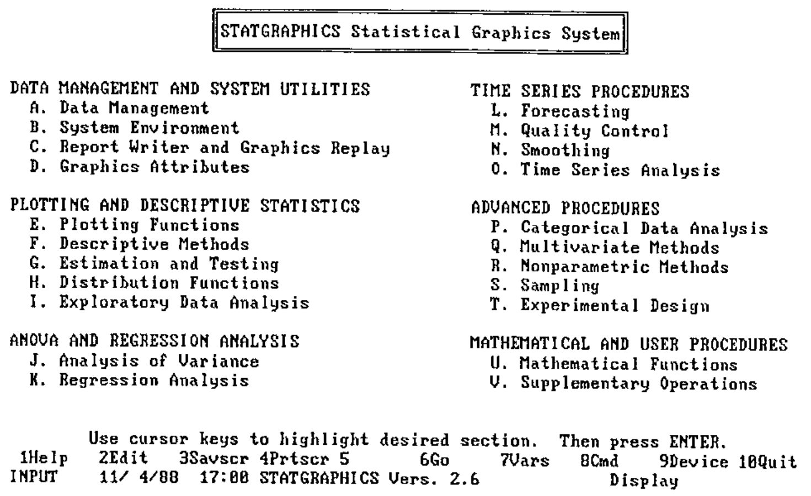
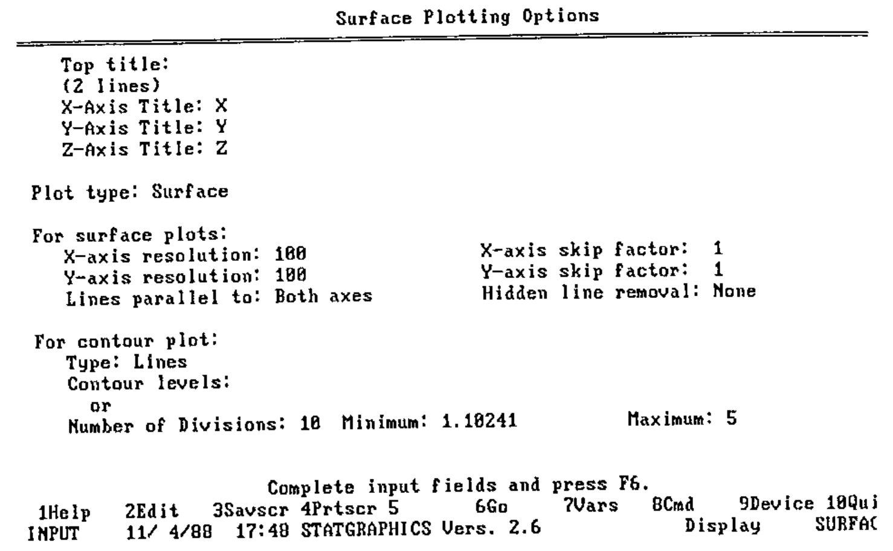
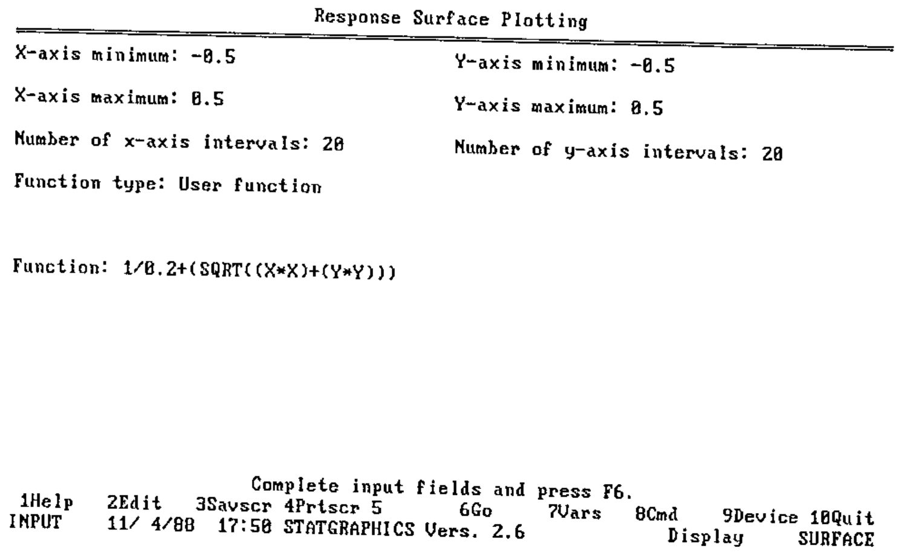
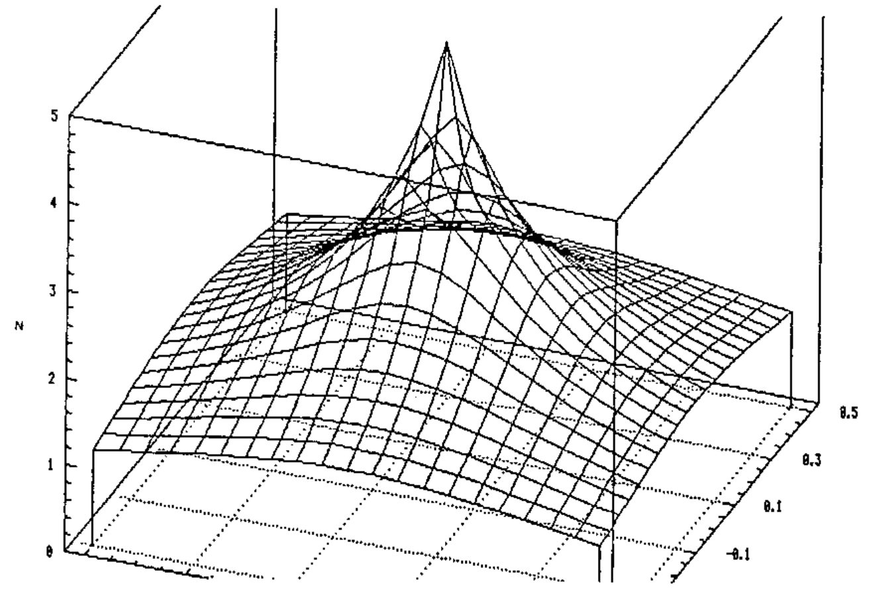

*reviewed (for an APLer by an APLer) by Gavin Schwarzenbach*
{ .byline }

As an Operational Research Scientist using APL to build solutions to business problems, I often find myself needing statistical algorithms and fancy graphs. My need is for a set of relevant functions, either to use as a toolkit, or to build into a system for a user. With that in mind I came to review Statgraphics to see how well it could meet this need, rather than to analyse the statistical validity of the algorithms. The size of the package means that I have only looked at certain areas of it in detail, and cannot comment on the usefulness of all of the functions.

## Introduction

Statgraphics is a statistical and statistical graphics package, written in APL for a PC. The areas covered are best shown by looking at the main options menu.

*Fig1: screen copy of Statgraphics main menu*

Most users would be unaware of its being written in APL, apart from having to read mathematical expressions from right to left, which is perhaps natural only to those acquainted with APL.

Installation was fairly straightforward, with the user being clearly guided through the joys of setting up drivers and editing config.sys files. There are two methods of running Statgraphics: either straight from DOS or, more useful to an APLer, as a workspace within APL\*PLUS. Running Statgraphics from APL\*PLUS on a Toshiba portable caused problems on exiting from the graphics, which was due to the use of the soft CGA character set (E=1024) for APL\*PLUS. It was however easy to change the colours of the Statgraphics menus and highlighting, in order to improve readability on a plasma display.

The user-interface is good, with easy and quick access to familiar routines, but also with good help facilities for the less familiar. Graphs are easily produced, labelled and then printed or saved, as shown below.

*Fig2: screen copy of graph label*

*Fig3: setup options*

*Fig4: Failed attempt at a Mexican Hat!*

I didn't find the need to use the documentation very often, mainly because I didn't get lost. The documentation is organised into sections according to the main menu screen, making it relatively quick to look up problems.

## Analysis of Experimental Data

Having accumulated a fairly large amount of data from a 'Taguchi' experimental design, this seemed an excellent opportunity to put the package through its paces. At this point, certain annoying features came to light which would probably only be noticed by APLers. The first is that when inputting an expression within the package, one has to type English equivalents for common or garden APL expressions such as TAKE, COUNT for iota, COMPRESS etc. The other more important fault is the lack of active memory when running from APL\*PLUS rather than from DOS. I found that it was very easy to crash the system trying to perform fairly normal tasks like trying to edit 6 variables that were 216 long, or to perform multiple regression on three of the above variables.

It was quick and easy to explore the data and summarise, through simple and 'box and whisker' plots, as one would expect from a statistical package. However, fitting a multiple regression model to the data was nowhere near as good as the University of Kent package "UREG" which I was also using. UREG points out potential problems with the data, suggests transformations that could improve the fit, and generally is more informative than just producing a model as Statgraphics does. Anyone buying Statgraphics to perform a lot of regression analysis, or more complex analysis, could be disappointed.

Statgraphics was also useful for quickly producing response surface plots of the results, although it would have been useful to superimpose the actual data points against the surface.

## Of more Interest to an APLer

I set out to investigate the possibilities of building a toolkit of statistical and graphical functions, that could be used by others as a toolkit, or merged together to form part of a larger system. Being written in APL gives Statgraphics advantages in this respect, but more importantly the system design enhances these possibilities. When running from APL\*PLUS one can 'drop out' into APL, and then restart the package, thus enabling data manipulation in a familiar environment.

There are however more significant advantages to running Statgraphics from APL\*PLUS than just being able to manipulate data. One can write functions using the "building blocks" that Statgraphics uses, which is an excellent way to build fairly complex routines quickly. Most of the functions used by Statgraphics are documented, making them very easy to use. Once a function has been written, it can then be incorporated into Statgraphics and accessed from the menus, just like any other function

If the environment provided by Statgraphics is not suitable for any reason, the Statgraphics functions can be used in another workspace, enabling users to build systems tailored to their needs. Of course you do need a Statgraphics runtime license before you give such a system to anyone else!

## Summary

Statgraphics provides a fairly broad, but shallow approach to Statistics, which should meet most people's needs. To an APLer there is quite a lot of scope for enhancing it, and for using selected functions as part of a customised statistical package.

## Availability

Statgraphics is available from Cocking and Drury, or from Mercia Software. Please check the VECTOR Product Guide for the latest prices. Both the above vendors run regular Statgraphics courses, again you will find the dates in the VECTOR Course Diary.
