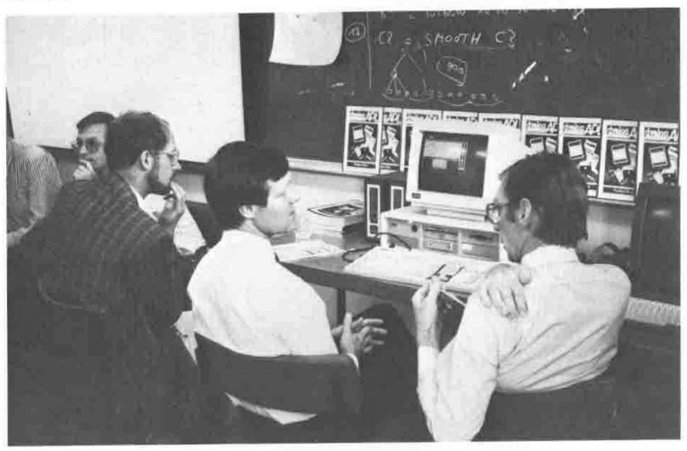
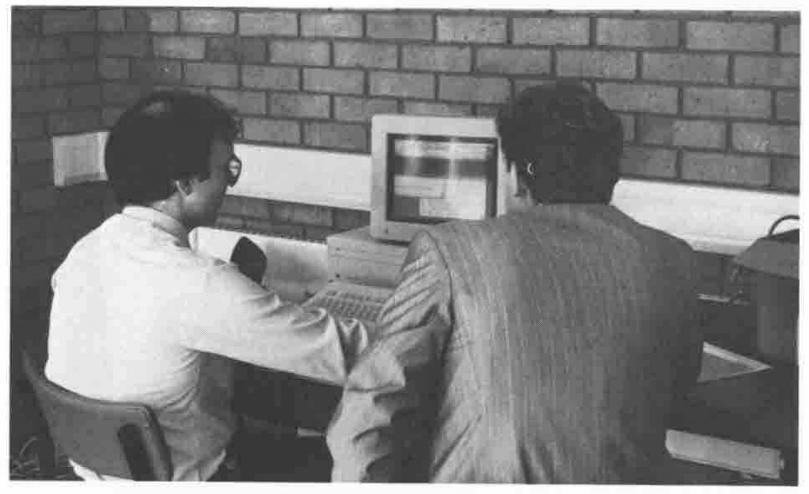
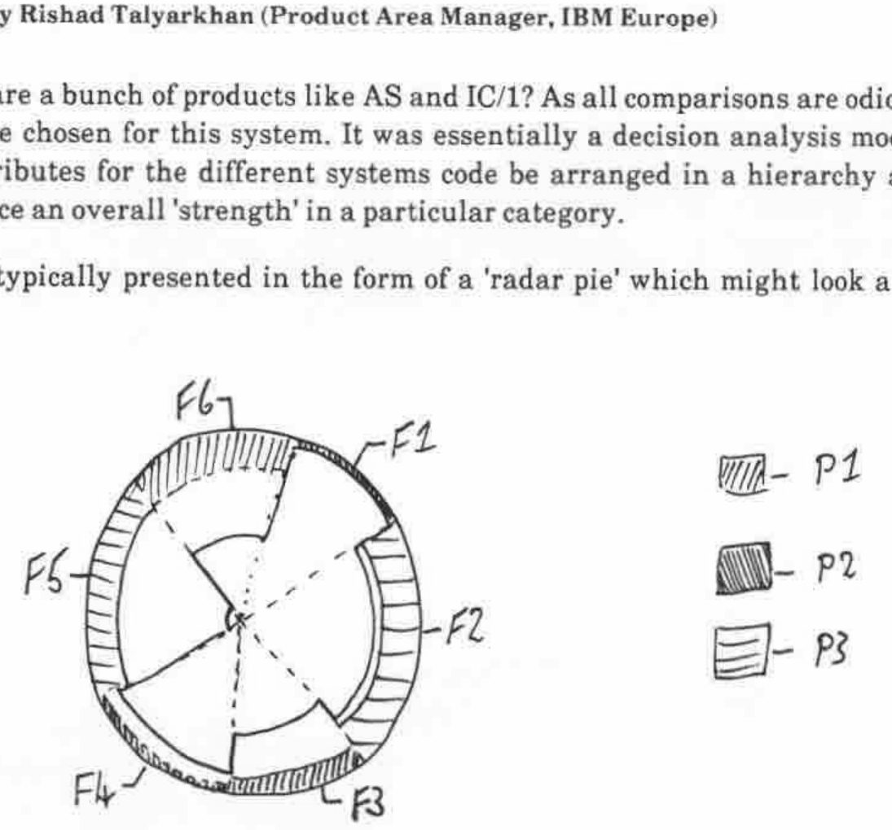

## Extending the Domain of APL

*by Michael Wheatley (IBM Santa Teresa)*
{ .byline }

Michael spoke from a long experience of APL development, his main interest having been the linking of APL to the external world. In the beginning, APL was its own operating system, and even in OS:

> "It was a characteristic of those early systems that OS would gradually grind down, while APL kept running. We'ed poke around in the control blocks for a while, and kick one of the users off, and the system would come back up again!"

I suppose this was the sort of thing that gave APL a bad name, but at least it made it popular with the system programmers!

Michael commented that the 'user-interface' of early APL had developed far more incrementally than the 'core' of the language. It was an ad hoc mix of )cmds, 'magic' locked functions (SETIO), and dyadic I-beams, which did things like shutting down APL!

By 1969, file systems had crept in, again via locked functions. APL now ran on DOS/360 and then on OS/360. It still considered itself in control of the machine; APL got all the interrupts first, then passed the unwanted ones to DOS!! The remainder of the history is better known:

| | |
|---|---|
| 1971 | APLSV (IBM internal use). System variables and shared variables. Formalized access to the environment. |
| 1974ish | APL\360 handed over the machine to CMS! More functions were included to access the environment .... quad-TS |
| 1982 | APL2. Various implementations had been running since 1976. |
| 1985 | APL2 with quad-NA. Greatly broadens the range of facilities; a 'coming of age'. |
| 1988 | now you can call APL things from outside APL, e.g. PL/1 can access arrays created within the APL environment. |
| ??? | co-operative processing. "I think that we have all the necessary linguistic constructs <u>now</u>!" |

Michael continued with a detailed tabulation of all the ways APL had ever interfaced to the outside world; what these were originally designed for, what they were actually used for, what they proved good for, and what they were bad for! I shall attempt to reproduce those points which stuck most firmly in my notes/brain ....

```
Feature  Designed for        Used for            Good for          Bad for
-------  ------------        --------            -------           -------
)CMDS    People! No results  )COPY under         People            Interfacing
         returned!!          applicn control                       to the envt.

I-beam   ad hoc facility     Exec assembler      Sys-level
                             code outside APL    debugging

quad-IB  undoc. locked       e.g. turning
         functions           vector on/off

Lkd fns  providing 'side-    "magic functions"                     Need copying; name
         effects, without                                          conflicts - you can't
         really understanding                                      rename them.
         them!

Sys fns  Iverson & Falkoff   Giving control to   No name           Name pollution. No
Sys vars wouldn't give us any the outside envt.  conflicts!        consistency across APLs
         more symbols! "Wow, Proper return when
         now I can have as   complete.           m/c dep'dt        Didn't allow users or
         many as I want"                         things like       installations to add
                             APL developer's     quad-ARBIN.       their own facilities.
                             tool
         "We went much
         overboard ....
         APL2:41
         APL*PLUS:120

Shared   Asynch. interface   File systems        Formal descr      "The management of multiple
Variables to outside world.                      of APL\360        pairs of variables drives
you
                                                 Extremely         nuts, & is a wonderful
         Very much simplified Synchronous        useful general    source of error"
         with the use of     processes, with     comms facility.
         nested arrays.      full quad-SVC       Asynch access     Costly: high path-length,
                                                 to SQL data "Has  much data movement etc.
                                                 that dumbo over   Over-engineered for the
                                                 there finished    commonest use in synch
                                                 my query yet?"    processes.

Quad-NA  "I'm sure this one                      Resolves name     High performace, not
         is right, because                       conflicts         high useability.
         I thought of it!"

         ---- Synchronous interface ----
```

In summary ....

| | |
|---|---|
| Horses | Courses .... |
| Primitives | should be totally machine-independent. OK for use when there is one well-defined way of doing something. `⍞` is a classic example of a bad primitive! |
| `⎕`fns/vars | ad hoc linguistic facilities, like `⎕IO`. A path to other functions, like `⎕SVO`. Bad for system-dependent things like files. |
| `⎕NA` | magic locked functions, but user-definable. Handy for implementors who want to experiment with new ideas without polluting the language. Give access to existing subroutine libraries in other languages. |
| `⎕SVO` | asynchronous comms. and distributed processing. These should work between machines as well as from user-to-user on the same machine. |

## A Better Mouse-trap

*by Richard Nabavi (MicroAPL)*
{ .byline }

Richard has more experience than most of implementing APL interpreters in the Mac environment. His demonstration of APL.68000 on a 4Mbyte Mac2 was most impressive: some of his comments were ...

> "The APL application has to rise to the challenge of using these interfaces. The APL interpreter needs to use them also."

> "A programming language has to be able to control the environment as well as run under it. This is a problem for APL, because the application has to run simultaneously with the 'compiler and editor' that created it."

The freedom that the Mac environment gives is often a problem for applications ... you might need to stop the user resizing the active window if you had just set up a screen panel within it!

Normally you would expect the screen-handling to be a function of the application. In Mac-APL it all works the other way round: APL is called as a subroutine of the operating system event-loop, which is continually checking for mouse actions and so on. The odd thing is how little help it gives to the application (in this case the APL interpreter). Tricky operations like writing output to half-hidden windows must all be dealt with by the interpreter. Of course all your application does is to output text to the 'screen' as normal .... Richard and his pals have already done all the hard bit.

## The Dyalog APL Screen Manager

*by John Scholes and Peter Donnelly*
{ .byline }

This was ostensibly a Product Forum, but turned into a substantial tutorial on screen management with nested arrays, and included some exceedingly silly ideas, such as screen panels which 'bounced' around the screen (and off each other) as you attempted to type your name. It culminated in a very workable spreadsheet, implemented almost entirely in a single nested screen definition.

Some long time ago I wrote a book about APL design, and those of you lucky enough to own a copy can look up Chapter-9 (page 90), where you will find:

> "For too long, APL has been a multidimensional notation constrained by a one-dimensional vew of the world. Even now, life is not perfect: why can't we just treat quad as the screen?
>
> ```apl
> ⎕[2+⍳3;10+⍳60]←HEADING
> DATA←⎕[10+⍳10;10+⍳20]
> ```
>
> ... the damn' thing looks like a screen after all! One day ...?"

That was written in 1981; at last, Dyalog have come up with a screen-management system which gives the user this kind of power and simplicity!

Essentially, the screen is reflected in a single nested array called `⎕SM`. This can be assigned to, referenced and (very important) localised just like any other system variable. Each row in `⎕SM` represents a rectangular field on the screen (a bit like the GDDM panel definition in AP126, or `⎕WIN` in APL\*PLUS/PC); each column (of course most of these have defaults) defines a different attribute. The great advantage of the nested representation is that column-1 can be a text matrix of field contents for text fields, a numeric matrix for numeric fields, and so on.

When you assign to the array (or catenate a new field to the end) the content of `⎕SM` is immediately reflected on the screen. The user can then scribble all over the input bits, and when he exits, the auxiliary variable `⎕SR` holds the usual information about the exit key, modified fields, cursor location (again as per GDDM).

The great value of localising `⎕SM` is that you can do basic windowing, pop-up help and so on trivially easily. As long as your help function mentions `⎕SM` in the header it can define part of the screen as a new panel, manipulate it as it wishes, and as soon as it exits the original screen is fully restored with no action at all from the programmer! Wonderful!!



*Peter Donnelly expounding the virtues of the Dyalog Screen Manager to Tim Perry*

Only one quibble, which I took up with John Scholes afterwards, and which I still feel is wrong. Because the change to `⎕SM` is reflected instantly on the physical screen, if you want to build up a screen over several lines of code (say repeated catenates to the end) you need to do this to a local work variable, only assigning to `⎕SM` at the last minute. It might have been better to reflect the changes to the physical screen only on the call to `⎕SR` (as per GDDM when you don't see anything until you issue an ASREAD with `CTLS←101`). However I accept that the fancy animation effects (making a panel scoot round the screen) would be less effective.

For me, the highlight of the conference. Every home should have one.

## MicroAPL: the next 5 years

*by Richard Nabavi*
{ .byline }

> "The Mac is a window into the future. Design for the Mac in the knowledge that the IBM world will eventually catch up!"

Richard saw three main strands of development ...

- the IBM PS/2 with OS/2 (Presentation Manager) in its true 386 guise (end 89)
- the Mac 6820/68881 (here and now)
- Unix-based systems (with windows)

Richard's theme was very straightforward and to the point (as Richard's themes always are). If you want to learn how to program for windows and mice, get a Mac and start now. OS/2 is a dead duck on 286 hardware:

> "Microsoft have done something to OS/2 which is about the nastiest thing they could have done. You are stuck with 64K segments as OS/2 doesn't save the 386 registers. The Phar-lap extender runs 386 protected mode: Microsoft thought this might be useful .... so they stopped it!"

While we wait for the REAL OS/2 (the 386 version) we can buy a Mac2, or we can use the Phar-lap extender with APL\*PLUS II.



*David Eastwood Demonstrating APL.68000*

## Mr HRH Prince, Charles Buckingham, Palace Road, The Mall, LONDON

*by David Piper (Cocking & Drury)*
{ .byline }

... or to be more accurate, the generation of decent looking name and address output from truly yukky input!

This had every right to be called an Expert System! The problem was to take free-format, upper-case name and address data (full of nasty little keying errOrs and incorrectspac ing), analyse it for content errors, and correct automatically as many keying errors as possible.

The output was required to look smart, get the case correct on the McGuffogg's and O'Hara's and sort out little details like "The Revd. Canon C Smith MA".

Oh ... and it needed to run in a finite time on files with several millions of records! The benefits to the customer were obvious: reduced cost in eliminating dud mailshots; reduced customer irritation at incorrect salutations; better take up.

### Implementation

The system was essentially rule-driven, with user-maintained tables of standard titles 'Group Captain' and possible abbreviations for these, such as 'GRP CAPT', 'GRP CPT' etc. In this particular case there were nine different ways of abbreviating this one title; 'Squadron Leader' had 21!

Simple QSAM files were used, with fixed length blocked records. The processing order of battle ...

1. Keying errors corrected. 5 --> S etc with some degree of intelligence.
2. Tokenize data, retaining boolean pattern to record position in original data.
3. Find standard words and divide into clauses where possible
4. Search early in the clause for known lists of titles.
5. Search late in the clause for 'gongs'. Some hairy cases such as "A McTavish MC" cause problems!
6. Use a `⍋` algorithm to turn tokens into token codes. At this point the variation in spellings of 'SQDR LDR' is eliminated. Note the decision to avoid dyadic `⍳` on a nested vector.

The resulting output could be verified as having both a title and surname, initials in a sensible place, and as not containing a specific list of 'reject' words like 'deceased'!

### Efficiency Considerations

Very large files .... hence blocked I/O on fixed length records. The absolute avoidance of `¨` at the record level ... processing is some 15 times faster if the looping is by clause rather than by record.

Lots of 'partition vector' operations using plain old VS APL techniques; the word and phrase search uses these in preference to a nested approach.

Runs in batch from a TSO CLIST, using the AP101 stack to set a return code on completion. On an IBM 3090/200 (MVS/XA) it will process 1000 records in 4.1 to 4.6 CPU sec, using a 2Mbyte workspace. Multi-million record files are processed, with a hit rate of 94 - 96%, most of the errors being untitled names.

## All Comparisons are ODIOUS

*by Rishad Talyarkhan (Product Area Manager, IBM Europe)*
{ .byline }

How do you compare a bunch of products like AS and IC/1? As all comparisons are odious, that was the name chosen for this system. It was essentially a decision analysis model, where all the attributes for the different systems code be arranged in a hierarchy and weighted to produce an overall 'strength' in a particular category.

The results were typically presented in the form of a 'radar pie' which might look a bit like this:



... apologies for the lousy drawing! The weightings determine the size of each segment, the pie being ordered by segment size. Only the outermost band was shaded in each sector, this representing the dominance of that particular product in that sector. If they were all much the same, then very little shading would show, on the other hand a product with a really strong 'unique selling proposition' would jump off the page.

It was written in 3 - 4 man-months using Graphpak and APE.

| | |
|---|---|
| Q | could we have written this in AS? |
| RT | No. Users will try to do it in AS, and will fail. On the other hand, the initial APL hump is too big, so people just won't try at all. AS sits somewhere in the middle; it is nowhere near as flexible as APL, and by the way, neither is IC/1 |
| Q | Who makes the choice between systems? |
| RT | The answer is changing. 5 years ago it was DP ... the answer was QMF. Since the users couldn't get what they wanted from DP they went to PCs and applied pressure to get access to the data. |


