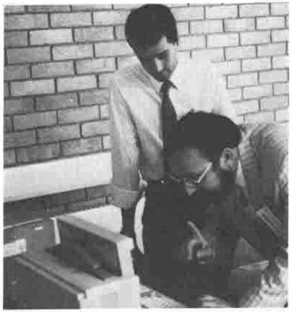

## APL\*PLUS II

*by James Wheeler (STSC)*
{ .byline }

> "Like any APL system, I am at my best when used interactively"

APL\*PLUS II is aimed to fill the gap between desktop convenience and mainframe capacity. I find conventional PC APL very satisfactory for the majority of things I do; APL\*PLUS II is for the serious APL user who wants a seamless all-in-one APL environkment at their fingertips all the time.

*Aelred Tobin explaining some of the finer points of APL\*PLUS II*

### Architecture

STSC have followed a two-fold thrust in APL technology ...

- the 'PC' road to a ver complete PC-oriented APL
- a portable APL\*PLUS system. A very advanced interpreter for 32-bit computers. Designed for a 10-year life; currently available on Unix systems and will be used on the IBM mainframe.

They have long had the dream of bringing together the two activities into a single product. The 80386 is an ideal machine for APL ...

- 'real mode' is a very fast PC.
- 'protected mode' is a true 32-bit machine.

Hence APL\*PLUS II is a two-part syatem:

- the Session Manager runs in real mode, and has the look and feel of a PC product. It controls the screen, sound, keyboard etc.
- the APL interpreter runs in protected mode using everything above the 1Mb line as free workspace. It co-operates with the session manager ... each "enter" passes a command to APL for execution. The chip can switch very rapidly between the two modes, so there is no perceptible delay.

### Features of the Interpreter

The data is held mainframe style (bitty booleans, big integers), but in the APL\*PLUS/PC `⎕AV`. The nested array implementation is the same as release-6 of the mainframe product.

The `¨` operator is provided to manage looping, and the interpreter was designed from the outset to support nested arrays.

There are 160 system commands and functions ...

> "Adding lots of system functions is the right way to do it. We are convinced that integration direct into the interpreter is what our uers want."

### Features of the Session Manager

Function editing is integrated with the APL session. The editor gives a ring of sessions, which may include several functions, DOS native files, as well as the interactive APL session. Cut and paste is allowed from anywhere to anywhere in the ring.

The session can be driven from a menu tree, or via keystokes; the keyboard is configurable, but from a configureation file outside APL, rather than with `⎕POKE`.

### Summary

This is a true 32-bit APL in the MS DOS environment. It uses all the available memory; it is the serious APL for professional APL users.
