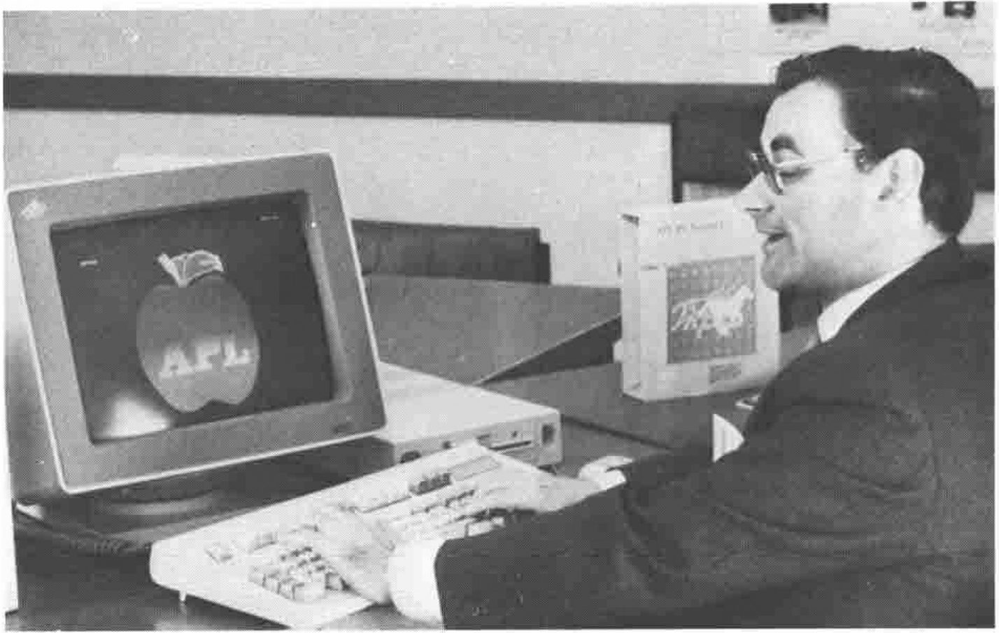

## IBM's APL2/PC

*notes by Adrian Smith*
{ .byline }

One of the most visited rooms in the exhibition contained a solitary PS/2 model-80 running the 8514-A large monitor, and the US version of APL2/PC.

*APL2/PC and the famous Apple.*

I managed a mere half-hour on this very exciting APL. The 32-bit version responded happily with `⎕WA` as 9797104 (i.e. lots) and proved rather fast and extremely robust. There are APs to do pretty well everything under the sun, and the whole lot is now available for £348 (or at least it would be if IBM would actually sell you one!)

The 16-bit version includes a packager, which really does hold the promise of free runtime!

P.S. If you can get your hands on the 8514-A display, it is really lovely.
