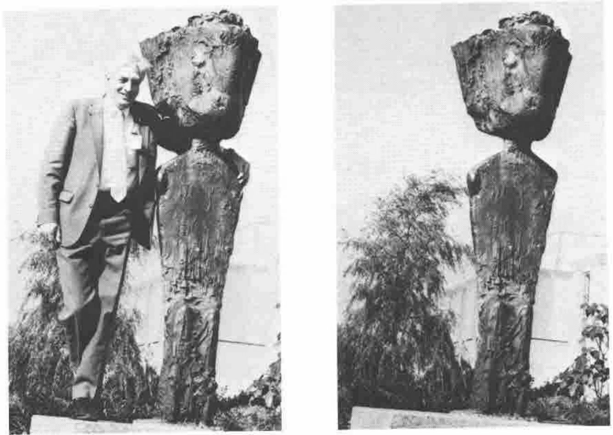

Entries are invited to caption the above pair of photographs. The usual rules and prizes apply (£100 split as the judges see fit amongst the three best entries), with the proviso that "Beam me up Scotty" is ruled to be a `NONCE ERROR` by the editor.

Please submit your entry to the editor, or to Dave Ziemann, by 1st April 1989.
