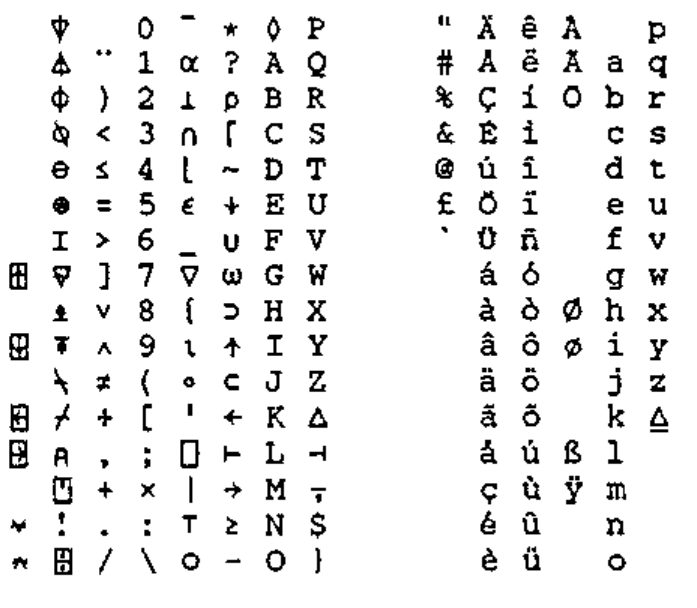
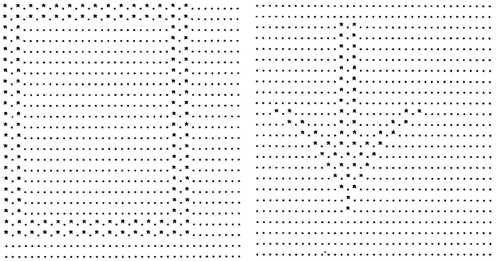

*From: Iain Hayward, 10th January 1989*
{ .byline }

Well, in the end I went ahead and wrote a font designer in APL. It was fun and it gave me an excuse to use some of the special features of APL.68000 on the Amiga. Having written my own program, I couldn’t resist the temptation to try it out, and ended up having designed a font to my own taste.

I am sending you the font design because I want to put it into the public domain before any enterprising individual tries to copyright it and sell it, thereby making life harder for other APLers. I am therefore making it available to the British APL Association well before I give it to anyone else.

I have sent you the design on paper (a selection of sample characters are printed opposite … Ed.) because it could probably be used on any 24-pin printer. I have also enclosed a listing of the APL.68000 character set as it appears on my NEC CP6 using my font. Later on I can send the binary file and the printer driver.

Yours sincerely

Iain Hayward

Copyright December 1988 by Iain Hayward.

