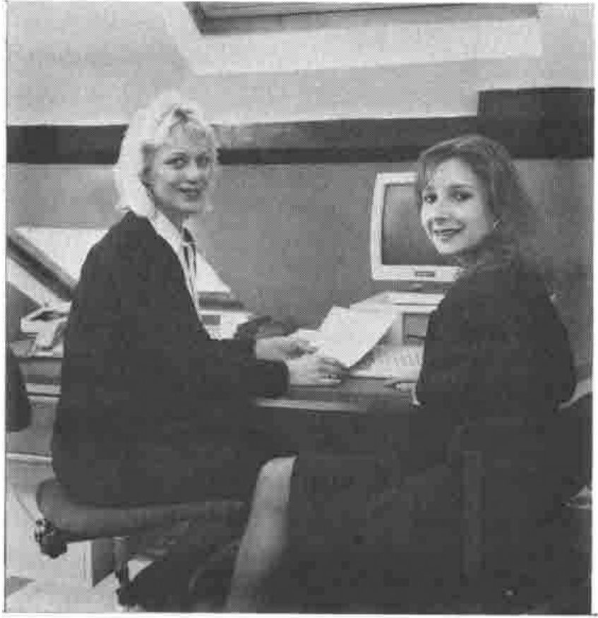

*Compiled by Cathy Dargue*
{ .byline }

## APL People Ltd

APL People are pleased to welcome Karen Opper who joined the company a few months ago in the Bath office. Karen is assisting Jill with the permanent recruitment side of the business (some of you will already have spoken to her on the phone). Now you can put a face to the voice! Call Karen or Jill to find out more about our service to APLers!

*New Recruit Karen Opper, pictured with Jill Moss of APL People*

## HMW Computing Ltd

HMW Computing Limited continue to work on "4XTRA" our front end Foreign Exchange Dealing and Position Keeping System adding facilities to enable overall management analysis across all dealing positions both graphical and numerically. We have also improved file access times by moving away from APL component files. If you would like to see a demonstration of "4XTRA" we now have regular demonstrations taking place every Tuesday. Please call us for a booking.

HMW Employment Limited is gaining acknowledgement in the APL field and potential employers will be pleased to hear that we have numerous skilled people looking for new careers as well as a pool of well qualified contractors ready to start work now.

To find out what HMW can offer, please call Stan Wilkinson on 01-353-4212 or write to us at Hamilton House. If you would prefer to phone out of office hours Stan's home number is [omitted].

## MicroAPL Ltd

Version 7.10 of APL.68000 for the Apple Macintosh has been well received. The beta test finished at the end of November 1988 and shipments of the upgrade started towards the end of December. We have been encouraged by the response to the software and also by the rapidly growing numbers of Mac users in the corporate sector. The USA continues to be the strongest market for the Mac version of APL.68000, although the level of UK sales for the Mac version is growing fast. Any users who have not yet received upgrade notices should contact MicroAPL.

APL.68000 for the Apple Mac now offers an APL multi-tasking environment. An APLuser can run workspaces, EDIT tasks and a terminal emulator task at the same time. Each copy of APL.68000 supports a number of tasks, and multiple copies of APL.68000 may be run under Multifinder. Richard Nabavi discussed the way in which the feature was achieved in Vector 5.1.

Upgrades for the Commodore Amiga and Atari ST versions of the APL.68000 are being planned. These will incorporate many,if not all, of the features of the Mac version. We hope to announce the first of these in the next issue of Vector. If any users have upgrade suggestions, you should have sent them in by now!

MicroAPL runs regular courses covering many topics from the elementary use of APL through to advanced APL Systems Programming. Naturally we specialise in APL.68000, but we also run courses on APL\*PLUS and can arrange training for most mainframe and mini APLs. Each course may be tailored to suit individual needs if required. In addition our subsidiary, Sahara Software runs complementary courses covering the Mirage Operating System, Word Processing and general 68000 Assembly Language Programming.

For details of dates, see the Course Diary on page 9. For further information or bookings please call David Eastwood on 01-922-8866.

## Cocking and Drury Ltd

Demand for the second-generation APL\*PLUS Mainframe system continues, and a recent flurry of installs has kept Dave Phillips' team very busy indeed. The popularity of APL\*PLUS Mainframe is particularly due to its financial benefits in terms of machine and staff productivity. Small migration costs, plus provision of a second-generation interpreter without the need for conversion, lead customers to move quickly. Coupled with performance improvements through Fast-functions, faster algorithms and the Compiler, plus the storage, access speed and organisational benefits brought by Sharefile, all user departments get immediate value.

Meanwhile, the APL\*PLUS II system for 80386 machines produces a steady stream of enquiries. Our customers like us selling it properly supported under licence; it gives them confidence for the future. The performance of this system is excellent; users are reporting that it provides faster response than their mainframe APL sessions.

The APL\*PLUS II 'run-time' system allows easy distribution of PC applications to this high performance environment. A one-price site licence agreement is now also available for the APL\*PLUS II system.

## Dyadic Systems Ltd

**Screen Manager.** Dyadic's new screen manager (which went out on Beta test before Christmas) is nearing final release. Although the basic design is unchanged, feedback from users has resulted in numerous improvements being made. Field types include character, numeric and date. Field behaviour includes autotab, exit if modified, exit if invalid number, exit on entry to field, pocket-calculator input, and everything else you need to control user interaction in a sophisticated and efficient manner.

**Oracle Interface.** Dyalog has recently supplemented the IBM 'vendor-logo' Oracle interface with an interface to the full Oracle product on all systems that support Dyalog APL.

**New APL Development Environment.** Dyalog is in the early stages of designing a new environment in which the APL session, the editor, and the stack are all integrated in a seamless fashion. It will fully exploit the workstation environment of a bit-mapped colour screen but will remain fully compatible with existing APL conventions.

**Dyalog APL for AIX and MS-DOS.** Dyalog APL will shortly be available for AIX on PS/2s and mainframes in addition to the IBM 6150. Dyadic are currently working on an imple-mentation of Dyalog APL that runs under MS-DOS on 386-based PCs. Performance of the DOS version is similar to that of Dyalog APL under Xenix. Under DOS, the component file system is slower than it is under Unix, but is highly competitive with other DOS APLs. Like Dyalog APL under Xenix, graphics will be supported by an interface to GSS\*CGI.
