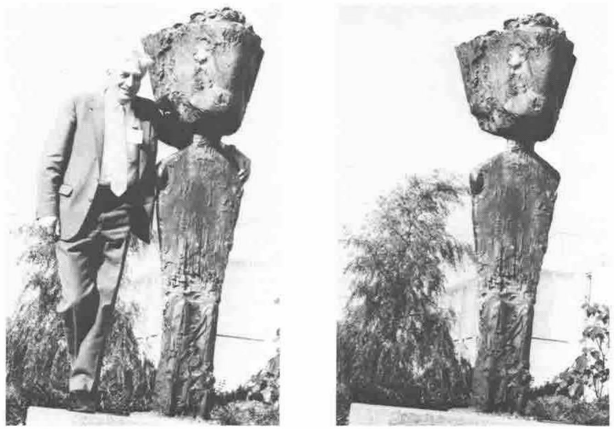

We think we ought to run a subsidiary competition for anyone who can explain this entry from Tony Caporn:

> "Question: what is the shape of the enclose of Mike Kingston … `⍴⊂'MIKE KINGSTON'`"
>
> "Answer: An empty vase"

We can also give an honorable mention to Edwin Ashworth for the following:

> "This lower-case 'i' is a little large for your keyboard Son."

However the prize has to go to John Searle for:

> L: Kingston upon Canterbury (Not upon Thames) 
> R: (Not Kingston upon Thames) upon Canterbury
>
> L: An APL developer with prototype function symbol 
> R: New function symbol with prototype user community
>
> … working from Right to Left …
>
> `BEAM ME DOWN SCOTTY`

A cheque for £75 is on its way. We await Mike Kingston's riposte with interest …
