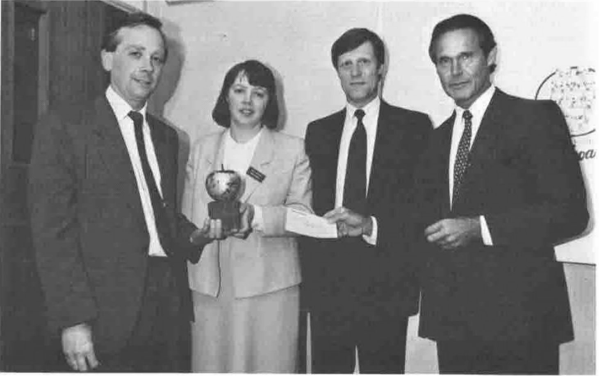
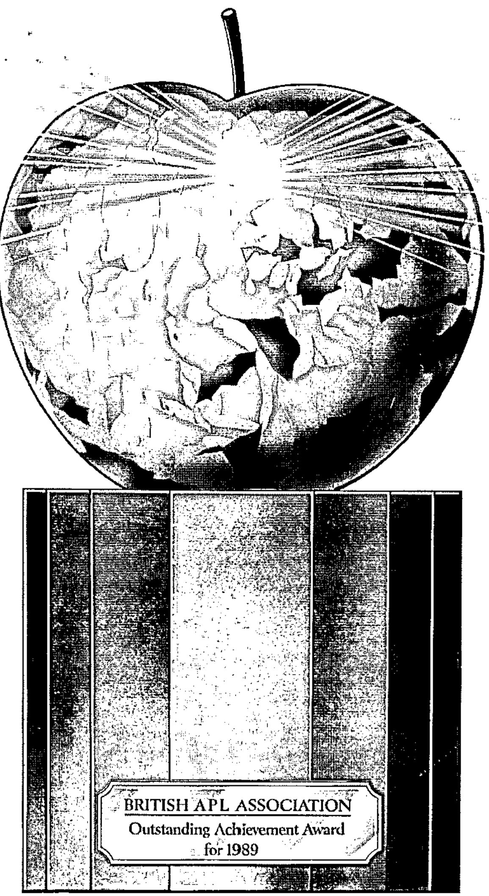

The Special Achievement Award for 1989 has been given to Delia Hickson and Graeme Davison on behalf of their project teams at British Airways. The award was presented at a special meeting of the British Airways APL User Group on 6th June.

The award was given for a suite of APL executive information systems which are in daily use at British Airways. The BAA considers that these APL systems are exceptional in terms of their acceptance by Senior Board Members and for the importance of the information they provide. Within British Airways, these systems have achieved an enormous respect for APL and what it can do.

Delia and Graeme have generously donated the £500 prize to the Dhaka Orphanage Fund; a charity founded by a British Airways stewardess to build a new orphanage with facilities for 750 boys in Bangladesh. The BAA is delighted to see the money go to such a worthy cause.

Following the award presentation by Peter Donnelly, the audience were treated to a demonstration of the applications; AIMS (Airline Information Management System) and a suite of Forecasting programs.

## A Demonstration of AIMS

The systems are designed to provide the top brass in British Airways with the sort of information they need to make executive decisions.

First we were shown the various facilities provided. These included charts showing bookings and forecasts broken down in every conceivable manner, actual results, operational statistics (eg the number of delays caused by catering hiccups), competitive information, ... in all a most impressive amount of data presented in a pleasing and informative manner. It was easy to understand how useful it must all be to the Airline's Senior Management.

As evidence of the system's success, Keith Rapley (Senior Manager, Corporate Business Centre) described how they were used during two major crises during 1986, the American bombing of Libya and the Chernobyl disaster. Together these events caused an enormous upheaval in the world travel industry which jeopardised the survival of many of the major international airlines.

At the start of the crisis, bookings fell dramatically and cancellations rose, as tourists (particularly American tourists) decided that it would be safer to stay at home. The AIMS and Forecasting systems, which were normally updated weekly, were now consulted by anxious BA executives on a daily basis. The modifications that were necessary to meet this new demand for information were, naturally, completed in only a few days.

The result was that BA's executives had access to timely, accurate information from a system they had grown to trust which was presented in a (graphical) form they could readily understand. This enabled them to detect a recovery in the confidence of the travelling public long before their competitors. At the same time that other airlines were reducing capacity, BA launched a bold promotional campaign in North America designed to reinforce the recovery in confidence. As a result, BA came out of the crisis more or less unscathed (some other airlines suffered greatly) and was able to continue with its privatisation in February 1987.

A British Airways Director has said that 'Without a doubt, British Airways weathered the storm better than any other airline' and 'without (these systems) we'd have been lost since I'm sure that we'd have reacted like other airlines ... AIMS has been indispensable to running our business and to its privatisation'.

Keith Rapley concluded his talk by emphasising the importance of APL to British Airways and said that 'APL has already played a major role in the airline and will continue to do so for the next decade'. He went on to say 'Some of our junior members of staff occasionally question the use of APL ... I can assure you however that the management is committed to it and recognises APL's strategic importance in the development of present and future information systems for the airline'.

