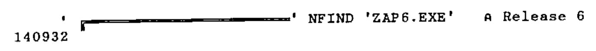

*by Adrian Smith*
{ .byline }

I eventually became bored with the exercise of tracking down the banner in APLx.EXE, so I wrote a function to do it for me ...

```apl
     R←STRING NFIND FI;LEN;OFF;IN
[1]      ⍝ Returns position of <STRING> within DOS file (origin-0)
[2]       FI ⎕NTIE ¯2 ⋄ LEN←⎕NSIZE ¯2 ⋄ OFF←0 ⋄ R←⍬
[3]      ⍝ Now check file contents in 4000-byte segments ...
[4]  LOOP:IN←⎕NREAD ¯2 82 ,(4000⌊LEN-OFF),OFF
[5]       R←R,¯1+OFF+(IN ⎕SS STRING)/⍳⍴IN
[6]       →(LEN≤OFF+4000)↑DONE
[7]       OFF←OFF+4000 ⋄ →LOOP
[8]  DONE:⎕NUNTIE ¯2
     ∇
```

Version-8 is a distinct improvement on its predecessors, as you only need to replace the banner. In earlier releases you had to obliterate the serial number and release information as well! It now has the good sense to detect that the banner has altered, and to suppress the version and serial information. This is probably just as well, as it checks for a valid number before it will load at all!

Here is the much simplified function to install your own signon banner:

```apl
     BNRPOS PUTΔBAN BANNER
[1]  ⍝ Patch in <BANNER> to file ⍙EXE at <BNRPOS>.....
[2]   ⍙EXE ⎕NTIE ¯1
[3]   (631↑BANNER,⎕TCNL,630⍴⎕TCNUL)⎕NREPLACE ¯1,BNRPOS
[4]   ⎕NUNTIE ¯1
     ∇

     ⍙EXE←'ZAP6.EXE'                         ⍝ .... set filename
     140932 PUTΔBAN 'HELLO FROM APL6'        ⍝ Replace current banner
```

Maybe one day they will get the message and restore the B= option.



```apl
     BNR←153429          ⍝ Vn8
     BNR←102804          ⍝ Vn8 with SM
```
