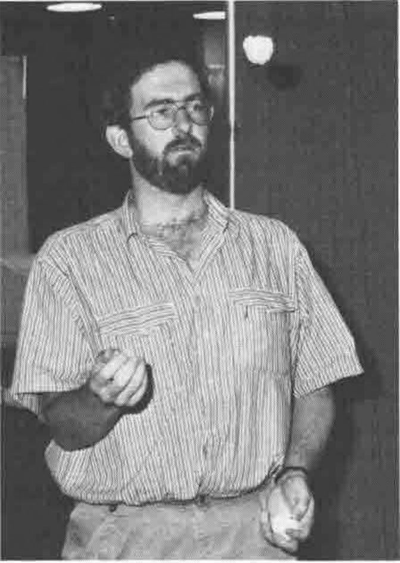

*Reported by Jonathan Martin*
{ .byline }



**Jonathan Martin .... Juggling!**

At APL89, I seemed to spend a great deal of my time in the tutorial sessions. This also gave me some ammunition for one of my great hobby horses - that is that APL is very good at doing some things, but there are commercially available packages that do the other things a hundred times better than APL can ever hope to. The only way forward is to enable APL to be the binding, to take up when these packages cannot cope. Here's what I thought of them.

## Nancy Wheeler: APL2 & SQL

This was of great interest to me as the Dyalog APL-Oracle link that I use has its origins in this. I also feel that one of the major hindrances that I have come across has been the inability of the rest of the world to access the data that we have had available to our APL systems. At last, here is a standard product that enables everybody to access some common data.

The talk was split up into three sections: SQL, APL2 and SQL & APL2.

The first section on SQL was a basic introduction to Relational Databases, the simple ideas behind them, the simple data constructions and a fairly brief introduction to the SQL language. This was great - about the limit of my knowledge!

Then Nancy talked about the APL2 Auxiliary Processor that they had written at the IBM lab in Santa Teresa. To use an APL-SQL link there is one major prerequisite - you must have a nested array APL. Relational data fits so well into nested arrays that one would appear to have been made for the other. The AP comes with a supplied workspace of about 20 functions which emulate the corresponding SQL features. Fortunately, there were lots of examples of the use of it e.g.:

```apl
PREP 'NULL' 'select * from ABC where NAME=''WHEELER'''

OPEN 'NULL'

FETCH 'NULL'   .... which gets all the fields from database ABC into
                    the workspace for which NAME equals Wheeler.
```

The most important message of the talk, though, was left to the end. "To write a successful application one needs to consider such issues as database design, performance, storage usage, locking, and authority schemes as well as just 'getting the right answers'". How true - a tool as powerful as a relational database mis-used can cause far more damage than, say, a run-of-the-mill third generation language. A relational database used with APL could be the answer to all your problems - or just the start of them.

## Kevin Weaver, Eric Baelen, Rob Lauer, Roy Sykes: Software Tools for Enhancing Performance

*Reported by John Searle*
{ .byline }

This session was a "must" for any APL\*PLUS/PC application developers. The presenters have combined their resources and considerable experience to give us a free workspace of techniques for speeding up PC applications, achieved mostly by providing cover functions for Assembler or compiled C code. Eric Baelen presented a function for speeding up the wrapping of words in a text vector into a neatly formatted matrix, and functions for improving the robustness of joining text matrices together, and determining whether a sufficient number of files can be accessed for an application. Roy Sykes presented functions for rapidly searching the symbol tables in a library of workspaces for a wanted name, and for speeding up the operation of `⎕WGET` and `⎕WPUT`. Rob Lauer presented software which implements a complete Windows-like pulldown menu system, with mouse support. All the software was made available on diskette as part of the registration package, and is in the public domain. The benchmarks and documentation were printed in the "Session Tutorials" booklet.

## Harry Bertuccelli: Exchanging Workspaces

My feeling on entering this tutorial was that it was going to be one of the more important of the bunch. Porting workspaces from one machine to another is something that all of us will probably get involved in someday with the advent of more and more powerful DOS and Unix machines. Fast going are the days when APL was solely a mainframe language.

But... it disappoints me to have to admit that this was one of the worst presentations I have ever attended at a conference. I lasted getting on for 30 minutes (it was scheduled for 90) before I decided that enough was enough. Most of what I say here is cobbled from the paper in the proceedings - little of note was said during the time I was in the room.

The method itself is fairly simple and standard.

1. Convert workspace into some text representation
2. Transfer text file to target machine
3. Convert text file back into workspace

However, Mr Bertuccelli tries to cloud the issue somewhat by writing out his text file with the last eight characters of his "80-byte 'card image'" with a sequence number. I may be short in the tooth but I can just about remember decks of cards - and yes, sequence numbers were fairly useful for the times you decided to juggle with them. But how often do IBM mainframes randomise the order of text files? Maybe I'm being unfair - the method is based on compatibility with the format of APL2's `)OUT` & `)IN` (which is a major plus point as this appears to be becoming the standard form) and maybe this is the reason.

The paper itself is somewhat disappointing also. Reading it, I found, was very hard work, I think because it is pitched at too low a level, preferring to explain the intricacies of "the loop ... beginning at line 5" rather than at the overview level.

Anyway, try reading the paper yourself if you can get hold of it - I'd be interested to hear what other people think about it and to know whether my view is clouded by the fact that I thought so little of the presentation itself.

## Pamela Baron & James Kraemer: Desktop Publishing

This was billed as an introductory tutorial on Desktop Publishing (DTP) and was both professionally presented and pitched at the right level. Four major areas were covered: Hardware considerations, Software considerations, DTP Style and a small amount of DTP and APL.

The Hardware and Software considerations were based around the two scenarios:

"I have a computer. What software will give me the best publishing abilities?" (probably the most common problem) and "I want to publish long documents using Ventura Publisher. What hardware do I need?"

The basics for a decent DTP system are adequate memory (2Meg is a good base to start from), a monitor and a mouse. As far as extra memory and faster machines go, the need is regulated by the expectations of the user. I get frustrated using Pagemaker on a 286 machine with 640K memory though find it more than palatable on a 386 with 2Meg.

As to which package to go for, the list is endless with Pagemaker and Ventura being the front-runners in the DOS world. Although I have only ever used Pagemaker, the feeling seems to be that Pagemaker is best suited for small documents (say up to a dozen pages) while Ventura scores on much larger tomes.

Style, and this was rightly stressed in the presentation, is the most important factor in producing any document with a DTP package. Suddenly, going from a standard WP package to a fully blown DTP system, you are faced with what seems like a hundred and one different ways of doing the same thing. Should you use Helvetica for the text and NewCenturySchoolBook for the headings? What about some italicisation for section headings? How about some stresses here and there and should I use bold or underline? Some nice boxes around everything would look nice. Shall I use thin or thick lines?

As ever, simple is best. Use no more than two different fonts, one for headings (sans-serif) and one for the body of the text (serif) but try to break up pages and pages of text with the addition of graphics, pictures or something else appropriate. Standardize on the format throughout the document (fonts, pitch, headers & footers, margin widths etc.) and make sure you stick to it.

The paper provides a wonderful example of what Pamela Baron referred to as the "Ransom Note style". Needless to say, in eight lines of story (written by her young son James) four or five different fonts are employed along with random use of bold, capitals, italics and even underlined italics.

The majority of the talk managed to avoid mentioning APL, but I guess it had to rear its head sometime. Desktop Publishing and APL have, up to now, been very much like oil and water. Despite the numerous fonts available, the chances of getting an APL font were zero. Up to now that is, because the tail of the talk was to have been a demonstration by Ed Cherlin showing Pagemaker, running on a Mac, with a real, live PostScript APL font. Could this be the answer to the APL community's publishing problems. Very much yes and no! After showing off the APL fonts listed amongst all the other available fonts, as soon as Ed selected one of them and tried to use it, the package went haywire, spreading what he had typed in in a rather random fashion across the screen. End of demonstration!

One day (and I don't think it will be too far away now) we will have a true, fully scalable PostScript APL font. I just wish one of the big companies would fund it and have it done properly rather than relying on individuals having to spend their own time cobbling it together themselves. Then we could take another step towards acceptability in the outside world.

## Judson Rosebush: Using APL for Computer Graphics Notation

The presentation and the paper in the proceedings were very different for this talk. The presentation mainly consisted of a number of slides and videos of some stunning computer-generated graphics, some that Judson Rosebush had been involved in, some that were just so good he wanted to show us anyway.

However, it is the paper that I will discuss, as there are some very nice algorithms for playing around with graphic shapes. Given an image, there are three main transformations you can perform on it: **translation** moves it left, right, up or down; **scaling** makes it bigger or smaller; **rotation** gives a rotary motion about the origin.

- Translation is the simplest - if your object is in coordinate form, simply add or subtract constant values to it to move it around.
- Scaling is almost as simple. Rather than add or subtract, multiply your coordinate representation by the proportions you wish to scale the object along each axis.
- Rotation, which is probably the most interesting, is, of course, also the most difficult. Simply, it involves a couple of sines and cosines and both a minus and a plus reduction.

A much neater way of doing these translations is through the use of homogeneous coordinates and transformation matrices. A homogeneous coordinate transformation matrix consists of as many rows as there are vertices in the object and columns one greater than the number of axes. The extra column is referred to as the homogeneous coordinate and has the value 1. The transformation is performed using `+.×` with the data being the left argument and a Transformation Matrix the right. This transformation matrix, in its various forms, copes with translation, scaling and rotation, simply by using different versions of itself.

This method of transformation matrices also enables us to combine transformations, without transforming our data until the very end. For example if you wish to scale and translate your object, it is possible to combine the two TM's into a third and operate that on your data, rather than having an intermediate form. Again `+.×` provides the link, converting our two initial translation matrices into the new third matrix

`TM3` gets `TM1+.×TM2` then `DATA` gets `DATA+.×TM3` If you are at all interested in graphics and some simple animation techniques, then this is a good, fairly readable paper with quite a few examples that work. My only trouble was trying to cope with plotting in 3-D.
