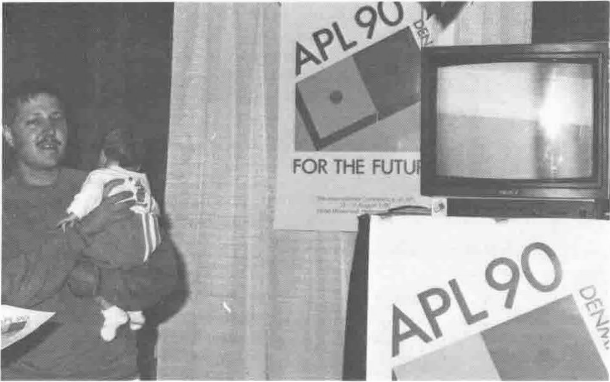
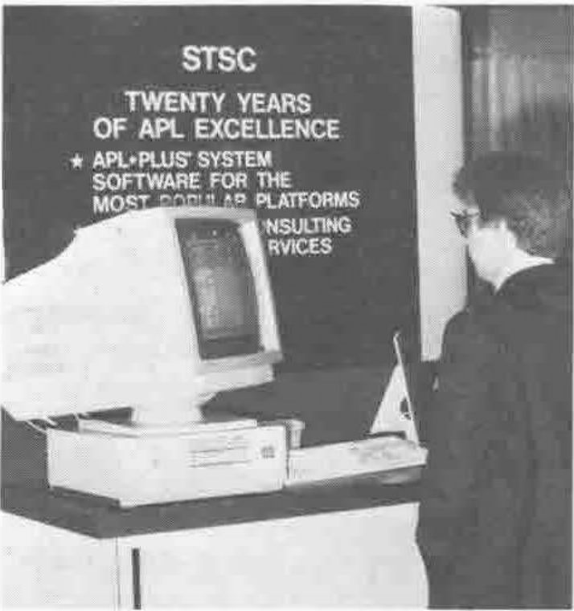
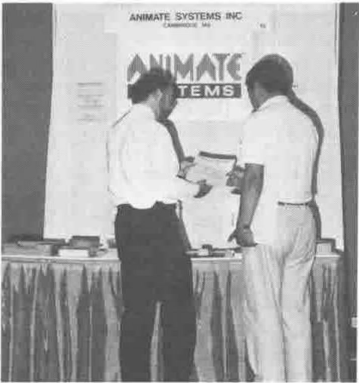
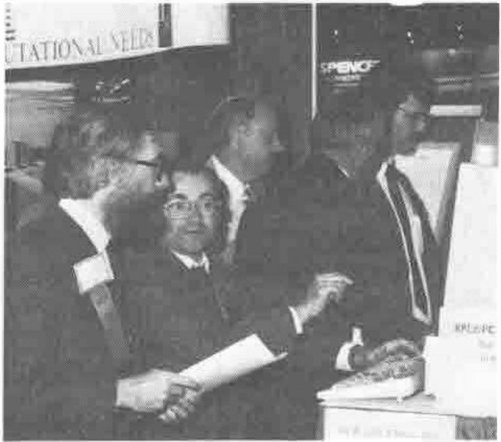
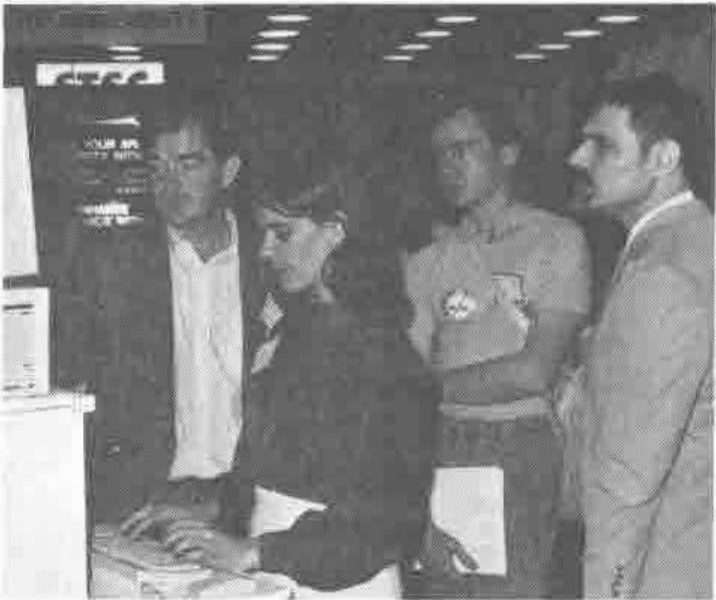
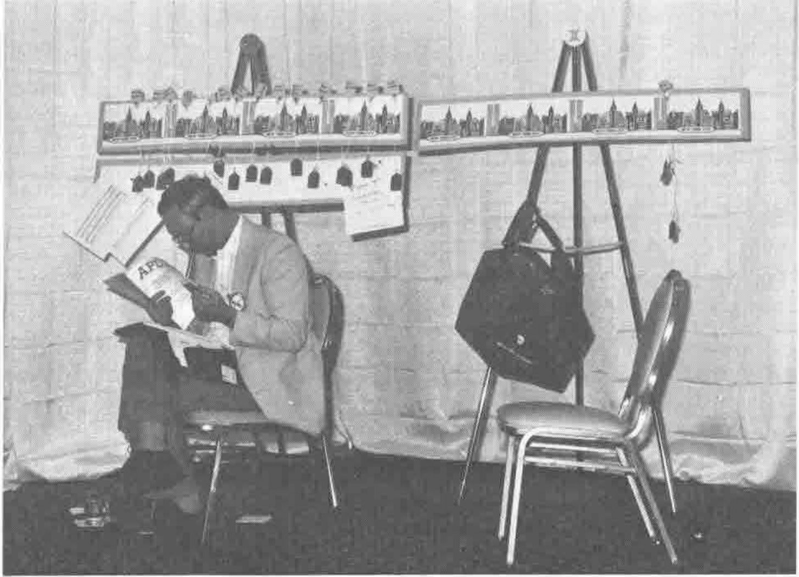

*photographed by David Ziemann*
{ .byline }

**The Youngest Delegate at the APL90 Stand**

**The STSC Stand**

**Animate Systems**

**Ron Wilkes with APL2/PC**

**Nancy Blachmann demonstrating Mathematica**

**APL as a Tool of Thought**
