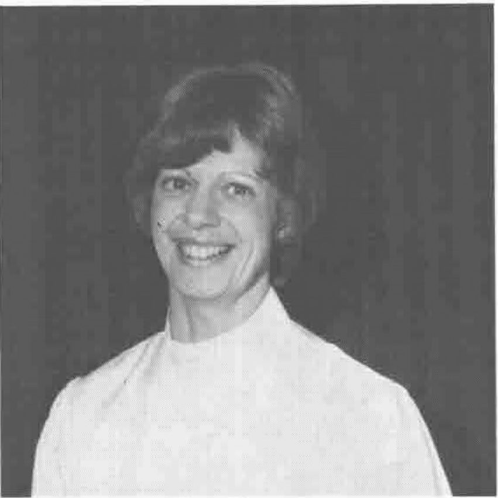

*from Graham Parkhouse*
{ .byline }

The first committee meeting of the current year began with our Chairman, Peter Donnelly, suggesting that we scrap a tradition of going over the actions outstanding from previous meetings and introduce more spontaneity. The meetings in May and June were well attended. It was suggested that the AGM should be in June next year, instead of April, to enable the treasurer to be able to present our accounts properly audited. So the next AGM will be on Friday 8th June.

**Alison Chatterton**

It is time to be thinking about who will be on next year's committee. Adrian Smith is now in his third year as Editor of VECTOR, and according to the constitution therefore his last. Running a voluntary organisation like ours taxes our time and requires a great deal of motivation, and this certainly applies to Adrian and whoever will follow. We are hoping his successor will come from the Journal Working Group. But none of them has volunteered yet, possibly because they know what they would be letting themselves in for! Producing VECTOR is doubly exciting, with the challenge of typesetting APL characters as well as the challenge of presenting APL as a subject. Adrian has achieved much on both fronts: I could have written fonts, because he has been developing an APL font for PostScript to look like the original IBM golf ball font as used in Gilman and Rose. Streamlining the production process has been just one of Adrian's achievements which we need to build upon.

Streamlining the processes of a voluntary organisation is vital for its success. People on a committee should be there for their initiative. As much as possible they should be spared the work which is common to every business. Where it is not feasible to employ the help needed there may be the chance to provide tools to make the work easier. An example of the benefits to be gained from this strategy are becoming apparent in the BAA. Alison Chatterton has been working part time as our administrator for over a year now. The Association provided her with a PC on which she keeps the membership data and the software library.

She has helped Adrian by compiling the news from sustaining members and the APL product guide, looking after advertisements and typing articles. She has taken a substantial amount of work off the Treasurer, who used to maintain the membership data, and is an invaluable support and prompt to the Secretary. You may have already noticed some of the benefits like receiving your July VECTOR in July! While Adrian will willingly bear responsibility for that, Alison helped him achieve it.

That Alison should be a maths graduate and an ex-member of the committee may appear a little over the top, yet that is our good fortune! She first met APL in the OR Department at SE Gas, then worked for Tesco in Cheshunt for nearly three years before going into the family business which allows her, when not looking after Julia (6) and Rachel (4) and her husband, Steve, to work for the BAA. She weathered that initial period when everyone wonders whether their computer is for or against them, and I think she wondered when we were going to give her anything to do. That is now past: she has found her feet and is very busy.

All of this is very gratifying to the Secretary, now in his third year. Who is willing to take over my job in June?

Graham Parkhouse
