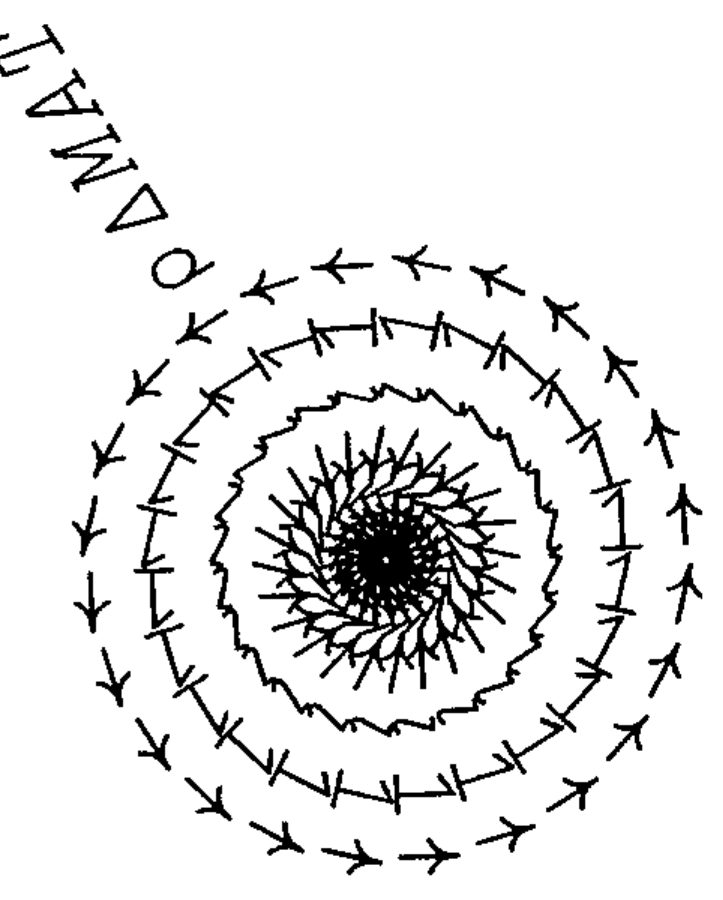

*by Adrian Smith*
{ .byline }

One of the highlights of the recent APL in Statistics conference was a splendid rendering of "APL is a very funny language" by the Alan Sykes Trio on the second evening. (Full lyrics to be published in Vector 6.3 unless Alan gets to them first!) I suppose we ought to admit that there is something a bit unusual about APL, but perhaps we are not as far from the mainstream as we thought?

I have recently been experimenting with a very well-established programming language, among whose attributes are numbered:

- general arrays. Arrays may be made up of numbers, text, and other arrays. There is a language primitive to automate the processing of each element of an array.
- direct definition. There is a language primitive which takes as arguments a function name, and a text array of executable code.
- no predefined hierarchy of arithmetic functions. Incidentally these convert automatically between integer and floating point as required. The user has no control over (or indeed knowledge of) data types.
- a workspace in which defined functions and data arrays may be saved, and an execution stack where temporary variables may be kept.

The parallels are really rather remarkable, and I could keep going for some time about the benefits of straightforward recursion and the interpretive environment! However as you probably haven't yet guessed what I'm on about, the language in question is PostScript.

The example to the right takes about eight very simple lines of coding, and serves to demonstrate rather nicely the power of a language whose sole object is the manipulation of graphics and text. Oh, and by the way, it does it all with this very funny concept of matrices ... now who would credit that?!
