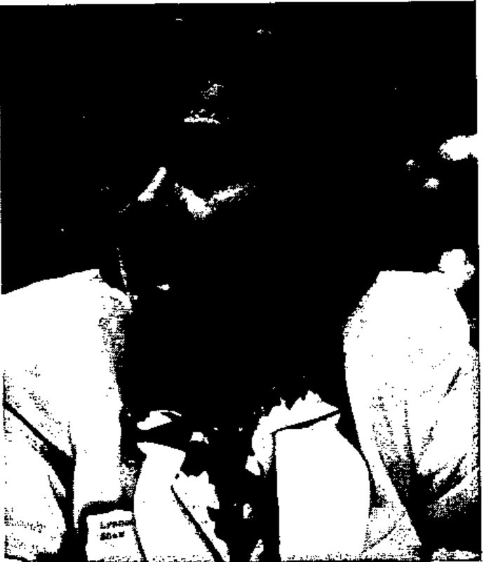
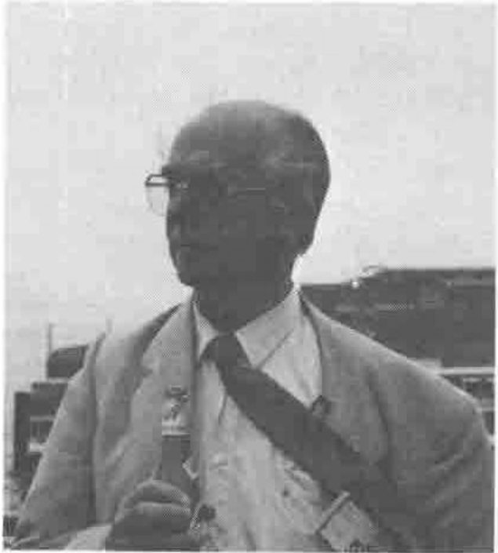
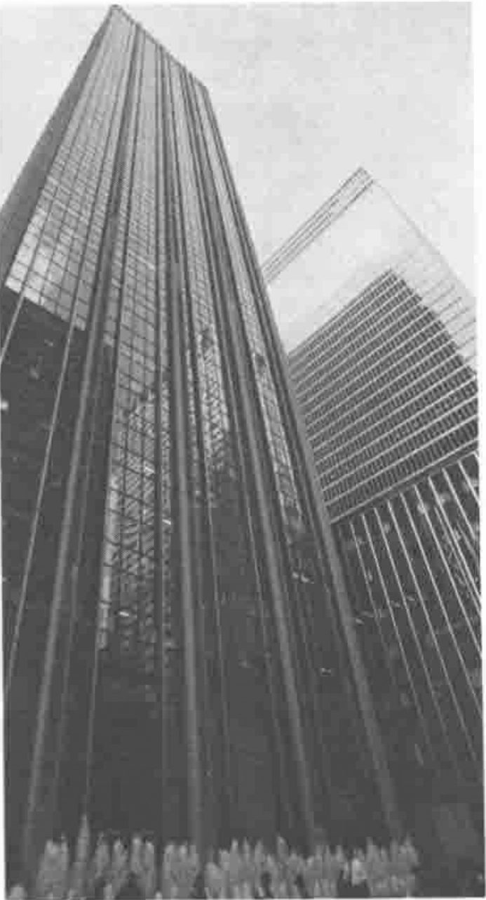
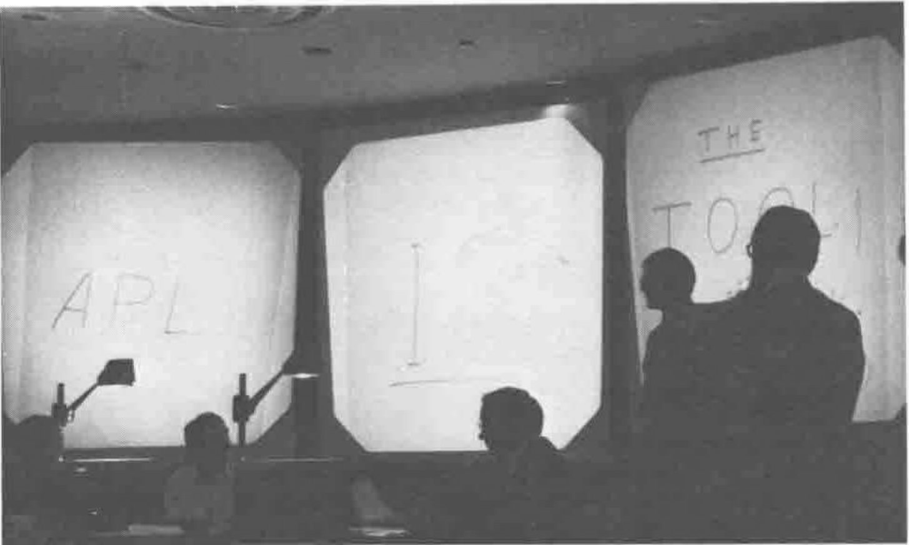

*by Anthony Camacho*
{ .byline }

**Lynne Shaw (programme chair) at the Opening Session**

## Thanks for a Great Job

The volunteers who ran APL 89 deserve our gratitude for the great job they did. Running a conference such as this is an enormous amount of work and every volunteer, when stretched to the limit, then discovers six extra things to do which would make all the difference. I don't think they could have worked much harder than they did. The conference ran smoothly and the hitches were few. Many things were really well organised. At the debriefing we learned of some crises that had to be handled at the last minute: it is amazing how little these showed.

## The Invited Speakers

The invited speakers were marvellous. Tom Gilb, Stanley Jordan, Arthur Whitney, Stephen Wolfram and A. K. Dewdney each produced something special for us. Dewdney showed a video of part of the Mandelbrot set zooming into ever finer detail! These speakers were thought-provoking, entertaining and well-prepared with excellent material.

## The Boat Trip Round Manhattan

The boat trip was an excellent idea well executed; it was on a large boat which could carry the complete conference and all hangers-on with ease, leaving plenty of space to move around, there was ample food and drink and nothing to do but talk to congenial people and watch the skyline and shore of New York as it gradually went dark.

The trip started at 42nd St wharf, went south round the statue of Liberty and up the east river but turned before the first bridge (Brooklyn) and then went north up the main river and turned just below George Washington bridge and returned to 42nd St. There was even one compartment with a Loud Noise in it (allegedly music) for people who preferred not to hear what their companions said! There was real music too - a barber-shop group who sounded great and who seemed to be having great fun. Getting such a large party fed with food and drink without excessive waiting in line was a problem; it was not really solved but as there was two and a half hours to feed oneself in not even the most diehard line avoiders had to go hungry. The occasion was a great success and rounded off the first day of the conference on a high note.

**Per Gjerlov (chairman APL90) with some of the Danish Beer the Danes gave us for the boat trip**

## More Printed Material Than Ever Before

The conference proceedings were supplemented by a tutorial volume. There was a separate book containing the Statistics day tutorial. The amount of written material a visitor to APL 89 could take away with him was more, I suspect, than was provided at any other APL conference. Lynne Shaw told me that the amount of work done to raise the standard of the typography and layout was greater than ever before and certainly the results are more uniform than some proceedings have been.

## Panels and Tutorials

Perhaps I was unlucky with the tutorials I attended. Tutorials and panel sessions are very easy to do badly. I was disappointed by every panel in the conference, even the panel after Arthur Whitney's talk about 'A'. It takes a lot of effort to co-ordinate what various panellists are going to say, and if there is no such planning what too often results is words filling time. Some of the panellists were being recruited as the delegates arrived and the results were what you would expect - inadequately prepared contributions which failed to fit together well.

## Rather a Sad End

The closing session was a case in point. The session was called 'Thought, Structure and APL' but the three contributions were independent and unlinked. Each of those speakers can hold an audience spellbound for an hour and a half. None of them did himself justice (and these were recruited months beforehand). No doubt each had material prepared for a longer talk. The time allowed was shortened at the last minute and the result was banality or incoherence. Rather a bathetic end, I felt.

## The Self-service Banquet

The banquet was self-service and there was not adequate control over when you joined the queues; the consequence was that the queues were too long. It had been intended that there should be a choice of flavours - there was Italian food, Chinese food etc. on offer. This was not announced nor clearly signposted so what you got depended on which queue you happened to join. It turned out that each queue led to a mixture, which in my case tasted good. There was no drink supplied as part of the banquet - we had to pay Hilton prices for a bottle. Many of us felt that the Hilton skimped rather on the banquet. It also skimped on other things. On the first day the coffee arrived with china cups and saucers. By the end of the conference we had grown accustomed to polystyrene beakers.

**Fountains near the Hilton**

## The Hilton

Hilton prices were too high: apart from a share in that bottle of wine and two beers, I bought no food or drink at the hotel. Instead we walked round the corner to a delicatessen for breakfast, lunch and dinner. Looking back on this I realise that eating together at other conferences brought the delegates together and gave more opportunities to meet and talk in a relaxed atmosphere - I missed this at the Hilton. We also bought wine; the Chandos Californian champagne from a Lexington Avenue shop at under $10 a bottle was $45 a bottle in the hotel. We carried it back and drank it out of tooth mugs after cooling it with free Hilton ice. I'm sure this way it tasted better.

## The Conference Luncheon

There was a conference Lunch as well as the banquet. I applaud this innovation. The meal was served - no queuing. The food was good and the after-lunch speakers were first rate. APL is on the whole a very visual notation and it was a pleasant change to be asked to appreciate results through one's ears.

## Will APL 89 help to spread the use of APL?

What will APL 89 do for the growth of APL? Not many converts to APL will have been made. A few students attended and perhaps the Statistics day will have engaged the enthusiasm of some non-APLers. A conference at a big hotel which targets the company employee and tries to provide sufficient value to justify the cost of sending delegates at company expense, a conference that relies on income from a vendor exhibition and must try to deliver professional users to visit the stands and consider buying the products, such a conference can neither attract the uncommitted nor the poor (which in England includes most teachers) nor is spreading APL likely to be in the forefront of the minds of its delegates. Even the vendors' undoubted aim to sell more APL can only be pursued in such an audience to a limited extent; most delegates already have an APL and for most the cost of a change would be high.

## More Free Interpreters: now we must get them into use

The only initiative at APL 89 that might have a significant effect on the number of APL users was the launch of TryAPL2 - IBM APL2/PC as freeware (but without many auxiliary processors). To obtain such an effect the APL world will have to make a concerted effort to help and encourage teachers to try using APL with their pupils. This is a much harder task than the production of free APLs (as I have reason to know).

## Pleasant Memories

What was memorable about APL 89? Apart from the highlights mentioned above I shall remember with pleasure:

- Phil Benkard's presentation on three overhead projectors simultaneously with David Landaeta, David Livingstone and Jim Brown as the foil changing machinery,
- Linda Alvord's Willie-the-snail who wanted to be an architect,
- Charles Waters' paper from the 'Institute of Geometric Entomology' at Scotch Plains-Fanwood school making observations on flight behaviour in the butterfly,
- The little torches with colour filters and light-guides which STSC gave away at their reception,

**3xOHP Foil Changers! Silhouettes of David Landaeta; David Livingstone; Jim Brown; Phil Benkard (and someone standing in the photographer's way)**

- Last but not least Tangible Math and TryAPL2. Tangible Math is Sharp APL/PC with a workspace that sets error traps to provide help of many kinds and a booklet introducing APL by Ken Iverson. TryAPL2 is IBM's APL2/PC complete but without auxiliary processors. Each of these gives large workspaces and enhancements to APL. Both can be copied and given away. No PC-owning maths teacher should be without these products.
