## Tom Gilb: APL - A Planning Language

*Reported by Maurice Jordan and Chris Brady*
{ .byline }

The first plenary session of the conference was a talk by Tom Gilb, an independent consultant who used to have a column in Computer Weekly.

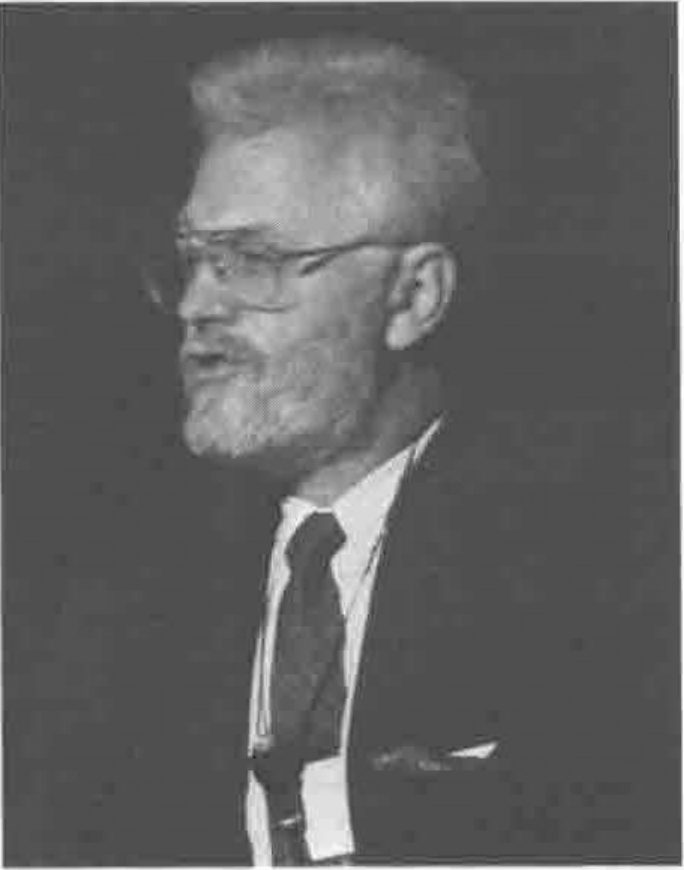

**Tom Gilb**

His main theme was that every attribute of a project should be measured, e.g. throughput, response times, expected quality levels, test criteria, resources needed. Worst case figures (the project fails if these are not attained), planned figures (what is being aimed at), figures for existing systems (which might be manual), and record levels (best known performance) are all recorded. If you are aiming at beating the record, you have a research project on your hands, and are almost certainly going to overrun. You then attack the project in an evolutionary manner, doing as little as possible to achieve benefits at each stage. His thesis is that ALL projects can be done in this manner, and that this method consistently produces projects delivered on time, within budget, and highly satisfied users. The ideas are similar to those of Tom Peters ("In Search of Excellence", "Thriving on Chaos" etc.).

He has recently produced a book detailing his thoughts - "Principles of Software Engineering Management" published by Addison-Wesley (ISBN 0-201-19246-2). At 442 pages, it does ramble a bit, but is a thought-provoking book, and I would recommend it to everyone. It is available from Modern Books in Praed Street (near Paddington station) at $18.95 (and probably from lots of other bookshops as well).

He started by briefly introducing the ideas in his book, by defining software engineering as a management and engineering problem, not a programming problem. Then he stated that the keys to successful software management were to focus on the following:

- people, not computer programming
- processes, not methods
- system attributes, not function
- eternal change, i.e. nothing is constant, we must always be responsive to end-users' needs, and
- regular communication, to meet users' objectives.

He stated that in today's rapidly changing world, an evolutionary delivery process to software management is the only really cost-effective one. He emphasised the need for close contact and frequent communication with the intended end-users, and that they and the developers should be on a learning curve whilst a project is progressing so that experience and feedback may be used to meet the requirements of the end-users as closely as possible. This is implicit in normal APL use.

He emphasised that the key to successful software management is to manage people not projects. In the future, software engineering methods will need to focus upon:

- multi-attribute capability;
- evolutionary change capability;
- adaptation to mid-project major change(s);
- rational engineering decision making (not dogma);
- designing to cost and value of results;
- process control (entry, exit, limits control), and
- evaluation, for what is best now, not what people think will be best for all forever.

The most powerful principles of control are:

- early delivery of at least part of a system, users will then be less concerned if there are problems later on;
- an evolutionary or iterative approach with frequent communication with users, (utilise the 'small wins' psychology);
- identify and define exactly the results expected by the users (customers), in writing and quantitatively, i.e. the positive results desired (the benefits) and for the constraining economic and practical limitations on solving the problem (the "costs" and the constraints), and
- design to cost.

For the above it is necessary to quantify:

- availability (reliability, maintainability, integrity);
- workability; adaptability; usability; and many other dimensions.

Tom has devised a complete software engineering management methodology to achieve the above and more.

## Harry Bertucelli: What is an Argument?

*Reported by Anthony Camacho*
{ .byline }

This paper began with a discussion of ways of representing numbers which would allow one to extend the number of digits in an integer without limit; then rational numbers represented by pairs of such integers would make unlimited precision arithmetic possible. Such rational numbers fill the number line sufficiently densely to represent all but the irrational part of real numbers. In extending such representations so that they can be held in arrays and in providing functions which can handle such arrays in the most general way the author was led by a sequence of trials and errors to propose a 'hide' and a 'reveal' primitive.

I was left with the impression that the trials were picaresque rather than empirical, and that there is no reason to suppose there are no errors in the latest version of the proposals. The presentation was didactic and enunciated clearly and slowly, with pauses for the audience to consider what had been said.

## James A. Brown: Understanding Selective Assignment

*Reported by Anthony Camacho*
{ .byline }

In essence the idea of selective assignment is that any expression which is used to select some items from an arbitrary array may be put in parentheses on the left of an assignment arrow. Then the expression on the right of the arrow, if its result is items which match in shape, will assign that result to the positions of the selected items in the array. Such a mechanism is very powerful and such expressions seem natural in APL2. The paper discussed the problems that arise; for example as it is possible to write expressions which select an item more than once such expressions on the left of assignment arrows would assign multiple values in turn to a single position in the array. The advice we were given was 'don't do this - the results are not defined' from which I concluded that there is something seriously wrong somewhere. The presentation was a clear piece of exposition and did not much extend the ideas in the paper.

## Mansour: Techniques for Avoiding Conditional Execute in APL2

*Reported by John Searle*
{ .byline }

This paper was a good summary of methods for avoiding the use of conditional execute, which can be very expensive to process and which can create blind spots for workspace analyzers. Some of the content was specific to APL2, but the techniques were generally applicable to any interpreter. There is a place in all conferences for useful, nitty-gritty contributions such as this.

## Cook: High Productivity for Large APL Systems

*Reported by Chris Brady*
{ .byline }

This paper discussed some of the problems of large systems and how they can be resolved by using structured techniques from traditional project management. For over three years the author has maintained a large APL financial application for a major (magazine) publishing company. This was developed as a prototype designed to estimate complex manufacturing budgets, consisting of several hundred different cost-items, each with its own calculation rule. APL enabled the team to develop and modify programs very quickly. The users, delighted with the responsiveness of the initial model, soon began relying on it as a production system.

The major problem was updating and keeping track of the numerous and constantly changing system specifications. The system consisted of 10 APL workspaces, 20,000 lines of code, and several hundred magazine files each containing one Mbyte of data. The structured techniques used helped to reduce the number of bugs and decrease costs of maintenance to 1/3 of their previous levels. I recommend this paper to all managers, project leaders and developers of 'large' APL systems.

## Charles Waters: Observations on Flight Behaviour in the Butterfly

*Reported by Anthony Camacho*
{ .byline }

An exercise for a class was to devise an algorithm for the path (of a butterfly) which visited each vertex of a cube once and only once in a random sequence, and to calculate the length of the complete journey.

The presentation was enhanced by a demonstration, which ran throughout, of a cube drawn on a screen with a purple butterfly following such a random path, pausing and then restarting on a new cube.

The frequency of paths of different lengths (calculated by Eugene McDonnell) may surprise you; it should make you think whether you do the thinking before you see the table or afterwards.

As Charles Waters wrote:

> "School activities too often emphasize remembering at the expense of more important mental functions. Composing APL expressions offers unique opportunities to extend the dimensions of student experience by furnishing exercises in thinking."

## Alan Graham: APL0: A Simple Modern APL

*Reported by Anthony Camacho & John Searle*
{ .byline }

Alan Graham has continued his exploratory voyage into the worlds of interpreter and language design, even after leaving IBM. APL0 is an experimental language that translates into APL2, but it is designed to be simpler and more consistent than existing APL's (hence the title).

Alan's APL is written in APL2 (about 600 lines of code) and incorporates features from APL2, Dictionary APL, APL90, Scheme and Smalltalk. In his view APL has grown too big - starting simple was fine but the twenty years of extensions without any deletions make it unwieldy. There were flaws in the original design and in some extensions.

He rejects any concept of modes (`⎕IO`, `⎕CT`, edit-mode, etc.) bracket indexing and bracket axis. Instead, he uses the indexing function and the rank operator, and changes the behaviour of selected language features. The net result is a language which "performs reasonably well" and which implements the modern view that "Less is More". Alan also gave us his predictions for the subject matter of APL99.

## Camacho: Workspace "Maze"

*Reported by John Searle*
{ .byline }

Anthony entertained us with lots of nice slides of mazes, and left the technical detail to the reader of the proceedings. The concept of the coloured maze has revolutionised the market for mazes. We were challenged to solve a three-colour maze from a slide, but I must admit that I walked backwards into a black hole. Psychological poser: when you enter a maze, do you try to minimize or maximize the amount of time you spend in it?

## Edward J. Shaw Jr: Making APL Error Messages Kinder and Gentler

*Reported by Anthony Camacho*
{ .byline }

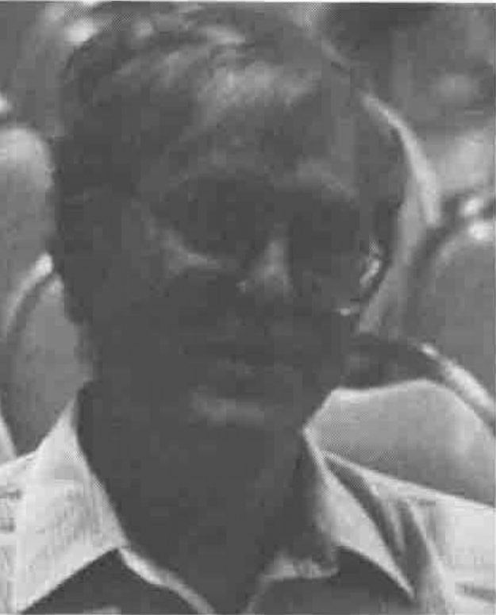

**Ed Shaw**

Ed is the man who promoted the idea of 'APL as a tool of thought' - the title of a series of professional development seminars held by NY SigAPL. He began his presentation with some slides of New York Harbor. The simple idea of his paper is that APL could give much more helpful error messages. Why `DOMAIN ERROR` and a caret under the division symbol when you divide by zero, when it would be possible to say 'Improper Value - denominator must not be zero' and put the caret under the zero? The paper had a dozen and a half detailed suggestions like this.

Ed had hurt his back and had to give his presentation from a stool; he missed some of the conference as a result. Get well soon.

## Friis: A Fusion of Lotus 1-2-3 and APL2

*Reported by John Searle*
{ .byline }

Eric Friis described the results of an IBM-internal project "FUSION", which models the contents of a Lotus 1-2-3 spreadsheet as an APL2 workspace. The advantage of this approach is that the full power of the APL2 mainframe product can then be applied to the data, e.g. SQL/DS, DB2 and GDDM. Various techniques were described which overcome the 'WS FULL' and 'SYMBOL TABLE FULL' problems inherent in such a model. The presentation was a concise summary of the published paper. Unfortunately, neither the presentation nor the paper referred to any of the previous non-IBM work done in this field. This paper extends these previous ideas by using the mainframe environment, although the data upload and download problems were glossed over. Hopefully, in the future this work will be made available externally as an APL2/PC workspace, with either an interface to the PC Auxiliary Processors, or with an appropriate workspace transfer mechanism to or from APL2 on a mainframe.

## Gary Bergquist: Vendor Forum on the Zark APL Tutor

*Reported by Anthony Camacho*
{ .byline }

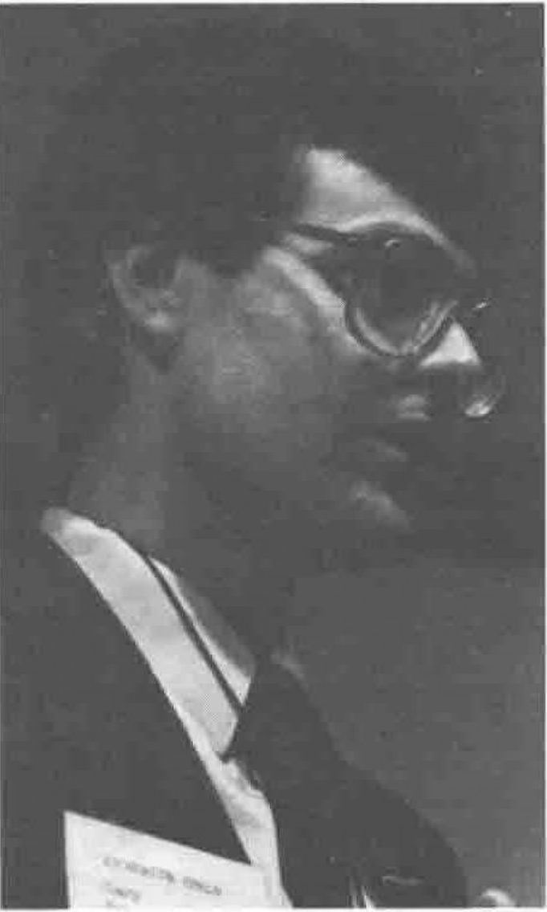

**Gary Bergquist**

Vector hopes to review this product in due course. It is a tutor for APL\*PLUS/PC in 26 'units' and on four floppies. It can load itself into your workspace at any time when you may need its help and will clear itself out when you have done with it. Gary explained that many tutorials are not much better than page turning machines, with the disadvantage that you can't easily use them on the beach or in the bath. His objective with this product was to do as much as possible to make it do as much as possible beyond turning pages. The user can set several bookmarks for quick access to particular parts of the course and there are four other methods of reference:

1. Resume where you left off
2. Use the table of contents
3. Move the bounce bar to one of 100 or so functions
4. Look in a 300-entry subject index

Throughout the course the bottom third of the screen is available for immediate execution of trial expressions. The course will also offer you 'read' problems (what does this do?), 'write' problems (what expression will do this?) and drill on a range of functions. It is also intended to make you smile occasionally.

## Dick Bowman: APL and GDDM - A High Performance Toolkit

*Reported by Sylvia Camacho*
{ .byline }

The paper presented in this session is a description of some workmanlike cover functions for GDDM written in APL 2 and replacing the vanilla-flavour IBM offering. Dick made some characteristically robust comments along the way about the inadequacies of IBM software.

Dick made it clear that the prime object of the toolkit is to achieve maximum speed and that this is the justification for having global variables 'hanging around in the workspace'. Some interesting speed comparisions are given in the paper.

It should be held in mind that the applications for which the author uses the toolkit include both graphics and text and that this is the requirement for a truly general purpose package. AP126 is not very APL-like but it has full graphics capability (compare the Dyalog quad-SM paper where only text screens are described).

## A.D. Curtin and J.M. Scholes: Quad-SM: A Full-Screen Manager for Dialog APL

*Reported by Sylvia Camacho*
{ .byline }

Since full-screen interaction between user and machine became commonplace, the most memorable characteristic of packaged software is its public 'face'. A glance at a screen will tell you what your computer is doing unless, of course, it is using one of those older full-blooded languages such as APL, Fortran or Cobol. This lack of image is a disadvantage to those of us who try to promote APL in competition with mainframe and micro packages. I am sure I am not alone in welcoming a friendly and versatile full screen manager. In the short time available John Scholes did an excellent job of introducing the Dyalog offering.

The ability to localise quad-SM and the built in scrolling of nested data is a natural for APL. The combination of the facilities of quad-SM and quad-SR seem well matched. I am sure I am not alone in wanting to hold and present my data to the screen in a format which is convenient for other purposes. Similarly I welcome a simple method to control the cursor - so many GDDM based cover functions lamely accept tabs always in row major sequence.

This was a good presentation of welcome software. Am I alone in wishing that there were a full-screen standard for APL which we could all come to find as familiar and comfortable and instantly recognizable as the proverbial 'old shoe'?

## Learning and Teaching APL: Demonstration and Discussion

*Reported by Anthony Camacho*
{ .byline }

This session began with a delightful children's story about Willie the snail, who wanted to be an architect. The story begins with Willie going to school and ends with a logarithmic spiral in a series of golden section rectangles made by dividing each into a square and a smaller rectangle. The logarithmic spiral is the elevation of the snail's 'house'. Linda Alvord did the drawings and told the story.

Since 1985, when Tama Traberman was invited to speak to APL 85 about APL in Education there have been no significant advances in the use of APL in schools. The New York Times recently said there has been no revolution in computer education; nowhere is anything being taught with computers which couldn't be learnt equally well without them - and there is still only about one computer between 20 students. It was suggested that we should get APL into use through the hierarchy of education - attack the power centres where the decisions are made.

Lee Dickey said that Computer Science leaves students short- changed. They think they are going to learn how to make computers do what they want and end up writing Pascal! At Waterloo the use of APL has reduced. The computer science department is prejudiced against it even though there are Sun workstations running SAX. He has recently announced two courses - Modern APL (for the faculty and graduates) and a student course for actuarial students.

Anthony Camacho was asked to report progress on I-APL; he reported:

1. Steady sales: over 1000 copies now sold
2. A new full screen workspace for the PC version
3. Version 1.1 with all known bugs removed
4. BBC Master and B version with colour graphics and sound
5. Archimedes version with colour graphics and sound
6. A new version of the manual printed
7. APL in Social Studies by Tama Traberman printed
8. An APL Tutorial reprinted with minor revision
9. An encyclopedia of APL second edition printed
10. Education Vector sent out to 1500 on mailing list
11. Porters working on Apple, Atari ST, Amstrad WP etc
12. APL for the Maths Classroom by Norman Thomson published
13. A 32-bit version of I-APL is now working on Archimedes
14. Several British schools are beginning to try APL

Robert Brown felt that the first job when teaching people APL was to engage their enthusiasm: show them things they are already familiar with and delight them with new insights from there. He uses a cardboard box as an analogy of a workspace.

Howard Smith told how he got into trouble by beginning a course with an explanation of scalar, vector and matrix. He asked the students to leave and come back in in five minutes so that he could begin again. His second try was to call to their attention the way information was arranged in the real world, and how people looked things up. This proceeded through share prices in the paper to telephone directories and dictionaries until he was able to put on the board a description of a general array. Then he introduced APL and it was accepted.

Bruce Prior suggested that access to computers ought to be a civil right.

Apologies to people who contributed and have not been reported.

## Stanley Jordan: APL for Music

*Reported by Paul Chapman*
{ .byline }

At the APL89 conference lunch, we were treated to two talks on computer music. The first, by David Steinbrook, was a rather brief and simple introduction, while the second, by Stanley Jordan, bowled the audience over. It is this second talk which I will try to review, without the benefit of notes.

### Stanley Jordan

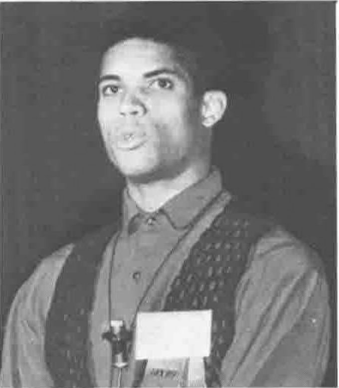

**Stanley Jordan: APL for Music**

Stanley Jordan was introduced to us as a professional musician who has had a number of albums published. Neither he nor his music was known to me, and I had not read his paper in the conference proceedings before hearing him talk. Perhaps I expected him to be a musician dabbling in computers, as many do now with the advent of MIDI (the Musical Instrument Digital Interface) and the use of micros as music sequencers. Nothing in the first fifteen minutes or so of his presentation led me to believe anything else, but then my ears pricked up, as he began to talk in more detail about his use of computers, and of APL in particular, when he suddenly mentioned Markov Chains.

### Markov Chains

My own memory of such things would be very dim now, were it not for regular visits to the country house of an old friend, Saul Jacka, full-time research statistician at the University of Warwick, and part-time sheep farmer. He presents me from time to time with puzzles in the field of stochastic processes, the latest of which involved random walks across a Sierpinski carpet. Whilst I do not know of any direct application of this to music, it served as a reminder of the mechanics of Markov Chains, which turn out to be sequences of numbers, where each successive number is derived from those most recently written down by some function whose result is partly determined randomly. Jordan's application was brilliant, and solved a problem I have given thought to for some years - how to produce random music which sounds tuneful.

### Random and Tuneful

He explained, or I understood, that certain musical intervals (pairs of notes) are more tuneful than others, and that music produced randomly can sound more rational, at least to Western ears, if note follows note with a high probability that the interval will be consonant (ie a perfect fourth, fifth or octave, or a third or sixth). He went further, and combined groups of four notes in a sequence into a single chord (something akin to partitioned reduction, for the APL theorists among you), explaining that the resulting chord sequence would make good sense. To make his point, he then asked for a tape recording to be played, and the result was marvellous! We sat entranced by this simple device.

### The Music Played

Recording followed recording, with explanations for the algorithms for each piece. I found the results very beautiful, and only became less interested when Jordan began introducing the Human element into the pieces. Not, you understand, because his compositions were bad or even not to my taste, nor because of any lack in the ability of the session musicians employed to enhance the creations of the computer, but because I had heard for the first time what a clever algorithm was capable of producing in the way of Baroque beauty.

### Computer Music vs Programmer Music

In his own talk at the conference banquet, A. K. Dewdney made the distinction between Personal Computing and Personal Programming. The first is what millions of middle managers do with Lotus 1-2-3 every day, whereas the latter is what I do sitting at home with my Archimedes. Now, thanks to Dewdney, I can describe my job (and hobby) to lay friends without lumping myself with the acres of blessed users. But Dewdney's language prompts a plea that a similar distinction be made in the application of computers to art. Computer Art is what is done by Ad-men and Paintbox users, and Computer Music is produced by sound sampling and bit-wiggling. But graphics from those old Moire demos through Conway's Life to the Mandelbrot Set are Programmer Art, and Jordan showed us the first steps in Programmer Music. The Musician's Union may not like it, but Bach would be in there hacking.

### Questions and Applause

During the questions after Jordan's talk, a request that he acknowledge his use of APL on the cover of his next album was greeted with some acclamation. But the applause at the end went on longer than for any session that I attended, and afterwards, between autographs, he revealed hints of deep mathematical and musical knowledge. For a while I have expressed my belief that in not too many years' time we will be able to buy black boxes to attach to our stereos to compose and play trios in the style of Bach in real time. Jordan's work has brought that a step closer.

## Astrophysical APL - Diamonds In The Sky

*Reviewed by Dave Ziemann*
{ .byline }

The paper was presented by Glenn Schneider, a young astronomer from the Computer Sciences Corporation, Space Telescope Science Institute, in Maryland USA. Paul Paluzzi and James Webb were named as co-authors.

The presentation was not about statement delimiters in APL, but was rather more concerned with using APL to model the structure of white dwarf stars. What exactly is a white dwarf star? Glenn explained that a star spends most of its life creating energy by nuclear fusion, and that this energy flow supports the weight of the outer layers in hydrostatic equilibrium. But when the nuclear fuel is expended this equilibrium is violated, and the star collapses under its own gravitational force. The final configuration depends on the mass of the star; if the mass exceeds the famous Chandrasekhar limit then neutron star formation or even supernova collapse are possible, otherwise a small dense star called a white dwarf is formed.

Glenn and his colleagues chose to model the structure of these stars as a way of putting APL to the test. They looked for an astronomical application that was fundamentally iterative and would at worst involve small amounts of data in vectors and matrices rather than higher rank arrays. White dwarf stars fit the bill perfectly; the model performs simultaneous numerical integration of the structure equations using a Runge-Kutta procedure to "step out" from the centre of the star to its surface in appropriately small increments.

The presentation involved many excellent foils which summarised the general concepts of stellar structure; the hydrostatic equilibrium, the mass distribution with stellar radius, energy loss versus energy generation, and the temperature gradient across a spherical shell of star. These equations were presented in standard mathematical form along with their APL representation.

By its nature a white dwarf has no energy generation mechanism and little or no temperature gradient, leading to a great simplification of the equations. On the other hand, general relativistic effects must be taken into account because the high internal gas pressure leads to partial degeneracy, the gas no longer obeying the "perfect gas laws".

The model was restricted to white dwarfs made of carbon, although it could be extended to deal with other compositions. The compressed core of the star, which is often nearly pure carbon for stars of the appropriate initial mass, is crystallised during the collapse, a fact which at last fully explains the title of the paper.

The authors were refreshingly concerned with the readability of the code, which appeared to be modular and well-commented. They are also very aware of how well APL lets them get to the heart of the problem, avoiding the excess baggage of many other languages. (In the paper Glenn reveals that a colleague of his once had a sign above his door which read "Today I am" followed by a tiltable arrow which pointed to "an astronomer", or "a computer programmer"). The APL model was originally programmed in Waterloo MicroAPL on a Commodore SP9000 (SuperPet), in only 28K of workspace. The version presented was coded in APL.68000 on a Macintosh.

Unfortunately, their enthusiasm for APL is not universally shared by the traditional astronomical community; many of the authors' colleagues would apparently be unhappy with the speed of such systems in APL - they feel that using APL to prototype the system and then re-coding in C would be a more effective way of selling the virtues of APL, until at least they can get APL on the Cray...

Disturbingly, when they attempted to publish their paper in a well-known astronomical journal, it was rejected, with a "unanimously concurrent" request that the "algorithmic representation should be removed" and replaced with something that is "machine readable". Needless to say the authors plan to re-submit their paper with some suitable explanations; Glenn, we await the outcome with great interest - please let us know what happens...

## Norman Thomson: Generic Binary Trees in APL2

*Reported by Anthony Camacho*
{ .byline }

Norman likes the elegance of direct definition, and in this paper he combines it with the power of APL2 to create functions to perform the basic operations (and a few others) on binary trees. The functions are recursive and the amount of code required is astonishingly small. Norman's thesis is that trees should be thought of as a data type with valuable special properties; APL2 enclosure makes it possible to store anything whatever in a node. Of course to execute the examples you must write a direct definition processor in APL2 or translate them into del form.

## Kristen Sternberg: Reflections on Teaching APL to Eighth Graders

*Reported by Sylvia Camacho*
{ .byline }

It was very useful to have an account of teaching experience over eight years - there cannot be many Schools having so long a continuous exposure to APL. The Dalton School course nevertheless is like all other schools experimenting with APL in that the courses are all elective and tend to attract only the pupils of higher academic ability. As only volunteer pupils are exposed to APL we have not yet any evidence to decide whether it is truly more difficult for average pupils or whether it attracts the brighter ones because they are more confident and more curious.

The questions following the paper were dominated by a discussion about the proportion of girls electing to take the APL course. The evidence at Dalton seemed to be that there is much variation from year to year although probably there is the usual bias in favour of boys.

There were very few references to APL texts. Perhaps if there were more teaching material which uses APL more teachers could be persuaded to try teaching with it. Let us hope the APL Community will make an effort and get some produced.

## ACM/SigAPL Open Meeting

*Reported by Anthony Camacho*
{ .byline }

Marilyn Pritchard opened the meeting, suggesting an agenda as follows:

1. Introduction
2. Finance
3. Membership
4. New Projects
5. Quote-quad
6. Future conferences
7. Questions and answers

In her introduction she reported the resignation of Paul Berry and thanked him for his work. Linda Alvord has agreed to take on the role of SigAPL historian. The Bay Area User Group has become a Sig in its own right.

On finance SigAPL is operating near the break-even level on an annual turnover of approximately $35,000. Dallas made a profit of about $45,000 and the reserves now stand at $65,000. The major income is from membership dues and the major expenditure is on Quote-quad.

The membership is falling steadily. Marilyn felt we must give better value for the money and hoped for 50 or 100 new recruits from this conference. She showed a slide of the membership since 1983.

| Year | Members |
|---|--:|
| 1983 | 2100 |
| 1984 | 1960 |
| 1985 | 1850 |
| 1986 | 1750 |
| 1987 | 1570 |
| 1988 | 1460 |
| 1989 | 1350 |

There is a time lag between starting a new project and getting any results. There are three projects to mention now:

1. An index of APL articles (interim version in the delegate pack) which was supervised by Dick Bowman
2. A phrasebook of extended APL which was being worked on by Paul Berry
3. A new SigAPL award for extending awareness of APL - please send in your nominations now.

Proposals for further projects which will make APL or SigAPL stronger would be welcome.

Lee Dickey reported on Quote-quad. He hopes to solve some of the problems of setting mixed APL and text. He wants to be able to do APL characters in various sizes. Joey Tuttle has produced an APL font. Lee is looking at Knuth's TeX because it allows hardware independent font designs. It would be nice if both author and editor could see on the screen what will eventually be printed on the page.

Lee thanked his sub-editors:

| | |
|---|---|
| Norman Thomson: | Algorithms |
| Howard Peelle: | Education |
| Roger Hui: | Recreation |
| Jim Brown: | Language |
| Vacancy: | New Products |

He would welcome a volunteer to take over the vacant post.

An algorithm project has been running for two years and many of the algorithms are in the software exchange.

The recent delays in publication are the editor's fault: the problems have now been overcome.

A roster of members of SigAPL is being created, and an index to Quote-quad which it is intended to publish in a special promotional issue in about a year's time.

Lynne Shaw reported on future conferences. APL 90 will be at Elsinore, near Copenhagen. Per Gjerlov, the conference chairman, spoke promoting it and asked everyone to give urgent attention to getting their papers ready. There are no arrangements for APL 91. Madrid has been mentioned for APL 92, but will need a significant partner as the Spaniards do not feel able to shoulder the whole burden on their own. It was pointed out that APL 90 and SHARE were planned for the same week next year.

Marilyn said the ACM will allow members of the committee who are willing to continue in office after their two year term for another two years. There are now two vacancies on the committee, a membership co-ordinator and a member at large. She would like to see this occupied by someone resident outside the USA.

Linda Alvord listed the initiatives on membership now ready for the new co-ordinator to take over. There is a new brochure. A list of professional materials is in preparation. There is a disk of statistical material from the Statistics day. Version 1.1 of I-APL is now available for circulation.

## Plenary Session — Arthur Whitney: Streamlining APL

*Report by Anthony Camacho*
{ .byline }

This was the highlight session of the conference. I had not heard of the Morgan Stanley APL interpreter before and was delighted to see the limitations of every APL I use so dramatically overcome. Workspace and object size and execution speed far exceeding anything on the commercial market made it the keynote of the conference for me.

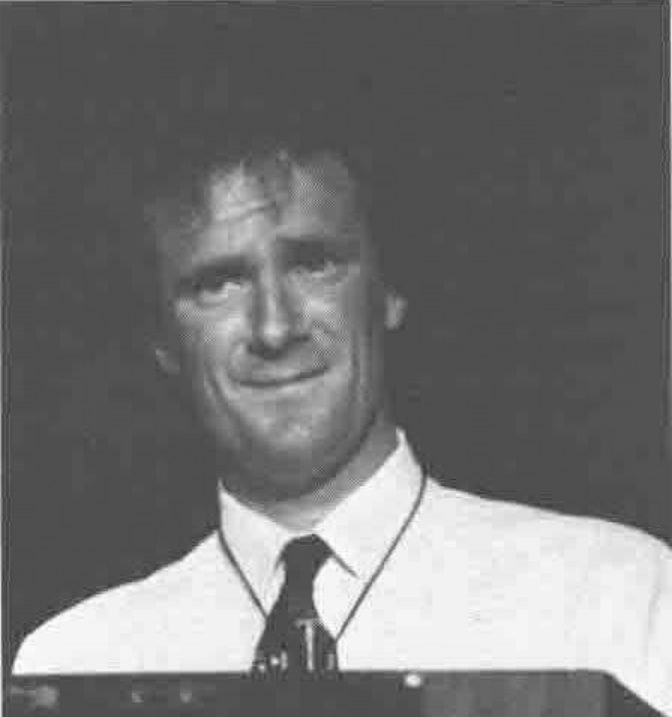

**Arthur Whitney**

Arthur Whitney introduced himself as working in Analytical Proprietary Trading for Morgan Stanley, whose transactions exceed $100,000,000 a day and who have around six gigabytes of databases used for real-time trading. They do considerable mathematical and statistical analysis in the process.

The needs are to provide hardware, software and data platforms, to create models and optimal trading strategies and to write and manage real-time trading systems. The hardware is IBM 3090/600E with Vector Facility and NAS XL80, Sun 3, Sun 4 and Solborne workstations; the software is APL2 and SharpAPL on mainframes and APL\*PLUS and SAX on workstations.

The nature of the work is well suited to APL but Morgan Stanley dislike paying for this in reduced speed or increased processor usage so decided to produce an APL interpreter which more nearly meets their needs. The goals were:

- Implement a low-overhead streamlined interpreter
- Allow large workspaces and objects (use disk to give virtual memory)
- Integrate with Unix and other languages
- Write in C and provide an ASCII version

The result is called A. It outperforms the mainframes when running on workstations, gives 500 megabyte workspaces, provides access to C, Fortran and Unix utilities and runs on several machines. It is about ten times the speed of any other APL.

The features of A:

- Enclosed arrays as well as 'each'.
- Generalised rank operator, which
    - applies functions to subarrays
    - generalises the notion of scalar functions
    - rationalises the bracket-axis operator
    - encourages and simplifies modular programming
    - can run with no overhead in time or space
- An indexing function
- User-defined operators
- All operators take any functions as arguments
- Direct definition
- Any number of arguments per function
- Control structures: IF, ELSE, WHILE
- A 'symbolic' data type
- Scalar encoded data, functions and operators

The main design principle was to keep it simple. Overheads were kept low and primitives were made as fast as possible so that no special casing was required. The rank operator is built-in. There is no garbage collection - freed space is made available immediately. Movement of objects is minimised by intelligent use of pointers. A makes use of memory mapped files and has no practical limit on object or workspace size (at present the limit is 2 gigabytes, but this is temporary and will be increased). Library routines (Unix, C or Fortran) are loaded dynamically when APL calls them and APL expressions can be evaluated from C with no overhead. A can read from and write to Unix std I/O and import and export objects through 'sockets'.

A thus becomes the lingua franca or the glue which links programs written in any of these languages. The applications of A so far are in numerical analysis, simulation, plotting, 3D graphics, continuous rule-based market monitoring, real time trading and in various optimisations involving C and Fortran.

Here is a routine in C:

```c
bin(v,n)A v;{
   int l=0,h=v->n,m;
   while(l<h)
   if(n>v->p[m=(l+h)/2])l=m+1; else h=m
   return l;}
```

and in A:

```
"bin.o" dyld "IT bin(IA,IT)"
```

Here is a direct definition of nub.

```apl
unique ω: ((ω⍳ω)=⍳⍴ω)/ω
```

Here is the SAPL of binary search beside the A version, to show how with `⎕IO` permanently set to zero [this got a round of applause] and WHILE, IF and ELSE, a short and elegant function results.

```apl
    ∇ l←v bin n;h;m
[1]   l←⎕io
[2]   h←⎕io+⍴v
[3]  L0:→(l<h)↓0
[4]   →(n>v[m←⌊.5×l+h])↓L1
[5]   l←m+1
[6]   →L0
[7]  L1:h←m
[8]   →L0
    ∇
```

*Direct Definition*

*... binary search*

```
v bin n:{
  l←0; h←⍴v;
  while(l<h)
   if(n>v[m←⌊.5×l+h])l←m+1
   else h←m;
  l }
```

Arthur then explained some timings using variables i, f, m, v, and e.

*Timings*

```
i←?10000⍴10000
f←i÷10000
m←1000 10⍴i
v←i[⍋i]
e←⍳¨ ?10000⍴5
```

*Dynamic Programming*

*... sparse matrix product*

*m - market transition probabilities*<br>
*s - state objective values*

```
m +.×#2 s

⊃(⊂[1 2] m) +.ר ⊂[1 2] s
```

*Optimizer Formulation*

*... sort the rows of a matrix*

*m - matrix of breakpoints (by stock)*

```
(⍋#1 m)⌷#1 m

⊃(⊂¨⍋¨m)⌷¨m←⊂[1]m
⊃(⍋¨m)⊃¨¨⊂¨m←⊂[1]m
```

*Database Query*

*... find opening price*

```
(valid ⍳#1 (1))⌷#¯2 price

⊃((⊂[2]valid)⍳¨ 1)⊃¨⊂[2] price
```

*Boxing*

*recursion, each and* `⍋`

```
i bx v:{
  r←⍴u←⍋d←(i⊃m)[v];
  b←<d[u[1↓(j←⌊r÷j)×⍳j←n[i]]];
  if((⍴n)=i←i+1)b
  else b,i bx¨ j⊂u⌷v}
```

*... workarounds*

```
m +.×#2 s

 r←(⍴m),k←¯1↑⍴m
 +/(r⍴k/[0]m)×r⍴k/[1]s

(⍋#1 m) ⌷#1 m

 v←,m
 d←(⌈/v)-⌊/v
 (⍴m)⍴v[⍋v+(¯1↑⍴m)/d×⍳1↑⍴m]
```

| | A | APLPLUS | SAX | APL2 | SHARPAPL |
|---|--:|--:|--:|--:|--:|
| *v bin n* | 1 | 3 | 6 | 3 | 4 |
| *+/¨ e* | 1 | 5 | 17 | 5 | 38 |
| *unique i* | 1 | 3 | 4 | \*2 | 5 |
| *unique f* | 1 | 7 | 13 | 100 | 3 |
| *unique m* | 1 | 1500 | 1000 | 800 | 600 |

*Normalized*

**%**

| | A | APLPLUS | SAX | APL2 | SHARPAPL |
|---|--:|--:|--:|--:|--:|
| *boxing* | 1 | 4 | 4 | 6 | 3 |
| *dynamic programming* | 1 | 18 | 14 | 4 | \* |
| *optimizer formulation* | 1 | 17 | 23 | 16 | \* |
| *database query* | 1 | 13 | 35 | 18 | \* |

*Normalized*

Arthur concluded that APL is well positioned for the future, because:

- APL primitives, especially with rank and each, can naturally take advantage of vector and parallel processors.
- APL workspaces and objects can take effective advantage of large physical and virtual memory.
- APL can be open to the outside world and take advantage of improving operating systems and libraries of code.
- APL can be a tremendously productive prototyping and programming environment

### Questions

The talk was followed by questions; some of the points raised are noted below.

Making A into a marketable product is 157th priority - that is to say it comes nowhere; Morgan isn't in that business and would need persuading that there was enough benefit in it to be worth giving up a competitive advantage and diverting people from highly profitable work.

Alan Graham pointed out that 'each' and 'rank' apply to functions; wouldn't it be nice to allow them to apply to a phrase as APL0's lambda proposed. Arthur confirmed that lambda was a nice feature and has been included in A in earlier versions and may be put in again in later ones. It is like having direct definition for operators.

Adin Falkoff asked (a) whether part of the speed was obtained by making A single-user and (b) how arguments after the second were passed to a function. Arthur explained that workspaces were just files and many users could access a file at a time; A turns a workstation into a nice multiprocessing workspace environment. There is nothing 'single-user' about it. Multiple arguments are enclosed in braces. Adin suggested that brackets and semicolons would be a neat way to punctuate multiple arguments.

Eugene McDonnell asked whether a full description of A would be published; Arthur said that he would like to do that but gave neither undertaking nor date.

### Panel Session

The questions were followed by a panel session which the chairman introduced by suggesting that each panel member should say what improvements would be likeliest to help APL make ground.

Roy Sykes thought A sounded marvellous, but that not being able to set the index origin was not so marvellous. Was the applause from the origin-zero camp. He asked the audience to raise their hands to vote for zero-origin fixed, one-origin fixed or variable origin as now. More people would fix the origin at zero than at one, but at least as many would like to keep the option. Roy felt that parallelism would be important and gave it as his opinion that the syntax analyser was not an appropriate place to introduce it.

Maurice Jordan (of British Airways) wanted to stick to measurements rather than religion and the best measure of work he had yet found was the function point. BA was now achieving 300 function points a man-month and with facilities like `⎕SM` he felt the target should be 100 function points a man-day. The two leading APLs offer differing notations and ways of thinking, but the difference is academic; Maurice's estimate of the cost to BA of conversion to an APL where the enclose of a scalar did not equal the scalar would be zero.

Robert Brown (of Shearson, Lehman, Hutton) wanted to broaden the use of APL and felt that the three most important things to go for were 1: speed, 2: speed and 3: speed.

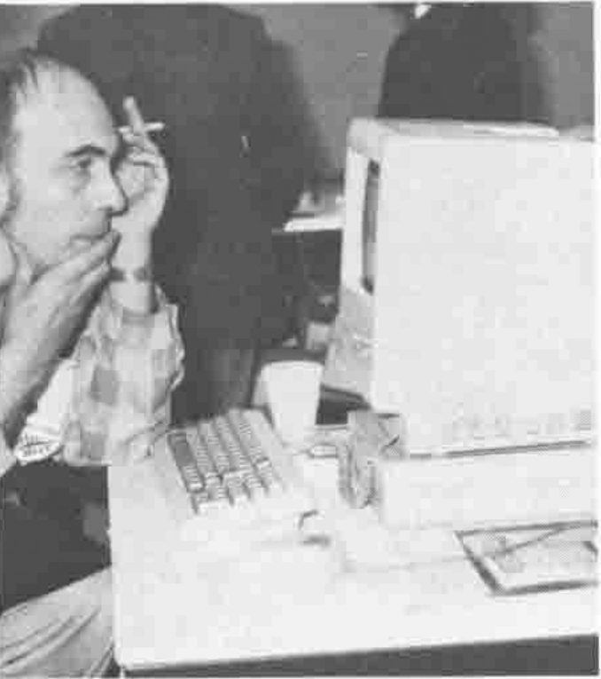

**Gerard Langlet at the MicroAPL stand**

Gerard Langlet (of CEA dept of Physical Chemistry and the French ISO group [AFNOR]) said that the main problem was portability. To obtain maximum portability he was now using (after 17 years!) a subset of the ISO standard. He too foresaw great importance in parallel processing and felt that it would be a worthwhile simplification to program only in vectors and to eschew branches and labels. Ideally he would like a notation for student use which could be converted to APL or to other languages.

David Ziemann (of Cocking and Drury Ltd and the British ISO group [BSI]) felt that the APL vendors had hijacked the domain of APL extensions and that he would like to see the APL community regain control. He wondered why 'each' had been included in A. Was it to simplify porting from APL2? How did Arthur rate the priority of 'each' and 'rank'? Arthur Whitney confessed that he felt ambivalent about 'each'. By allowing people to avoid multidimensional arrays it delayed their progress to becoming really good APLers. On the other hand this was the first time that 'each' and 'rank' had been implemented in the same system and when the data was ragged he used 'each' and when it was rectangular he used 'rank'.

Adin Falkoff joined in from the floor and complained of three tendencies that reduce readability of code; the use of lower case, strand notation and failing to use brackets and semi-colons. There are times when one feels Adin would like to make it a rule that every APL function must have at least one use of brackets and semicolons.

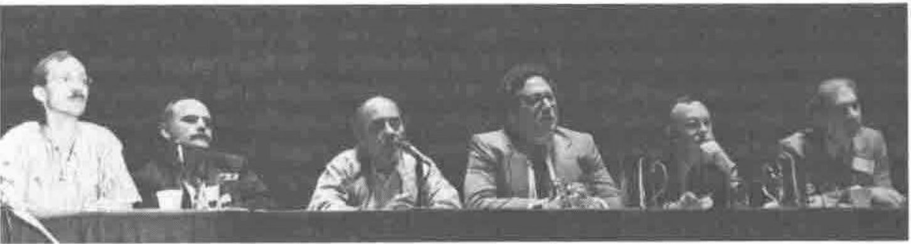

**The Panel: Ziemann, Langlet, Brown, Jordan and Sykes**

Phil Benkard (of IBM) was astonished at Maurice's low estimate of the cost of conversion from floating to grounded enhanced arrays. The thing to bear in mind is whether the objects you create are within the domain of the functions you wish to process them with.

Jim Lucas' idea of APL pie in the sky was that APL should 'believe in' screens and shapes and colour. On APL and parallel processing he would like to see parsing and interpreting done in parallel, not just the processing of arrays.

Robert Brown felt that faster addition and subtraction would bring more benefit than any new feature, and that the quality of the system depended most upon the coding and commenting style.

Somebody asked how far interpretation preceded execution, but his question was ignored.

Dave Weintraub also addressed the question of portability, asking to what extent it could be automated, but his main thrust was to complain about the standard of the code issued by the major vendors. Too much of it sets a really poor example and unfortunately is copied. The APL professionals have a lot of power to influence newcomers to use good practices and too often give a bad example.

Linda Alvord did not believe the audience understood the problem of `⎕IO` when Roy Sykes took his vote earlier. She suggested that to understand it you needed to look at the effect of having both iota (for index origin one) and gamma (for index origin zero). She would also like to see the graphics origin in the centre of the screen.

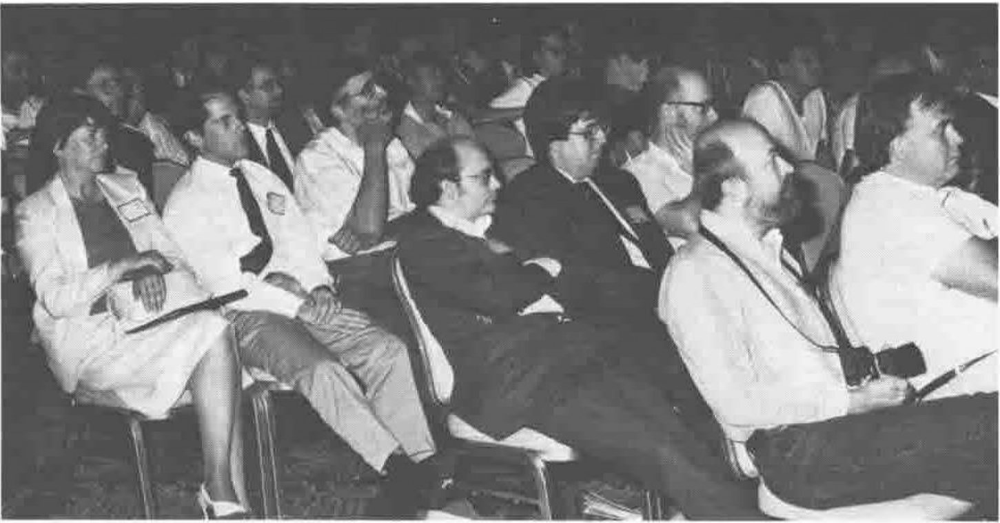

**The Audience!**

Rosemary Snow asked why we bothered optimising general purpose computers when surely a computer designed from the ground up to process APL would surpass any general purpose machine.

Carol Stein felt that there was room for two standards of interpreter; one would be for thinking about the problem and experimenting and the other for when finished code had to be executed really fast. Her idea of an improvement would be to display variable names in a way which indicated e.g. their rank by the colour and their depth by the typeface.

Gerard Langlet would like to be able to speed up interpretation by asking for a reduction in arithmetic precision.

## Neidinger: APL Approach to Differential Calculus

*Reported by John Searle*
{ .byline }

Richard Neidinger described a simple APL2 approach to calculus. His workspace of 14 one-line functions permits the automatic differentiation of "practically any function", by using a representation of a function f(x) as a vector { f(a), f′(a) } at point a. The rules for differentiation (e.g. product and chain rules) follow from this notation. He has achieved the exact calculation of the tenth derivative of f(x) = (x.csc(x))/ln(arctan(exp(x))) in less than four seconds using APL2/PC. Try it using Mathematica (but don't hold your breath)!

## Banquet Speaker — A.K. Dewdney: A Loose Cannon Takes Aim at APL

*Reported by Paul Chapman*
{ .byline }

With alcohol available only at exclusive New York Hilton prices (prices, in other words, designed to exclude even the moderate drinker), coffee was the one free drug on offer at the APL89 banquet. With its arrival, A. K. Dewdney, the Scientific American computer recreations columnist, took the stage for his presentation, entitled "A Loose Cannon Takes Aim at APL". This slightly balding, initially rather shy character turned out to have a dry sense of humour. His delivery was a little reminiscent of Bob Newhart's.

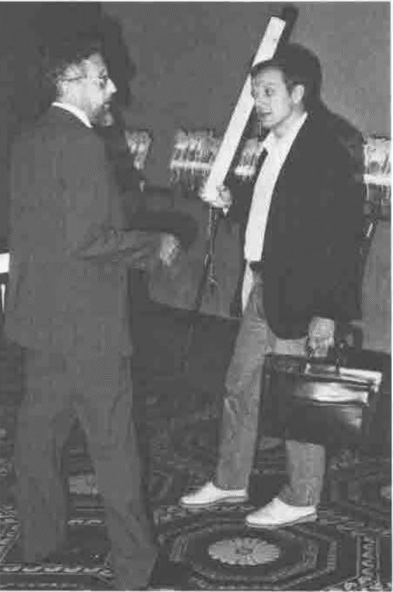

**Lee Dickey with A.K Dewdney**

His talk was divided roughly into three parts: Wallpaper for the Mind, Cellular Automata, and the Mandelbrot Set. It was really a reprise of some recent topics from his column, but the pictures he showed, together with detailed algorithms, were interesting and enlightening. I do not have the benefit of notes, but I remember that he showed an IPSA one-liner, worked out earlier that day with the help of Roger Hui, for Conway's Life.

To many of us who are, in Dewdney's words, Personal Programmers, the topics were familiar, but it was nice to see the algorithm for generating graphics from the Mandelbrot Set fully explained for once, rather than just touched upon. I myself took notes on a Cellular Automaton which he described, but I have not yet had time to implement it.

The highlight was definitely a video film entitled "Nothing But Zooms," a series of slow zooms into various parts of the Mandelbrot Set each lasting a few minutes. Even on a large mainframe, detailed pictures of large magnification take seconds to calculate, so the tape as a whole represented the expenditure of a great deal of CPU. Dewdney said the tape was available from Art Matrix, PO Box 880, Ithaca, NY 14851, USA. He did not know the price, nor whether it is available in PAL, the British video format.

After the banquet, I retired like many others to the conference hospitality suite in room 4141 of the Hilton, where the fridge was stocked with large amounts of beer which had fallen off the back of a boat earlier in the week. Dewdney followed in time, and I discovered that Anthony Camacho had lapelled him (a rather more insistent version of buttonholing) and persuaded him to talk to me about the Life algorithm I have developed, since I wished to find out if he knew of any other similar implementation.

After finding the New York Cafe in the Hilton's basement closed, we settled in a bar in the lobby of the hotel which made Gatwick Village look stylish. I discovered that Dewdney is rather shy about treading in the footsteps of Martin Gardner and Douglas R. Hofstadter. He is a full professor, earning a 3/4 salary for a 3/4 timetable, and also runs a small software company to supply the readers of his column with copies of various program fragments, and is often in a panic about what to write about next. I heard a little about Hofstadter's departure from the magazine, and I wonder if Dewdney fears to follow too closely.

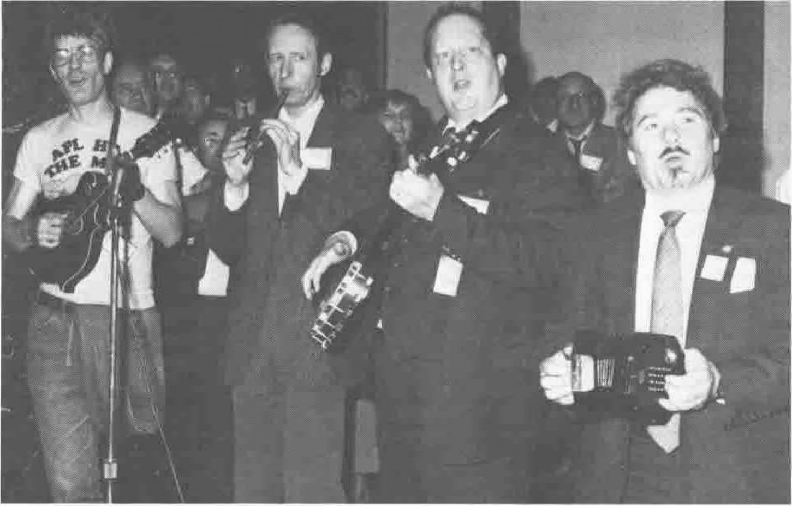

**The Band at the Pre-banquet Concert**

The main part of the all too brief discussion was made up of the discussion about Life. I described my algorithm, and he told me that he had not come across anything similar. We then went on to explore another potential improvement - that of temporarily eliminating currently 'stable' areas of the pattern, far enough removed from areas of instability to be unaffected by them for some fixed number of generations, and continuing the iteration until this many generations had passed. For small patterns (up to 1000 cells on a side), the overhead in examining the plane to see what could be left out would probably slow the program down, but for large universes (as would be necessary to implement a Life Computer, for example) the improvements would be dramatic.

Over drinks, we explored again Conway's original intention - that Life could be a simple model for a real universe - and came to a startling conclusion when examining the new algorithm in this light. I shall assume a passing familiarity (which is all I have) with Quantum Mechanics in the following. Our own universe is believed to be non-deterministic in its evolution. That is to say, certain small scale quantum events occur randomly, though in statistically measurable ways. The evolution of a quantum state, however, is completely deterministic, and it is only when the wave function collapses to give 'reality' (some believe this happens when an observation is made) that the randomness encroaches. Now, we asked, why has God designed such a complex universe? Surely a simple mechanistic universe would be easier to design and implement on his cloudtop?

Let us suppose that he started with the simpler design, but it failed to give the organisational richness which our universe undoubtedly possesses. He tried more and more complex ideas, and eventually had to go non-deterministic to hope to get any worshippers out of the program. But his cloudtop is not the latest generation model, and all those pseudo-random numbers were taking an age to calculate. After all, at the rate at which random events occur in the nanoworld, a short cycle would result in clear determinism at the macro-level, and thus fail to achieve the desired complexity.

Ah, but wait! why not have most of the universe evolve deterministically most of the time for the sake of efficiency, and only introduce randomness where observers are present and observing. Why bother to actually simulate all those photons from that distant quasar taking every possible Quantum Electrodynamical route from source to target? Why not just have them appear, with statistical instantaneity, at the eyes of the sentient products of evolution? CPU cut by a fraction less than 100%, and no shortage of souls to save. WE were pleased with this discovery. I, for one, have been looking for a reason for all those integrals for some time.

But before the more pious readers of this piece cry "blasphemy", let me assure them that I have already been chastised. In the middle of this frenzied discussion we became aware, through the haze of smoke from St Moritz Extra Lights, of the strange figure of a man hovering near our table. We pretended to ignore him and he went away. Two minutes later he was back, and resolved this time. He stared at us like a Rangers fan finding a group of Celtic supporters in the corner of a Glasgow pub. Someone had to say something, and Dewdney came out with the beautiful reverse, "Was I looking at you?"

I remember only one sentence from our visitor in the short and uncomfortable exchange that followed. He was perhaps not an unlikely character given that we were in New York. He looked the worse for a drug stronger than coffee. Most of what he said was incoherent. But his admonishment, delivered with a zealot's passion, still rings clearly in my mind: "Remember: mathematicians are not philosophers."

## Claire Sykes: A Paediatric Management Information System in APL

*Reported by Anthony Camacho*
{ .byline }

The presentation was a demonstration with a large screen display of the system described in the paper. What came over was the amount of consultation with the nurses and doctors who use the system and the frequent adjustment of the system necessary to make the users feel completely at home with it. It is a well canvassed idea in the APL community that a system that meets 100% of the users' needs (and is kept up to date so that it continues near that level) is twice as valuable in the long run as one that only meets 90%. Of course APL can do this more easily than other languages but it is easy to underestimate the time and cost of the continual review and consultation with the users that is needed. It is rare and welcome to hear a fairly detailed account of how this is done: plainly Claire and Alan have made allies of their users, have not tried to impose their own views on how the work should be done and seem to have a very successful system as a result.

The prognosis is good too; they see no end to the adjustment and enhancement process and it seems quite likely that the information collected will have great value in improving the way such paediatric units care for their patients.

## Eugene McDonnell: Phrasal Forms

*Reported by Anthony Camacho*
{ .byline }

The suggestion is that a meaning is given to syntactic forms:

```
      function function omega            and
alpha function function omega            and
      function function function omega   and
alpha function function function omega
```

or (as Iverson and McDonnell would say)

```
        verb    verb    pronoun           and
pronoun verb    verb    pronoun           and
        verb    verb    verb    pronoun   and
pronoun verb    verb    verb    pronoun
```

Of course there is already an interpretation for some cases; + adds each item in alpha to the reciprocal of the corresponding item in omega. The extension is more obvious when plus-divide in parentheses is the left argument to scan, thus `(+÷)\`.

He displayed a table of logic functions with SAPL equivalents:

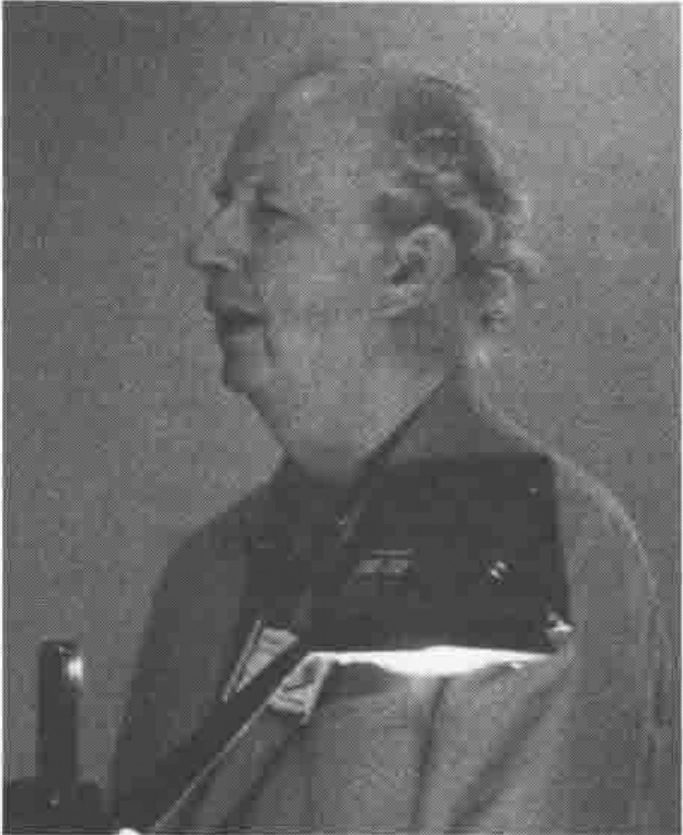

**Eugene McDonnell**

This was one of the cases where the standard half hour allowed for presentation was not adequate. Eugene McDonnell could only touch on the criteria which had led to the choice of the proposed interpretation. Your reporter is not familiar enough with the background and could not follow everything. A fuller explanation would have been welcome to at least this member of the audience. Eugene allowed for at least some of the people in this category by quoting many references for the interested to follow up:

- Combinatory Logic, Curry, Feys & Craig, North Holland
- Can programming be liberated from the Von Neumann style? A functional style and its algebra of programs. Backus CACM 21,8 (August 1978)
- To kill a mocking bird, Smullyan, Knopf
- The Mathematical Intelligencer, Springer-Verlag

After a short detour into programming without (explicit) variables (one of the criteria was minimising the number of assignations) Eugene ended with what he said is a solution to the coupon collectors problem. This reporter doesn't know what the problem is and doesn't understand the answer, but he wrote it down twice so this reproduction of it is quite possibly correct for anyone who does understand the problem:

```apl
(× + / ⍥ ÷ ⍥ ⍳) ω
```

[times plus over paws divide paws iota]
