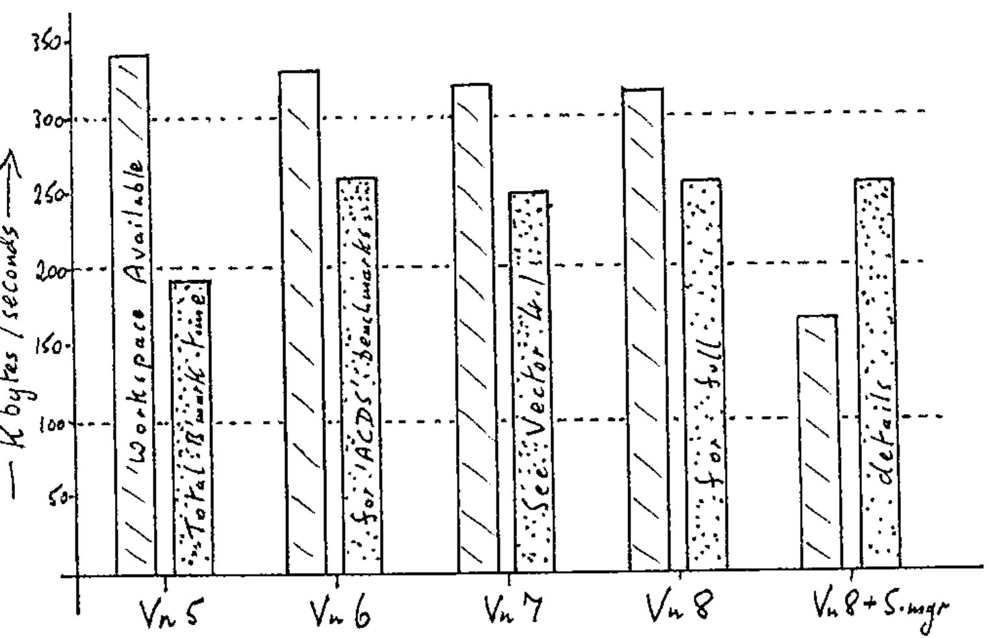

*by Adrian Smith*
{ .byline }

I started with APL\*PLUS/PC back at release 4.0, running on a 256K IBM PC, with twin floppy drives. It took about 10 sec to load from disk, and it gave me just over 100K of free workspace. It also ran rather fast. The graph summarizes one view of progress since then:

**The March of Progress?**

In other words we have been forced into sacrificing speed and economy for a whole raft of new features that most of us could well do without. It isn't just APL that suffers from this disease; MS word (release 1.0) would run on similar hardware very happily, it now requires most of 640K and a hard disk. It is also a good deal slower than it was at the simple task like scrolling around your document.

The new session manager (avoidable with APL\*PLUS/PC) is unfortunately an integral part of the II system. It is so gross that you have to shoehorn it to fit into a 500K machine: yes that's just for the session manager - the APL runs in high memory!! Let me make a few comments about its effectiveness (since all the STSC handouts concentrate only on the functionality):

- with the default keyboard layout, you need to hold down *three* keys to do that most obvious and common operation - erase to end of line. On the majority of PC keyboards, the three keys in question are so arranged that this has to be a two-handed operation!
- the APL function editor `⎕EDIT` no longer indents labels and comments. If there is a way of turning this feature on, would STSC please tell me about it; I can't find anything obvious in the manuals.
- the session scrolling is a lot slower than it was in APL\*PLUS/PC. I reckon that Ctrl+Up goes by faster on my plain old 8088 PC than on my whizzo 386 machine; what's more it stops when I take my finger off! The II system badly needs anti-skid braking!!
- the same problem occurs in the editor, only it is much nastier here. As an example, I set out to delete the last 20 lines from a 30-line variable; I held down Ctrl-Delete for just long enough to see the last unwanted line vanish, then was a little put out to see the editor swallow the remaining 10 lines, back up to the top! To add insult to injury, it then beeped at me several times to admonish me for my attempt at deleting the non-existent line[0].

This sort of thing is absolutely typical of many of today's software products. STSC are on record as saying that they listen to their users, and that their policy is to include everything they can directly into the interpreter. As with the Lotus Corporation, the result is a bit like 123-Version-3; full of features, but so slow that no-one will use it!

To summarize: if your user-environment has gotten so goddamn complicated that only someone with a Black Belt in Origami could drive it - don't try to alleviate the situation by adding another layer of confusion (in the shape of those useless pull-down menus); redesign it. Even better, buy a copy of Dyalog APL.
