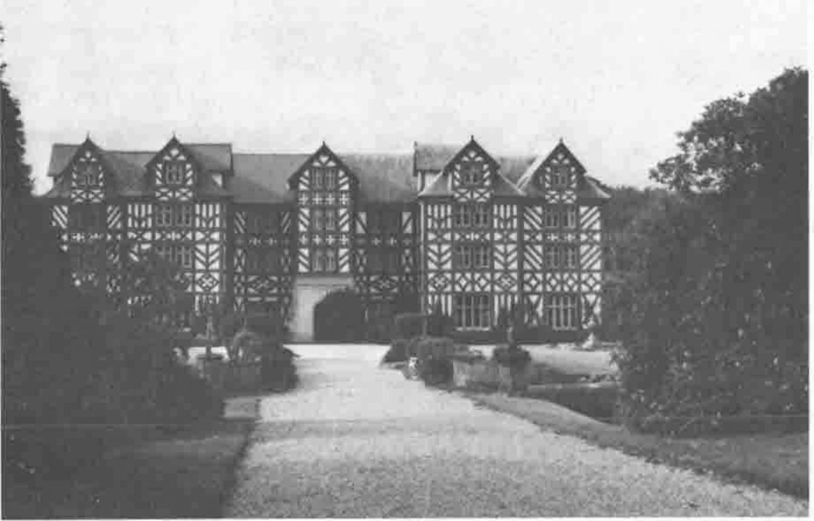
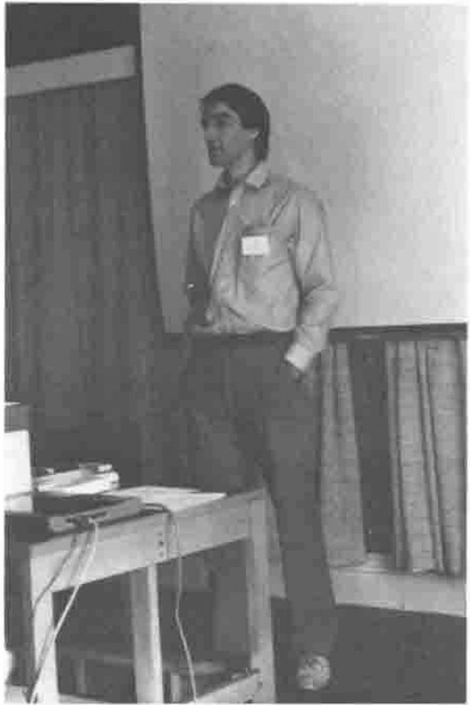
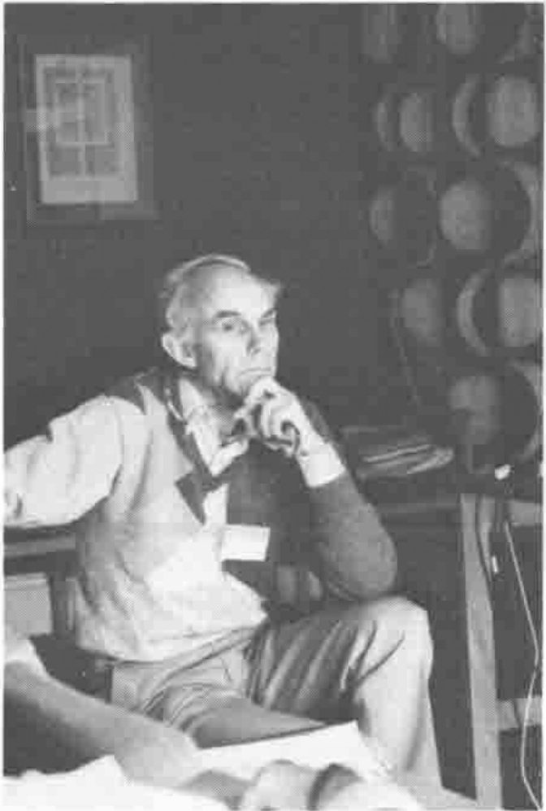
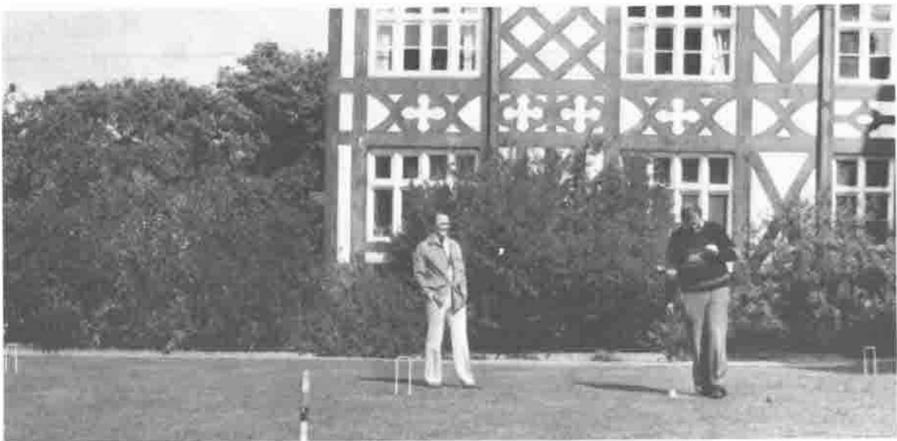
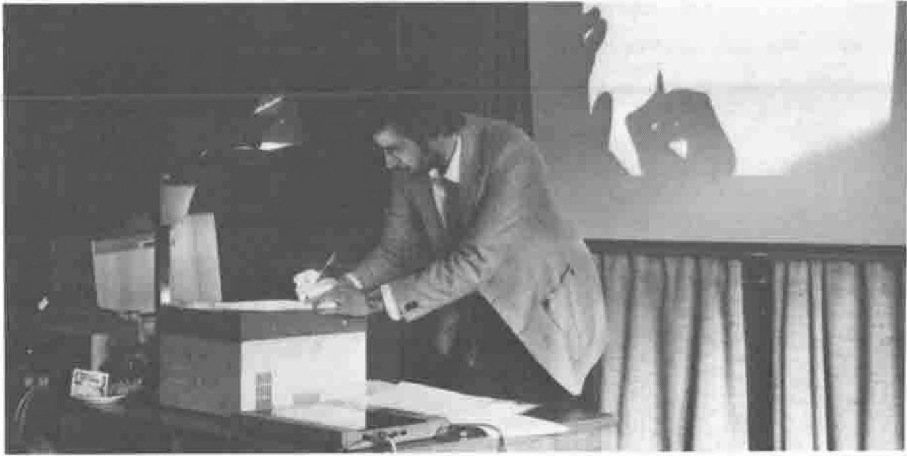
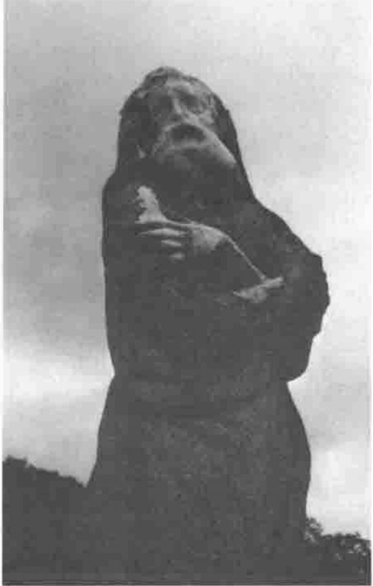

## The ASL Conference

*A report by Alan Sykes*
{ .byline }

The APL Statistics Library Project (ASL for short) was launched with a conference, held at the University of Wales Conference Centre at Gregynog (pronounced Gre-*gun*-ug ... Ed) near Newtown from the 18th to the 20th of September. It was attended by 29 people, 18 from academia and 11 from industry and commerce. All had a splendid time working hard during the day, and relaxing/imbibing in the evening. All agreed that it was a very successful event. So what did we set out to do, what did we achieve and what has happened as a consequence?

**Greg-y-Nog Hall From the Gardens**

The aim of the conference was to discuss the feasibility of the ASL project, to listen to talks and discuss proposals on the content and methodology of the project, and to set up a management structure and appropriate working parties for ASL - quite a task for just over 48 hours. However all participants worked very hard and considerable progress was made towards these aims.

Tony O'Hagan (of the Department of Statistics at Warwick University) started the conference off with a brief introduction to ASL. Tony suggested the library should consist of 'shelves' - and we were quickly led by Norman Thomson into a comprehensive suggestion for the 'bottom shelf' together with a rather daunting list of urgent topics for consideration under the general headings of:

1. Management
2. Programming/Computing
3. Statistics/Numerical Analysis
4. Further Shelves in the Library

**Tony O'Hagan Leads off the Conference**

**... while Norman Thomson Listens intently!**

Not surprisingly, tea was required after we had plunged so willingly in at the deep end. (Gregynog teas are a worthy reward for any conference session!) Duly refreshed, we returned to the conference room to be further entertained and enlightened, this time by Adrian Smith on a topic he is well qualified to propound - what constitutes good APL code. It was a salutary experience for us academic APLers as we realized how many of the bad coding methods that Adrian exposed were endemic in our hitherto prized APL functions. After dinner, Alan Mayer presented some thoughts on the teaching of Probability and Statistics using APL, rounding off day one of the conference.

**Relaxing (?!!) on the Croquet Lawn after Tea**

The next day was divided basically into to two different types of sessions. In the morning Tony O'Hagan presented his thoughts on how the core graphics functions in the bottom shelf should be constructed, based on his experience with 'WAGS' at Warwick. Jake Ansell and I then tackled the favourite APL statistics topic - that of Regression Analysis.

By contrast, the afternoon was devoted entirely to parallel workshops on the topics so far presented, namely the Bottom Shelf, APL Coding Standards, Graphics and Regression. As a bit of light relief, a musical entertainment (for which I must take full responsibility!) finished the day off.

**Martyn Adams of MetaPraxis**

The final day of the conference consisted of suggestions for further ASL shelves - on Time Series (given by Andy Pole) and on Reliability Modelling (by Jake Ansell). To balance the statistical input, two presentations were given on constructing packages in APL, by Martyn Adams and Maurice Jordan. And finally Tony O'Hagan brought all the conference contributions together in a planning session.

So what conclusions did we come to, and what decisions did we make? Everybody agreed that ASL was a worthwhile project and should go ahead, though we were all well aware of the enormity of the task, particularly as so much of the input would require that rare commodity these days - participants' spare time! The detailed decisions were later written up by Tony and presented to the BAA for their approval in the following article entitled 'ASL after Gregynog'.

**A Bard's Eye View of the Proceedings**

Thanks must go to the BAA for their unanimous support of the ASL conference and project, and in particular to David Eastwood who was always available for advice when it was most needed. But above all I must give thanks to all who so willingly participated in the conference - if their enthusiasm is maintained and appropriately channelled into productive work, then the success of ASL is a realistic target.

## ASL after Gregynog

*by Tony O'Hagan*
{ .byline }

The ASL conference at Gregynog proved a tremendous success. In two and a half days, the whole ASL project has been given a new and much clearer shape and a greatly increased impetus.

### Decisions Made

1. ASL should go ahead in the form and according to the timescale described below.
2. ASL should consist of APL functions primarily to perform statistical calculations, with basic facilities for displaying the results (including some graphics), but without attempting to develop a sophisticated user interface.
3. ASL should be independent of commercial interests, and the ASL functions should be made freely available for only a nominal charge.
4. ASL should be documented in book form, giving detailed information on the functions including full code. This book will thereby set the standard for statistical computations in APL. The functions should also be made available in machine-readable forms.
5. The form of ASL described above is intended to be the most useful resource for statisticians who are already familiar with APL. Packaging ASL with a user-friendly interface would not be helpful for such an audience, and would even be an impediment to realising the power and flexibility of APL. However, it is vital to reach wider audiences. For the statistician who is not familiar with APL, a tutorial text should be written to explain how to use ASL for common statistical analyses. If this book is well done, the power and elegance should tempt the reader to learn APL.
6. The even wider audience of users of statistics packages will need a user-friendly front end and more eye-catching graphics. There should be a real commercial interest for companies to provide such a package. The market is large, and the basic computational code will have been done for them already. Commercial exploitations of ASL for this and other markets should be licensed so as to provide income to continue the development of ASL. The financial management should be handled through the BAA.
7. The language for ASL should consist of ISO standard APL ('first generation') plus nested arrays. The use of nested arrays permitted in ASL should be carefully defined so as to be compatible with as many 'second generation' interpreters as possible. This means that ASL will not be compatible with the Sharp approach, but there should be no other problems, and it was felt that to confine ASL to ISO APL would be short-sighted. However, nested arrays are inevitably more complicated for the user, therefore they should only be used where they confer a distinct advantage over the simple arrays.
8. ASL should not exclude any branches or methods of reputable statistical analysis. As a consequence, ASL is potentially very big indeed. Many of the decisions which follow reflect this fact.
9. ASL will need a variety of high-level library management and information tools. Users will need to obtain information about what functions are available for specific tasks, and to be able to extract those functions together with all other functions called by them. Such 'anthologies' of functions, which form a coherent group to perform a particular kind of analysis, will cut across any structuring of the library into 'shelves' or 'volumes'. Standard 'anthologies' should be readily available for common needs.
10. A number of guidelines for good coding practices were agreed. The need for naming conventions in a library was stressed. A full set of standards should be defined soon.
11. A large, highly interconnected library will be very vulnerable to bugs introduced when functions are changed. Change is inevitable as ASL grows, but changes to existing functions must be rigidly controlled. It is particularly important that the utility functions in the bottom shelf be got right from the start.
12. The time-scale for ASL needs to be realistic. The programme of work that was initially submitted to the BAA was reviewed. It was decided that more time should be allowed in the first months for establishing the fundamental structure, standards, development and management tools, etc., in the light of the increased size that is now envisaged for ASL. The bottom shelf and regression shelf should be written as previously envisaged, although it is now recognised that in those forms they will be far from complete (Completeness will never be a property of ASL!) The extra work on fundamentals will delay the regression shelf by three months, so that the programme is now as follows.

    October-December 1989 - Finalise standards. Write development and management tools. Write preliminary version of the bottom shelf.

    January-March 1990 - Test and prove bottom shelf, leading to selected release. Specify regression shelf.

    April-June 1990 - Finalise bottom shelf for general release. Write preliminary version of regression shelf.

    July-September 1990 - Test and prove regression shelf, leading to selected release.

13. The bottom shelf should: (a) provide a basic statistical analysis capability at a level appropriate to a first course in statistics, e.g. 'A' level or first year university, and (b) include basic utility functions of all kinds, for use in other shelves. As for ASL, as a whole, the emphasis is on numerical functions, supported by basic display facilities.
14. The bottom shelf will include graphics functions written in a graphics primitive language based on the Warwick APL Graphics Standard (WAGS). Implementations of WAGS should be developed to drive a range of graphics devices from a choice of interpreters. However, implementation should be left primarily to vendors, since it will be in their commercial interests to make ASL usable with their products.
15. ASL will be coordinated by a small group of people. It was not clear that 'committee' would be an appropriate word for this group in the absence of any formal constitution, so I will call them the Management Team. The following were nominated.

    Tony O'Hagan - Chairman 
    Jake Ansell - Manager 
    Alan Sykes - Vice Chairman 
    David Eastwood, John Searle - BAA Representatives.

16. The specifications and development of each part of ASL will be the responsibility of a small (2 or 3 person) Working Party, reporting to the Management Team. The Manager will be responsible for the Programmer, providing programming support for the Working Parties. The following Working Parties were envisaged as being needed at the outset:

    Standards and Tools 
    Bottom Shelf Statistics 
    Bottom Shelf Graphics 
    WAGS Implementation -

17. The involvement of the wider statistics/APL community in ASL is vital. Communication will be through the APL Statistics User Group. Major developments should be reported in VECTOR.

## APL is a *Very* Funny Language

*as sung by The Alan Sykes Trio*
{ .byline }

1. A P L ers use these funny <u>symbols</u> - upgrade, 
   downgrade, rho and many more. 
   When you get them talking and <u>drinking</u> 
   God, they really are an awful bore!

( with a jot-dot here and a jot-dot there - here a jot, there a jot, 
everywhere a jot-dot... )

*Chorus* 
*APL is a very funny language - it is one of the very best;* 
*Won't you come and join the B A A?*

2. Adrian Smith says you must stop all <u>looping</u>: 
   always go to `Exit` when you end 
   Avoid all brackets, design before you write it - 
   That's enough to drive you round the bend.
{ start="2" }

*Chorus* 
*APL is a very funny language - it is one of the very best;* 
*Won't you come and join the B A A?*

3. Norman's tried to inculcate some <u>standards</u> 
   Do you mean by `MEAN` what I mean too? 
   On his shelf are lots of lovely functions 
   How to use them, no we've not a clue
{ start="3" }

*Chorus* 
*APL is a very funny language - it is one of the very best;* 
*Won't you come and join the B A A?*

4. Alan Sykes is definitely the <u>key</u>-man 
   He has brought us here to Greg-y-Nog 
   Perhaps we'ed better take him for a walk now 
   Get him stuck right in a good Welsh bog
{ start="4" }

*Chorus* 
*APL is a very funny language - it is one of the very best;* 
*Won't you come and join the B A A?*

*Won't you come and join the B A A*

