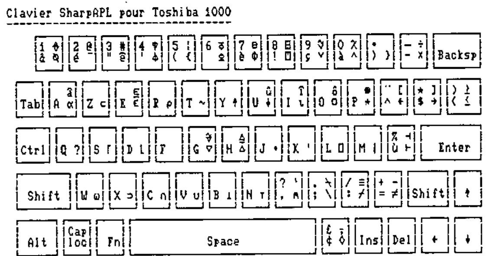

*From: Alain Delmotte, Rome 29th of May 90*
{ .byline }

I read with interest the article of Adrian Smith on the Falkoff keyboard (VECTOR 6.4 p.92). As an inveterate French speaker and typist, I completely agree with the first precept of Falkoff: "If a symbol is shown on a key, then that is where it should go." This makes justice to other languages keyboard layouts.

This is what I did for the SharpAPL/PC and tested also with APL\*PLUS. On a French or Belgian keyboard (AZERTY) figures are .uppercase, some specific symbols appear (accented a,e,u and ç) and some common use symbols (@#\\^[]) are obtained with Ctrl-Alt-key (key being the key on which these symbols are engraved in front).

I enclose an example of my keyboard on the Toshiba 1000. The left side shows the base and shift normal keys (the engraved normal keytop). The right side shows the Alt and Ctrl combinations (for APL\*PLUS Alt-Shift in place of Ctrl).



\\ was moved from the <> key to leave room for ≤≥. Mu not existing in `⎕AV` was replaced by ¢. There are sometimes problems with the <> key (scan code 43); when redefined it could move to the left of the &1 key or to the left of the W key depending on the keyboard.

It is also possible and very useful to define the numerical keypad in APL\*PLUS (Numlock) as it is in SharpAPL: + gives a blank and - a high minus. Smith’s arguments would be:

```apl
  NKEY←74 78
  NKEYDEFS←⍉2 6⍴'-¯ +   '
```

Yours sincerely

Alain DELMOTTE

N.B. I think that Smith’s `⍴AFKEYS` should be 51 7 with APL\*PLUS **unified** keyboard, the Shift-Alt being in position [6] with `⎕IO←0`.
