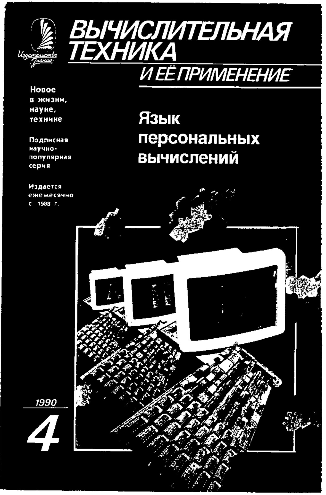
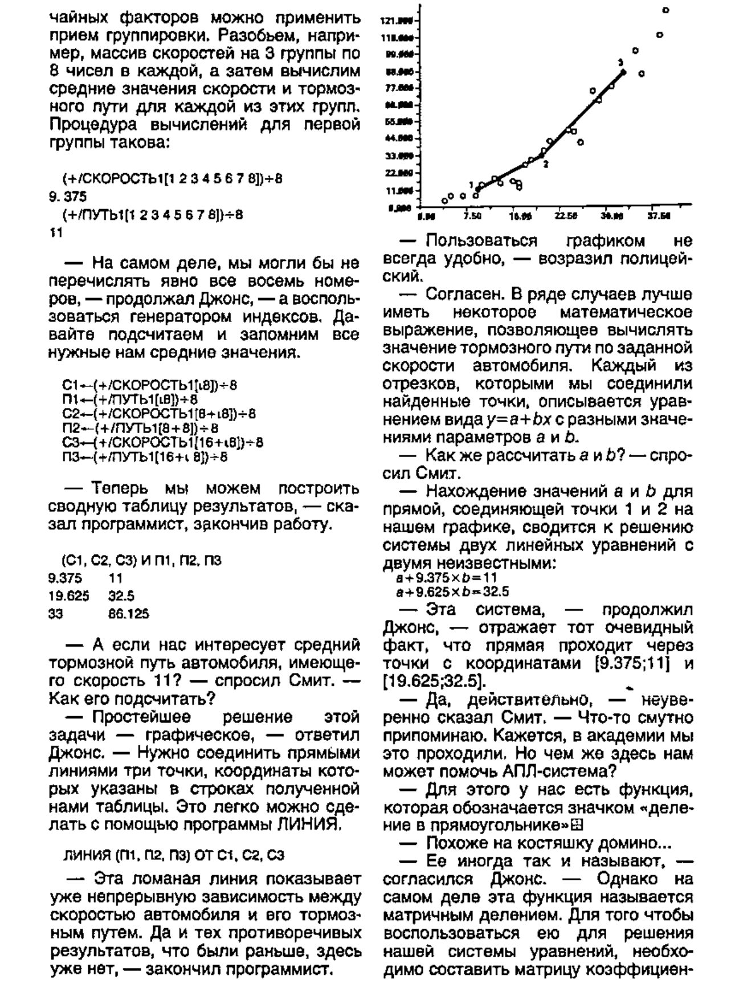

*Translations by Peter Saunders*
{ .byline }

At APL 90 Alexei Miroshnikov and Andrei Kondrashev gave away copies of the Russian magazine that is nearest to Personal Computer World or Byte. The April issue is devoted to APL (40 or so of the 48 pages). We thought Vector readers would be interested to read some of this in English, and to see a couple of pages reproduced from the original.

Extracts from:

***Computer Technology and its Application* No.4, 1990**

## [Editorial] The World of the APL Language

No programming language appears to inspire as many disputes and mutually exclusive views as APL. The outstanding programming theorist, J.Martin, has pronounced on APL, "This is a super high level language, the only candidate so far as a fifth generation language". Another no less authoritative scholar, E. Dijkstra has called it "error brought to a state of perfection". In his book "The Mythical Man Month" F. Brooks remarked that if he had to rewrite the IBM 360 operating system he would start by modelling it on APL. In another publication someone miscalled APL "Chinese Basic".

APL is practically unknown in the USSR although the number putting it to practical use world wide has been estimated as hundreds of thousands. Following several years active and successful work with APL the authors of the article decided to write the brochure presented here so that Soviet Computer users could also discover and, we hope, come to love the amazing world of APL.

To love it - means to understand it...

## Languages, Programmers and Programs

*by V.M. Kuprianov [Reproduced in full]*
{ .byline }

> "How poor our language! My ambition foiled, 
> The limpid storm cloud in my soul 
> Remains opaque to friend or foe." *A.Fet*

Machine languages are numbered in hundreds and more are written every day. Most widely used ones - FORTRAN, BASIC, COBOL - are neither user friendly nor linguistically structured.

The main cause of programming 'Tower of Babel' is the limitation of each language to a fairly small task set. Each new demand/application calls forth a new language so arguments about their respective merits are not well founded.

There are no good or bad languages: a programmer just picks the one most favourable to writing a good program in his field.

To 'What is a good program?' professional programmers answer 'one that works as fast as possible while using the least processing resources'. At the present stage of development that answer is unsound. When computing technology was expensive and limited, merit lay in using hardware almost as economically as possible with machine code. Today's situation quite different. The ratio of hardware productivity to expenditure on achieving it has multiplied a million times whereas programming costs rise continually. Parameters for assessing program quality have changed.

A good program is quick to write, easy to polish, reliable (no bugs), transparent to the customer, easy to modify. No traditional language scores many points. Some - PASCAL & MODULA - deliver reliability but not the paramount requirements - speed of writing and cheapness.

The programming backlog is growing faster than the number of programmers. Cheaper & faster hardware only increases the problem. With prevalent methods no conceivable number of programmers could soak up the work. If nothing is done [at current rate of growth] by the year 2000 the WHOLE labour force of the developed world will be programming. IT specialists estimate programming productivity must grow 50-100 times but in the whole history of computing it has grown 4-fold.

Must use more powerful languages and automated programming where possible. That doesn't mean end of PASCAL, SI[sic], & COBOL as high grade programmers (systems programmers) and traditional languages will be essential for writing the new languages' operating systems & data base systems etc. Applications programs are quite another matter to which mechanised automated programming & more powerful languages are ideally suited.

Lion's share of work will fall to end-user able ideally to program own applications. Machine language 'competence threshold' too high so languages for non-professional must become more powerful.

APL has all properties mentioned. Simple, easy for beginner, not at all primitive, ten times the productivity of FORTRAN or PL/1. APL programs an order or two shorter so that much cheaper.

## Historical Perspective

*by A.I. Miroshnikov*
{ .byline }

[An extended article giving the full history of APL. The following extracts cover the history in the USSR]

Late 70's Prof.P. I. Meadow of Toronto University brought two MCM/70's to Soviet Union and many took up study of APL.

End 70'S: impressed by APL on trip to Canada Academician Moiseev initiated development of first Soviet system, APL/BESM-6 by S.M.Prokhorov in the AN computing Centre of the USSR (BTsAN) and in 1978 in an Obninsk institute the APL/VIDEO system for an ES EVM was introduced - adapted version of APL/360. Lead by E.T.Semyonov group of programmers started work on Soviet APL system in Moscow Energetics Inst.

1979: first use in Leningrad on powerful Cyber 172 machine by AN USSR computing centre.

1984: working on a system for processing images the Novosibirsk Computing Centre developed one of first APL parallel interpreters; IBM and IPSA presently working actively on APL systems for multiprocessor complexes.

1985: the AN USSR Computing Centre produced the first Soviet APL system for a minicomputer, the SM-4, which has since spawned a family of systems for minis, micros and PC's with the general name APL/VTsAN.

1986: first annual All-Union APL conference. A hitherto informal working group is being formalised to popularise APL in the USSR and coordinate developments using it.

1987: first Soviet APL machine built on basis of DVK and Elektronika 60M micros (v. Microprocessors and Systems 1989. No.4).

1988: First Soviet organisation devoted exclusively to production and distribution of APL products (the 'Dialog' scientific and technical cooperative); its latest product is the powerful APL/85 system for the 'Elektronika 85' PC.

Despite its 25 years existence APL is still considered a new language. The unique property of easy expansion conferred on it by Iverson enables it stay up to date and popular.

## What is APL?

*By A.V. Kondrashev*
{ .byline }

> "There are many things that we don't understand, not because our understanding is weak but, because they don't enter the circle of our understanding." *K.Prutkov*

APL allows one to code the specific structures of algorithms with the same ease as one can represent mathematical ideas with algebra. It is strikingly compact - average APL program length is 10 lines! Programming productivity is much higher than with compiled languages like PL\1 or PASCAL and other interpreted languages like BASIC. The programmer can concentrate on getting doing what he wants with the computer's help instead of on the problem of how to program it.

### The APL Language and the APL System

The language is a formal notation for writing Information processing algorithms - pen and paper, chalk and blackboard can be used.

The system is a special program permitting communication with a computer in APL, conventionally called a dialogue integrated medium including all the computer controls a user needs, its own concept of dialogue organisation, and techniques for developing, polishing, saving and using programs.

Imagine that you have a clean piece of paper, a pencil, and a calculaotr. In the drawers of your desk are the notes, calculations, or drawings you have prepared earlier. On the bookshelf are textbooks and reference books. The daily environment in other words of the engineer, the scientific worker, the student and university or school. The APL system is constructed in just the same way with just one difference: the role of the piece of paper is played by a computer's memory and the sheet, called in APL the working area, can reach several megabytes. The keyboard fulfils the role of pencil and the screen is the communication link between system and man showing what is stored in the working area or the answer to a question. etc. etc... The APL user can always copy any program or array of data into the working area just as he would copy references, formulae and quotations onto his paper.

The APL system working area can hold as many program and blocks of data as its dimensions allow. Programs and data are quite independent of one another just as the same variable can form part of different mathematical formulae.

The laconic language makes communication with the system very productive as the time spent entering information is practically nil, very different from BASIC say which requires the programmer to expend no little effort on 'stuffing' even the simplest of programs. With the entry of only one line the APL system allows one to accomplish tasks that would demand tens or hundreds of lines in traditional languages.

..... [A 12 page tutorial on APL follows] .....

Here we finish this section where we hope to have given you the most general presentation of the APL language. The vast majority of its powerful tools have not been mentioned but one of the advantages of the language is that no matter what you do not know you can still work in it. No one uses all APL's facilities - it is inexhaustible...

## APL in the Analysis of Data

*by O.P. Lushka*
{ .byline }

[The article deals with use of APL in statistics ... here is a page from the original!]

