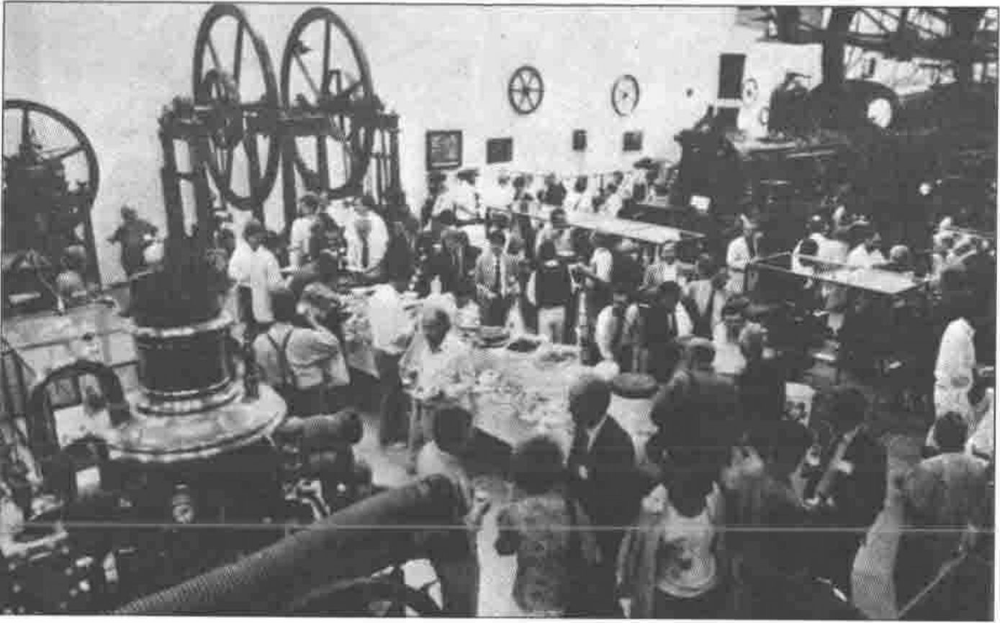
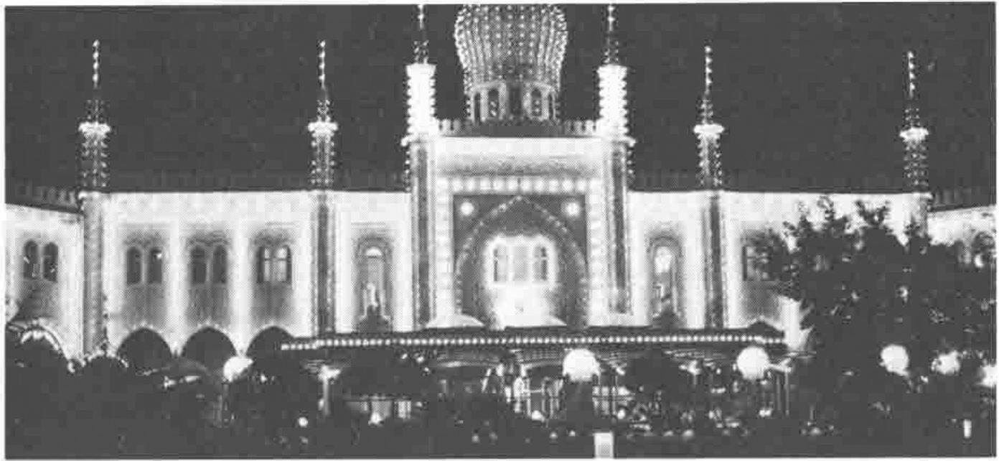
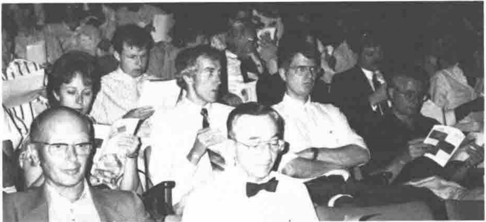

*by Anthony Camacho*
{ .byline }

What is it that would make an ideal APL conference? No doubt everyone will have a different view. Here is mine with, I hope, a fair assessment of how well APL 90 lived up to it.

The ideal conference would help to make APL more widely used, teach me how to be a better APLer, give me code and other help in doing my job better, inform me about the state of the art (and what hardware and software I ought to want for my next system). It would also entertain me, give me time and opportunity to meet as many people as possible, and be held in an attractive place (where I would like to stay on and have a holiday). And if any conference ever did all of this I would be dead of exhaustion at the end of it.

*High IQ in Helsingør (from the Helsingør Dagblad)*
{ .caption }

How did APL 90 measure up? It was well organised. All events ran smoothly. The conference bureau was friendly and efficient. The proceedings were posted to those who registered early so that a determined person could have read all the papers beforehand and made much better-informed decisions about which presentations to attend than at any previous conference. I welcomed this and hope other conferences will do it. The selection of papers was broad and the quality seemed to me to be at least up to the standard of previous conferences. There were more invited papers than usual and they were most of them very good. The get-together on the opening night was a success; it was held in the Danish science museum at Helsingør - a very good location with interesting exhibits from early computing and electronics - and very enjoyable. The banquet too was good and held in one of the best restaurants in the Tivoli gardens. Wine was supplied and the main dish was reindeer - very tasty. We were able to walk round the gardens before and after the meal.

*Restaurant Nimb on leaving the Banquet*
{ .caption }

The organisers deserve our thanks and congratulations on an excellent job. They had bad luck too: the original venue, the Marienlyst Hotel, went out of business at the critical moment and the conference had to be moved in haste to the Falkoner centre. The consequence was that people were not so well collected together. They were spread among many hotels and although the Falkoner centre has plenty of space and places to sit and talk, I fancy APL 90 was less of a social occasion than it would have been if the original venue had been possible. But it is fair to say that if I had not known that the conference was originally to have been elsewhere, I don't think I could have told. It was undoubtedly well done. Among the 'free' items given to every delegate was a pass for all central Copenhagen buses and trains and a pass giving entry to the Tivoli Gardens on two days.

Even if the conference had been held where originally planned, I feel it would not have done much to help spread the use of APL. In a way, of course, by encouraging people who work at this, it did help, but the complaint about New York, that it probably didn't recruit ten new people to use the notation, is also valid for Copenhagen. It was, of course, slightly more expensive than the general run of conferences. Not too expensive for companies, but too expensive for most other people. Perhaps it was this that reduced the size of the audience; perhaps not. It is a pity that the organisers were not rewarded by a bigger audience; there were about under 300 paying delegates, I am told. I hope that it was not a financial failure because it was certainly a success as an event. The APL world has not discovered how to ensure there are enough delegates at conferences; I hope that the APL 91 committee, who are making such determined efforts to publicise Stanford, strike upon a more productive way to obtain delegates.

The good planning extended to the software library which had collected most of its offerings well before the conference and was ready with complete sets of copies from Tuesday onwards. Indeed some contributions were delivered too late to get into the early sets. A first-rate job was done here with little fuss.

In contrast to the excellent software library, there were no books on sale. Perhaps there is no Danish APL bookseller. We would nowadays have difficulty in providing one in the UK. Probably the delegates to APL 90 already had all the APL books they wanted. Nevertheless I would like to see books at such a conference. I am sure that most of the delegates had not seen Norman Thomson's book "APL for the Mathematics Classroom" and many would have been interested. Perhaps it would be carping to point out there was no education day, only three papers in the education stream, and as far as I could see practically no delegates from schools.

One of the events worth mentioning was the FinnAPL dinner in the Danish Royal yacht club building close to the little mermaid. They gave the best meal of the conference to the Russian visitors Alexei Miroshnikov from Leningrad and Andrei Kondrashev from Moscow, and to everyone they thought might be able to help spread the use of APL in the USSR. Apart from the meal, the speeches were excellent and sensible and there was ample time for everyone who wanted to buttonhole the principal guests to do so. FinnAPL are to be congratulated for what may be a trailblazing effort. SigAPL even mentioned that they are considering Leningrad for APL 92! This contact may encourage the richer APL organisations to support the Russians in spreading APL further through the USSR.

After the get-together in the Science museum, some of us were invited by Henri Brudzewsky to drinks at his house "twenty minutes walk away through the woods". This 'midnight hike' became one of the jokes of the conference. Either Henri can walk faster than the rest of us or the party lost its way in the dark, probably the latter, because we measured it later on a large scale map and it was 2.50 kilometres. I'm glad I had a lift: the rest of them took over an hour! They saw quite a lot of the local wild life on they way I hear. But everyone including Ken Iverson himself survived the journey and some people enjoyed it. Now poor Henri gets teased whenever he says something will take twenty minutes - "You mean as in '20 minutes walk'!". They were quite good drinks too.

*Plenary Audience: Henri Brudzewsky, Gustav Tollet et al*
{ .caption }

The conference ended with two plenary sessions. In the first a magnificent series of images was shown by Hans-Peter Meinzer. His software (all written in APL) can create sections through and views of parts of the human anatomy. He was able to show us the head of a girl, first complete, then with the skin removed and gradually layer by layer distinguishing between tissues of only slightly different densities, to the bare bones. We were shown images mainly of heads. One could even view the inside of a head which was, in real life complete. One could view the brain as a cloud with the cerebellum visibly different and a tumour extremely distinct, and rotate the image to see from any angle exactly how the tumour lay with regard to the rest of it. Here is an application for a massively parallel APL machine if ever there was one; each image can take hours to calculate.

After lunch the final session by Baird Smith was not at all to my taste. First it had nothing to do with APL. Second it was much too loud, both in the sense of the loudspeaker volume and in taste. I have to admit that he is a showman and that he had quite a number of good jokes in his presentation, but for me this was bathos; after a good conference, with lots of good APL, to have a non-APL clown getting laughs from fairly hackneyed data-processing jokes.
