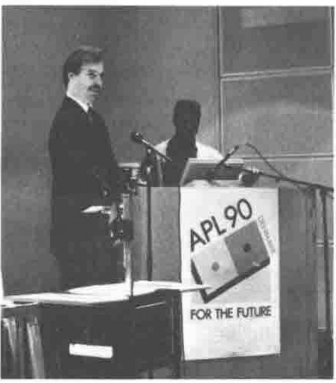

*by Ray Cannon*
{ .byline }

A week to the day after the end of APL 90, I received my copy of APL Quote Quad, volume 20, number 2, December 1989, in which an invitation to attend APL 90 was included! Luckily, the Danish end of the Conference was better organised, as I received the conference proceedings (APL Quote Quad volume 20 number 4) in July, 2 weeks BEFORE the conference started!

*Eric Friis and Stanley Jordan*
{ .caption }

This was the fourth International Conference on APL I have attended, and the one I have enjoyed the most. The standard of the papers was good, the organization excellent, the food superb, the location wonderful, and probably the best lager in the world!

The main difficulty I have with all such conferences is deciding which of the venues to attend. (APL90 as is customary, had 3 streams.) So, when I talk about the papers I found outstanding, at best I have missed two thirds of the conference. Since the theme of this conference was "For the Future" I decided to try to attend those talks about compilers, parallel computers, and APL linking to other languages with a secondary theme of windows, mice and CUA. I'll bypass the vendors' forums, the time allotted to them was a bit too short, and I felt that the ones I attended were not as good as the BAA's forum held earlier this year.

APL90 was exceptional for another reason. For the first time, delegates from the USSR attended an International APL conference. They gave two papers but I missed the first (it conflicted with one on my pet interest, parallel computers). However I managed to squeeze into the second "The Family of Soviet APL Systems" given by Andrew Kondrashev. This talk was a "sell out", some people were even listening from outside! I for one found it fascinating, for instance, (I hope I noted it down correctly), 37,000 copies of a Russian translation of "APL an Interactive Approach" by Gilman and Rose have been printed in the USSR.
