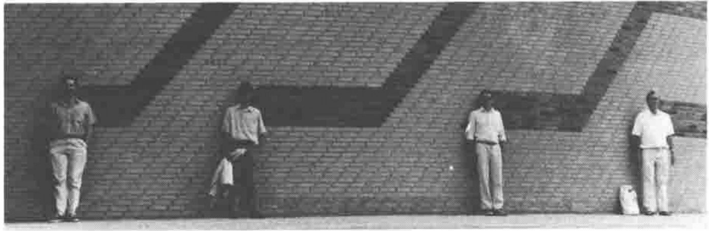
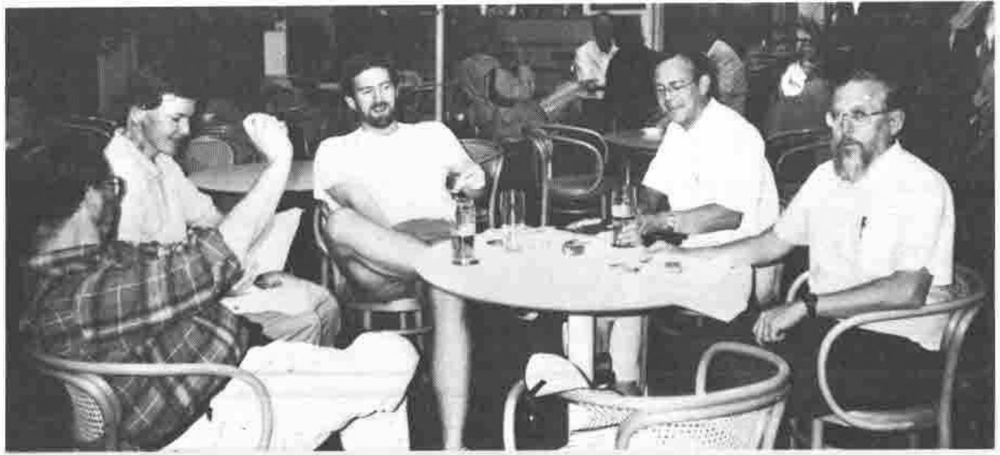
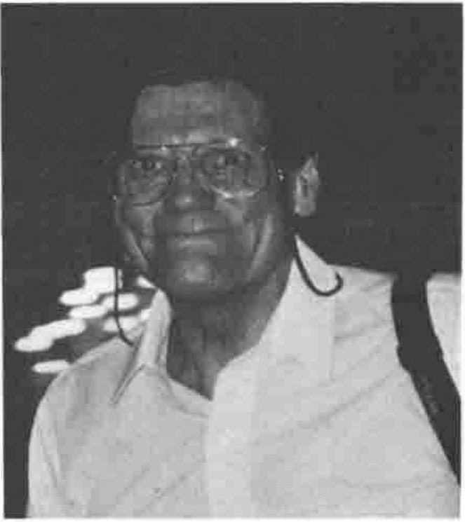
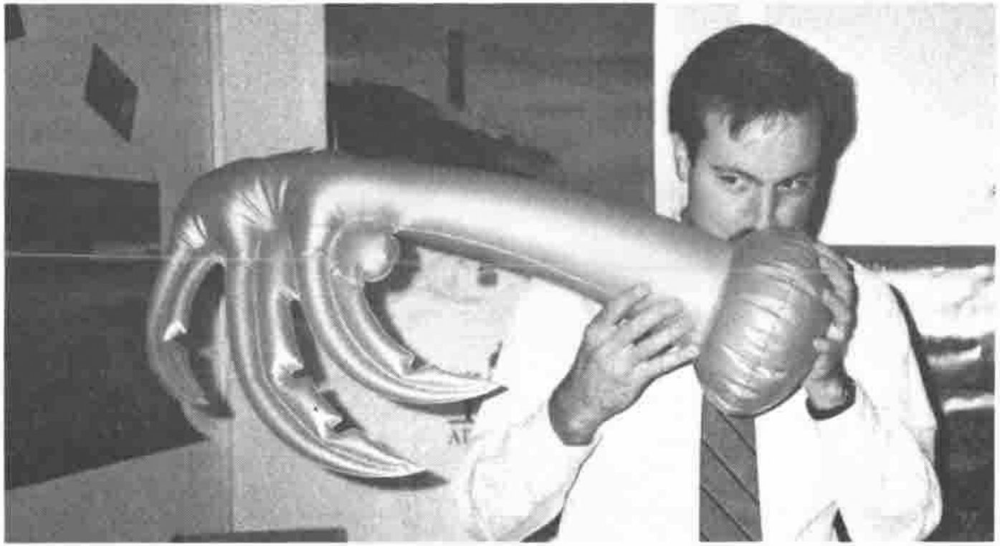

## The People, the Information and the Corporation<br>Mads Øvlisen of Novo Nordisk A/S

*reported by Sylvia Camacho*
{ .byline }

Mads' talk was professional, well structured and well timed with good slide illustrations. The interest for me was the insight he gave into a Company with a high research and development commitment (25% of employees). This R&D serviced the 44% of employees engaged in production and 21% engaged in marketing the products. The traditional business is a restricted range of pharmaceuticals, particularly insulin. Most R&D is concerned with biotechnology and disease control and other aspects of environmental care. The Company sees its edge over its competitors to be matching its products to the exact requirements of customers. For instance the development of insulin delivery hypodermics convenient for patient use.

There is some tension within Marketing because the direct customers are doctors which means that contact with the actual users, the patients, is mediated by the doctors who do not necessarily have the same priorities. One possible use of Information Technology is therefore to obtain feedback from patients.

Øvlisen made the point that management concern for the interests of the shareholders does not offer the Company a plan of action. This is an obviously true but perhaps not sufficiently realized part of free enterprise ideology. Øvlisen made two other points; that employees usually under-perform and that Companies become conservative because of management anxiety. His remedy for some of these problems is increased dispersion of information among employees and encouragement of their individual differences. This he sees as incompatible with a tight central control of computer systems by DP management.

Øvlisen gave as the major uses of IT within his Company:

1. Mailbox facilities
2. Medical Representative System
3. R&D including molecular modelling
4. IFCA

The mailbox was prominent among his interests because of the flexible and fast exchange of information that it provided to for a geographically widely dispersed sales force. The Sales Representative System he hopes to base on lap top computers to give management feedback from the grass roots. He made the point that there is no right way to manage R&D. The most that can be done is to match the risks and benefits over a portfolio of research projects and that this has to be directed from the top of the management hierarchy.

Mads' final comment was that the IFCA project which has a concept of adding information to products based on patient needs is a good but costly study by outside consultants and has the difficulty that the technical language used is not familiar to the management. This he said was his own problem and he feels that IT requires too much learning and encourages excessive emphasis on perfection whereas managers need to use less than perfect data. The problem is how to get a dialogue going between IT professionals and management so that if they are offered a better mousetrap they are able to decide whether they need to catch a mouse.

## APL\\? (or J) by Roger Hui and Ken Iverson

*reported by Anthony Camacho*
{ .byline }

Since this paper was submitted APL\\? has been named 'J'. Apparently even Ken Iverson does not know the reason why that particular name was chosen, although he must have assented to the name. Roger Hui chose it and keeps his reasons secret.

Ken Iverson told us that J is a dialect of APL, but it does not offer compatibility with any other dialect. The features it contains have been chosen without regard to any predecessor. This is interesting; it allows us to see what Ken Iverson and his collaborators like and dislike about their previous APLs.

J does away with the special APL symbols; all tokens in J are ASCII symbols or combinations of them. (This caused some dismay among the Scandinavians, who use the ASCII codes for the less used symbols for their special Scandinavian letters.) J preserves some things from APL: it has no reserved word, does not need spaces to punctuate its tokens, the tokens have mnemonic value but are not linked to any natural language, so it is truly international, but its tokens may be one symbol or two, whereas APL tokens are single. J simplifies and is more general than APL. Whereas APL has two 'parts of speech' the function (verb) and the operator (adverb), J has three (verb, adverb and conjunction) and whereas in ISO APL there are limitations which prevent adverbs modifying user-defined verbs, or even the existence of user-defined adverbs, in J there are no such restrictions. User defined conjuctions can join user-defined verbs as modified with user-defined adverbs.

In a brief review of the history of APL development he mentioned that Gene McDonnell had spoken about the 'sociotechnical' origins of APL at the tenth anniversary conference which was also in Copenhagen, and that APL\360 had been able to support 24 users when other time sharing systems had difficulty with three or four or five users. Many great improvements had been made over the years: Sharp had introduced: fast sum-over-booleans, fast indexing, membership, reverse, transpose, general arrays, complex arithmetic, fuzzy residue, dyadic grade, replicate. In 1982 Rationalised APL was circulated as an IPSA internal paper. In 1986 A Dictionary of APL was published and now in 1990 J.

The trends of Dictionary APL are:

1. Simplification of grammar and syntax
2. Operators significantly beyond APL\360
3. A uniform method for associating identifier with object
4. A strong emphasis on function rank, leading axes, major cells
5. The removal of dependence on such parameters as index origin
6. Exclude anything not functional<br>strands<br>bracket semicolon indexing<br>indexed assignment<br>bracket axis
7. A preference for functional rather than shape identities

Roger Hui told us something about the implementations of J so far. It is available on the AT&T 3B1, the Macintosh, the PC, the R6000, the MIPS R3000, the NeXt and a Philips machine. The implementations are written in C; the parser is a single page of code and all objects are held in a single C form, which contains the type, the reference count, the number of atoms, the rank, the shape and each atom. Most of the C functions accept arguments in this structure and return such results and, of course, all verbs, adverbs and conjunctions are held in this form as well as the nouns and pronouns.

J is to be freeware and the registration charge which brings a manual is to be $24. Copies of the PC implementation (which is not quite complete) were issued through the software library. The address of Iverson Software Inc. is in the product guide.

## Parallel Computing with APL

*reported by Ray Cannon*
{ .byline }

I have an interest in Transputers, so I attended the paper "An APL-Simulator of Non-Von Neumann Computer Architectures" written by A. Geyer-Schulz, Alfred Taudes and J. Mitlohner (who gave the talk). This paper showed how APL could simulate various parallel computer architectures. Unfortunately (for me at least) the paper did not describe transputer array simulation, but the simulation of a theoretical model of a PRAM-machine described by Parberry (*Parallel Complexity Theory*, New York, John Wiley & Sons, 1987). That apart, I found the paper well presented and most stimulating.



*Parallel APLers (in front of the Tycho Brahe Planetarium)<br>Jonathan Martin, Panagiotis Pantziarka, David Toop & Maurice Jordan*
{ .caption }

The next paper was "Automatic Parallelization of APL-style Programs" written and given by Wai-Mee Ching. (Some of you may remember Ching from Manchester where he gave a paper on an APL/370 compiler.) This paper talked about extending the compiler so that it produces 370 machine code to run applications in parallel mode on IBM 3090 multi-processors.

I talked to Ching about his work afterwards. He has written two compilers, one producing 370 machine code and the other generating C output. Both compilers by the way are written in APL and compile IBM VS APL!

Ching said that "Parallel computing is only interesting if it is transparent to the programmer". Some other gems from his talk I noted down include: "the compiler can find the parallelism in existing programs"; "data is parallel...use nodes not do-loops"; "to efficiently program on a parallel machine, write good sequential APL code".

The next paper in this vein was given by Robert Bernecky, "ACORN, APL to C on Real Numbers". This paper described how the authors wrote an APL to C compiler, in Sharp APL/PC, and had a prototype working within a week! The resulting C code was compared against hand-coded Fortran and benchmarked on a Cray super-computer. The final results show that APL should be able to be compiled to C to run at least as fast as hand-coded Fortran, but there is still a long way to go before we get there.

After giving his paper, Bernecky then chaired a session with an invited speaker Alan Huang, of AT&T-Bell Laboratories on "Massively Parallel Computing". This talk was all about "light computers", "micro-lasers" and "life after electronics". The units Huang is creating are so fast that standard electronic equipment cannot be used to measure their speed, and so small that his laboratory has equalled the world production of lasers, by producing micro-lasers by the thousand on single silicon wafers.

They can now produce "designer crystals" where each atomic layer can be laid down individually. However, Huang said that his physicists only understood HP Basic, his computer scientists Lisp but his machines required A Parallel Language.

## High Quality User Interfaces and fast Data Filing using a PC<br>by Jonny Österman

*reported by Ray Cannon*
{ .byline }

Jonny Österman of A-System gave a very good talk on "High Quality User Interfaces and fast Data Filing using a PC". This he backed up with a demonstration, using some of the tools from his APL toolbox (commercially available as "ABOX").

Talking to Jonny on the A-System stand, I discovered that we have both been working on very similar airline charter costing systems for different airlines, he for SAS and myself for BA. These are the only two charter costing systems either of us had come across, and both were written quite independently in APL. Jonny was using a cut down version of his to demonstrate his ABOX utilities, and I was very impressed.

## Compiled Language Interface in APL\*PLUS II by James Wheeler

*reported by Ray Cannon*
{ .byline }

In his talk, James Wheeler described how, under DOS, (which does NOT have dynamic linking) STSC's APL is able to call non-APL programs. With some background knowledge of 80386 assembler, it all made good sense, and was very revealing.

## Tutorials

*reported by Anthony Camacho*
{ .byline }

The tutorials given by Eugene McDonnell and Philip Benkard were, for me, the highlight of the conference. Both were excellent presentations; both gave new insights into the differences between the main streams of enhanced versions of APL; both contained much too much material for even the best reporter to capture. I hope that the following brief impressions will be superseded by complete accounts prepared with the help of the presenters.

### Tutorial in Dictionary APL by Eugene McDonnell

Gene pitched this tutorial to suit people who have some knowledge of Dictionary APL, boxed (and nested) arrays and the ISO standard. It was not a programming lesson but a review of fundamentals, concentrating on identities, symmetries and analogies.



*Dick Bowman, John Searle, Jonathan Martin, Maurice Jordan, & Lee Dickey relaxing in the Falkoner Centre*
{ .caption }

APL was contrasted with FBAPP (FORTRAN BASIC Algol Pascal PL/1) languages: in APL arrays are primitive objects whereas in the others generally a scalar is the primitive object. It is the way a language is parsed that determines its consistency. Gene explained a parsing table, against which expressions were compared from right to left 'until the binding drops' - that is until a match between the rightmost part of the line being parsed and a complete row of the table is found. Finding a match establishes that the part of the line being matched can be executed and the result substituted for the matched phrase before further parsing need be done. Incidentally it was pointed out how valuable it is that in APL it is not necessary to separate tokens by blanks. An analysis of the forms of expressions showed where data, function and operator strands would be.

Gene offered some snappy definitions of syntax and semantics.

> Syntax is what goes with what.<br>
> Syntax is what the user really learns.<br>
> Syntax is context dependent and of short scope.<br>
> Semantics is where the action is.

Dictionary BOX (`<`) was compared with APL2 ENCLOSE (`⊂`). Everyone knows the difference for shallow scalars, but how many of us can state the differences for other arrays? For example:

```apl
      3+<1 5
DOMAIN ERROR
      3+⊂1 5
4 8
```

So Gene suggested that `<` is semantics and `⊂` is structure.

### Tutorial in APL2 by J. P. Benkard



*J. Philip Benkard*
{ .caption }

Phil Benkard's tutorial was given at a faster pace. By using two overhead projectors a great deal could be shown and compared. Phil produced a fascinating series of insights based on analysis of the simple function to remove duplicates: `((⍵⍳⍵)=⍳⍴⍵)/⍵`.

I regret that I was unable both to follow and write down what Phil said and showed us; my notes contain enough pepper to cook a cauldron of soup, but they are too incoherent to offer to Vector. We have asked Phil if we can publish the full tutorial.

## Education Stream: Wednesday Morning

*reported by Anthony Camacho*
{ .byline }

### APL Trivia by Ed Cherlin<br>Reading to Write by Ray Polivka<br>APLegance by Norman Thomson

These three sessions formed the Education Stream. They were a delight to attend. Three expert presenters provided an object lesson in exposition. Your reporter was also the chairman, but his lack of notes is not serious since the presentations did not wander far from the papers in the proceedings.

Ed showed how APL's inner consistency can be revealed in apparently trivial ways. He produced a nice paradox: beginning with a definition of *trivial* which seemed to leave little scope for anything of importance to creep in, he showed how trivial functions and operators can be valuable both for what they do and for the improved clarity of the code in which they are properly used. Surely what is valuable is important.

Ray suggested that as in natural languages one does not normally write anything until one has progressed quite a long way towards learning to read, APL could be taught by getting the pupil to read code before writing it. He gave some lovely examples, many of which are in the appendix to his paper.

Norman highlighted a common problem of newcomers to APL2 - namely that they find they have enclosed their variables without realising it. His subtitle was 'The Art of Staying within One's Depth'. He gave many useful prescriptions and hints of great value in reaching a more intuitive understanding of APL2 facilities.

This was the education stream, yet there were several questioners who objected to some of the elegant and brief expressions shown on the grounds that they were not the fastest to execute. It was almost as if the only kind of education with APL they could imagine was teaching professional programmers how to earn their living with APL. The APL world ought to want APL to be used in the teaching of other subjects, where its simplicity, consistency and elegance are such a powerful advantage. Surely it is unreasonable to expect any implementation to be most efficient in its use of the machine on the briefest and most elegant expressions. Even if it is not unreasonable surely it is irrelevant. Nowadays machines are very cheap by comparison with the cost of the programmers' time; when the purpose is education the efficiency of the code really can almost be ignored. While so many APLers have their sense of values wrong about this, how are we to persuade the rest of the world?

## Looking Beyond APL2 and NIAL<br>Invited Speaker: Trenchard More Jr.

*reported by Anthony Camacho*
{ .byline }

This session was a tour de force on Array theory. It started simply by using the hands and feet as examples of hierarchy and nesting. Considerations of consistency and how to handle the degenerative cases of empty arguments according to their shapes and nestedness were dealt with in a breathtaking sequence of slides. Here are two of them. We hope to be able to persuade the author to publish an article about this in Vector.


*Two of Trenchard More's slides*
{ .caption }

## The K. E. Iverson Award for Outstanding Achievement

*reported by Anthony Camacho*
{ .byline }

SigAPL announced that the Outstanding Achievement award has been renamed 'The K. E. Iverson Award for Outstanding Achievement' and that the first renamed award goes to Ray Polivka.

Jon McGrew did the presentation and had prepared a splendid testimonial to Ray's work over the years. There were photographs of Ray with his classes, of him teaching, of the books he had written or collaborated in and even of him asleep in an armchair. (Ray later told us that Jon had insisted on Ray's company when he went to buy himself a suit and while he had it fitted Ray, tired after the day's work, went to sleep in an armchair in the shop waiting for him.) Jon's account of Ray's career was fascinating and beautifully illustrated. Ray's work in teaching and writing about APL must be well known to every APLer and the audience obviously was both delighted by the award and felt it to be well deserved.

And the award came as a complete surprise to Ray - he had not suspected anything when he was photographed teaching because it just so happened that no-one else was teaching when the photographer needed some urgent photos of IBM education - neither he nor Jo were even suspicious at the stratagems the organisers used to make sure that they would be present at the session when the award was announced. It was a heart-warming occasion.

## ACM SigAPL report: Lynne Shaw

*reported by Anthony Camacho*
{ .byline }

Lynne was pressed for time and the report this year was shorter than, for example, at New York.

**Quote-quad**: Prof L. J. Dickey has resigned and the new editors of Quote-quad are Adam Kertesz and Jon McGrew. The March issue of Quote-quad and the proceedings will be sent to members soon.

**Membership**: The membership trend is UP at the latest membership roster as of mid-June.



*Charles Schulz with the APL91 Palm Tree*
{ .caption }

**Conferences**: APL 91 is to be at Stanford. Charles Schulz made some announcements about it. The aim is to make attendance as easy as possible for people paying their own way or whose employers have little to spend on conferences. There will be cheap university accommodation as well as luxurious hotels for those who want them. It is hoped to encourage far more educators to attend without reducing the conference's value to the professional APL programmer. The APL 91 committee are eager to receive people's suggestions and ideas. They are making great efforts to circulate the call for participation as widely as possible.

APL 92 is not yet allocated. One suggestion is to hold it in Leningrad.

**A new award**: SigAPL intend to establish a new award for extending awareness of APL. Anyone who wants to suggest a recipient should contact SigAPL for details.
