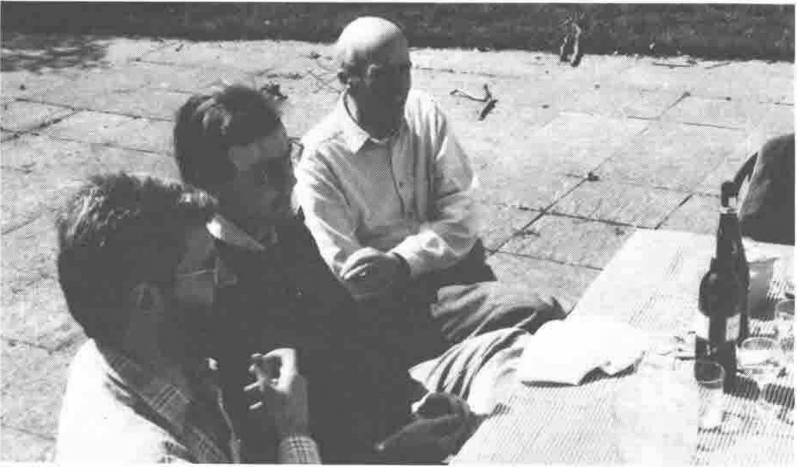
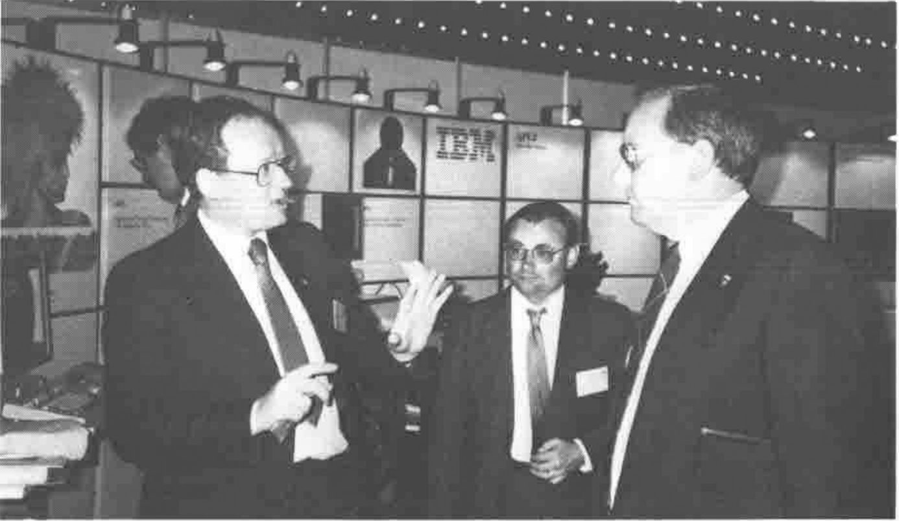
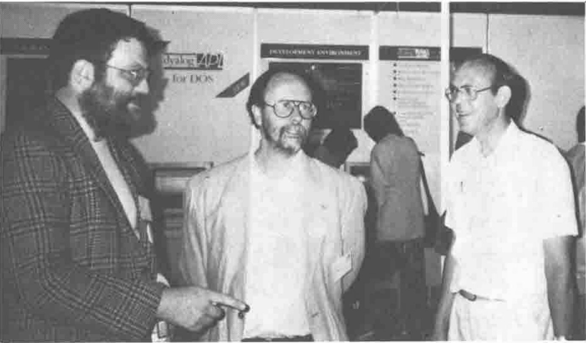
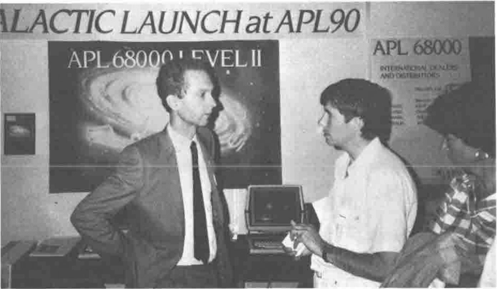

## Pictures at an Exhibition (I)

*The Vector Working Group plan their Campaign: Ray Cannon, John Searle, Jonathan Barman, and an excellent bottle of Australian Wine!*
{ .caption }

*Dave Selby, Ron Wilkes & Jim Brown on the IBM Stand*
{ .caption }

## Pictures at an Exhibition (II)

*John Sullivan, Dick Bowman and Maurice Jordan at the Dyalog APL Stand*
{ .caption }

*Richard Nabavi with David Crossley at the MicroAPL Stand*
{ .caption }
