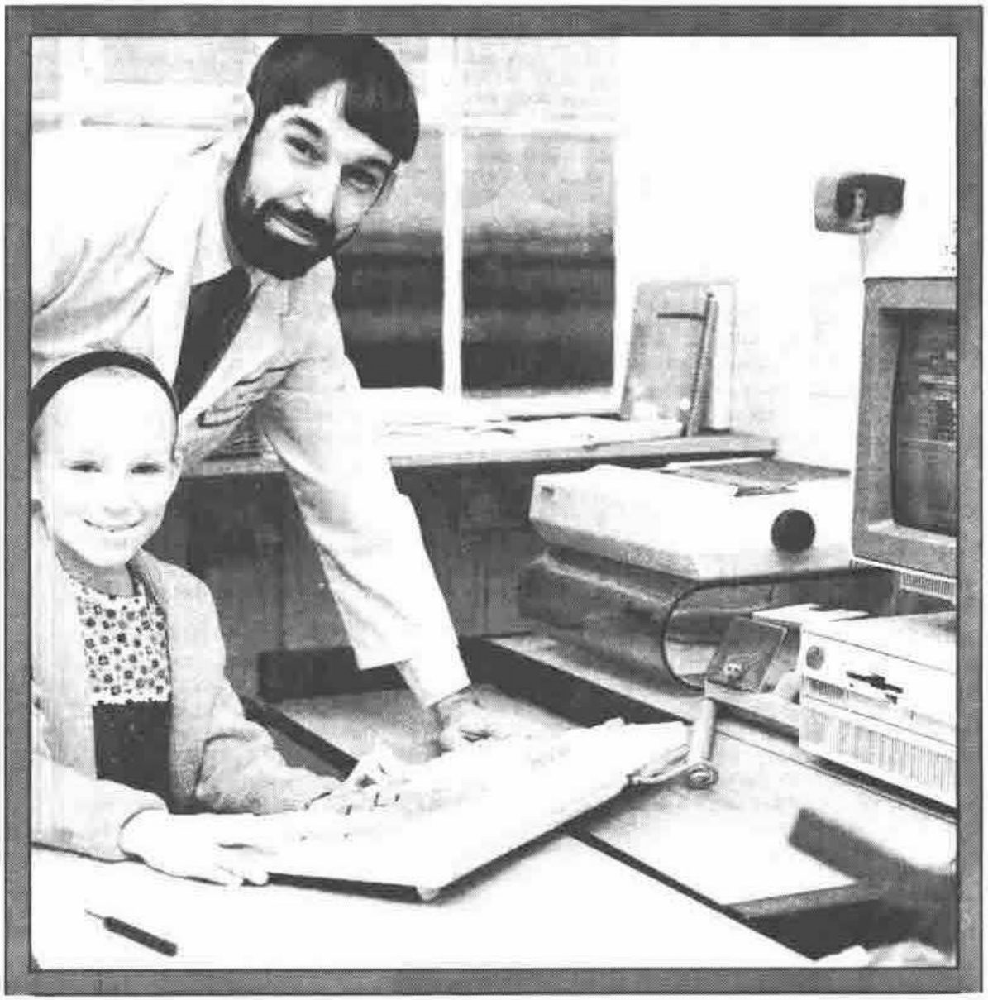

## The BAA Visit Rowntree Mackintosh

*reported by Sylvia Camacho and Jonathan Martin*
{ .byline }

The decision to hold some meetings away from London was amply justified by the success of this visit to York. About 20 chose to arrive mid-morning to take a tour of the factory and found themselves kitted out in white overalls, caps and hairnets before being allowed into the world of Kit Kat, Smarties, Polo mints and Black Magic. Attendance at the afternoon meeting also exceeded expectation and the speakers were very well received.

## Why we use APL by Tom McGuffog (Purchasing, Logistics and IT director)

The theme running through this talk was that computers and the software which runs on them are too valuable to be monopolised by Data Processing departments. Rowntree has backed this judgement by moving its Operational Research facility away from IT management into an area now called Logistics. They argue that Rowntrees are looking for people interested in the problems they need solving and not those whose primary interest is in computers.

They look upon computer facilities as a way of adding value to bright people and use APL to help them articulate and prototype their problems and solutions. Experience shows that people who can make computers sing are often not good at messy business problems, and they also find that IT departments have inappropriate career structures.

## Supply Chain Management

Mr McGuffog continued by describing how Rowntrees use computers in supply chain management. He pointed out that whereas the goods flow from the suppliers through warehouses and on to the customer, the data flow is naturally in the reverse direction from the (probably EPOS) checkout, through goods packaged in ‘outers’ by pallet loads, to the orders (often on Electronic Data Exchange), to the invoices and delivery instructions and so through to contract and production plan.

As the parties involved in these activities become more automated, the control demanded becomes more stringent. Tesco, for instance, will not only specify a day for delivering but a precise time to fit with their own warehouse throughput schedule.

The hardware Rowntrees use is becoming increasingly distributed, nationally and internationally. Mainframes are seen as file servers to mini computers (VAX) which service networked (Ethernet) micro computers (mostly IBM PCs). Data is held on a relational database (Oracle) from which it is pulled down and uploaded using SQL. This allows a fast and flexible access to data on 30-40 Brands presented in about 1000 varieties of pack. The packs change continually so that there may be 3000 in the course of a year.

## Chocolate Monitoring demonstrated by Adrian Smith

Adrian was able to bring the factory into the lecture room by plugging into the live, real time chocolate making system enquiry and scheduling packages which monitors production for 6-8 ingredients and displays the activity of the various machines in 1/4 hour schedule slots.

The data is brought down to the PCs via SQL from a Vax ORACLE database. This delegates all problems of data integrating to the ORACLE software. It is a matter of horses-for-courses, ORACLE to handle large amounts of data but APL to manipulate it as arrays. Postscript is used for the graphics because it has a defined public standard. It is very important not to get locked into any particular vendor.

## Medium Term Planning by Vicki Wright

## Interactive Planning Board by Andy Gibson

There has been a system from 1983 onwards. The object of medium term planning is to reduce stock-holding and improve service to customers and thereby increase value added to the raw materials. The system provides an interface between otherwise incompatible systems. In the spirit of the time the mainframe is gradually giving way to PC based systems.

Products are organised hierarchically, and frequent packaging changes impose many restraints on planning. The system provides an immediate response to any data edited. Colour is used extensively and standards for its use have been devised.

Data is taken weekly from the mainframe via a local VAX. The planners maintain their preferred product tree structure. They find that Export production tends to require bottom up planning, but the home market is better suited top-down. The front end is a short term schedule into which actual data is linked as it becomes available.

An unconsidered but intriguing trifle of information emerged from this talk - some Smartie tubes are abbreviated to ‘Tooth’ which is short for ‘toothpaste tube’, but they aren’t tubes, they’re cardboard boxes - quite square; they’re for Irish Smarties! (Andy said “That’s not a joke. Its true.”)

It was also pointed out that for the first time an APL system had **made the front page** of the Company Newpaper! (captioned “Daddy - I want your job”).

## APL Training at Rowntrees by Richard Taylor (OR Manager)

The first contact Rowntrees had with APL was via time-sharing in 1976. The second system they set up (1979) after bringing it in house is still running. They used VM CMS and then VSPC and AP124, going in 1983 to GDDM & PGF graphics and occasionally to APL\*PLUS/PC & APL 68000 on a SAGE IV. By 1986 they had over 150 mainframe users and by 1987 were beginning a serious move to PC systems integrated with the company Ethernet and Dec’s PCSA. By 1989 they could develop major systems on 386 machines as a consequence of the facility to copy the code and data easily (and quickly) over the network.

Rowntrees have a recruitment policy biased towards numerate graduates. They offer 8 weeks structured training, after which graduates are eased into existing systems via routine maintenance and simple changes. Where possible, graduates are given little ‘stand-alone’ projects as soon as possible, so that they can grow in confidence (and so that their inevitable mistakes cannot cause too much damage!).

Staff turnover averages 16% with an average service of 4 years. About one third of the recruits tend to stay in the Company, with a good spread about the different functions (e.g. the current head of I.T. is ex-OR, and there is ex-OR representation in Marketing, Production, and Product Development).

---

## Don’t Even Think About It!

*a (sore) footnote by Jonathan Martin*
{ .byline }

Quite possibly those words don’t mean anything to you. They are taken from the back page of the notice for the meeting at Rowntree’s concerning methods of getting to York, in this case by air. But, hang on a minute, I work for an airline - flying is the most obvious (and most convenient for me) way of travelling north. So that’s what I did.

I set off from home early Friday morning and arrived at Heathrow Terminal 1 in plenty of time, only to find that (because of bad weather up north) the plane was late arriving and would consequently be about an hour late departing. This was not good news - I had worked out my timetable (fly to Leeds, pick up a hire car and drive up to York) so that I didn’t have a great degree of leeway. However, there was nothing I could do about it.

Eventually we boarded the plane to the wonderful smells of a British Midland cooked breakfast wafting around. Just before we pushed back, the Captain came on and announced that we had a problem - there weren’t enough breakfasts to go around! How could he possibly resolve this situation? - send all the breakfasts back and make us do without!

Thirty minutes later and we began our descent into Leeds. The captain immediately warned us that the weather at Leeds had deteriorated and that we may not be able to land. Sure enough, after two attempts and not even a whiff of a view of the airport, we diverted to Teesside airport (near Darlington).

Things were now getting desperate as it was 11:30 and I was due in York at 10:30. So, off the plane, skip the coaches back to Leeds and straight to the Hertz desk to beg for a car. Fortunately I was one of the first there and they had some spares. So into the car and off into the wilderness of North Yorkshire, not altogether knowing where I was going except that I wanted to go South. Ninety minutes later I finally arrived at Rowntrees, just in time to catch the end of lunch. A very interesting but thankfully (with respect to the morning) uneventful meeting followed.

Back to the journey - the meeting finished at about 5:15 and my plane back from Leeds was at 7:05 - plenty of time. For a change, I made it quite easily, even managing to call in at my sister-in-law’s for a cup of tea before going to the airport.

At the airport, all was still gloom and doom (in that order) - the fog had well and truly settled in and they had cancelled the evening flight to London. Instead they were going to bus everyone down to Heathrow on coaches! Now the M1 to London on a Friday night in the fog is not my idea of a good time - so back to my sister-in-law’s I went and spent a very comfortable evening with a glass of gin and tonic...

First plane Saturday morning was 7.05! I woke just about in time and glanced out of the window - no prizes for guessing the state of the weather. So the options open were either to sit in Leeds and wait for it to clear (anyone who knows where Leeds/Bradford airport is will know that this could take a long time) or to drive over to Manchester and get on the shuttle. Manchester it was, over the M62, over the pennines.

Now if Leeds/Bradford is not the best place to put an airport, then the top of the Pennines is not necessarily the best place to put a motorway - needless to say, the fog was as bad (if not worse) on the M62 as it had been at the airport. So I crawled my way, in visibility down to about 20-30 feet in places, over to Manchester, where surprisingly there was bright sunshine (a rare occurrence!) and some flying aircraft. Thankfully, from then on normal service was resumed and I arrived home somewhat later and a touch more crumpled that I had expected.

Hindsight is a wonderful thing.
