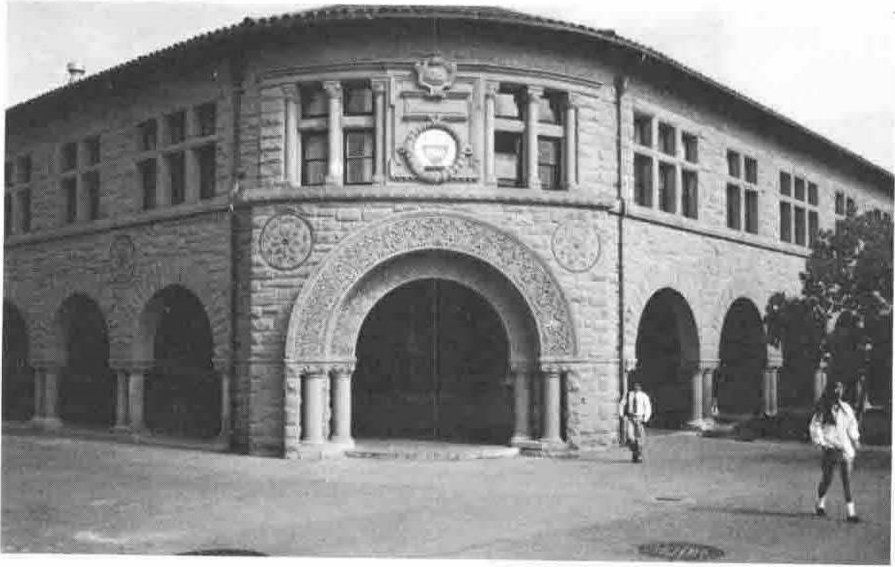
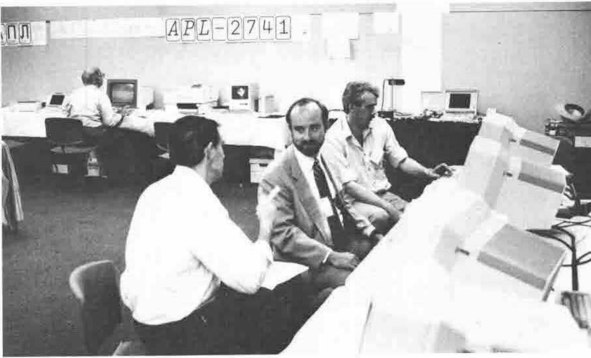
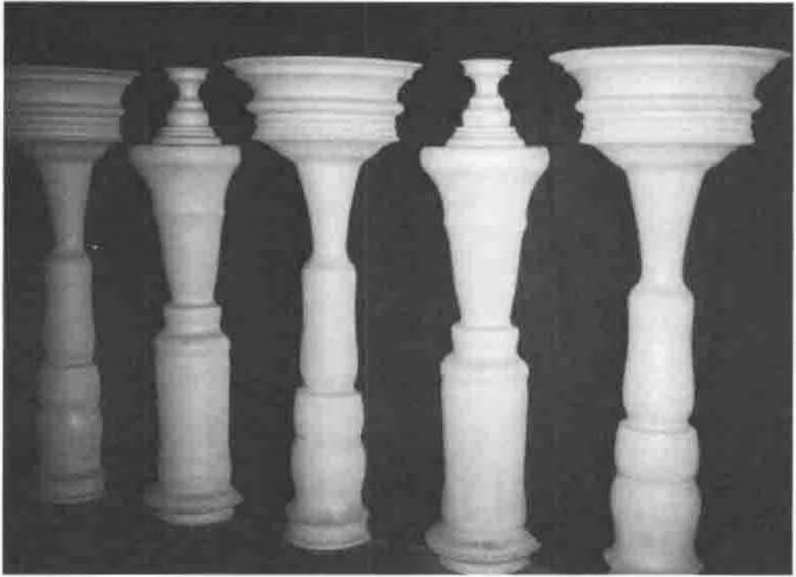
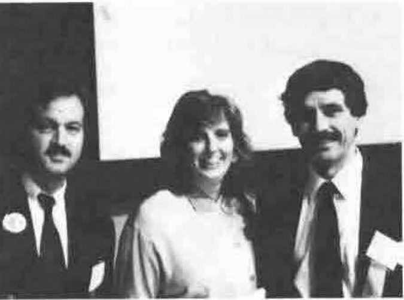

*reported by Anthony Camacho*
{ .byline }

APL 91 was a social, financial and technical success. About 400 people attended, well over the break-even figure and all visible signs were that everything went to plan.

*A Typical Stanford Arcade*

We stayed in the student accommodation. We would not have paid $110 a day for our non-air conditioned room with communal washing and lavatories if we had known w e could get a good clean air conditioned motel room for $41 a day. The $69 a day difference would have paid to hire a car and eat grandly, leaving plenty over. The food, though not worth anywhere near $69 a day, was excellent. I didn't hear a single complaint about it.

There was no formal banquet; I don't know whether it was replaced by the Exploratorium Evening or by the final barbecue picnic. The food and drink at both were excellent.

Sessions began early at 0830 and I felt we were worked really rather hard, but the quality of the papers I attended was as high as any conference I've been to.

The Conference Proceedings, edited by Jan Engel, were if anything of a higher standard than ever before. I am sorry that the Danish precedent could not be followed. I would have benefited greatly from a chance to read proceedings before the conference. I found I simply did not have time to look at papers before attending presentations and that too many presenters assumed that I had. Every evening was occupied, some by more than one event. Sunday evening there was a welcome reception, Monday an Exhibitors' reception and a Russian evening, Tuesday the Exploratorium, Wednesday a visit to Fry's and on Thursday, for some hours after the final session there was the final picnic.

*The Software Exchange*

The panels I attended were better than most previous conferences. Each speaker seemed to have something prepared which was a reasonable length for the time allotted. The worst over-run was the 25 year panel - Ken only began to speak after it should have ended - but Roy Sykes was right to let it run.

The plenary speakers were Phil Smith of IBM on IBM's Personal Scientific Laboratory, Therese Myers of and on Quarterdeck Office Systems, Dr William Scherlis of DARPA and Ted Nelson of the Xanadu hypermedia project. Phil Smith did a neat demonstration and William Scherlis gave an excellent summary of DARPA's work on the computer side. Therese Myers, whose excellent products I use, seemed to me to do a straight plug for her company. Ted Nelson went on too long and had too few visual aids.

Tresidder Union was a good place to hold the exhibition. It was equipped with cafes and a bar. There was plenty of space to sit and talk or rest. The notice board, the enquiry desk and the software library were well arranged.

There was also a museum of historical APL exhibits - first editions, the first logon to a cleanspace and an interesting collection of APL ephemera - tags, stickers, labels, posters and so on. The museum exhibits were collected and displayed by George Mendonsa, who would be glad to hear of other items which could be given or lent to the museum for next time it is displayed.

*People talking - at the Exploratorium*

The Exploratorium describes itself as 'a playful museum where you make discoveries for yourself'. It has over 650 experiments which the visitor can take part in, arranged in 13 large subject areas. A good many APLers are overgrown kids and this suited us perfectly. The experiments are designed with flair: you are sat on a freely rotatable stool before you try to turn a bicycle wheel gyroscope through 90 degrees; there are trays of soap bubble mixture and frames to dip into them; there are wind (with condensed water vapour) and water (with sand) vortices; lots of things to hit or listen to; dozens of computer keyboards controlling things and even frogs' legs and octopus nerves set up to respond to controllable electrical stimuli. Among all this were tables of several varieties of ethnic food and more tables giving out as much beer or wine as you wanted to drink. I never got to the beer, and it was good beer, because the wine was so good. It was the right recipe for an excellent evening. I had a wonderful time. Congratulations to all concerned.

The conference debriefing is really confidential, but I'm sure I don't reveal too many secrets by saying that when the Meeting Planning Associates staff left (before we went on to discuss the future) they were given a spontaneous ovation.

*reported by Jonathan Barman*
{ .byline }

One of the best things about any conference is meeting people, and this conference was no exception. The social events were informal and relaxed, and it seemed easier than usual to mix and talk APL and other gossip.

Hiring the whole of the Exploratorium for the evening normally reserved for a formal banquet was a brilliant idea. The Exploratorium caters for children with enquiring minds which exactly fits the APLers attending the conference. There was so much to do and see that if I had tried to cover all the items there would have been no time to eat or chat.

There was an evening outing to a computer supermarket called Fry's. I experienced culture shock due to the sheer quantity and range of goods for sale. The store was laid out in much the same was as a conventional supermarket. There must have been over 100 different computers on display, and there was a complete aisle of shelves filled with different sorts of fax machines, and another with telephones, then another with memory chips, and it seemed to go on and on.

*Charles Schulz, Therese Myers, Tibor Horvath*

The administration of the conference was excellent. The only area where there was a minor slip was for the tutorials. As the tutorials started at 8:30am on the Sunday, before registration, everyone who booked should have been notified when and where they started. There was a bit of milling about, but everything was soon sorted out.

*reported by John Searle*
{ .byline }

APL91 was a very successful conference, with over 400 delegates, which I understand was the break-even point for financial success. Stanford University is a charming campus and a very lively place at all hours. I think that the Stanford Bookstore is the best technical bookshop I have ever been in.

The campus accommodation was adequate and clean, even though I did tend to bounce off my bed whenever I lay on it. Or perhaps that was the fault of the late night glasnost sessions. (For "glasnost" read "vodka".)

*reported by Ray Cannon*
{ .byline }

As Ted Nelson said in the closing address "Stanford University is a city". Many a time while at Stanford, I thought back to my university days at Salford (part of Greater Manchester), and compared the two. Stanford won hands down (with the possible exception of cricket at Old Trafford). May I congratulate the organisers on their choice of site, the generally good weather (remember the Manchester 86 umbrellas?), the Welcome Reception (even if it was a bit windy), the visit to the Exploratorium (enjoyed by kids of all ages from 7 to 70, and I swear I saw the base of one of the Golden Gate towers through the fog on the way there), and the Closing Picnic (I was lucky, and found a table in the shade). So once again well done and thank you.

Once again, there were (as in previous conferences) 3 streams for the presentation of papers, so any one delegate could only hope to attend at best one third of the talks. At APL90 the proceedings were available well before the conference, and one had time to read the papers and choose which to attend. Unfortunately, this was not the case at Stanford, but the extract that appeared in the final program provided a good guide to deciding which to attend.
