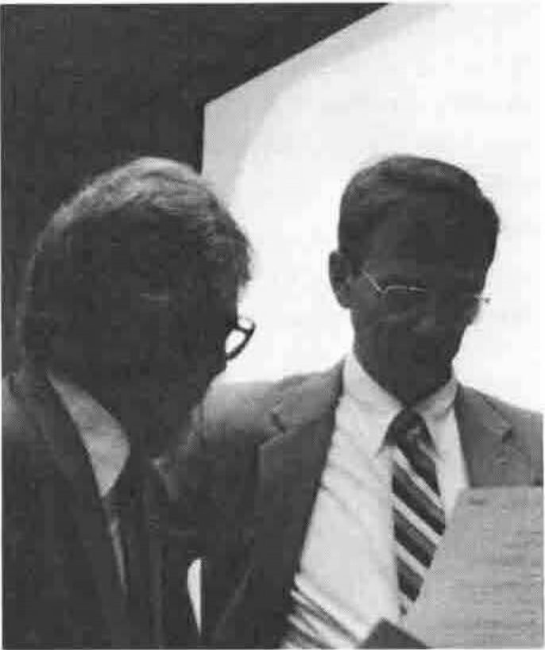
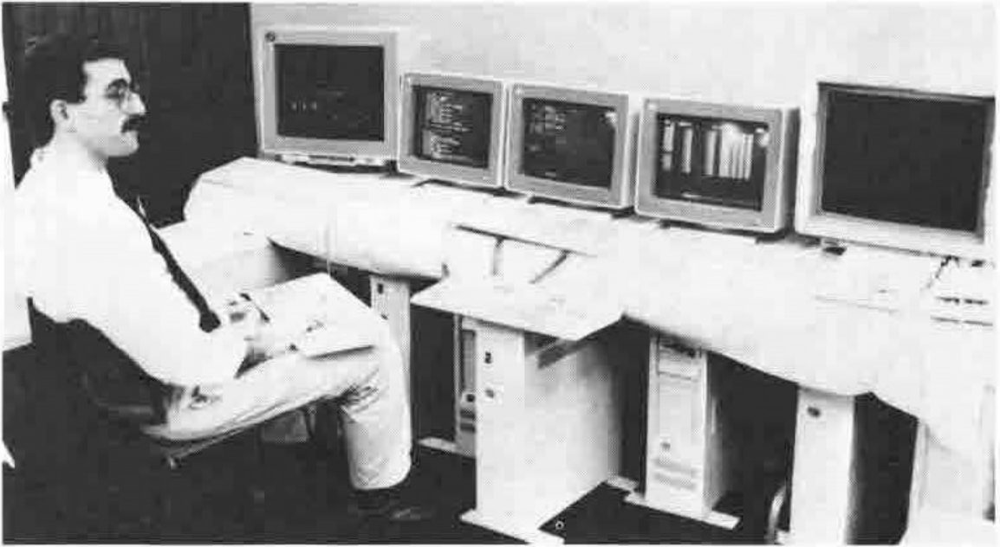
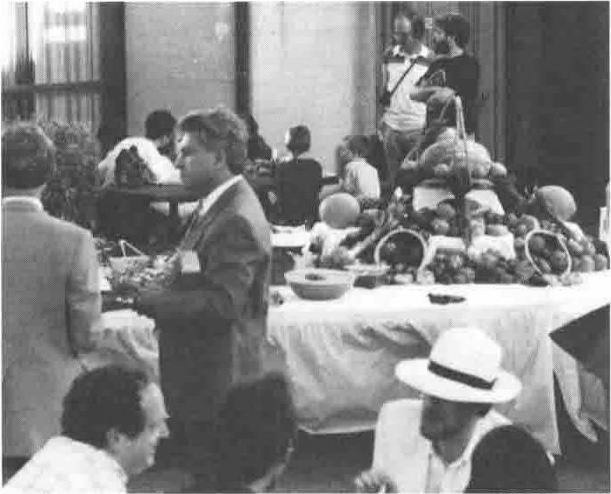

## Introductory Tutorial: An Introduction to APL by Ray Polivka

*reported by Anthony and Sylvia Camacho*
{ .byline }

One of the most notable features of APL is the low threshold that newcomers need to cross to do useful work and the high ceiling they discover as they challenge APL with more complex problems. For a teacher this poses its own challenge: whether to reassure by demonstrating the low threshold or impress with a brief glimpse of the high ceiling. Ray refused all compromise and chose to give his audience a glimpse of the imposing height of a full nested array implementation. This required that he went beyond the ISO standard and be frank in his partiality for APL2. What resulted was a tour de force by a practised teacher, and notable for the ability of Speaker and Chairman to finish all sessions to specification and on time.

*Anthony Camacho and Ray Polivka*

Ray Polivka's Tutorial was billed as an introduction to APL and was clearly not intended to impart skills to the participants. It was in two parts: a description and illustrations. The description covered Array Orientation, the Rich Set of Primitives, Syntax & Grammar, Programming, Operators and Control Constructs. Ray gave those aspects of APL which so often alienate newcomers, a hard sell. He described APL as a conceptually parallel, highly symbolic array-oriented language which had been 10 years in gestation. He showed Donald McIntyre's list of mathematical symbols and the dates each was first used. Perhaps it is not so odd that logical AND (`∧`) was only first used in 1933; it is amazing that PLUS (`+`) was not used before 1489.

After this short toe-dipping ession Ray pushed his audience into the deep end. He started with heterogeneous arrays, concepts of dimension, vectors of vectors, nesting and definitions of 'depth'. For the programmers he made the point that APL is self-describing and that the data carries with it a description of its own data type, shape/rank and structure. Complex numbers were mentioned in passing as an example of a vector.

In what amounted to a digression, the relation of APL (as a computer language) to its environment was given a slightly breathless overview covering system commands, libraries, workspaces and the nested array display function.

Now was the time to 'taste the beef' with a review of APL2 language pure and not simple. With a reminder that 'APL manipulates whole arrays as well as items within them', Ray gave his gloss on the job of a programming language, saying it must do simple things simply, such as data transformation, array construction, array enquiry, data selection, data rearrangement, and data replacement.

With this as a framework the primitives were then presented, including such APL2 extensions as string search and enlist. Passing from primitives to definitions was then made a little more challenging by moving from defined functions to defined operators. 'There is no difficulty', said Ray, 'functions use variable data, operators have variable functions'.

Within two minutes of the appointed time the pupils were dismissed to afternoon coffee break with the promise of a final session to look at the solutions they had found to the problems they had been set to keep them from idleness over lunch.

This hard day's work was advertised as 'free'. Those attending might, if they wished, buy, for $25, a package of papers and software demonstrating various aspects and implementations of APL.

This contained Ray's slides, leaflets from vendors, and three free APL interpreters: TryAPL2 (manual and disk), I-APL (manual, tutorial and disk) and APLISW (the shareware version of Sharp APL/PC now being produced by Iverson Software Inc). This last does not need a manual as it includes extensive help files on disk and some of the start-up options are no longer the problem they were with Sharp's version.

They certainly had their money's worth!

## Introductory Tutorial: An Introduction to APL by Ray Polivka

*reported by Lee Ann Estep*
{ .byline }

During the APL91 conference I enrolled in the Introduction to APL Tutorial. My expectation of a beginning APL class was that it would begin at the beginning and proceed at some reasonable rate toward, perhaps, the beginning of the middle. What I needed was the elementary school version of beginning APL, but found myself in the graduate school version.

Several minutes actually were spent on the beginning but by the lunch break we had covered the beginning, middle, and the far end of APL. The majority of the material went so far over my head it never even ruffled my hair. No enquiry was made as to the level of ability or expectations of the students. We were treated to a pre-packaged script delivered at lightning speed. Questions were not encouraged.

There was no sign of a computer, either for the students, which I did not expect, or for the instructor, which I certainly did expect.

At the beginning of the session I knew nothing about APL. I still do!

## Advanced Tutorial: Computer-Aided Software Engineering (CASE) by Larry Zeidner

*reported by Jonathan Barman*
{ .byline }

I found the initial sessions of the CASE Tutorial rather difficult to understand. I am still not sure just what CASE is supposed to be, apart from the initials standing for Computer Aided Software Engineering. It looks as though most of the APL tools and utilities that people usually create for themselves could be described as CASE. The demonstration of the new editor in IBM's APL2/PC seemed to be irrelevant to CASE, though the editor itself looks useful.

*Larry Zeidner and his Multiprocessor*

The afternoon session turned out to be very interesting. Dr Zeidner gave a scintillating presentation of his CASE tool, which enables the APL programmer to create a system which will run numerically intensive computations on several machines at once. The particular application for which the CASE tool had been used was in the calculation of the complex path a numerically controlled machine tool has to traverse when machining an arbitrary shape. The Conference Proceedings contain a paper by Dr Zeidner which describes the details of the system.

After the official tutorial was over many of us went to a demonstration of the software. It was fun to see a partly machined golf club head, which Dr Hazodny brought along, and then see the system calculate the path that a machine tool would have to traverse to make some of the initial cuts. The number of calculations involved is enormous, so farming out the job to several machines at once is essential if the job is to be finished in a reasonable time. Even with multiple processors the full golf club head machining calculations take all night to complete.

I feel sure that this CASE tool will be applied in many other disciplines.

*The Welcome Reception 4 Smiths and Ray Cannon in the Background Ed Cherlin and The Cat in the Hat in the Foreground*
